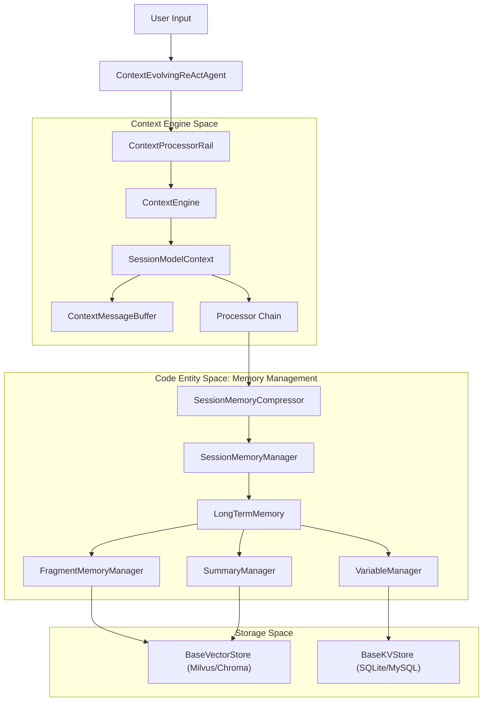

<!-- source: DeepWiki mcp.deepwiki.com · repo openJiuwen-ai/agent-core · page 6.6 Context Evolver Extension · fetched 2026-11-02 -->

# Context Evolver Extension

<details>
<summary>Relevant source files</summary>

The following files were used as context for generating this wiki page:

- [docs/en/2.Development Guide/API Docs/openjiuwen.core/memory/config.md](docs/en/2.Development Guide/API Docs/openjiuwen.core/memory/config.md)
- [docs/en/2.Development Guide/API Docs/openjiuwen.core/memory/long_term_memory.md](docs/en/2.Development Guide/API Docs/openjiuwen.core/memory/long_term_memory.md)
- [docs/en/2.Development Guide/Advanced Usage/Memory Engine.md](docs/en/2.Development Guide/Advanced Usage/Memory Engine.md)
- [openjiuwen/core/context_engine/__init__.py](openjiuwen/core/context_engine/__init__.py)
- [openjiuwen/core/context_engine/base.py](openjiuwen/core/context_engine/base.py)
- [openjiuwen/core/context_engine/context/context.py](openjiuwen/core/context_engine/context/context.py)
- [openjiuwen/core/context_engine/context/context_utils.py](openjiuwen/core/context_engine/context/context_utils.py)
- [openjiuwen/core/context_engine/context/message_buffer.py](openjiuwen/core/context_engine/context/message_buffer.py)
- [openjiuwen/core/context_engine/context/session_memory_manager.py](openjiuwen/core/context_engine/context/session_memory_manager.py)
- [openjiuwen/core/context_engine/context_engine.py](openjiuwen/core/context_engine/context_engine.py)
- [openjiuwen/core/context_engine/processor/compressor/__init__.py](openjiuwen/core/context_engine/processor/compressor/__init__.py)
- [openjiuwen/core/context_engine/processor/compressor/reasoning_tool_loop_compact_processor.py](openjiuwen/core/context_engine/processor/compressor/reasoning_tool_loop_compact_processor.py)
- [openjiuwen/core/context_engine/processor/forked/compressor/base.py](openjiuwen/core/context_engine/processor/forked/compressor/base.py)
- [openjiuwen/core/context_engine/processor/forked/compressor/session_memory_compressor.py](openjiuwen/core/context_engine/processor/forked/compressor/session_memory_compressor.py)
- [openjiuwen/core/context_engine/processor/forked/compressor/support/util.py](openjiuwen/core/context_engine/processor/forked/compressor/support/util.py)
- [openjiuwen/core/context_engine/processor/forked/offloader/message_offloader.py](openjiuwen/core/context_engine/processor/forked/offloader/message_offloader.py)
- [openjiuwen/core/context_engine/processor/forked/offloader/rule_compression/common.py](openjiuwen/core/context_engine/processor/forked/offloader/rule_compression/common.py)
- [openjiuwen/core/context_engine/processor/forked/offloader/rule_compression/pipeline.py](openjiuwen/core/context_engine/processor/forked/offloader/rule_compression/pipeline.py)
- [openjiuwen/core/context_engine/processor/offloader/__init__.py](openjiuwen/core/context_engine/processor/offloader/__init__.py)
- [openjiuwen/core/context_engine/schema/config.py](openjiuwen/core/context_engine/schema/config.py)
- [openjiuwen/core/foundation/store/base_memory_index.py](openjiuwen/core/foundation/store/base_memory_index.py)
- [openjiuwen/core/foundation/store/index/simple_memory_index.py](openjiuwen/core/foundation/store/index/simple_memory_index.py)
- [openjiuwen/core/memory/config/config.py](openjiuwen/core/memory/config/config.py)
- [openjiuwen/core/memory/long_term_memory.py](openjiuwen/core/memory/long_term_memory.py)
- [openjiuwen/core/memory/manage/index/base_memory_manager.py](openjiuwen/core/memory/manage/index/base_memory_manager.py)
- [openjiuwen/core/memory/manage/index/fragment_memory_manager.py](openjiuwen/core/memory/manage/index/fragment_memory_manager.py)
- [openjiuwen/core/memory/manage/index/summary_manager.py](openjiuwen/core/memory/manage/index/summary_manager.py)
- [openjiuwen/core/memory/manage/index/variable_manager.py](openjiuwen/core/memory/manage/index/variable_manager.py)
- [openjiuwen/core/memory/manage/index/write_manager.py](openjiuwen/core/memory/manage/index/write_manager.py)
- [openjiuwen/core/memory/manage/mem_model/memory_unit.py](openjiuwen/core/memory/manage/mem_model/memory_unit.py)
- [openjiuwen/core/memory/manage/mem_model/message_manager.py](openjiuwen/core/memory/manage/mem_model/message_manager.py)
- [openjiuwen/core/memory/manage/mem_model/semantic_store.py](openjiuwen/core/memory/manage/mem_model/semantic_store.py)
- [openjiuwen/core/memory/manage/mem_model/sql_db_store.py](openjiuwen/core/memory/manage/mem_model/sql_db_store.py)
- [openjiuwen/core/memory/manage/mem_model/user_mem_store.py](openjiuwen/core/memory/manage/mem_model/user_mem_store.py)
- [openjiuwen/core/memory/manage/search/search_manager.py](openjiuwen/core/memory/manage/search/search_manager.py)
- [openjiuwen/core/memory/process/extract/common.py](openjiuwen/core/memory/process/extract/common.py)
- [openjiuwen/core/memory/process/extract/generation.py](openjiuwen/core/memory/process/extract/generation.py)
- [openjiuwen/core/memory/process/extract/long_term_memory_extractor.py](openjiuwen/core/memory/process/extract/long_term_memory_extractor.py)
- [openjiuwen/core/memory/process/extract/memory_analyzer.py](openjiuwen/core/memory/process/extract/memory_analyzer.py)
- [openjiuwen/core/memory/prompts/fragment_memory_prompt.md](openjiuwen/core/memory/prompts/fragment_memory_prompt.md)
- [openjiuwen/core/memory/prompts/memory_analysis_prompt.md](openjiuwen/core/memory/prompts/memory_analysis_prompt.md)
- [openjiuwen/harness/rails/context_engineer/context_processor_rail.py](openjiuwen/harness/rails/context_engineer/context_processor_rail.py)
- [tests/system_tests/memory/test_long_term_memory.py](tests/system_tests/memory/test_long_term_memory.py)
- [tests/unit_tests/core/context_engine/test_compressor_token_budget.py](tests/unit_tests/core/context_engine/test_compressor_token_budget.py)
- [tests/unit_tests/core/context_engine/test_context_engine.py](tests/unit_tests/core/context_engine/test_context_engine.py)
- [tests/unit_tests/core/context_engine/test_context_model.py](tests/unit_tests/core/context_engine/test_context_model.py)
- [tests/unit_tests/core/context_engine/test_forked_message_offloader.py](tests/unit_tests/core/context_engine/test_forked_message_offloader.py)
- [tests/unit_tests/core/context_engine/test_reasoning_tool_loop_compact_processor.py](tests/unit_tests/core/context_engine/test_reasoning_tool_loop_compact_processor.py)
- [tests/unit_tests/core/context_engine/test_rule_compression_pipeline.py](tests/unit_tests/core/context_engine/test_rule_compression_pipeline.py)
- [tests/unit_tests/core/context_engine/test_session_memory_agent.py](tests/unit_tests/core/context_engine/test_session_memory_agent.py)
- [tests/unit_tests/core/foundation/store/test_simple_memory_index.py](tests/unit_tests/core/foundation/store/test_simple_memory_index.py)
- [tests/unit_tests/core/memory/manage/test_manage.py](tests/unit_tests/core/memory/manage/test_manage.py)
- [tests/unit_tests/core/memory/test_search_manager.py](tests/unit_tests/core/memory/test_search_manager.py)
- [tests/unit_tests/harness/test_context_processor_rail.py](tests/unit_tests/harness/test_context_processor_rail.py)

</details>


The Context Evolver extension provides advanced task memory management and context optimization strategies for agents. It enables agents to manage long-term trajectories, summarize execution history, and apply sophisticated memory strategies to maintain performance over extended interactions.

## Overview

The extension revolves around the `TaskMemoryService` and the `ContextProcessorRail`, which orchestrate how an agent's context is evolved, compressed, and retrieved. It supports multiple memory strategies including **ACE** (Adaptive Context Evolution), **ReME** (Recursive Memory Evolution), **ReasoningBank**, and **Cognition** to handle different task complexities.

### Key Components

| Component | Role |
| :--- | :--- |
| `TaskMemoryService` | Central service for managing task-specific memory units and trajectory persistence. |
| `ContextProcessorRail` | A harness rail that injects context processing logic into the agent's lifecycle. |
| `SessionModelContext` | Manages the active message buffer and applies processor chains for windowing and compression. |
| `MemoryManagers` | Specialized managers (`FragmentMemoryManager`, `SummaryManager`, `VariableManager`) that handle different memory types. |

Sources: [openjiuwen/core/context_engine/context/context.py:41-55](), [openjiuwen/harness/rails/context_engineer/context_processor_rail.py:71-81](), [openjiuwen/core/memory/long_term_memory.py:98-105]()

## Architecture and Data Flow

The following diagram illustrates how natural language interactions are transformed into structured memory entities and how the system manages the context window.

### Context Evolution Pipeline

Sources: [openjiuwen/core/context_engine/context/context.py:84-89](), [openjiuwen/harness/rails/context_engineer/context_processor_rail.py:105-112](), [openjiuwen/core/memory/long_term_memory.py:88-105]()

## Task Memory Service

The `TaskMemoryService` (interfacing through `LongTermMemory`) is responsible for the extraction and storage of task-related information.

### Memory Types
The system distinguishes between several memory categories defined in `MemoryType`:
*   **USER_PROFILE**: Basic identity, preferences, and interpersonal relationships.
*   **SEMANTIC_MEMORY**: Fact-based content or concepts without clear time relationships.
*   **EPISODIC_MEMORY**: Facts or concepts tied to specific temporal events.
*   **SUMMARY**: Trajectory summarizations of past dialogue rounds.

Sources: [openjiuwen/core/memory/manage/mem_model/memory_unit.py:19-20](), [openjiuwen/core/memory/config/config.py:42-46]()

### Memory Processing Logic
The `FragmentMemoryManager` handles the deduplication and conflict resolution of new memories against existing ones using the `MemUpdateChecker`.

1.  **Extraction**: The `Generator` uses LLM prompts to extract memory units from dialogue.
2.  **Related Retrieval**: The system queries the `MemoryVectorStore` for existing memories similar to the new extracts [openjiuwen/core/memory/manage/index/fragment_memory_manager.py:149-150]().
3.  **Conflict Check**: `MemUpdateChecker` analyzes redundancy or contradictions [openjiuwen/core/memory/manage/index/fragment_memory_manager.py:163-168]().
4.  **Persistence**: Validated memories are stored in `BaseMemoryIndex` (e.g., `SimpleMemoryIndex`) [openjiuwen/core/memory/manage/index/fragment_memory_manager.py:158-160]().

Sources: [openjiuwen/core/memory/manage/index/fragment_memory_manager.py:53-170](), [openjiuwen/core/memory/long_term_memory.py:15-21]()

## Context Engine and Processors

The `ContextEngine` manages the `SessionModelContext`, which acts as a sophisticated message buffer with automated compression.

### The Processor Chain
When `get_context_window` is called, the context applies a chain of `ContextProcessor` instances:

| Processor | Class Name | Function |
| :--- | :--- | :--- |
| **Offloader** | `MessageSummaryOffloader` | Replaces old messages with a summary to save tokens. |
| **Memory** | `SessionMemoryCompressor` | Injects relevant long-term memories into the prompt. |
| **Compactor** | `ReasoningToolLoopCompactProcessor` | Detects and collapses repetitive tool-call loops. |
| **Truncator** | `DialogueCompressor` | Enforces hard limits based on message or round count. |

Sources: [openjiuwen/core/context_engine/context_engine.py:108-111](), [openjiuwen/harness/rails/context_engineer/context_processor_rail.py:151-180](), [openjiuwen/core/context_engine/__init__.py:73-107]()

### Reasoning Loop Compaction
The `ReasoningToolLoopCompactProcessor` prevents infinite loops where an agent calls the same tool with identical arguments. It tracks state using `LOOP_COMPACT_BAILOUT_STATE_KEY` and raises an `AbortError` if the threshold is exceeded.

Sources: [openjiuwen/core/context_engine/processor/compressor/reasoning_tool_loop_compact_processor.py:48-53](), [openjiuwen/harness/rails/context_engineer/context_processor_rail.py:54-67]()

## Configuration and Integration

The extension is integrated into agents via the `ContextProcessorRail`.

### Configuration Schema
The `ContextEngineConfig` governs how the engine behaves:
*   `max_context_message_num`: Hard limit on total messages [openjiuwen/core/context_engine/schema/config.py:94]().
*   `default_window_round_num`: Number of conversation rounds to retain [openjiuwen/core/context_engine/schema/config.py:96]().
*   `enable_reload`: Enables automatic restoration of offloaded content via `[[HANDLE:xxx]]` signals [openjiuwen/core/context_engine/schema/config.py:97]().

### Integration Example
To enable advanced context evolution in a `DeepAgent`, the `ContextProcessorRail` is added to the agent's rail list.

```python
from openjiuwen.harness.rails.context_engineer.context_processor_rail import ContextProcessorRail
from openjiuwen.core.context_engine.processor.compressor.dialogue_compressor import DialogueCompressorConfig

# Configure the rail with specific processor overrides
rail = ContextProcessorRail(
    processors=[
        ("DialogueCompressor", DialogueCompressorConfig(messages_threshold=50))
    ]
)
```
Sources: [openjiuwen/harness/rails/context_engineer/context_processor_rail.py:85-112](), [tests/unit_tests/harness/test_context_processor_rail.py:193-202]()

## Memory Vector Store Integration

The `MemoryVectorStore` is implemented as a layer over `BaseVectorStore`. It supports semantic search across different memory types using the `SearchManager`.

### Retrieval Flow
1.  **Query Generation**: `SearchManager` takes a natural language query.
2.  **Vector Search**: Executes search against the `BaseMemoryIndex` [openjiuwen/core/memory/manage/index/summary_manager.py:171-177]().
3.  **Scoring**: Results are returned as `MemResult` objects containing `MemInfo` and a relevance score.

Sources: [openjiuwen/core/memory/long_term_memory.py:49-61](), [openjiuwen/core/memory/manage/search/search_manager.py:21-22](), [openjiuwen/core/memory/manage/index/summary_manager.py:164-180]()

---

