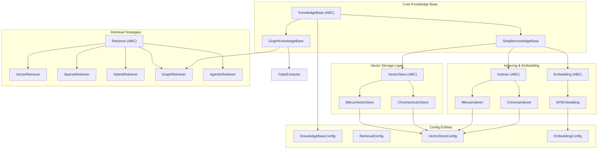
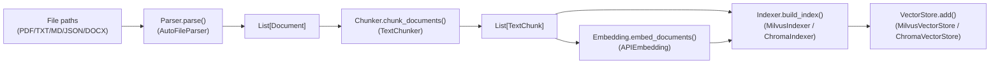

<!-- source: DeepWiki mcp.deepwiki.com · repo openJiuwen-ai/agent-core · page 7 Knowledge Retrieval · fetched 2026-11-02 -->

# Knowledge Retrieval

Relevant source files

The following files were used as context for generating this wiki page:

- [.gitignore](.gitignore)
- [Makefile](Makefile)
- [openjiuwen/core/common/exception/codes.py](openjiuwen/core/common/exception/codes.py)
- [openjiuwen/core/foundation/tool/mcp/client/openapi_client.py](openjiuwen/core/foundation/tool/mcp/client/openapi_client.py)
- [openjiuwen/core/memory/common/base.py](openjiuwen/core/memory/common/base.py)
- [openjiuwen/core/retrieval/__init__.py](openjiuwen/core/retrieval/__init__.py)
- [openjiuwen/core/retrieval/common/config.py](openjiuwen/core/retrieval/common/config.py)
- [openjiuwen/core/retrieval/graph_knowledge_base.py](openjiuwen/core/retrieval/graph_knowledge_base.py)
- [openjiuwen/core/retrieval/indexing/indexer/chroma_indexer.py](openjiuwen/core/retrieval/indexing/indexer/chroma_indexer.py)
- [openjiuwen/core/retrieval/indexing/indexer/milvus_indexer.py](openjiuwen/core/retrieval/indexing/indexer/milvus_indexer.py)
- [openjiuwen/core/retrieval/knowledge_base.py](openjiuwen/core/retrieval/knowledge_base.py)
- [openjiuwen/core/retrieval/simple_knowledge_base.py](openjiuwen/core/retrieval/simple_knowledge_base.py)
- [openjiuwen/core/retrieval/vector_store/base.py](openjiuwen/core/retrieval/vector_store/base.py)
- [openjiuwen/core/retrieval/vector_store/chroma_store.py](openjiuwen/core/retrieval/vector_store/chroma_store.py)
- [openjiuwen/core/retrieval/vector_store/milvus_store.py](openjiuwen/core/retrieval/vector_store/milvus_store.py)
- [openjiuwen/core/runner/resources_manager/resource_manager.py](openjiuwen/core/runner/resources_manager/resource_manager.py)
- [openjiuwen/core/runner/resources_manager/tool_manager.py](openjiuwen/core/runner/resources_manager/tool_manager.py)
- [openjiuwen/core/single_agent/__init__.py](openjiuwen/core/single_agent/__init__.py)
- [pyproject.toml](pyproject.toml)
- [tests/system_tests/runner/test_runner.py](tests/system_tests/runner/test_runner.py)
- [tests/system_tests/tune/test_prompt_tune.py](tests/system_tests/tune/test_prompt_tune.py)
- [tests/system_tests/workflow/test_real_workflow.py](tests/system_tests/workflow/test_real_workflow.py)
- [tests/test_logger.py](tests/test_logger.py)
- [tests/unit_tests/agent_teams/observability/test_team_observability_mock_llm.py](tests/unit_tests/agent_teams/observability/test_team_observability_mock_llm.py)
- [tests/unit_tests/core/context_engine/conftest.py](tests/unit_tests/core/context_engine/conftest.py)
- [tests/unit_tests/core/retrieval/indexing/indexer/test_chroma_indexer.py](tests/unit_tests/core/retrieval/indexing/indexer/test_chroma_indexer.py)
- [tests/unit_tests/core/retrieval/indexing/indexer/test_milvus_indexer.py](tests/unit_tests/core/retrieval/indexing/indexer/test_milvus_indexer.py)
- [tests/unit_tests/core/retrieval/vector_store/test_base.py](tests/unit_tests/core/retrieval/vector_store/test_base.py)
- [tests/unit_tests/core/retrieval/vector_store/test_chroma_store.py](tests/unit_tests/core/retrieval/vector_store/test_chroma_store.py)
- [tests/unit_tests/core/retrieval/vector_store/test_milvus_store.py](tests/unit_tests/core/retrieval/vector_store/test_milvus_store.py)
- [uv.lock](uv.lock)

This page covers the architecture and design of the `openjiuwen.core.retrieval` module: its lazy-loading mechanism, configuration model, the indexing pipeline that processes documents into searchable stores, and the retrieval strategies available at query time.

Detailed documentation for each subsystem is split across child pages:
- Vector store implementations → [Vector Stores](#7.1)
- Knowledge base classes and their document operations → [Knowledge Base](#7.2)
- Embedding models and indexers → [Embeddings and Indexing](#7.3)
- Retriever implementations → [Retrievers](#7.4)

---

## Module Design: Lazy Loading

The retrieval module ([openjiuwen/core/retrieval/__init__.py:1-8]()) implements PEP 562 `__getattr__` to defer the import of heavy optional dependencies (`pymilvus`, `chromadb`, etc.) until they are actually accessed.

Classes that depend on these libraries — `MilvusVectorStore`, `ChromaVectorStore`, `MilvusIndexer`, `ChromaIndexer`, `OpenAIEmbedding`, `GraphKnowledgeBase`, `SimpleKnowledgeBase` — are listed in `_LAZY_ATTRIBUTES` and loaded via the `lazy_load` helper only on first access [openjiuwen/core/retrieval/__init__.py:91-120]().

Classes that have no heavy dependencies (`KnowledgeBaseConfig`, `RetrievalConfig`, `VectorStore`, `Retriever`, `Embedding`, text processors, etc.) are listed in `_NON_LAZY_ATTRIBUTES` and are imported eagerly at module load time [openjiuwen/core/retrieval/__init__.py:121-179]().

| Attribute type | Import time | Examples |
|---|---|---|
| `_NON_LAZY_ATTRIBUTES` | Eager (at import) | `KnowledgeBaseConfig`, `Retriever`, `APIEmbedding`, `TextChunker` |
| `_LAZY_ATTRIBUTES` | Lazy (on first access) | `MilvusVectorStore`, `ChromaVectorStore`, `MilvusIndexer`, `ChromaIndexer`, `KnowledgeBase`, `SimpleKnowledgeBase`, `GraphKnowledgeBase` |

This design means installing only `openjiuwen[chromadb]` or `openjiuwen[all-vector]` (defined in [pyproject.toml:85-118]()) controls which lazy attributes become available. Accessing an attribute whose dependency is not installed results in an `ImportError` at that point rather than at package import time.

**Sources:** [openjiuwen/core/retrieval/__init__.py:1-182](), [pyproject.toml:40-118]()

---

## Configuration

All configuration is defined as Pydantic `BaseModel` classes in `openjiuwen.core.retrieval.common.config`.

### `KnowledgeBaseConfig`
Top-level config for a knowledge base instance. It defines the `kb_id`, `index_type` (hybrid, bm25, or vector), and whether to `use_graph` for RAG [openjiuwen/core/retrieval/common/config.py:16-19]().

### `VectorStoreConfig`
Passed to `MilvusVectorStore` or `ChromaVectorStore`. It specifies the `store_provider`, `collection_name`, and `distance_metric` (cosine, euclidean, or dot) [openjiuwen/core/retrieval/common/config.py:22]().

### `RetrievalConfig`
Passed to `KnowledgeBase.retrieve()` to control query-time behavior, such as `top_k`, `score_threshold`, and whether to enable `agentic` iterative retrieval [openjiuwen/core/retrieval/common/config.py:21]().

**Sources:** [openjiuwen/core/retrieval/common/config.py:15-23]()

---

## System Architecture

The diagram below maps the major class names to their roles and dependencies, bridging the conceptual retrieval space with the code entities.

**Retrieval Module: Class Dependency Overview**

**Sources:** [openjiuwen/core/retrieval/knowledge_base.py:27-51](), [openjiuwen/core/retrieval/vector_store/milvus_store.py:32-96](), [openjiuwen/core/retrieval/vector_store/chroma_store.py:33-102](), [openjiuwen/core/retrieval/indexing/indexer/milvus_indexer.py:29-100]()

---

## Indexing Pipeline

Documents pass through a pipeline before vectors are written to the store. The concrete steps depend on the `index_type` configured in `KnowledgeBaseConfig`.

**Indexing Pipeline: File → Vector Store**

### Step Details

1.  **Parsing**: `KnowledgeBase.parse_files()` uses a `Parser` to convert raw files into `Document` objects [openjiuwen/core/retrieval/knowledge_base.py:94-128]().
2.  **Chunking**: Documents are broken into `TextChunk` instances using implementations like `TextChunker` or `TokenizerChunker` [openjiuwen/core/retrieval/__init__.py:39-59]().
3.  **Embedding**: For `vector` or `hybrid` indices, the `Indexer` calls `compute_chunk_embeddings` which utilizes an `Embedding` model [openjiuwen/core/retrieval/indexing/indexer/milvus_indexer.py:156-167]().
4.  **Index Building**: `Indexer.build_index()` writes chunks and embeddings to the `VectorStore`. It validates that no duplicate `doc_id` exists before insertion [openjiuwen/core/retrieval/indexing/indexer/milvus_indexer.py:142-153]().

**Sources:** [openjiuwen/core/retrieval/knowledge_base.py:94-128](), [openjiuwen/core/retrieval/indexing/indexer/milvus_indexer.py:111-167](), [openjiuwen/core/retrieval/indexing/indexer/chroma_indexer.py:103-164]()

---

## Retrieval Strategies

All retrievers implement the `Retriever` interface [openjiuwen/core/retrieval/retriever/base.py:74]().

### `VectorRetriever`
Performs dense vector search by embedding the query and calling `vector_store.search()`.

### `SparseRetriever`
Performs keyword-based search using `vector_store.sparse_search()`. In Milvus, this uses native BM25 sparse vectors [openjiuwen/core/retrieval/vector_store/milvus_store.py:6-7]().

### `HybridRetriever`
Combines dense and sparse results. On Milvus, it uses native `hybrid_search` with `RRFRanker` [openjiuwen/core/retrieval/vector_store/milvus_store.py:12](). On Chroma, it performs separate searches and fuses them using `rrf_fusion` [openjiuwen/core/retrieval/vector_store/chroma_store.py:29]().

### `AgenticRetriever`
An LLM-driven iterative retriever that rewrites queries and explores information to find missing context [openjiuwen/core/retrieval/retriever/agentic_retriever.py:73-74]().

**Sources:** [openjiuwen/core/retrieval/retriever/base.py:74](), [openjiuwen/core/retrieval/vector_store/milvus_store.py:6-12](), [openjiuwen/core/retrieval/vector_store/chroma_store.py:29](), [openjiuwen/core/retrieval/retriever/agentic_retriever.py:73-74]()

---

## Vector Store Backends

The `VectorStore` abstract base class defines the interface for all storage backends [openjiuwen/core/retrieval/vector_store/base.py:29-30]().

| Feature | `MilvusVectorStore` | `ChromaVectorStore` |
|---|---|---|
| **Dense Search** | Supported [milvus_store.py:33]() | Supported [chroma_store.py:34]() |
| **Sparse Search** | Native BM25 [milvus_store.py:6]() | Text matching [chroma_store.py:6]() |
| **Hybrid Search** | Native `RRFRanker` [milvus_store.py:12]() | `rrf_fusion` [chroma_store.py:29]() |
| **Persistence** | Remote Server / URI [milvus_store.py:38]() | Local Path [chroma_store.py:39]() |

**Sources:** [openjiuwen/core/retrieval/vector_store/base.py:29](), [openjiuwen/core/retrieval/vector_store/milvus_store.py:6-38](), [openjiuwen/core/retrieval/vector_store/chroma_store.py:6-39]()

---

