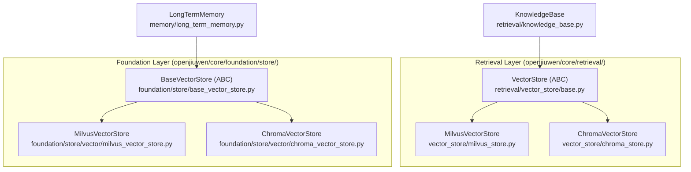
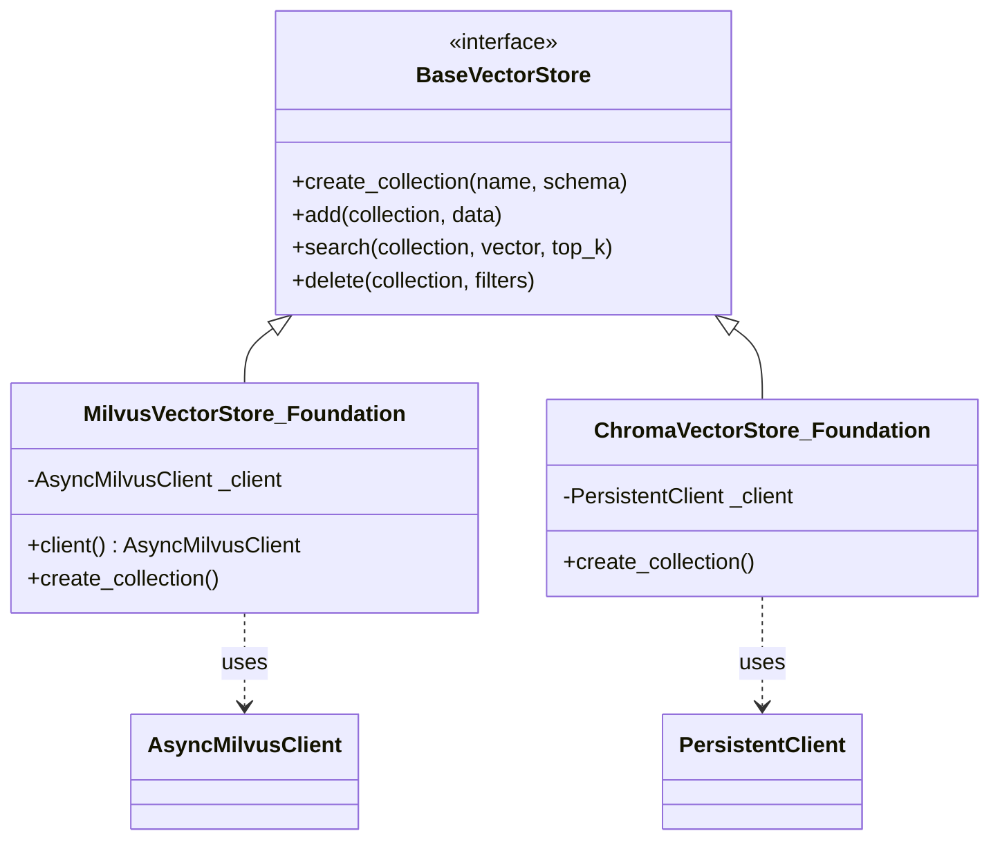

<!-- source: DeepWiki mcp.deepwiki.com · repo openJiuwen-ai/agent-core · page 7.1 Vector Stores · fetched 2026-11-02 -->

# Vector Stores

Relevant source files

The following files were used as context for generating this wiki page:

- [docs/en/2.Development Guide/API Docs/openjiuwen.core/foundation/store.README.md](docs/en/2.Development Guide/API Docs/openjiuwen.core/foundation/store.README.md)
- [docs/en/2.Development Guide/API Docs/openjiuwen.core/foundation/store/store.md](docs/en/2.Development Guide/API Docs/openjiuwen.core/foundation/store/store.md)
- [openjiuwen/core/foundation/store/__init__.py](openjiuwen/core/foundation/store/__init__.py)
- [openjiuwen/core/foundation/store/base_db_store.py](openjiuwen/core/foundation/store/base_db_store.py)
- [openjiuwen/core/foundation/store/base_kv_store.py](openjiuwen/core/foundation/store/base_kv_store.py)
- [openjiuwen/core/foundation/store/base_vector_store.py](openjiuwen/core/foundation/store/base_vector_store.py)
- [openjiuwen/core/foundation/store/vector/__init__.py](openjiuwen/core/foundation/store/vector/__init__.py)
- [openjiuwen/core/foundation/store/vector/chroma_vector_store.py](openjiuwen/core/foundation/store/vector/chroma_vector_store.py)
- [openjiuwen/core/foundation/store/vector/milvus_vector_store.py](openjiuwen/core/foundation/store/vector/milvus_vector_store.py)
- [openjiuwen/core/foundation/store/vector/utils.py](openjiuwen/core/foundation/store/vector/utils.py)
- [openjiuwen/core/retrieval/common/config.py](openjiuwen/core/retrieval/common/config.py)
- [openjiuwen/core/retrieval/graph_knowledge_base.py](openjiuwen/core/retrieval/graph_knowledge_base.py)
- [openjiuwen/core/retrieval/indexing/indexer/chroma_indexer.py](openjiuwen/core/retrieval/indexing/indexer/chroma_indexer.py)
- [openjiuwen/core/retrieval/indexing/indexer/milvus_indexer.py](openjiuwen/core/retrieval/indexing/indexer/milvus_indexer.py)
- [openjiuwen/core/retrieval/knowledge_base.py](openjiuwen/core/retrieval/knowledge_base.py)
- [openjiuwen/core/retrieval/simple_knowledge_base.py](openjiuwen/core/retrieval/simple_knowledge_base.py)
- [openjiuwen/core/retrieval/vector_store/base.py](openjiuwen/core/retrieval/vector_store/base.py)
- [openjiuwen/core/retrieval/vector_store/chroma_store.py](openjiuwen/core/retrieval/vector_store/chroma_store.py)
- [openjiuwen/core/retrieval/vector_store/milvus_store.py](openjiuwen/core/retrieval/vector_store/milvus_store.py)
- [tests/unit_tests/core/foundation/store/test_chroma_vector_store.py](tests/unit_tests/core/foundation/store/test_chroma_vector_store.py)
- [tests/unit_tests/core/foundation/store/test_milvus_vector_store.py](tests/unit_tests/core/foundation/store/test_milvus_vector_store.py)
- [tests/unit_tests/core/memory/migration/migrator/test_chroma_vec_migrator.py](tests/unit_tests/core/memory/migration/migrator/test_chroma_vec_migrator.py)
- [tests/unit_tests/core/retrieval/indexing/indexer/test_chroma_indexer.py](tests/unit_tests/core/retrieval/indexing/indexer/test_chroma_indexer.py)
- [tests/unit_tests/core/retrieval/indexing/indexer/test_milvus_indexer.py](tests/unit_tests/core/retrieval/indexing/indexer/test_milvus_indexer.py)
- [tests/unit_tests/core/retrieval/vector_store/test_base.py](tests/unit_tests/core/retrieval/vector_store/test_base.py)
- [tests/unit_tests/core/retrieval/vector_store/test_chroma_store.py](tests/unit_tests/core/retrieval/vector_store/test_chroma_store.py)
- [tests/unit_tests/core/retrieval/vector_store/test_milvus_store.py](tests/unit_tests/core/retrieval/vector_store/test_milvus_store.py)

This page documents the vector store implementations used by the Knowledge Retrieval subsystem: the abstract `VectorStore` interface, `MilvusVectorStore`, `ChromaVectorStore`, and `VectorStoreConfig`. It also describes the foundation-layer `BaseVectorStore` abstraction, which serves the Memory System.

---

## Two-Layer Architecture

There are two separate vector store abstractions in the codebase, serving different consumers. The retrieval layer focuses on high-level RAG capabilities (hybrid search, BM25), while the foundation layer provides a unified interface for low-level storage operations used by memory and distributed locking.

**Diagram: Vector Store Layer Relationships**

| Layer | Abstract Base | Consumers |
|---|---|---|
| Retrieval | `VectorStore` | `KnowledgeBase`, `Indexer`, `Retriever` |
| Foundation | `BaseVectorStore` | `LongTermMemory`, memory subsystem |

Sources: [openjiuwen/core/retrieval/vector_store/base.py:29-32](), [openjiuwen/core/foundation/store/base_vector_store.py:14-20](), [openjiuwen/core/retrieval/knowledge_base.py:27-33](), [openjiuwen/core/foundation/store/__init__.py:18-24]()

---

## VectorStoreConfig

`VectorStoreConfig` is a Pydantic model used to configure both `MilvusVectorStore` and `ChromaVectorStore` in the retrieval layer.

| Field | Type | Default | Description |
|---|---|---|---|
| `store_provider` | `StoreType` | required | `"milvus"`, `"chroma"`, or `"pgvector"` |
| `database_name` | `str` | `""` | Database namespace within the backend |
| `collection_name` | `str` | required | Name of the collection/table to use |
| `distance_metric` | `str` | `"cosine"` | Distance metric (mapped to backend-specific names) |

Distance metric name mapping:
- **Milvus:** `"dot"` → `"IP"`, `"euclidean"` → `"L2"`, `"cosine"` → `"COSINE"` [openjiuwen/core/retrieval/vector_store/milvus_store.py:70-70]()
- **Chroma:** `"dot"` → `"ip"`, `"euclidean"` → `"l2"`, `"cosine"` → `"cosine"` [openjiuwen/core/retrieval/vector_store/chroma_store.py:77-77]()

Sources: [openjiuwen/core/retrieval/common/config.py:75-82](), [openjiuwen/core/retrieval/vector_store/milvus_store.py:61-70](), [openjiuwen/core/retrieval/vector_store/chroma_store.py:69-77]()

---

## MilvusVectorStore (Retrieval Layer)

`MilvusVectorStore` in `openjiuwen/core/retrieval/vector_store/milvus_store.py` wraps `pymilvus.MilvusClient` to provide dense, sparse, and hybrid search.

### Initialization and Lifecycle
The constructor initializes the `MilvusClient` and ensures the database exists via `create_client` [openjiuwen/core/retrieval/vector_store/milvus_store.py:108-115](). Collections must be loaded into memory before search; the `_ensure_loaded` helper [openjiuwen/core/retrieval/vector_store/milvus_store.py:504-512]() is called by search and add methods to trigger `client.load_collection`.

### Search Implementation
- **Dense Search:** Uses `client.search` on the primary vector field [openjiuwen/core/retrieval/vector_store/milvus_store.py:198-218]().
- **Sparse Search (BM25):** Uses `client.search` on the `sparse_vector_field` with `metric_type="BM25"` [openjiuwen/core/retrieval/vector_store/milvus_store.py:220-244]().
- **Hybrid Search:** Attempts native Milvus `hybrid_search` using `RRFRanker` [openjiuwen/core/retrieval/vector_store/milvus_store.py:246-292](). If it fails, it falls back to concurrent dense/sparse searches followed by `rrf_fusion` [openjiuwen/core/retrieval/vector_store/milvus_store.py:321-378]().

### Score Normalization
Scores are converted to a standard `[0, 1]` similarity range:
- **L2:** `convert_l2_squared` [openjiuwen/core/foundation/store/vector/utils.py:46-51]()
- **IP:** `convert_ip_similarity` [openjiuwen/core/foundation/store/vector/utils.py:68-73]()
- **Cosine:** `convert_cosine_similarity` [openjiuwen/core/foundation/store/vector/utils.py:54-59]()

Sources: [openjiuwen/core/retrieval/vector_store/milvus_store.py:32-512](), [openjiuwen/core/foundation/store/vector/utils.py:46-73]()

---

## ChromaVectorStore (Retrieval Layer)

`ChromaVectorStore` in `openjiuwen/core/retrieval/vector_store/chroma_store.py` wraps `chromadb.PersistentClient`.

### Key Characteristics
- **Persistence:** Requires a `chroma_path` for persistent storage [openjiuwen/core/retrieval/vector_store/chroma_store.py:63-67]().
- **Sparse Search:** ChromaDB does not have native sparse vectors. Sparse search is implemented as a text-matching query via `collection.query(query_texts=...)` [openjiuwen/core/retrieval/vector_store/chroma_store.py:284-307]().
- **Hybrid Search:** Performed by running dense and sparse searches in parallel and fusing results via `rrf_fusion` [openjiuwen/core/retrieval/utils/fusion.py:28-28]() called in `hybrid_search` [openjiuwen/core/retrieval/vector_store/chroma_store.py:309-370]().
- **Normalization:** Unlike Milvus, Chroma returns distances. These are converted using `convert_cosine_distance`, `convert_l2_squared`, and `convert_ip_distance` [openjiuwen/core/foundation/store/vector/utils.py:11-43]().

Sources: [openjiuwen/core/retrieval/vector_store/chroma_store.py:33-549](), [openjiuwen/core/foundation/store/vector/utils.py:11-43]()

---

## Foundation-Layer BaseVectorStore

The `BaseVectorStore` in `openjiuwen/core/foundation/store/` provides a lower-level abstraction used primarily by the memory system and distributed locking. It is designed for lazy loading via `create_vector_store` [openjiuwen/core/foundation/store/__init__.py:118-136]().

**Diagram: Code Entity Space - Foundation Vector Stores**

### Implementation Details
- **Milvus Implementation:** Uses `AsyncMilvusClient` for non-blocking operations [openjiuwen/core/foundation/store/vector/milvus_vector_store.py:8-38](). It supports complex `CollectionSchema` and `FieldSchema` definitions [openjiuwen/core/foundation/store/vector/milvus_vector_store.py:165-183](). It uses a `_task_manager` to handle lazy client creation [openjiuwen/core/foundation/store/vector/milvus_vector_store.py:85-95]().
- **Chroma Implementation:** Uses `chromadb.PersistentClient` [openjiuwen/core/foundation/store/vector/chroma_vector_store.py:40-50](). It maps user-defined schemas to Chroma's internal `ids`, `embeddings`, `documents`, and `metadatas` fields [openjiuwen/core/foundation/store/vector/chroma_vector_store.py:117-127]().

Sources: [openjiuwen/core/foundation/store/base_vector_store.py:1-100](), [openjiuwen/core/foundation/store/vector/milvus_vector_store.py:33-116](), [openjiuwen/core/foundation/store/vector/chroma_vector_store.py:33-161](), [openjiuwen/core/foundation/store/__init__.py:66-78]()

---

## Indexing Pipeline

Indices are managed by `MilvusIndexer` and `ChromaIndexer`. They handle the high-level logic of ensuring collections exist and batch-writing chunks, including embedding generation.

| Feature | `MilvusIndexer` | `ChromaIndexer` |
|---|---|---|
| **Primary Method** | `build_index` | `build_index` |
| **Embedding** | Calls `compute_chunk_embeddings` | Calls `compute_chunk_embeddings` |
| **Duplicate Check** | Queries by `doc_id` before insert [openjiuwen/core/retrieval/indexing/indexer/milvus_indexer.py:143-153]() | Queries by `doc_id` before insert [openjiuwen/core/retrieval/indexing/indexer/chroma_indexer.py:143-154]() |
| **Store Interaction** | Instantiates `MilvusVectorStore` to call `add` [openjiuwen/core/retrieval/indexing/indexer/milvus_indexer.py:175-182]() | Instantiates `ChromaVectorStore` to call `add` [openjiuwen/core/retrieval/indexing/indexer/chroma_indexer.py:131-139]() |

Sources: [openjiuwen/core/retrieval/indexing/indexer/milvus_indexer.py:109-166](), [openjiuwen/core/retrieval/indexing/indexer/chroma_indexer.py:103-165](), [openjiuwen/core/retrieval/indexing/indexer/embed_chunks.py:25-25]()

---

## Comparison Table (Retrieval Layer)

| Feature | MilvusVectorStore | ChromaVectorStore |
|---|---|---|
| **Sparse Vector** | Native BM25 support | Text-matching fallback |
| **Hybrid Search** | Native + RRF Fallback | Manual RRF Fusion |
| **Collection Lifecycle** | Explicit `load`/`release` | Auto-managed |
| **Metric Support** | COSINE, L2, IP (similarities) | cosine, l2, ip (distances) |
| **Client Type** | `pymilvus.MilvusClient` | `chromadb.PersistentClient` |
| **Filter Logic** | Milvus String Expressions | Chroma `where` dicts |

Sources: [openjiuwen/core/retrieval/vector_store/milvus_store.py:12-32](), [openjiuwen/core/retrieval/vector_store/chroma_store.py:14-30](), [openjiuwen/core/retrieval/knowledge_base.py:59-64]()

---

