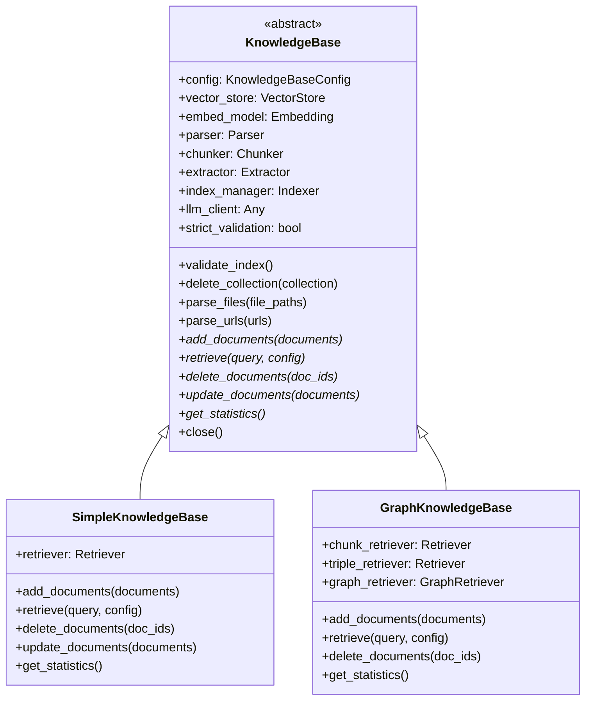
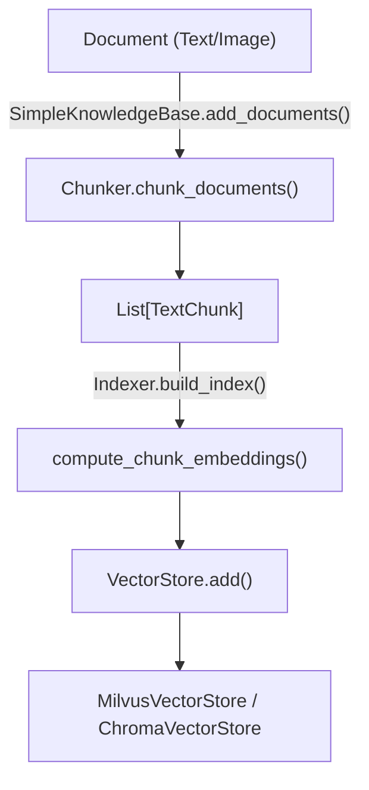
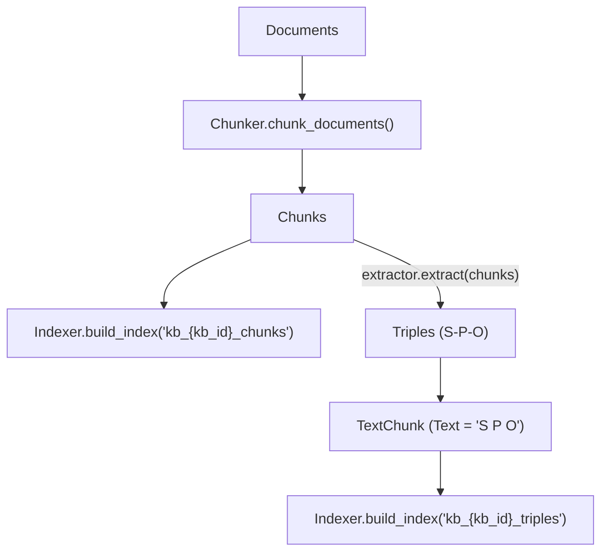

<!-- source: DeepWiki mcp.deepwiki.com · repo openJiuwen-ai/agent-core · page 7.2 Knowledge Base · fetched 2026-11-02 -->

# Knowledge Base

Relevant source files

The following files were used as context for generating this wiki page:

- [openjiuwen/core/retrieval/common/config.py](openjiuwen/core/retrieval/common/config.py)
- [openjiuwen/core/retrieval/graph_knowledge_base.py](openjiuwen/core/retrieval/graph_knowledge_base.py)
- [openjiuwen/core/retrieval/indexing/indexer/chroma_indexer.py](openjiuwen/core/retrieval/indexing/indexer/chroma_indexer.py)
- [openjiuwen/core/retrieval/indexing/indexer/milvus_indexer.py](openjiuwen/core/retrieval/indexing/indexer/milvus_indexer.py)
- [openjiuwen/core/retrieval/knowledge_base.py](openjiuwen/core/retrieval/knowledge_base.py)
- [openjiuwen/core/retrieval/simple_knowledge_base.py](openjiuwen/core/retrieval/simple_knowledge_base.py)
- [openjiuwen/core/retrieval/vector_store/base.py](openjiuwen/core/retrieval/vector_store/base.py)
- [openjiuwen/core/retrieval/vector_store/chroma_store.py](openjiuwen/core/retrieval/vector_store/chroma_store.py)
- [openjiuwen/core/retrieval/vector_store/milvus_store.py](openjiuwen/core/retrieval/vector_store/milvus_store.py)
- [tests/unit_tests/core/retrieval/indexing/indexer/test_chroma_indexer.py](tests/unit_tests/core/retrieval/indexing/indexer/test_chroma_indexer.py)
- [tests/unit_tests/core/retrieval/indexing/indexer/test_milvus_indexer.py](tests/unit_tests/core/retrieval/indexing/indexer/test_milvus_indexer.py)
- [tests/unit_tests/core/retrieval/vector_store/test_base.py](tests/unit_tests/core/retrieval/vector_store/test_base.py)
- [tests/unit_tests/core/retrieval/vector_store/test_chroma_store.py](tests/unit_tests/core/retrieval/vector_store/test_chroma_store.py)
- [tests/unit_tests/core/retrieval/vector_store/test_milvus_store.py](tests/unit_tests/core/retrieval/vector_store/test_milvus_store.py)

This page documents the Knowledge Base layer of the retrieval module: the `KnowledgeBase` abstract base class, `SimpleKnowledgeBase`, and `GraphKnowledgeBase`. It covers the full document lifecycle — parsing, chunking, indexing, retrieval, update, and deletion — as well as the `KnowledgeBaseConfig` and `RetrievalConfig` schemas.

For the underlying vector store backends that the knowledge base writes to and reads from, see [Vector Stores (7.1)](7.1). For the embedding models, indexers, and chunkers that the knowledge base orchestrates, see [Embeddings and Indexing (7.3)](7.3). For the retriever strategies invoked during `retrieve()`, see [Retrievers (7.4)](7.4).

---

## Class Hierarchy

**Class hierarchy and key responsibilities**

Sources: [openjiuwen/core/retrieval/knowledge_base.py:27-51](), [openjiuwen/core/retrieval/simple_knowledge_base.py:31-72](), [openjiuwen/core/retrieval/graph_knowledge_base.py:33-79]()

---

## Configuration

### KnowledgeBaseConfig

Defined in `openjiuwen/core/retrieval/common/config.py`. This model defines the static properties of a knowledge base instance.

| Field | Type | Default | Description |
|---|---|---|---|
| `kb_id` | `str` | required | Unique identifier for the knowledge base |
| `index_type` | `"hybrid" \| "bm25" \| "vector"` | `"hybrid"` | Index type; determines which retriever is used |
| `use_graph` | `bool` | `False` | Enable graph triple indexing and `GraphRetriever` |
| `chunk_size` | `int` | `512` | Character count per chunk |
| `chunk_overlap` | `int` | `50` | Overlap between consecutive chunks |
| `use_caption_for_images` | `bool` | `False` | Determines if multimodal or text-only embedding is used for images |

Sources: [openjiuwen/core/retrieval/common/config.py:28-40]()

### RetrievalConfig

Passed to `retrieve()` to control query-time behavior.

| Field | Type | Default | Description |
|---|---|---|---|
| `top_k` | `int` | `5` | Maximum number of results to return |
| `score_threshold` | `float \| None` | `None` | Minimum score; results below are dropped |
| `use_graph` | `bool \| None` | `None` | Override `KnowledgeBaseConfig.use_graph` at query time |
| `agentic` | `bool` | `False` | Wrap retriever in `AgenticRetriever` for iterative LLM-driven retrieval |
| `graph_expansion` | `bool` | `False` | Enable graph expansion during `GraphRetriever` execution |
| `filters` | `dict \| None` | `None` | Metadata field filters forwarded to the vector store |

Sources: [openjiuwen/core/retrieval/common/config.py:43-54]()

---

## KnowledgeBase Abstract Base Class

**File:** `openjiuwen/core/retrieval/knowledge_base.py`

`KnowledgeBase` is the top-level interface. It provides common logic for file/URL parsing and validation while delegating indexing and retrieval to subclasses.

### Auto-validation on attribute assignment

`KnowledgeBase.__setattr__` is overridden to perform consistency checks. When both `vector_store` and `index_manager` are assigned, `validate_index()` is automatically called [openjiuwen/core/retrieval/knowledge_base.py:53-58](). 

If a Chroma-based store is detected with `strict_validation=True` and `index_type` is not `"vector"`, a `StatusCode.RETRIEVAL_KB_DATABASE_CONFIG_INVALID` error is raised [openjiuwen/core/retrieval/knowledge_base.py:59-64](). This is because local ChromaDB does not support native sparse or hybrid indexing in the current implementation.

### validate_index()

Checks that the attributes `database_name`, `distance_metric`, and data fields (`text_field`, `vector_field`, `sparse_vector_field`, `metadata_field`, `doc_id_field`) are identical on both `vector_store` and `index_manager` [openjiuwen/core/retrieval/knowledge_base.py:69-81](). It also invokes `check_vector_field()` on the vector store [openjiuwen/core/retrieval/knowledge_base.py:83]().

### Document Parsing (Files and URLs)

`KnowledgeBase` provides concrete implementations for parsing raw sources into `Document` objects:

*   **parse_files**: Iterates through paths, generates a UUID `file_id`, and calls `self.parser.parse()` [openjiuwen/core/retrieval/knowledge_base.py:94-128]().
*   **parse_urls**: Validates URL support via `self.parser.supports()` and routes to the parser (e.g., `AutoParser` for WeChat or generic web) [openjiuwen/core/retrieval/knowledge_base.py:130-156]().

---

## SimpleKnowledgeBase

**File:** `openjiuwen/core/retrieval/simple_knowledge_base.py`

The standard implementation for RAG. It typically manages a single collection named `kb_{kb_id}_chunks`.

### Document Indexing Flow

**Natural Language Space to Code Entity Space: Simple Indexing**

Sources: [openjiuwen/core/retrieval/simple_knowledge_base.py:74-123](), [openjiuwen/core/retrieval/indexing/indexer/milvus_indexer.py:111-167]()

### Retrieval Strategy Selection

If `self.retriever` is not explicitly set, `retrieve()` auto-initializes one based on `index_type`:
*   `vector` -> `VectorRetriever` [openjiuwen/core/retrieval/simple_knowledge_base.py:141-147]()
*   `bm25` -> `SparseRetriever` [openjiuwen/core/retrieval/simple_knowledge_base.py:148-153]()
*   `hybrid` -> `HybridRetriever` [openjiuwen/core/retrieval/simple_knowledge_base.py:154-160]()

If `config.agentic` is `True`, the retriever is wrapped in an `AgenticRetriever` [openjiuwen/core/retrieval/simple_knowledge_base.py:173-178]().

---

## GraphKnowledgeBase

**File:** `openjiuwen/core/retrieval/graph_knowledge_base.py`

Supports GraphRAG by managing two parallel indices: a chunk index and a triple index.

### Dual-Index Management

**Natural Language Space to Code Entity Space: Graph Indexing**

Sources: [openjiuwen/core/retrieval/graph_knowledge_base.py:80-172]()

### Graph Retrieval

When `retrieve()` is called, if `use_graph` is enabled (either in `RetrievalConfig` or `KnowledgeBaseConfig`), it utilizes a `GraphRetriever` [openjiuwen/core/retrieval/graph_knowledge_base.py:230-244](). This retriever queries both the chunk and triple collections to provide context that includes relational knowledge.

---

## Statistics and Maintenance

### Statistics
Both implementations provide `get_statistics()`, which aggregates metadata from the underlying `Indexer` and `VectorStore`.
*   **Simple**: Returns document count and status for the primary chunk collection [openjiuwen/core/retrieval/simple_knowledge_base.py:262-290]().
*   **Graph**: Aggregates statistics from both `chunks` and `triples` collections [openjiuwen/core/retrieval/graph_knowledge_base.py:331-359]().

### Delete and Update
*   **delete_documents**: Removes all entries associated with specific `doc_ids`. In `GraphKnowledgeBase`, this is performed on both the chunk and triple collections [openjiuwen/core/retrieval/graph_knowledge_base.py:275-314]().
*   **update_documents**: Implemented as a `delete_documents` call followed by `add_documents` to refresh content [openjiuwen/core/retrieval/simple_knowledge_base.py:251-260]().

---

## Error Handling Summary

| Scenario | Status Code | File:Line |
|---|---|---|
| Vector store / Indexer config mismatch | `RETRIEVAL_KB_DATABASE_CONFIG_INVALID` | [openjiuwen/core/retrieval/knowledge_base.py:76-81]() |
| Chroma local mode with hybrid/sparse | `RETRIEVAL_KB_DATABASE_CONFIG_INVALID` | [openjiuwen/core/retrieval/knowledge_base.py:61-64]() |
| Missing parser for file/URL operations | `RETRIEVAL_KB_PARSER_NOT_FOUND` | [openjiuwen/core/retrieval/knowledge_base.py:110-113]() |
| Duplicate `doc_id` during indexing | `RETRIEVAL_INDEXING_ADD_DOC_RUNTIME_ERROR` | [openjiuwen/core/retrieval/indexing/indexer/milvus_indexer.py:149-153]() |
| Triple index build failure | `RETRIEVAL_KB_TRIPLE_INDEX_BUILD_EXECUTION_ERROR` | [openjiuwen/core/retrieval/graph_knowledge_base.py:168-171]() |

Sources: [openjiuwen/core/retrieval/knowledge_base.py:13-14](), [openjiuwen/core/retrieval/indexing/indexer/milvus_indexer.py:149-153](), [openjiuwen/core/retrieval/graph_knowledge_base.py:168-171]()

---

