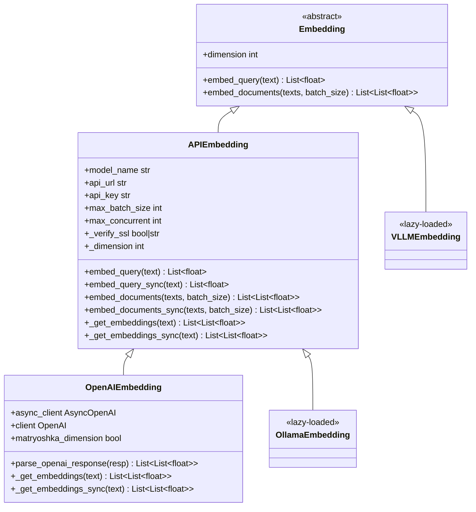
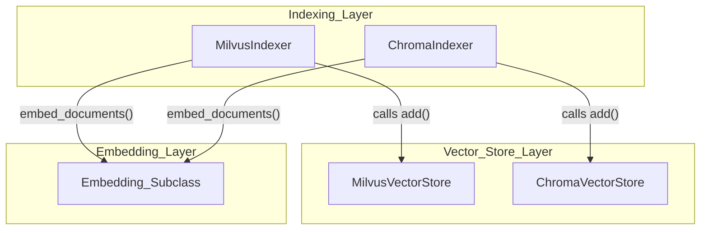

<!-- source: DeepWiki mcp.deepwiki.com · repo openJiuwen-ai/agent-core · page 7.3 Embeddings and Indexing · fetched 2026-11-02 -->

# Embeddings and Indexing

Relevant source files

The following files were used as context for generating this wiki page:

- [docs/en/2.Development Guide/API Docs/openjiuwen.core/retrieval/indexing/processor/parser/html_file_parser.md](docs/en/2.Development Guide/API Docs/openjiuwen.core/retrieval/indexing/processor/parser/html_file_parser.md)
- [docs/en/2.Development Guide/API Docs/openjiuwen.core/retrieval/indexing/processor/parser/web_page_parser.md](docs/en/2.Development Guide/API Docs/openjiuwen.core/retrieval/indexing/processor/parser/web_page_parser.md)
- [docs/en/2.Development Guide/API Docs/openjiuwen.core/retrieval/indexing/processor/parser/wechat_article_parser.md](docs/en/2.Development Guide/API Docs/openjiuwen.core/retrieval/indexing/processor/parser/wechat_article_parser.md)
- [docs/en/2.Development Guide/API Docs/openjiuwen.core/retrieval/indexing/processor/parser/word_parser.md](docs/en/2.Development Guide/API Docs/openjiuwen.core/retrieval/indexing/processor/parser/word_parser.md)
- [examples/retrieval/.env.example](examples/retrieval/.env.example)
- [examples/retrieval/configs.py](examples/retrieval/configs.py)
- [examples/retrieval/showcase_dashscope_multimodal_embedding.py](examples/retrieval/showcase_dashscope_multimodal_embedding.py)
- [openjiuwen/core/retrieval/common/document.py](openjiuwen/core/retrieval/common/document.py)
- [openjiuwen/core/retrieval/embedding/api_embedding.py](openjiuwen/core/retrieval/embedding/api_embedding.py)
- [openjiuwen/core/retrieval/embedding/base.py](openjiuwen/core/retrieval/embedding/base.py)
- [openjiuwen/core/retrieval/embedding/dashscope_embedding.py](openjiuwen/core/retrieval/embedding/dashscope_embedding.py)
- [openjiuwen/core/retrieval/embedding/openai_embedding.py](openjiuwen/core/retrieval/embedding/openai_embedding.py)
- [openjiuwen/core/retrieval/embedding/utils.py](openjiuwen/core/retrieval/embedding/utils.py)
- [openjiuwen/core/retrieval/embedding/vllm_embedding.py](openjiuwen/core/retrieval/embedding/vllm_embedding.py)
- [openjiuwen/core/retrieval/indexing/processor/chunker/text_splitter.py](openjiuwen/core/retrieval/indexing/processor/chunker/text_splitter.py)
- [openjiuwen/core/retrieval/indexing/processor/chunker/tokenizer_chunker.py](openjiuwen/core/retrieval/indexing/processor/chunker/tokenizer_chunker.py)
- [openjiuwen/core/retrieval/indexing/processor/parser/__init__.py](openjiuwen/core/retrieval/indexing/processor/parser/__init__.py)
- [openjiuwen/core/retrieval/indexing/processor/parser/auto_file_parser.py](openjiuwen/core/retrieval/indexing/processor/parser/auto_file_parser.py)
- [openjiuwen/core/retrieval/indexing/processor/parser/auto_link_parser.py](openjiuwen/core/retrieval/indexing/processor/parser/auto_link_parser.py)
- [openjiuwen/core/retrieval/indexing/processor/parser/auto_parser.py](openjiuwen/core/retrieval/indexing/processor/parser/auto_parser.py)
- [openjiuwen/core/retrieval/indexing/processor/parser/base.py](openjiuwen/core/retrieval/indexing/processor/parser/base.py)
- [openjiuwen/core/retrieval/indexing/processor/parser/captioner.py](openjiuwen/core/retrieval/indexing/processor/parser/captioner.py)
- [openjiuwen/core/retrieval/indexing/processor/parser/html_file_parser.py](openjiuwen/core/retrieval/indexing/processor/parser/html_file_parser.py)
- [openjiuwen/core/retrieval/indexing/processor/parser/image_parser.py](openjiuwen/core/retrieval/indexing/processor/parser/image_parser.py)
- [openjiuwen/core/retrieval/indexing/processor/parser/json_parser.py](openjiuwen/core/retrieval/indexing/processor/parser/json_parser.py)
- [openjiuwen/core/retrieval/indexing/processor/parser/pdf_parser.py](openjiuwen/core/retrieval/indexing/processor/parser/pdf_parser.py)
- [openjiuwen/core/retrieval/indexing/processor/parser/txt_md_parser.py](openjiuwen/core/retrieval/indexing/processor/parser/txt_md_parser.py)
- [openjiuwen/core/retrieval/indexing/processor/parser/web_page_parser.py](openjiuwen/core/retrieval/indexing/processor/parser/web_page_parser.py)
- [openjiuwen/core/retrieval/indexing/processor/parser/wechat_article_parser.py](openjiuwen/core/retrieval/indexing/processor/parser/wechat_article_parser.py)
- [openjiuwen/core/retrieval/indexing/processor/parser/word_parser.py](openjiuwen/core/retrieval/indexing/processor/parser/word_parser.py)
- [openjiuwen/core/retrieval/indexing/processor/splitter/__init__.py](openjiuwen/core/retrieval/indexing/processor/splitter/__init__.py)
- [openjiuwen/core/retrieval/indexing/processor/splitter/base.py](openjiuwen/core/retrieval/indexing/processor/splitter/base.py)
- [openjiuwen/core/retrieval/indexing/processor/splitter/splitter.py](openjiuwen/core/retrieval/indexing/processor/splitter/splitter.py)
- [openjiuwen/core/retrieval/lazy_load.py](openjiuwen/core/retrieval/lazy_load.py)
- [openjiuwen/core/retrieval/reranker/__init__.py](openjiuwen/core/retrieval/reranker/__init__.py)
- [openjiuwen/core/retrieval/reranker/base.py](openjiuwen/core/retrieval/reranker/base.py)
- [openjiuwen/core/retrieval/reranker/chat_reranker.py](openjiuwen/core/retrieval/reranker/chat_reranker.py)
- [openjiuwen/core/retrieval/reranker/standard_reranker.py](openjiuwen/core/retrieval/reranker/standard_reranker.py)
- [openjiuwen/core/retrieval/utils/api_requests.py](openjiuwen/core/retrieval/utils/api_requests.py)
- [openjiuwen/core/retrieval/vector_store/__init__.py](openjiuwen/core/retrieval/vector_store/__init__.py)
- [tests/unit_tests/core/retrieval/common/test_multimodal_document.py](tests/unit_tests/core/retrieval/common/test_multimodal_document.py)
- [tests/unit_tests/core/retrieval/embedding/test_dashscope_embedding.py](tests/unit_tests/core/retrieval/embedding/test_dashscope_embedding.py)
- [tests/unit_tests/core/retrieval/embedding/test_openai_embedding.py](tests/unit_tests/core/retrieval/embedding/test_openai_embedding.py)
- [tests/unit_tests/core/retrieval/embedding/test_vllm_embedding.py](tests/unit_tests/core/retrieval/embedding/test_vllm_embedding.py)
- [tests/unit_tests/core/retrieval/indexing/processor/chunker/test_text_splitter.py](tests/unit_tests/core/retrieval/indexing/processor/chunker/test_text_splitter.py)
- [tests/unit_tests/core/retrieval/indexing/processor/chunker/test_tokenizer_chunker.py](tests/unit_tests/core/retrieval/indexing/processor/chunker/test_tokenizer_chunker.py)
- [tests/unit_tests/core/retrieval/indexing/processor/parser/test_auto_parser.py](tests/unit_tests/core/retrieval/indexing/processor/parser/test_auto_parser.py)
- [tests/unit_tests/core/retrieval/indexing/processor/parser/test_base.py](tests/unit_tests/core/retrieval/indexing/processor/parser/test_base.py)
- [tests/unit_tests/core/retrieval/indexing/processor/parser/test_html_file_parser.py](tests/unit_tests/core/retrieval/indexing/processor/parser/test_html_file_parser.py)
- [tests/unit_tests/core/retrieval/indexing/processor/parser/test_image_parser.py](tests/unit_tests/core/retrieval/indexing/processor/parser/test_image_parser.py)
- [tests/unit_tests/core/retrieval/indexing/processor/parser/test_pdf_parser.py](tests/unit_tests/core/retrieval/indexing/processor/parser/test_pdf_parser.py)
- [tests/unit_tests/core/retrieval/indexing/processor/parser/test_web_page_parser.py](tests/unit_tests/core/retrieval/indexing/processor/parser/test_web_page_parser.py)
- [tests/unit_tests/core/retrieval/indexing/processor/parser/test_wechat_article_parser.py](tests/unit_tests/core/retrieval/indexing/processor/parser/test_wechat_article_parser.py)
- [tests/unit_tests/core/retrieval/indexing/processor/parser/test_word_parser.py](tests/unit_tests/core/retrieval/indexing/processor/parser/test_word_parser.py)
- [tests/unit_tests/core/retrieval/indexing/processor/splitter/__init__.py](tests/unit_tests/core/retrieval/indexing/processor/splitter/__init__.py)
- [tests/unit_tests/core/retrieval/indexing/processor/splitter/test_base.py](tests/unit_tests/core/retrieval/indexing/processor/splitter/test_base.py)
- [tests/unit_tests/core/retrieval/indexing/processor/splitter/test_splitter.py](tests/unit_tests/core/retrieval/indexing/processor/splitter/test_splitter.py)

This page covers the embedding model abstractions, the document processing pipeline (parsing, chunking, text preprocessing, triple extraction), and the indexer layer that writes processed chunks into vector stores. Together these components form the ingestion path for knowledge bases.

For how vector stores are structured and queried, see [Vector Stores](#7.1). For how `KnowledgeBase` and `SimpleKnowledgeBase` call this pipeline during `add_documents`, see [Knowledge Base](#7.2). For retriever strategies that consume the resulting index, see [Retrievers](#7.4).

---

## Embedding Models

### Class Hierarchy

**Embedding class hierarchy and primary API**

Sources: [openjiuwen/core/foundation/store/base_embedding.py:1-32](), [openjiuwen/core/retrieval/embedding/api_embedding.py:25-47](), [openjiuwen/core/retrieval/embedding/openai_embedding.py:24-40](), [openjiuwen/core/retrieval/lazy_load.py:72-82]()

---

### `Embedding` (Abstract Base)

Defined in [openjiuwen/core/foundation/store/base_embedding.py:21-45]().

| Abstract member | Signature | Description |
|---|---|---|
| `embed_query` | `async (text: str) -> List[float]` | Embed a single query string |
| `embed_documents` | `async (texts, batch_size) -> List[List[float]]` | Batch-embed a list of document strings |
| `dimension` | `property -> int` | Embedding vector dimension |

All concrete implementations must provide both `embed_query` and `embed_documents`. The `embed_query_sync` / `embed_documents_sync` synchronous variants are provided by `APIEmbedding` but are not mandated by the abstract base.

---

### `APIEmbedding`

Defined in [openjiuwen/core/retrieval/embedding/api_embedding.py:25-100]().

Universal HTTP embedding client. Sends a POST to `api_url` with payload `{"model": model_name, "input": text, ...kwargs}` and parses one of three response formats:

| Response key | Structure |
|---|---|
| `embedding` | `[float, ...]` or `[[float, ...], ...]` |
| `embeddings` | `[[float, ...], ...]` |
| `data` | `[{"embedding": [...]}, ...]` (OpenAI-compatible) |

**Batching and concurrency:** `embed_documents` splits texts into batches of at most `max_batch_size`, then launches them concurrently bounded by `asyncio.Semaphore(max_concurrent)` [openjiuwen/core/retrieval/embedding/api_embedding.py:55-180](). The sync variant uses a `ThreadPoolExecutor` [openjiuwen/core/retrieval/embedding/api_embedding.py:117-122]().

**SSL configuration** is read from environment variables at construction time [openjiuwen/core/retrieval/embedding/api_embedding.py:62-85]():

| Env variable | Effect |
|---|---|
| `EMBEDDING_SSL_VERIFY=false` | Disables SSL verification (`verify=False`) |
| `EMBEDDING_SSL_CERT=/path/to/cert` | Uses a custom CA certificate file |
| _(neither set)_ | System default CA certificates |

The resolved `_verify_ssl` value is passed to `requests.post` and forwarded to `httpx` clients in subclasses [openjiuwen/core/retrieval/embedding/openai_embedding.py:74-92]().

---

### `OpenAIEmbedding`

Defined in [openjiuwen/core/retrieval/embedding/openai_embedding.py:24-92]().

Uses the `openai` SDK (`AsyncOpenAI` and `OpenAI`) instead of raw `requests`. Notable differences from `APIEmbedding`:

- Strips the `/embeddings` suffix from `api_url` automatically so that the base URL works with the OpenAI client [openjiuwen/core/retrieval/embedding/openai_embedding.py:71-71]().
- Supports **Matryoshka dimensions**: if `dimension` is passed as an integer constructor argument, it is forwarded to `embeddings.create(dimensions=...)` on every call [openjiuwen/core/retrieval/embedding/openai_embedding.py:134-145]().
- Handles **base64-encoded** embedding responses by calling `parse_base64_embedding` [openjiuwen/core/retrieval/embedding/openai_embedding.py:111-119]().
- Response parsing is factored into the static method `parse_openai_response(resp: CreateEmbeddingResponse)`, which sorts `data` items by `index` before extracting embedding vectors [openjiuwen/core/retrieval/embedding/openai_embedding.py:94-128]().

---

## Document Processing Pipeline

Before text is embedded and indexed, it passes through a staged processing pipeline:

**Document ingestion pipeline**

Sources: [openjiuwen/core/retrieval/indexing/processor/parser/auto_file_parser.py:49-132](), [openjiuwen/core/retrieval/indexing/processor/chunker/text_splitter.py:26-67](), [openjiuwen/core/retrieval/indexing/processor/extractor/triple_extractor.py:22-128]()

---

### Parsers and `AutoFileParser`

`AutoFileParser` (in [openjiuwen/core/retrieval/indexing/processor/parser/auto_file_parser.py:49-171]()) uses a module-level dict `_PARSER_REGISTRY: Dict[str, Callable[[], Parser]]`. Concrete parser classes register themselves by applying the `@register_parser([".pdf", ".PDF"])` decorator [openjiuwen/core/retrieval/indexing/processor/parser/auto_file_parser.py:24-46]().

**Supported Parsers:**
*   **PDFParser**: Extracts text using `pdfplumber`. It also extracts images from pages, saves them to an `images/` directory, and generates captions using an `ImageCaptioner` (LLM-based) which are appended to the document content [openjiuwen/core/retrieval/indexing/processor/parser/pdf_parser.py:16-100]().
*   **WordParser**: Formats paragraphs and tables from `.docx` files as Markdown. It extracts images from paragraphs and uses `ImageCaptioner` to generate descriptions [openjiuwen/core/retrieval/indexing/processor/parser/word_parser.py:63-171]().
*   **ImageParser**: Generates captions for image files (PNG, JPG, etc.) and stores the original path in the `image_path` metadata field for potential multimodal retrieval [openjiuwen/core/retrieval/indexing/processor/parser/image_parser.py:16-57]().
*   **WebPageParser**: Fetches and parses generic URLs using `httpx` and `BeautifulSoup` [openjiuwen/core/retrieval/indexing/processor/parser/web_page_parser.py:39-184]().
*   **WeChatArticleParser**: Specialized parser for WeChat official account articles, targeting the `js_content` div to extract the main article body [openjiuwen/core/retrieval/indexing/processor/parser/wechat_article_parser.py:34-94]().

Custom parsers can be added at runtime: `AutoFileParser.register_new_parser(".csv", lambda: MyCSVParser())` [openjiuwen/core/retrieval/indexing/processor/parser/auto_file_parser.py:151-161]().

---

### Chunkers and Splitters

The SDK provides multiple strategies for segmenting documents into manageable pieces.

| Class | File | Description |
|---|---|---|
| `CharSplitter` | `text_splitter.py` | Sliding-window character split with overlap. Does not require a tokenizer [openjiuwen/core/retrieval/indexing/processor/chunker/text_splitter.py:34-67](). |
| `IndexSentenceSplitter` | `text_splitter.py` | High-level wrapper that resolves the embedding model's tokenizer and passes it to `SentenceSplitter` [openjiuwen/core/retrieval/indexing/processor/chunker/text_splitter.py:70-115](). |
| `SentenceSplitter` | `splitter.py` | Greedy sentence-level merging using `pysbd`. It packs sentences into chunks up to `chunk_size` tokens [openjiuwen/core/retrieval/indexing/processor/splitter/splitter.py:11-140](). |
| `TokenizerChunker` | `tokenizer_chunker.py` | Chunker that uses token counts for boundaries. |

**Language Detection in `SentenceSplitter`**:
The `_detect_chinese` method [openjiuwen/core/retrieval/indexing/processor/splitter/splitter.py:45-90]() counts CJK Unified Ideographs using `numpy` for efficiency. If ≥10% of characters are Chinese, it selects the `"zh"` segmenter; otherwise, it defaults to `"en"`.

---

### `TripleExtractor`

Defined in [openjiuwen/core/retrieval/indexing/processor/extractor/triple_extractor.py:22-128]().

Used by `GraphKnowledgeBase` to populate a knowledge graph index. It prompts an LLM to extract structured `[subject, predicate, object]` relationships from text chunks. It uses `json_repair` to handle potential syntax errors in LLM output and executes requests concurrently bounded by a semaphore [openjiuwen/core/retrieval/indexing/processor/extractor/triple_extractor.py:86-117]().

---

## Indexers

Indexers receive `List[TextChunk]` and an `Embedding` model to write data into a `VectorStore`.

### Concrete Indexers

`MilvusIndexer` and `ChromaIndexer` are lazy-loaded [openjiuwen/core/retrieval/lazy_load.py:14-23]() and serve as the bridge between the indexing pipeline and storage.

**Indexer–VectorStore wiring**

Sources: [openjiuwen/core/retrieval/lazy_load.py:84-112](), [openjiuwen/core/retrieval/embedding/api_embedding.py:167-172]()

---

## Lazy Loading

To minimize the initial footprint and avoid dependency conflicts, heavy retrieval components are lazy-loaded via `lazy_load.py` [openjiuwen/core/retrieval/lazy_load.py:1-161]().

| Category | Components | Triggered by |
|---|---|---|
| **Milvus** | `MilvusIndexer`, `MilvusVectorStore` | `_load_milvus()` |
| **Chroma** | `ChromaIndexer`, `ChromaVectorStore` | `_load_chroma()` |
| **OpenAI** | `OpenAIEmbedding`, `VLLMEmbedding` | `_load_openai()` |
| **Parsers** | `AutoFileParser`, `PDFParser`, `WordParser`, `ImageParser`, `WeChatArticleParser` | `_load_parser()` |

Sources: [openjiuwen/core/retrieval/lazy_load.py:50-58](), [openjiuwen/core/retrieval/lazy_load.py:143-161]()

---

