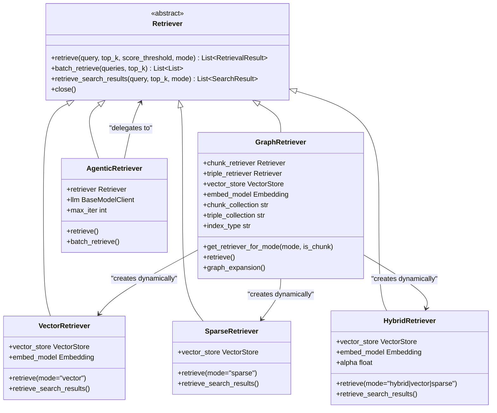
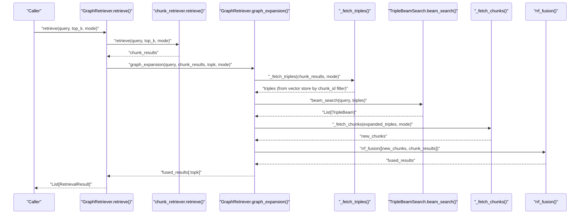
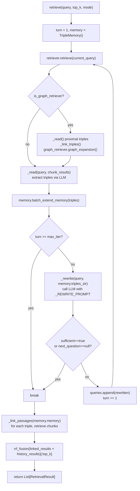

<!-- source: DeepWiki mcp.deepwiki.com · repo openJiuwen-ai/agent-core · page 7.4 Retrievers · fetched 2026-11-02 -->

# Retrievers

<details>
<summary>Relevant source files</summary>

The following files were used as context for generating this wiki page:

- [docs/en/2.Development Guide/API Docs/openjiuwen.core/retrieval/indexing/processor/extractor/triple_extractor.md](docs/en/2.Development Guide/API Docs/openjiuwen.core/retrieval/indexing/processor/extractor/triple_extractor.md)
- [openjiuwen/core/retrieval/common/triple_beam.py](openjiuwen/core/retrieval/common/triple_beam.py)
- [openjiuwen/core/retrieval/common/triple_memory.py](openjiuwen/core/retrieval/common/triple_memory.py)
- [openjiuwen/core/retrieval/indexing/processor/chunker/base.py](openjiuwen/core/retrieval/indexing/processor/chunker/base.py)
- [openjiuwen/core/retrieval/indexing/processor/chunker/chunking.py](openjiuwen/core/retrieval/indexing/processor/chunker/chunking.py)
- [openjiuwen/core/retrieval/indexing/processor/extractor/triple_extractor.py](openjiuwen/core/retrieval/indexing/processor/extractor/triple_extractor.py)
- [openjiuwen/core/retrieval/retriever/agentic_retriever.py](openjiuwen/core/retrieval/retriever/agentic_retriever.py)
- [openjiuwen/core/retrieval/retriever/base.py](openjiuwen/core/retrieval/retriever/base.py)
- [openjiuwen/core/retrieval/retriever/graph_retriever.py](openjiuwen/core/retrieval/retriever/graph_retriever.py)
- [openjiuwen/core/retrieval/retriever/hybrid_retriever.py](openjiuwen/core/retrieval/retriever/hybrid_retriever.py)
- [openjiuwen/core/retrieval/retriever/sparse_retriever.py](openjiuwen/core/retrieval/retriever/sparse_retriever.py)
- [openjiuwen/core/retrieval/retriever/vector_retriever.py](openjiuwen/core/retrieval/retriever/vector_retriever.py)
- [openjiuwen/core/retrieval/utils/common.py](openjiuwen/core/retrieval/utils/common.py)
- [tests/unit_tests/core/retrieval/indexing/processor/extractor/test_triple_extractor.py](tests/unit_tests/core/retrieval/indexing/processor/extractor/test_triple_extractor.py)
- [tests/unit_tests/core/retrieval/retriever/test_agentic_retriever.py](tests/unit_tests/core/retrieval/retriever/test_agentic_retriever.py)
- [tests/unit_tests/core/retrieval/retriever/test_graph_retriever.py](tests/unit_tests/core/retrieval/retriever/test_graph_retriever.py)

</details>


This page documents all retrieval strategy implementations in the `openjiuwen.core.retrieval.retriever` package: the `Retriever` base interface, and the five concrete implementations: `VectorRetriever`, `SparseRetriever`, `HybridRetriever`, `GraphRetriever`, and `AgenticRetriever`.

For background on the knowledge base layer that selects and configures these retrievers, see [Knowledge Base](#7.2). For the vector store operations (`search`, `sparse_search`, `hybrid_search`) that retrievers call into, see [Vector Stores](#7.1). For the embedding models that `VectorRetriever` and `HybridRetriever` depend on, see [Embeddings and Indexing](#7.3).

---

## `Retriever` Base Interface

All retrievers extend the abstract base class `Retriever` defined in [openjiuwen/core/retrieval/retriever/base.py]().

**Abstract methods:**

| Method | Signature | Description |
|---|---|---|
| `retrieve` | `(query, top_k=5, score_threshold=None, mode="hybrid", **kwargs) → List[RetrievalResult]` | Retrieve top-k documents for a query |
| `batch_retrieve` | `(queries, top_k=5, **kwargs) → List[List[RetrievalResult]]` | Concurrent batch retrieval across multiple queries |

**Optional methods (with default no-op implementations):**

| Method | Signature | Description |
|---|---|---|
| `retrieve_search_results` | `(query, top_k, mode, **kwargs) → List[SearchResult]` | Returns raw `SearchResult` objects (preserves store IDs) |
| `close` | `() → None` | Release underlying resources |

The `mode` parameter is a literal with three values: `"vector"`, `"sparse"`, `"hybrid"`. Not every retriever supports all three — the concrete classes enforce this at runtime.

Sources: [openjiuwen/core/retrieval/retriever/base.py:19-64]()

---

## Retriever Class Map

**Retriever inheritance and composition:**



Sources: [openjiuwen/core/retrieval/retriever/base.py:19-64](), [openjiuwen/core/retrieval/retriever/vector_retriever.py:19-21](), [openjiuwen/core/retrieval/retriever/sparse_retriever.py:18-20](), [openjiuwen/core/retrieval/retriever/hybrid_retriever.py:19-21](), [openjiuwen/core/retrieval/retriever/graph_retriever.py:228-230](), [openjiuwen/core/retrieval/retriever/agentic_retriever.py:113-115]()

---

## Mode Compatibility

Each concrete retriever enforces which `mode` values it accepts. Attempting to call `retrieve()` with an unsupported mode raises a `StatusCode.RETRIEVAL_RETRIEVER_MODE_NOT_SUPPORT` error.

| Retriever | `"vector"` | `"sparse"` | `"hybrid"` |
|---|:---:|:---:|:---:|
| `VectorRetriever` | ✓ | ✗ | ✗ |
| `SparseRetriever` | ✗ | ✓ | ✗ |
| `HybridRetriever` | ✓ | ✓ | ✓ |
| `GraphRetriever` | depends on `index_type` | depends on `index_type` | depends on `index_type` |
| `AgenticRetriever` | inherited from `retriever` | inherited | inherited |

`GraphRetriever.index_type` is injected by the `KnowledgeBase` layer and controls allowed modes via `_allowed_modes()`:

| `index_type` | Allowed modes |
|---|---|
| `"vector"` | `{"vector"}` |
| `"bm25"` | `{"sparse"}` |
| `"hybrid"` | `{"vector", "sparse", "hybrid"}` |

Sources: [openjiuwen/core/retrieval/retriever/vector_retriever.py:59-63](), [openjiuwen/core/retrieval/retriever/sparse_retriever.py:55-59](), [openjiuwen/core/retrieval/retriever/hybrid_retriever.py:64-111](), [openjiuwen/core/retrieval/retriever/graph_retriever.py:466-489]()

---

## `VectorRetriever`

File: [openjiuwen/core/retrieval/retriever/vector_retriever.py]()

Performs dense vector search. Requires both a `VectorStore` and an `Embedding` model.

**Constructor:**
```python
VectorRetriever(vector_store, embed_model=None)
```

**Retrieval flow:**
1. Call `embed_model.embed_query(query)` to get a query vector [openjiuwen/core/retrieval/retriever/vector_retriever.py:78]().
2. Call `vector_store.search(query_vector, top_k)` [openjiuwen/core/retrieval/retriever/vector_retriever.py:79]().
3. If that returns nothing, fall back to `vector_store.sparse_search(query_text, top_k)` [openjiuwen/core/retrieval/retriever/vector_retriever.py:85]().
4. Filter results by `score_threshold` if provided [openjiuwen/core/retrieval/retriever/vector_retriever.py:94]().
5. Convert `SearchResult` objects to `RetrievalResult` [openjiuwen/core/retrieval/retriever/vector_retriever.py:97]().

Sources: [openjiuwen/core/retrieval/retriever/vector_retriever.py:22-106]()

---

## `SparseRetriever`

File: [openjiuwen/core/retrieval/retriever/sparse_retriever.py]()

Performs keyword-based (BM25) search by calling `vector_store.sparse_search()`. Does not require an embedding model. `score_threshold` is not supported.

**Constructor:**
```python
SparseRetriever(vector_store)
```

**Retrieval flow:**
1. Call `vector_store.sparse_search(query_text, top_k, filters=None)` [openjiuwen/core/retrieval/retriever/sparse_retriever.py:62]().
2. Map each `SearchResult` to a `RetrievalResult`, populating `chunk_id` from `result.id` [openjiuwen/core/retrieval/retriever/sparse_retriever.py:71-78]().

Sources: [openjiuwen/core/retrieval/retriever/sparse_retriever.py:18-80]()

---

## `HybridRetriever`

File: [openjiuwen/core/retrieval/retriever/hybrid_retriever.py]()

Combines dense and sparse search. The `alpha` parameter controls weighting: `0.0` = pure sparse, `1.0` = pure dense, `0.5` = balanced. The `alpha` can also be overridden per call via `**kwargs`.

**Constructor:**
```python
HybridRetriever(vector_store, embed_model=None, alpha=0.5)
```

**Mode dispatch:**

| `mode` | Operation |
|---|---|
| `"hybrid"` | `vector_store.hybrid_search(query_text, query_vector, top_k, alpha)` |
| `"vector"` | `vector_store.search(query_vector, top_k)` with BM25 fallback |
| `"sparse"` | `vector_store.sparse_search(query_text, top_k)` |

`score_threshold` is only enforced when `mode="vector"`.

Sources: [openjiuwen/core/retrieval/retriever/hybrid_retriever.py:19-130]()

---

## `GraphRetriever`

File: [openjiuwen/core/retrieval/retriever/graph_retriever.py]()

Extends retrieval with knowledge-graph expansion. It maintains two retrieval tracks: one for document chunks (`chunk_collection`) and one for extracted triples (`triple_collection`).

### Construction

```python
GraphRetriever(
    chunk_retriever=None,   # fixed Retriever for chunks
    triple_retriever=None,  # fixed Retriever for triples
    vector_store=None,      # used to build retrievers dynamically
    embed_model=None,
    chunk_collection=None,
    triple_collection=None,
)
```

If `chunk_retriever` / `triple_retriever` are not provided, `get_retriever_for_mode()` creates them on the fly from `vector_store`, `embed_model`, and the appropriate collection name [openjiuwen/core/retrieval/retriever/graph_retriever.py:276-328]().

### `retrieve()` Flow

**GraphRetriever retrieve() + graph_expansion() sequence:**



Sources: [openjiuwen/core/retrieval/retriever/graph_retriever.py:365-418](), [openjiuwen/core/retrieval/retriever/graph_retriever.py:491-576]()

### `TripleBeamSearch`

`TripleBeamSearch` performs iterative beam search over the triple graph to expand context.

**Constructor:**
```python
TripleBeamSearch(retriever, num_beams=10, num_candidates_per_beam=100, max_length=2, encoder_batch_size=256)
```

- `num_beams`: Number of beams to maintain simultaneously.
- `num_candidates_per_beam`: Candidates fetched per beam expansion step.
- `max_length`: Maximum number of hops (must be ≥ 1).

**Algorithm (in `beam_search()`):**
1. Embed all input triples and the query using `embed_model.embed_documents()` [openjiuwen/core/retrieval/retriever/graph_retriever.py:91]().
2. Select top `num_beams` triples by cosine similarity to the query as initial beams [openjiuwen/core/retrieval/retriever/graph_retriever.py:97]().
3. For each remaining hop (up to `max_length - 1`):
   a. For each beam, call `_search_candidates()` which retrieves triples connected to the beam's tail entity [openjiuwen/core/retrieval/retriever/graph_retriever.py:101]().
   b. `_expand_beams()` embeds all candidate extended paths and selects the top `num_beams` by cosine similarity [openjiuwen/core/retrieval/retriever/graph_retriever.py:102]().
4. Return final `List[TripleBeam]`.

`TripleBeam` [openjiuwen/core/retrieval/common/triple_beam.py]() is a container holding an ordered list of `RetrievalResult` triples and a beam score.

Sources: [openjiuwen/core/retrieval/retriever/graph_retriever.py:24-170]()

---

## `AgenticRetriever`

File: [openjiuwen/core/retrieval/retriever/agentic_retriever.py]()

Wraps a `Retriever` and adds an iterative LLM-driven loop that rewrites the query until sufficient evidence is found. When wrapping a `GraphRetriever`, graph-specific features like expansion are enabled [openjiuwen/core/retrieval/retriever/agentic_retriever.py:6-10]().

**Constructor:**
```python
AgenticRetriever(
    retriever,        # required Retriever
    llm_client,       # required BaseModelClient
    max_iter=2,
)
```

### Iteration Loop

**AgenticRetriever.retrieve() loop:**



Sources: [openjiuwen/core/retrieval/retriever/agentic_retriever.py:214-301]()

### LLM Prompts

Two prompt templates drive the loop:

| Constant | Used in | Purpose |
|---|---|---|
| `_READ_PROMPT` | `_read()` | Extract `(subject, predicate, object)` triples from retrieved passages [openjiuwen/core/retrieval/retriever/agentic_retriever.py:30-49]() |
| `_REWRITE_PROMPT` | `_rewrite()` | Decide if accumulated triples are sufficient; if not, generate a follow-up question [openjiuwen/core/retrieval/retriever/agentic_retriever.py:51-110]() |

`_rewrite()` returns `None` when the LLM responds with `{"sufficient": true}` or when `next_question` is `null` [openjiuwen/core/retrieval/retriever/agentic_retriever.py:441](). JSON parsing uses `json_repair.repair_json` for robustness [openjiuwen/core/retrieval/retriever/agentic_retriever.py:433]().

Sources: [openjiuwen/core/retrieval/retriever/agentic_retriever.py:30-110](), [openjiuwen/core/retrieval/retriever/agentic_retriever.py:417-452]()

---

## Result Types

Both `SearchResult` and `RetrievalResult` are defined in `openjiuwen/core/retrieval/common/retrieval_result.py`.

| Field | `SearchResult` | `RetrievalResult` |
|---|---|---|
| `id` | ✓ (store-internal ID) | — |
| `text` | ✓ | ✓ |
| `score` | ✓ | ✓ |
| `metadata` | ✓ | ✓ |
| `doc_id` | — | ✓ |
| `chunk_id` | — | ✓ |

`retrieve_search_results()` returns `SearchResult` (preserves the store ID, needed by `AgenticRetriever._link_triples()` for deduplication). The standard `retrieve()` always returns `RetrievalResult`.

Sources: [openjiuwen/core/retrieval/common/retrieval_result.py:16-56](), [openjiuwen/core/retrieval/retriever/base.py:51-53]()

---

## Utility Functions

| Function | Location | Purpose |
|---|---|---|
| `rrf_fusion(result_lists, k=60)` | `openjiuwen/core/retrieval/utils/fusion` | Reciprocal Rank Fusion across multiple retrieval result lists |
| `deduplicate(data, key=...)` | `openjiuwen/core/retrieval/utils/common` | Order-preserving deduplication using a key function |

`rrf_fusion` is used by `GraphRetriever.graph_expansion()` to merge chunk results with graph-expanded chunks [openjiuwen/core/retrieval/retriever/graph_retriever.py:567](), and by `AgenticRetriever.retrieve()` to merge results across all iterations [openjiuwen/core/retrieval/retriever/agentic_retriever.py:293]().

`deduplicate` is used in `AgenticRetriever._link_triples()` to remove duplicate `SearchResult` objects by `result.id` [openjiuwen/core/retrieval/retriever/agentic_retriever.py:381]().

Sources: [openjiuwen/core/retrieval/utils/fusion.py:18-20](), [openjiuwen/core/retrieval/utils/common.py:11-13](), [openjiuwen/core/retrieval/retriever/graph_retriever.py:567](), [openjiuwen/core/retrieval/retriever/agentic_retriever.py:293](), [openjiuwen/core/retrieval/retriever/agentic_retriever.py:381]()

---

