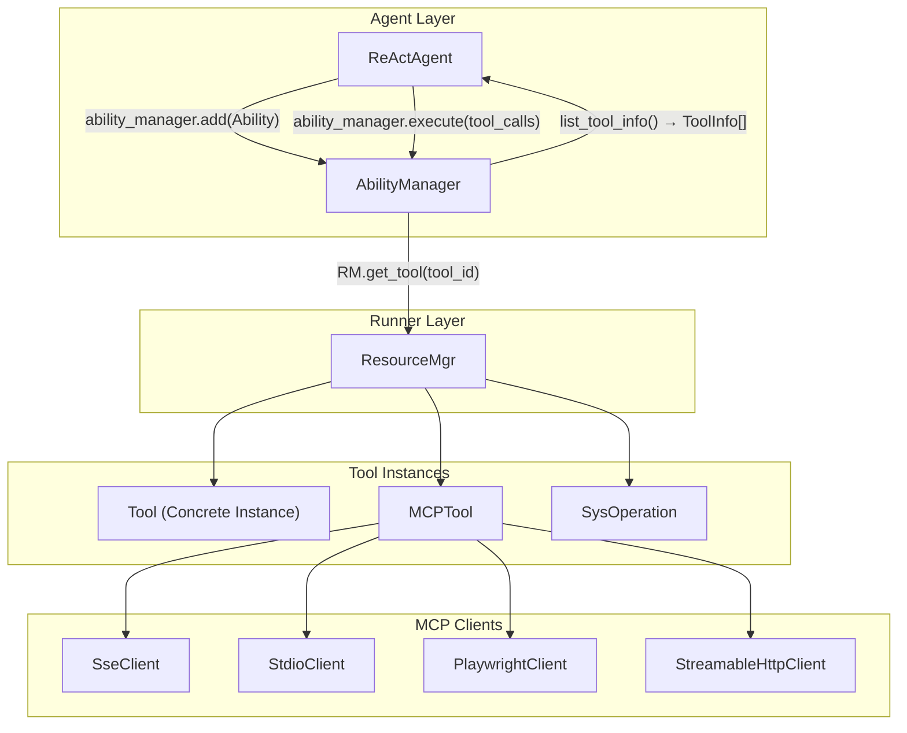
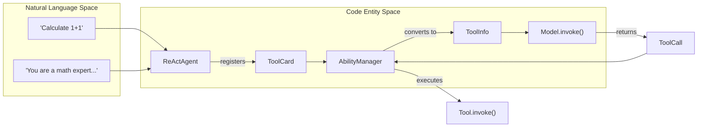

<!-- source: DeepWiki mcp.deepwiki.com · repo openJiuwen-ai/agent-core · page 8 Tools and Skills · fetched 2026-11-02 -->

# Tools and Skills

<details>
<summary>Relevant source files</summary>

The following files were used as context for generating this wiki page:

- [openjiuwen/core/foundation/tool/__init__.py](openjiuwen/core/foundation/tool/__init__.py)
- [openjiuwen/core/foundation/tool/mcp/base.py](openjiuwen/core/foundation/tool/mcp/base.py)
- [openjiuwen/core/foundation/tool/mcp/client/mcp_client.py](openjiuwen/core/foundation/tool/mcp/client/mcp_client.py)
- [openjiuwen/core/foundation/tool/mcp/client/playwright_client.py](openjiuwen/core/foundation/tool/mcp/client/playwright_client.py)
- [openjiuwen/core/foundation/tool/mcp/client/sse_client.py](openjiuwen/core/foundation/tool/mcp/client/sse_client.py)
- [openjiuwen/core/foundation/tool/mcp/client/stdio_client.py](openjiuwen/core/foundation/tool/mcp/client/stdio_client.py)
- [openjiuwen/core/foundation/tool/mcp/client/streamable_http_client.py](openjiuwen/core/foundation/tool/mcp/client/streamable_http_client.py)
- [openjiuwen/core/single_agent/ability_manager.py](openjiuwen/core/single_agent/ability_manager.py)
- [openjiuwen/core/single_agent/agent_callback_manager.py](openjiuwen/core/single_agent/agent_callback_manager.py)
- [openjiuwen/core/single_agent/agents/react_agent.py](openjiuwen/core/single_agent/agents/react_agent.py)
- [openjiuwen/core/single_agent/base.py](openjiuwen/core/single_agent/base.py)
- [openjiuwen/core/single_agent/rail/__init__.py](openjiuwen/core/single_agent/rail/__init__.py)
- [openjiuwen/core/single_agent/rail/base.py](openjiuwen/core/single_agent/rail/base.py)
- [openjiuwen/harness/deep_agent.py](openjiuwen/harness/deep_agent.py)
- [openjiuwen/harness/factory.py](openjiuwen/harness/factory.py)
- [openjiuwen/harness/prompts/sections/skills.py](openjiuwen/harness/prompts/sections/skills.py)
- [openjiuwen/harness/rails/skills/skill_use_rail.py](openjiuwen/harness/rails/skills/skill_use_rail.py)
- [openjiuwen/harness/rails/subagent/verification_rail.py](openjiuwen/harness/rails/subagent/verification_rail.py)
- [openjiuwen/harness/rails/sys_operation_rail.py](openjiuwen/harness/rails/sys_operation_rail.py)
- [openjiuwen/harness/schema/config.py](openjiuwen/harness/schema/config.py)
- [openjiuwen/harness/tools/worktree/rails.py](openjiuwen/harness/tools/worktree/rails.py)
- [tests/system_tests/rail/test_force_finish_rail.py](tests/system_tests/rail/test_force_finish_rail.py)
- [tests/unit_tests/agent/react_agent/test_multimodal_tool_results.py](tests/unit_tests/agent/react_agent/test_multimodal_tool_results.py)
- [tests/unit_tests/agent/react_agent/test_new_react_agent_mock.py](tests/unit_tests/agent/react_agent/test_new_react_agent_mock.py)
- [tests/unit_tests/core/foundation/tool/test_streamable_http_client.py](tests/unit_tests/core/foundation/tool/test_streamable_http_client.py)
- [tests/unit_tests/core/single_agent/rail/test_rail.py](tests/unit_tests/core/single_agent/rail/test_rail.py)
- [tests/unit_tests/core/single_agent/rail/test_rail_init_timing.py](tests/unit_tests/core/single_agent/rail/test_rail_init_timing.py)
- [tests/unit_tests/harness/test_deep_agent.py](tests/unit_tests/harness/test_deep_agent.py)
- [tests/unit_tests/harness/test_filesystem_rail.py](tests/unit_tests/harness/test_filesystem_rail.py)
- [tests/unit_tests/harness/test_skill_rail.py](tests/unit_tests/harness/test_skill_rail.py)

</details>


This page provides an overview of the tool and skill subsystems: how tools are typed and registered, how the MCP protocol is used to connect external tool servers, how the skills framework packages reusable capabilities, and how `AbilityManager` wires these together for agents.

- For tool registration internals and `ToolMgr`, see [Tool Management](#8.1).
- For MCP client implementations in detail, see [MCP Clients](#8.2).
- For the skills framework and `SkillManager`, see [Skills](#8.3).
- For RESTful API and Function tools, see [RESTful API and Function Tools](#8.4).

---

## Conceptual Model

The tool system has two distinct layers:

| Layer | Class | Responsibility |
|---|---|---|
| **Metadata layer** | `AbilityManager` | Holds descriptor cards; converts them to `ToolInfo` for the LLM [openjiuwen/core/single_agent/ability_manager.py:87-95]() |
| **Instance layer** | `ToolMgr` (via `ResourceMgr`) | Holds callable tool instances; executes them [openjiuwen/core/single_agent/ability_manager.py:94-95]() |

An **ability** is any of the four types the framework can present to an LLM as a callable tool:

```python
Ability = Union[ToolCard, WorkflowCard, AgentCard, McpServerConfig]
```
[openjiuwen/core/single_agent/ability_manager.py:40-40]()

`ToolCard`, `WorkflowCard`, and `AgentCard` are descriptors (name, description, input schema). `McpServerConfig` instructs the runtime to connect to an MCP server and dynamically retrieve tool descriptors from it.

**Skills** are a higher-level construct: a packaged set of tools and a prompt injection, loaded from a local path or a remote Git repository, then registered into the agent's `AbilityManager` [openjiuwen/harness/rails/skills/skill_use_rail.py:36-38]().

---

## Architecture Diagram

**Tool and Skill System: Class and Data Flow**


Sources: [openjiuwen/core/single_agent/ability_manager.py:87-101](), [openjiuwen/core/single_agent/agents/react_agent.py:193-210](), [openjiuwen/core/foundation/tool/mcp/client/sse_client.py:16-25]()

**From Natural Language Space to Code Entity Space**


Sources: [openjiuwen/core/single_agent/agents/react_agent.py:193-210](), [openjiuwen/core/single_agent/ability_manager.py:145-164](), [openjiuwen/core/foundation/tool/tool.py:1-50]()

---

## Tool Types

The SDK supports several categories of tools, each with its own descriptor card and execution logic:

| Ability Descriptor | Instance Type | Transport | Invocation |
|---|---|---|---|
| `ToolCard` | `Tool` | In-process Python call | `tool.invoke(args)` |
| `McpToolCard` | `MCPTool` | MCP protocol | `tool.invoke(args)` → `client.call_tool()` |
| `WorkflowCard` | Workflow instance | Internal engine | `workflow.invoke(args, session)` |
| `AgentCard` | Agent instance | Internal invocation | `agent.invoke(args)` |
| `McpServerConfig` | Multiple `MCPTool`s | Resolved at connect | Discovers multiple tools from server |

Sources: [openjiuwen/core/foundation/tool/tool.py:21-23](), [openjiuwen/core/single_agent/ability_manager.py:40-40](), [openjiuwen/core/foundation/tool/mcp/base.py:24-25]()

---

## AbilityManager

`AbilityManager` is instantiated per agent and acts as the agent's capability registry [openjiuwen/core/single_agent/base.py:110-110](). It does **not** hold live instances—only cards.

### Internal Storage
The manager maintains separate dictionaries for different resource types:
- `_tools`: `Dict[str, ToolCard]`
- `_workflows`: `Dict[str, WorkflowCard]`
- `_agents`: `Dict[str, AgentCard]`
- `_mcp_servers`: `Dict[str, McpServerConfig]`
[openjiuwen/core/single_agent/ability_manager.py:102-106]()

### Key Methods
- `add(ability)`: Registers one or more abilities.
- `execute(tool_call, session)`: Dispatches tool calls to the underlying instances via the resource manager. It includes a default timeout logic via `DEFAULT_TOOL_CALL_TIMEOUT` [openjiuwen/core/single_agent/ability_manager.py:78-84]().

Sources: [openjiuwen/core/single_agent/ability_manager.py:87-112]()

---

## MCP Protocol Support

MCP (Model Context Protocol) allows the SDK to connect to external tool servers dynamically.

### MCP Client Types
All clients implement the `McpClient` interface.

| Client Class | Transport | Use Case |
|---|---|---|
| `SseClient` | HTTP/SSE | Remote servers with Server-Sent Events [openjiuwen/core/foundation/tool/mcp/client/sse_client.py:16-25]() |
| `StdioClient` | Subprocess | Local executable servers via stdin/stdout [openjiuwen/core/foundation/tool/mcp/client/stdio_client.py:1-20]() |
| `StreamableHttpClient` | HTTP | High-performance HTTP transport [openjiuwen/core/foundation/tool/mcp/client/streamable_http_client.py:1-20]() |
| `PlaywrightClient` | Browser | Tools requiring browser automation [openjiuwen/core/foundation/tool/mcp/client/playwright_client.py:1-20]() |

### Tool Registration Flow
When an `McpServerConfig` is added, the system connects to the server and retrieves a list of available tools. These are then converted to `McpToolCard` objects for the LLM to use [openjiuwen/core/foundation/tool/mcp/base.py:1-30]().

Sources: [openjiuwen/core/foundation/tool/mcp/client/sse_client.py:28-53](), [openjiuwen/core/single_agent/ability_manager.py:117-131]()

---

## Skills Framework

Skills are packaged capabilities managed via `SkillUseRail` in the `DeepAgent` framework [openjiuwen/harness/rails/skills/skill_use_rail.py:36-38]().

- **Skill Storage**: Skills are stored as directories containing a `SKILL.md` file with YAML front matter describing the skill [openjiuwen/harness/rails/skills/skill_use_rail.py:30-33]().
- **Modes**:
    - `all`: Injects all enabled skills into the system prompt [openjiuwen/harness/rails/skills/skill_use_rail.py:47-49]().
    - `auto_list`: Adds a `list_skill` tool, letting the model decide when to inspect available skills [openjiuwen/harness/rails/skills/skill_use_rail.py:48-49]().
- **Evolution**: Skills can evolve over time, with experience text stored in an `EvolutionStore` [openjiuwen/harness/rails/skills/skill_use_rail.py:64-65]().

Sources: [openjiuwen/harness/rails/skills/skill_use_rail.py:54-81](), [openjiuwen/core/single_agent/base.py:164-173]()

---

