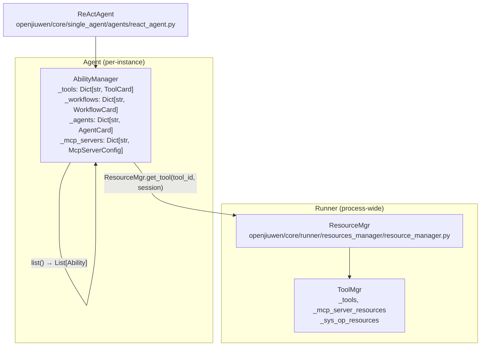
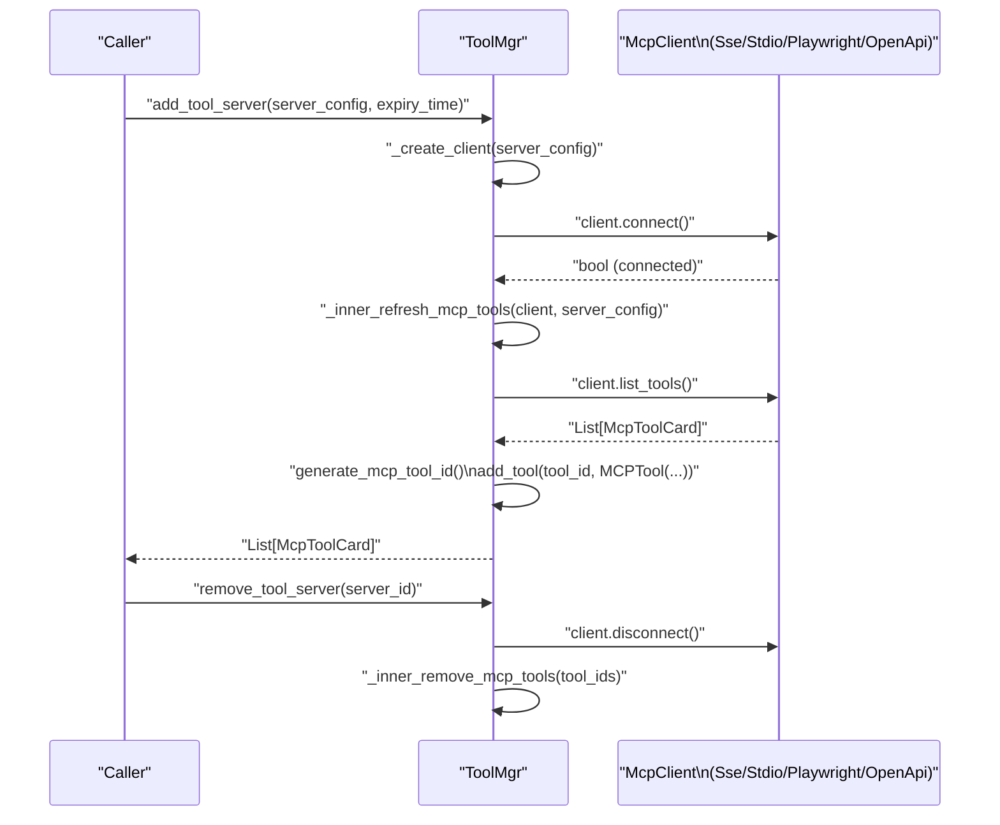
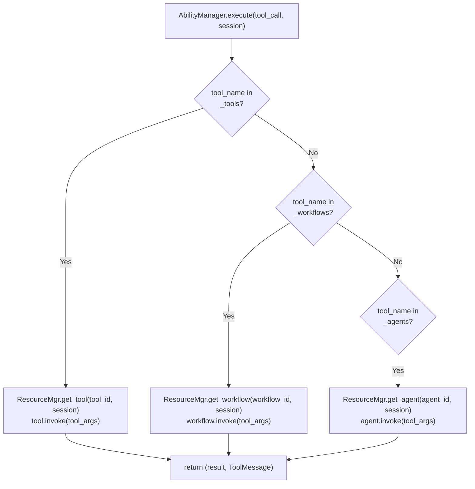
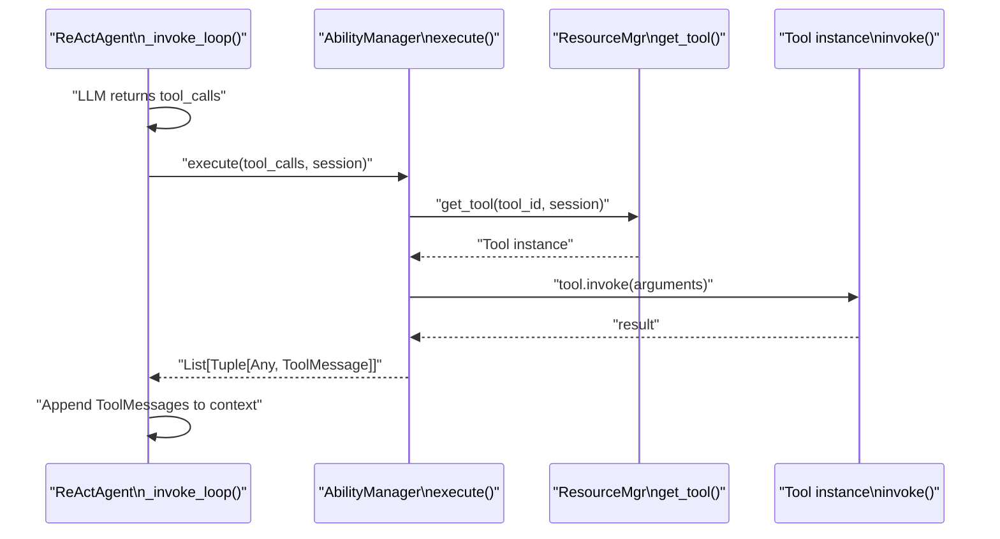

<!-- source: DeepWiki mcp.deepwiki.com · repo openJiuwen-ai/agent-core · page 8.1 Tool Management · fetched 2026-11-02 -->

# Tool Management

<details>
<summary>Relevant source files</summary>

The following files were used as context for generating this wiki page:

- [.gitignore](.gitignore)
- [Makefile](Makefile)
- [openjiuwen/core/common/exception/codes.py](openjiuwen/core/common/exception/codes.py)
- [openjiuwen/core/foundation/tool/mcp/client/openapi_client.py](openjiuwen/core/foundation/tool/mcp/client/openapi_client.py)
- [openjiuwen/core/memory/common/base.py](openjiuwen/core/memory/common/base.py)
- [openjiuwen/core/retrieval/__init__.py](openjiuwen/core/retrieval/__init__.py)
- [openjiuwen/core/runner/resources_manager/resource_manager.py](openjiuwen/core/runner/resources_manager/resource_manager.py)
- [openjiuwen/core/runner/resources_manager/tool_manager.py](openjiuwen/core/runner/resources_manager/tool_manager.py)
- [openjiuwen/core/single_agent/__init__.py](openjiuwen/core/single_agent/__init__.py)
- [openjiuwen/core/single_agent/ability_manager.py](openjiuwen/core/single_agent/ability_manager.py)
- [openjiuwen/core/single_agent/agent_callback_manager.py](openjiuwen/core/single_agent/agent_callback_manager.py)
- [openjiuwen/core/single_agent/agents/react_agent.py](openjiuwen/core/single_agent/agents/react_agent.py)
- [openjiuwen/core/single_agent/base.py](openjiuwen/core/single_agent/base.py)
- [openjiuwen/core/single_agent/rail/__init__.py](openjiuwen/core/single_agent/rail/__init__.py)
- [openjiuwen/core/single_agent/rail/base.py](openjiuwen/core/single_agent/rail/base.py)
- [openjiuwen/harness/deep_agent.py](openjiuwen/harness/deep_agent.py)
- [openjiuwen/harness/factory.py](openjiuwen/harness/factory.py)
- [openjiuwen/harness/prompts/sections/skills.py](openjiuwen/harness/prompts/sections/skills.py)
- [openjiuwen/harness/rails/skills/skill_use_rail.py](openjiuwen/harness/rails/skills/skill_use_rail.py)
- [openjiuwen/harness/rails/subagent/verification_rail.py](openjiuwen/harness/rails/subagent/verification_rail.py)
- [openjiuwen/harness/rails/sys_operation_rail.py](openjiuwen/harness/rails/sys_operation_rail.py)
- [openjiuwen/harness/schema/config.py](openjiuwen/harness/schema/config.py)
- [openjiuwen/harness/tools/worktree/rails.py](openjiuwen/harness/tools/worktree/rails.py)
- [pyproject.toml](pyproject.toml)
- [tests/system_tests/rail/test_force_finish_rail.py](tests/system_tests/rail/test_force_finish_rail.py)
- [tests/system_tests/runner/test_runner.py](tests/system_tests/runner/test_runner.py)
- [tests/system_tests/tune/test_prompt_tune.py](tests/system_tests/tune/test_prompt_tune.py)
- [tests/system_tests/workflow/test_real_workflow.py](tests/system_tests/workflow/test_real_workflow.py)
- [tests/test_logger.py](tests/test_logger.py)
- [tests/unit_tests/agent/react_agent/test_new_react_agent_mock.py](tests/unit_tests/agent/react_agent/test_new_react_agent_mock.py)
- [tests/unit_tests/agent_teams/observability/test_team_observability_mock_llm.py](tests/unit_tests/agent_teams/observability/test_team_observability_mock_llm.py)
- [tests/unit_tests/core/context_engine/conftest.py](tests/unit_tests/core/context_engine/conftest.py)
- [tests/unit_tests/core/single_agent/rail/test_rail.py](tests/unit_tests/core/single_agent/rail/test_rail.py)
- [tests/unit_tests/core/single_agent/rail/test_rail_init_timing.py](tests/unit_tests/core/single_agent/rail/test_rail_init_timing.py)
- [tests/unit_tests/harness/test_deep_agent.py](tests/unit_tests/harness/test_deep_agent.py)
- [tests/unit_tests/harness/test_filesystem_rail.py](tests/unit_tests/harness/test_filesystem_rail.py)
- [tests/unit_tests/harness/test_skill_rail.py](tests/unit_tests/harness/test_skill_rail.py)
- [uv.lock](uv.lock)

</details>


This page covers the internals of how tools are registered, scoped, and executed within the agent-core SDK. It focuses on two distinct but complementary classes: `ToolMgr` (the process-wide resource store at the `Runner` level) and `AbilityManager` (the per-agent metadata index).

---

## Conceptual Split: Instances vs. Cards

The tool system separates two concerns:

| Layer | Class | Location | Holds |
|---|---|---|---|
| Resource registry | `ToolMgr` | [openjiuwen/core/runner/resources_manager/tool_manager.py:36-37]() | Live `Tool` instances, keyed by `tool_id` |
| Agent ability index | `AbilityManager` | [openjiuwen/core/single_agent/ability_manager.py:87-111]() | Metadata cards (`ToolCard`, `WorkflowCard`, `AgentCard`, `McpServerConfig`) |

When an agent executes a tool call, `AbilityManager` looks up the card by name and retrieves the live instance from `ResourceMgr` (which wraps `ToolMgr`). This ensures that tool instances are shared across the process while each agent maintains its own visible capability set.

**Architecture Overview**



Sources: [openjiuwen/core/runner/resources_manager/resource_manager.py:68-76](), [openjiuwen/core/single_agent/ability_manager.py:102-111](), [openjiuwen/core/single_agent/agents/react_agent.py:230-240]()

---

## ToolMgr

`ToolMgr` is instantiated inside the `ResourceMgr` and is the authoritative store for all live `Tool` instances.

### Internal State

```python
self._tools: dict[str, Tool]                         # tool_id → Tool instance
self._mcp_server_name_to_ids: dict[str, list[str]]   # server_name → [server_id]
self._mcp_server_resources: dict[str, McpServerResource]  # server_id → resource
self._sys_op_resources: dict[str, SysOpToolResource] # sys_op_id → resource
```

Sources: [openjiuwen/core/runner/resources_manager/tool_manager.py:38-41]()

### Adding and Removing Plain Tools

| Method | Behavior |
|---|---|
| `add_tool(tool_id, tool)` | Registers a `Tool` instance; raises `ValueError` if `tool_id` already exists [openjiuwen/core/runner/resources_manager/tool_manager.py:43-46]() |
| `get_tool(tool_id, session)` | Returns the tool wrapped with `decorate_tool_with_trace(tool, session)` [openjiuwen/core/runner/resources_manager/tool_manager.py:48-50]() |
| `remove_tool(tool_id)` | Removes and returns the tool, or `None` [openjiuwen/core/runner/resources_manager/tool_manager.py:79-80]() |

### MCP Server Lifecycle

**Tool ID format:** `ToolMgr.generate_mcp_tool_id` produces `"{server_id}.{server_name}.{tool_name}"` as the canonical key for every MCP-sourced tool [openjiuwen/core/runner/resources_manager/tool_manager.py:82-84]().

**MCP Server Lifecycle**



Sources: [openjiuwen/core/runner/resources_manager/tool_manager.py:86-102](), [openjiuwen/core/runner/resources_manager/tool_manager.py:131-150](), [openjiuwen/core/runner/resources_manager/tool_manager.py:193-210]()

#### `McpServerConfig` Fields

`McpServerConfig` is defined in [openjiuwen/core/foundation/tool/mcp/base.py](). It contains:

| Field | Type | Description |
|---|---|---|
| `server_id` | `str` | Unique identifier for the server instance |
| `server_name` | `str` | Human-readable name used in tool ID generation |
| `client_type` | `str` | `"sse"`, `"stdio"`, `"playwright"`, `"openapi"`, or `"streamable-http"` |
| `server_path` | `str` | URL (SSE/OpenAPI) or command (stdio) |
| `auth_headers` | `Dict[str, str]` | HTTP headers injected at auth time |

Sources: [openjiuwen/core/single_agent/ability_manager.py:23]()

---

## AbilityManager

`AbilityManager` is instantiated once per agent (inside `BaseAgent` [openjiuwen/core/single_agent/base.py:107]()). It stores metadata cards; live instances are fetched from `ResourceMgr` at execution time.

### Ability Type

```python
Ability = Union[ToolCard, WorkflowCard, AgentCard, McpServerConfig]
```

Sources: [openjiuwen/core/single_agent/ability_manager.py:40]()

### Add and Remove

`add(ability)` dispatches on type and inserts the card into the matching dictionary [openjiuwen/core/single_agent/ability_manager.py:191-235]():

| Ability type | Stored in |
|---|---|
| `ToolCard` | `self._tools[card.name]` |
| `WorkflowCard` | `self._workflows[card.name]` |
| `AgentCard` | `self._agents[card.name]` |
| `McpServerConfig` | `self._mcp_servers[config.server_name]` |

`remove(name)` searches each dict in order and pops the first match [openjiuwen/core/single_agent/ability_manager.py:244-258]().

### execute — Dispatching Tool Calls

`execute(tool_call, session)` accepts a single `ToolCall` or a list and runs them concurrently [openjiuwen/core/single_agent/ability_manager.py:334-365](). It handles `ToolInterruptException` for Human-in-the-loop (HITL) scenarios [openjiuwen/core/single_agent/ability_manager.py:355]().

**Tool Call Dispatch**



Sources: [openjiuwen/core/single_agent/ability_manager.py:334-428]()

---

## Tag-Based Scoping and Per-Agent Isolation

Resources in the `ResourceMgr` can be tagged to provide isolation. When a `ReActAgent` is initialized, it uses its `AgentCard.id` as a default context for resource lookup.

The `ResourceMgr` uses a `TagMgr` to filter resources [openjiuwen/core/runner/resources_manager/resource_manager.py:75](). When `add_agent_team` or other add methods are called, tags are validated and associated with the resource [openjiuwen/core/runner/resources_manager/resource_manager.py:126-132]().

---

## Tool Execution Flow in ReActAgent

The `ReActAgent` loop handles tool calls by delegating to its `AbilityManager`.

**ReActAgent Tool Loop**



Sources: [openjiuwen/core/single_agent/agents/react_agent.py:463-510](), [openjiuwen/core/single_agent/ability_manager.py:334-365](), [openjiuwen/core/runner/resources_manager/resource_manager.py:97-103]()

---

## Summary of Key Classes and Their Files

| Class | File | Role |
|---|---|---|
| `ToolMgr` | [openjiuwen/core/runner/resources_manager/tool_manager.py:36]() | Process-wide `Tool` instance store; manages MCP lifecycles. |
| `AbilityManager` | [openjiuwen/core/single_agent/ability_manager.py:87]() | Per-agent card registry; dispatches execution to `ResourceMgr`. |
| `ResourceMgr` | [openjiuwen/core/runner/resources_manager/resource_manager.py:68]() | Unified manager for agents, tools, and workflows with tag support. |
| `McpServerConfig` | [openjiuwen/core/foundation/tool/mcp/base.py:23]() | Configuration for MCP server connection and client type. |
| `ToolCard` | [openjiuwen/core/foundation/tool/base.py:22]() | Metadata descriptor for a single tool including schema. |
| `OpenApiClient` | [openjiuwen/core/foundation/tool/mcp/client/openapi_client.py:52]() | MCP client that translates OpenAPI specs into tools. |

---

