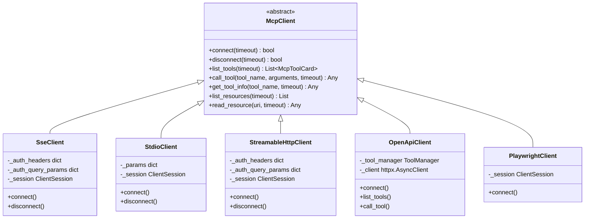
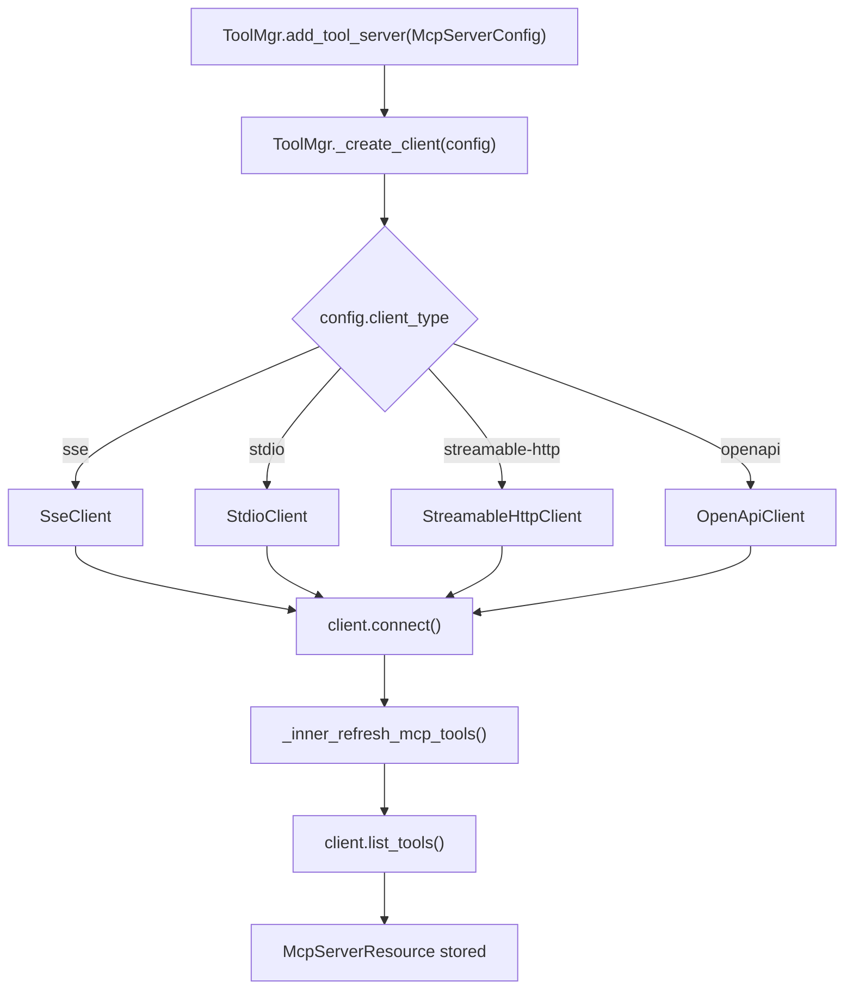

<!-- source: DeepWiki mcp.deepwiki.com · repo openJiuwen-ai/agent-core · page 8.2 MCP Clients · fetched 2026-11-02 -->

# MCP Clients

Relevant source files

The following files were used as context for generating this wiki page:

- [.gitignore](.gitignore)
- [Makefile](Makefile)
- [openjiuwen/core/common/exception/codes.py](openjiuwen/core/common/exception/codes.py)
- [openjiuwen/core/foundation/tool/__init__.py](openjiuwen/core/foundation/tool/__init__.py)
- [openjiuwen/core/foundation/tool/mcp/base.py](openjiuwen/core/foundation/tool/mcp/base.py)
- [openjiuwen/core/foundation/tool/mcp/client/mcp_client.py](openjiuwen/core/foundation/tool/mcp/client/mcp_client.py)
- [openjiuwen/core/foundation/tool/mcp/client/openapi_client.py](openjiuwen/core/foundation/tool/mcp/client/openapi_client.py)
- [openjiuwen/core/foundation/tool/mcp/client/playwright_client.py](openjiuwen/core/foundation/tool/mcp/client/playwright_client.py)
- [openjiuwen/core/foundation/tool/mcp/client/sse_client.py](openjiuwen/core/foundation/tool/mcp/client/sse_client.py)
- [openjiuwen/core/foundation/tool/mcp/client/stdio_client.py](openjiuwen/core/foundation/tool/mcp/client/stdio_client.py)
- [openjiuwen/core/foundation/tool/mcp/client/streamable_http_client.py](openjiuwen/core/foundation/tool/mcp/client/streamable_http_client.py)
- [openjiuwen/core/memory/common/base.py](openjiuwen/core/memory/common/base.py)
- [openjiuwen/core/retrieval/__init__.py](openjiuwen/core/retrieval/__init__.py)
- [openjiuwen/core/runner/resources_manager/resource_manager.py](openjiuwen/core/runner/resources_manager/resource_manager.py)
- [openjiuwen/core/runner/resources_manager/tool_manager.py](openjiuwen/core/runner/resources_manager/tool_manager.py)
- [openjiuwen/core/single_agent/__init__.py](openjiuwen/core/single_agent/__init__.py)
- [pyproject.toml](pyproject.toml)
- [tests/system_tests/runner/test_runner.py](tests/system_tests/runner/test_runner.py)
- [tests/system_tests/tune/test_prompt_tune.py](tests/system_tests/tune/test_prompt_tune.py)
- [tests/system_tests/workflow/test_real_workflow.py](tests/system_tests/workflow/test_real_workflow.py)
- [tests/test_logger.py](tests/test_logger.py)
- [tests/unit_tests/agent/react_agent/test_multimodal_tool_results.py](tests/unit_tests/agent/react_agent/test_multimodal_tool_results.py)
- [tests/unit_tests/agent_teams/observability/test_team_observability_mock_llm.py](tests/unit_tests/agent_teams/observability/test_team_observability_mock_llm.py)
- [tests/unit_tests/core/context_engine/conftest.py](tests/unit_tests/core/context_engine/conftest.py)
- [tests/unit_tests/core/foundation/tool/test_streamable_http_client.py](tests/unit_tests/core/foundation/tool/test_streamable_http_client.py)
- [uv.lock](uv.lock)

This page documents the MCP client implementations used to connect agents to external tool servers via the Model Context Protocol (MCP). It covers the common `McpClient` interface, the concrete transport clients (`SseClient`, `StdioClient`, `PlaywrightClient`, `OpenApiClient`, `StreamableHttpClient`), their lifecycle methods, and how `ToolMgr` selects and manages them.

---

## Architecture Overview

All MCP clients share a common abstract base class and a standardized interface. `ToolMgr` acts as the factory and lifecycle manager, selecting the appropriate client based on the `client_type` field in `McpServerConfig`.

**MCP Client Class Hierarchy**

Sources: [openjiuwen/core/foundation/tool/mcp/client/mcp_client.py:10-44](), [openjiuwen/core/foundation/tool/mcp/client/sse_client.py:16-25](), [openjiuwen/core/foundation/tool/mcp/client/stdio_client.py:13-15](), [openjiuwen/core/foundation/tool/mcp/client/streamable_http_client.py:16-18](), [openjiuwen/core/foundation/tool/mcp/client/openapi_client.py:52-74](), [openjiuwen/core/foundation/tool/mcp/client/playwright_client.py:13-15]()

---

## Client Selection and Lifecycle

`ToolMgr._create_client()` is the factory method that instantiates the correct client based on `McpServerConfig.client_type` [openjiuwen/core/runner/resources_manager/tool_manager.py:138-148]().

**Transport Type to Client Class Mapping**

| `client_type` value | Client class | Transport |
|---|---|---|
| `"sse"` | `SseClient` | HTTP/SSE |
| `"stdio"` | `StdioClient` | subprocess stdin/stdout |
| `"streamable-http"` | `StreamableHttpClient` | Streamable HTTP |
| `"playwright"` | `PlaywrightClient` | SSE or stdio (auto-detected) |
| `"openapi"` | `OpenApiClient` | HTTP (direct routing from spec) |

Sources: [openjiuwen/core/runner/resources_manager/tool_manager.py:138-148](), [openjiuwen/core/foundation/tool/__init__.py:10-15]()

**Client Registration Flow**

Sources: [openjiuwen/core/runner/resources_manager/tool_manager.py:104-136](), [openjiuwen/core/runner/resources_manager/tool_manager.py:138-148]()

---

## Concrete Implementations

### SseClient and StreamableHttpClient
Both clients use HTTP-based transports and support authentication via a callback framework.
- **Owner Task Pattern**: `SseClient` uses an internal `_owner_loop` and `_cmd_queue` to ensure lifecycle operations like `connect` and `disconnect` run on a dedicated task, satisfying anyio cancel-scope invariants [openjiuwen/core/foundation/tool/mcp/client/sse_client.py:19-25](), [openjiuwen/core/foundation/tool/mcp/client/sse_client.py:83-105]().
- **Authentication**: They trigger `ToolCallEvents.TOOL_AUTH` to obtain credentials or an `auth_provider` [openjiuwen/core/foundation/tool/mcp/client/sse_client.py:129-141]().
- **Lifecycle**: `_do_connect()` initializes a `ClientSession` on top of the SSE transport [openjiuwen/core/foundation/tool/mcp/client/sse_client.py:117-156]().
- **Tool Result**: They use `extract_mcp_tool_result_content` to parse the MCP response into a format the SDK can consume [openjiuwen/core/foundation/tool/mcp/base.py:29-103]().

### StdioClient
Used for local tools running as subprocesses.
- **Parameters**: Communicates with local binaries via standard input and output.
- **Transport**: Communicates via the `stdio_client` context manager from the underlying `mcp` library.

### OpenApiClient
`OpenApiClient` is unique as it does not use the MCP wire protocol. It parses OpenAPI specs (JSON/YAML) and converts them into tools [openjiuwen/core/foundation/tool/mcp/client/openapi_client.py:52-74]().
- **Parsing**: Loads specs from `server_path` and uses `parse_openapi_to_http_routes` to generate routes [openjiuwen/core/foundation/tool/mcp/client/openapi_client.py:157-185]().
- **Execution**: Uses a `ToolManager` to map tool names to `OpenAPITool` instances, executing them via `httpx.AsyncClient` [openjiuwen/core/foundation/tool/mcp/client/openapi_client.py:26-50]().

### PlaywrightClient
A specialized client for browser automation. It auto-detects the transport:
- Uses `stdio_client` for local playwright instances.
- Uses `sse_client` if the server path is a URL.

---

## Core Interface Methods

Every `McpClient` must implement the following interface defined in `McpClient` [openjiuwen/core/foundation/tool/mcp/client/mcp_client.py:10-44]():

| Method | Signature | Description |
|---|---|---|
| `connect` | `async connect(*, timeout) -> bool` | Establishes the connection to the MCP server [openjiuwen/core/foundation/tool/mcp/client/mcp_client.py:18](). |
| `disconnect` | `async disconnect(*, timeout) -> bool` | Closes the connection and releases resources [openjiuwen/core/foundation/tool/mcp/client/mcp_client.py:22](). |
| `list_tools` | `async list_tools(*, timeout) -> List[McpToolCard]` | Returns a list of tools provided by the server [openjiuwen/core/foundation/tool/mcp/client/mcp_client.py:26](). |
| `call_tool` | `async call_tool(tool_name, arguments, *, timeout) -> Any` | Executes a specific tool with the given arguments [openjiuwen/core/foundation/tool/mcp/client/mcp_client.py:30](). |
| `get_tool_info` | `async get_tool_info(tool_name, *, timeout) -> Optional[Any]` | Retrieves metadata for a specific tool [openjiuwen/core/foundation/tool/mcp/client/mcp_client.py:34](). |

Sources: [openjiuwen/core/foundation/tool/mcp/client/mcp_client.py:10-44](), [openjiuwen/core/foundation/tool/mcp/client/sse_client.py:107-116](), [openjiuwen/core/foundation/tool/mcp/client/openapi_client.py:157-185](), [openjiuwen/core/foundation/tool/mcp/client/openapi_client.py:191-203]()

---

