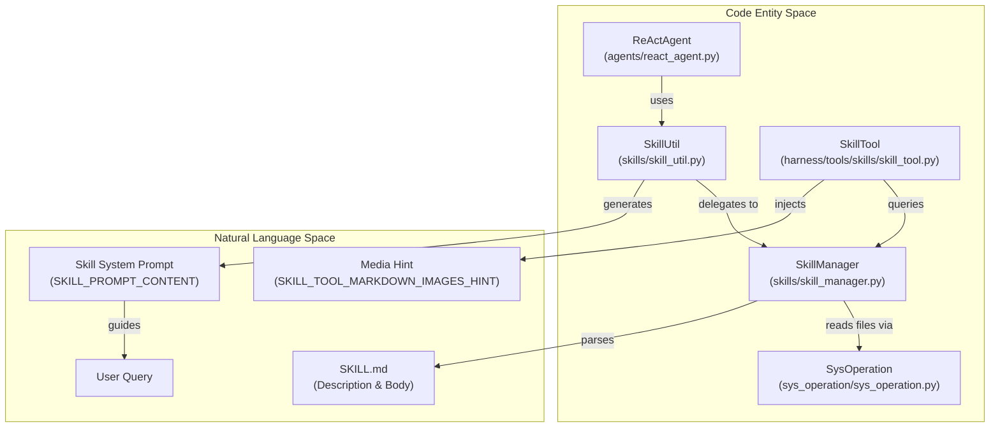
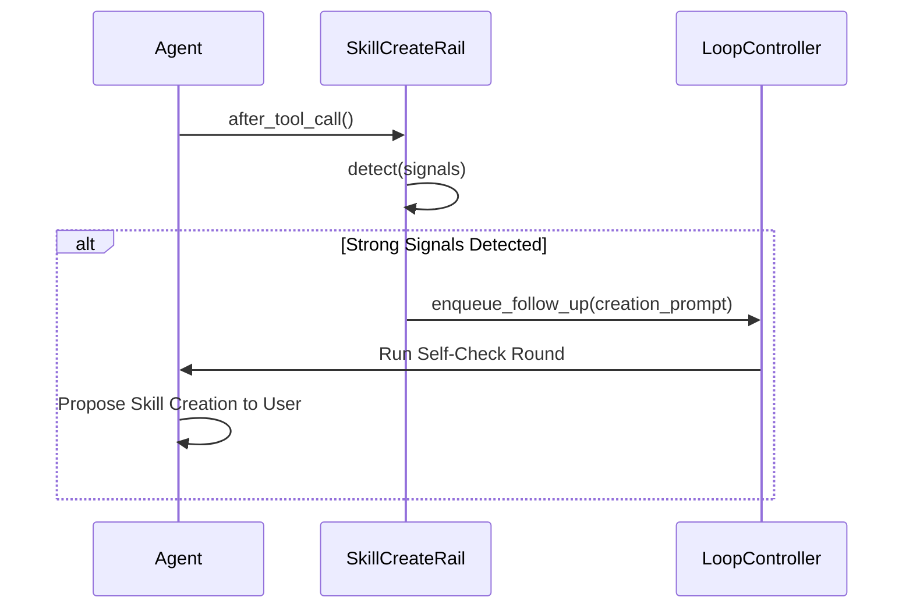

<!-- source: DeepWiki mcp.deepwiki.com · repo openJiuwen-ai/agent-core · page 8.3 Skills · fetched 2026-11-02 -->

# Skills

<details>
<summary>Relevant source files</summary>

The following files were used as context for generating this wiki page:

- [examples/skill_use/multimodal_skill_use.py](examples/skill_use/multimodal_skill_use.py)
- [examples/skill_use/skill_use.py](examples/skill_use/skill_use.py)
- [openjiuwen/core/single_agent/skills/__init__.py](openjiuwen/core/single_agent/skills/__init__.py)
- [openjiuwen/core/single_agent/skills/skill_manager.py](openjiuwen/core/single_agent/skills/skill_manager.py)
- [openjiuwen/core/single_agent/skills/skill_util.py](openjiuwen/core/single_agent/skills/skill_util.py)
- [openjiuwen/harness/prompts/tools/skill_tool.py](openjiuwen/harness/prompts/tools/skill_tool.py)
- [openjiuwen/harness/rails/skills/skill_create_rail.py](openjiuwen/harness/rails/skills/skill_create_rail.py)
- [openjiuwen/harness/rails/skills/team_skill_create_rail.py](openjiuwen/harness/rails/skills/team_skill_create_rail.py)
- [openjiuwen/harness/tools/skills/list_skill.py](openjiuwen/harness/tools/skills/list_skill.py)
- [openjiuwen/harness/tools/skills/markdown_media.py](openjiuwen/harness/tools/skills/markdown_media.py)
- [openjiuwen/harness/tools/skills/skill_tool.py](openjiuwen/harness/tools/skills/skill_tool.py)
- [tests/system_tests/agent/skill/test_skill_real_system.py](tests/system_tests/agent/skill/test_skill_real_system.py)
- [tests/system_tests/harness/rail/test_team_skill_rails_system.py](tests/system_tests/harness/rail/test_team_skill_rails_system.py)
- [tests/unit_tests/agent/skill/test_skill_remote.py](tests/unit_tests/agent/skill/test_skill_remote.py)
- [tests/unit_tests/agent/skill/test_skill_system_mock.py](tests/unit_tests/agent/skill/test_skill_system_mock.py)
- [tests/unit_tests/harness/test_skill_create_rail.py](tests/unit_tests/harness/test_skill_create_rail.py)
- [tests/unit_tests/harness/test_team_skill_create_rail.py](tests/unit_tests/harness/test_team_skill_create_rail.py)
- [tests/unit_tests/harness/tools/test_skill_tool.py](tests/unit_tests/harness/tools/test_skill_tool.py)

</details>


This page documents the skills framework: how skills are defined, structured, registered, and loaded by agents. It covers the `SkillManager`, `SkillUtil`, the `SkillTool` for interactive skill exploration, and the evolution rails that suggest skill creation during agent execution.

---

## What Are Skills?

A **skill** is a directory of structured documentation and resources that extends an agent's capabilities in a specific domain. Unlike tool-calling via JSON schemas, skills provide the agent with written instructions and reference materials that are injected into its context.

Skills follow a **progressive disclosure** pattern to minimize context usage:
1. **Metadata**: Only the skill's name and description are always present in the system prompt. [openjiuwen/core/single_agent/skills/skill_util.py:104-111]()
2. **On-Demand Loading**: The agent is instructed to use the `read_file` tool or the specialized `skill_tool` to access the full `SKILL.md` body and any referenced files only when it determines the skill is relevant to the task. [openjiuwen/core/single_agent/skills/skill_util.py:101-103]()

Sources: [openjiuwen/core/single_agent/skills/skill_util.py:12-17](), [openjiuwen/core/single_agent/skills/skill_util.py:99-113]()

---

## Skill Directory Structure

Every skill is a directory containing a required `SKILL.md` file.

```text
skill-name/
├── SKILL.md          # Required. Frontmatter + instructions.
├── scripts/          # Optional. Executable code.
├── references/       # Optional. Supplementary documentation.
└── assets/           # Optional. Templates or static files.
```

### `SKILL.md` Format
`SKILL.md` uses YAML frontmatter followed by a Markdown body. The `SkillManager` specifically parses the `description` field to inform the agent of the skill's purpose. [openjiuwen/core/single_agent/skills/skill_manager.py:97-100]()

```markdown
---
name: skill_name
description: Trigger description for the LLM.
kind: team-skill  # Optional: used by TeamSkillRail
---

# Skill Instructions
Detailed workflow for the agent to follow...
```

Sources: [openjiuwen/core/single_agent/skills/skill_manager.py:78-81](), [openjiuwen/core/single_agent/skills/skill_manager.py:112-116]()

---

## Architecture and Data Flow

The skill system bridges natural language instructions with code entities by using the `SkillManager` to scan the filesystem and the `SkillUtil` to format these into agent prompts.

**Skill System Component Map:**



Sources: [openjiuwen/core/single_agent/skills/skill_util.py:20-34](), [openjiuwen/core/single_agent/skills/skill_manager.py:39-57](), [openjiuwen/harness/tools/skills/skill_tool.py:31-48]()

---

## The SkillTool

The `SkillTool` provides a specialized interface for agents to explore and consume skills. Unlike generic `read_file` calls, it provides structured metadata about the skill's internal structure.

### Key Features
*   **ASCII Tree Generation**: Automatically builds a directory tree of the skill root to help the agent navigate sub-files. [openjiuwen/harness/tools/skills/skill_tool.py:164-195]()
*   **Media Handling**: Detects images and videos in the skill content and injects specific "hints" to the agent on how to consume them (e.g., using `visual_question_answering`). [openjiuwen/harness/tools/skills/skill_tool.py:31-48](), [openjiuwen/harness/tools/skills/skill_tool.py:68-86]()
*   **Nested Skill Discovery**: Automatically identifies subdirectories that contain their own `SKILL.md` and reports them as `discovered_skill_names`. [openjiuwen/harness/tools/skills/skill_tool.py:198-220]()

### Multimodal Modes
The tool supports different `multimodal_skill_mode` settings:
*   **`hint`**: Injects text reminders about how to handle media links. [openjiuwen/harness/tools/skills/skill_tool.py:68-86]()
*   **`branch`**: Optimized for video consumption where the agent should not read large binary data in the main loop. [openjiuwen/harness/tools/skills/skill_tool.py:44-48]()

Sources: [openjiuwen/harness/tools/skills/skill_tool.py:10-48](), [openjiuwen/harness/prompts/tools/skill_tool.py:12-26]()

---

## Skill Evolution Rails

The framework includes rails that monitor agent performance and suggest when new skills should be "captured" or "evolved."

### SkillCreateRail
Monitors single-agent execution. If the agent performs complex tool-calling sequences or achieves a significant milestone, this rail enqueues a "follow-up" task for the agent to self-reflect on whether a new skill should be created. [openjiuwen/harness/rails/skills/skill_create_rail.py:48-53](), [openjiuwen/harness/rails/skills/skill_create_rail.py:106-136]()

### TeamSkillCreateRail
Specifically designed for multi-agent collaboration. It triggers when a team collaboration threshold is met (e.g., `spawn_member` is called multiple times). [openjiuwen/harness/rails/skills/team_skill_create_rail.py:46-51](), [openjiuwen/harness/rails/skills/team_skill_create_rail.py:124-149]()

**Evolution Flow:**


Sources: [openjiuwen/harness/rails/skills/skill_create_rail.py:102-136](), [openjiuwen/harness/rails/skills/team_skill_create_rail.py:98-123]()

---

## Registering Skills

### Local Registration
The `SkillManager` scans directories for `SKILL.md`. It can handle single paths or lists of paths. [openjiuwen/core/single_agent/skills/skill_manager.py:159-176]()

```python
# Registration logic
await skill_manager.register(Path("/path/to/skills"), overwrite=True)
```

### Remote Registration
Remote skills are fetched from GitHub using `GitHubTree` configurations. The `RemoteSkillUtil` handles downloading the files and placing them in a local directory before the `SkillManager` registers them. [openjiuwen/core/single_agent/skills/skill_util.py:77-82]()

Sources: [openjiuwen/core/single_agent/skills/skill_manager.py:159-185](), [openjiuwen/core/single_agent/skills/skill_util.py:77-82]()

---

## Key Class Reference

| Class | File Path | Responsibility |
|---|---|---|
| `Skill` | `openjiuwen/core/single_agent/skills/skill_manager.py` | Data model for a skill (name, description, path). |
| `SkillManager` | `openjiuwen/core/single_agent/skills/skill_manager.py` | Registry for local skills; handles YAML parsing and scanning. |
| `SkillUtil` | `openjiuwen/core/single_agent/skills/skill_util.py` | High-level facade for agents to register and prompt skills. |
| `SkillTool` | `openjiuwen/harness/tools/skills/skill_tool.py` | Tool for agents to read and explore skill directories. |
| `SkillCreateRail` | `openjiuwen/harness/rails/skills/skill_create_rail.py` | Triggers skill creation suggestions based on execution signals. |

Sources: [openjiuwen/core/single_agent/skills/skill_manager.py:11-38](), [openjiuwen/core/single_agent/skills/skill_util.py:20-34](), [openjiuwen/harness/rails/skills/skill_create_rail.py:48-53]()

---

