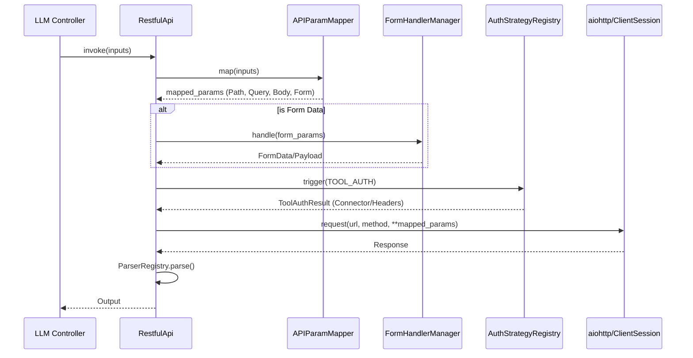

<!-- source: DeepWiki mcp.deepwiki.com · repo openJiuwen-ai/agent-core · page 8.4 RESTful API and Function Tools · fetched 2026-11-02 -->

# RESTful API and Function Tools

<details>
<summary>Relevant source files</summary>

The following files were used as context for generating this wiki page:

- [docs/en/2.Development Guide/API Docs/openjiuwen.core/foundation/tool.README.md](docs/en/2.Development Guide/API Docs/openjiuwen.core/foundation/tool.README.md)
- [docs/en/2.Development Guide/API Docs/openjiuwen.core/foundation/tool/form_handler/form_handler.md](docs/en/2.Development Guide/API Docs/openjiuwen.core/foundation/tool/form_handler/form_handler.md)
- [docs/en/2.Development Guide/API Docs/openjiuwen.core/foundation/tool/tool.md](docs/en/2.Development Guide/API Docs/openjiuwen.core/foundation/tool/tool.md)
- [openjiuwen/core/common/utils/schema_utils.py](openjiuwen/core/common/utils/schema_utils.py)
- [openjiuwen/core/foundation/tool/base.py](openjiuwen/core/foundation/tool/base.py)
- [openjiuwen/core/foundation/tool/form_handler/__init__.py](openjiuwen/core/foundation/tool/form_handler/__init__.py)
- [openjiuwen/core/foundation/tool/form_handler/form_handler_manager.py](openjiuwen/core/foundation/tool/form_handler/form_handler_manager.py)
- [openjiuwen/core/foundation/tool/function/function.py](openjiuwen/core/foundation/tool/function/function.py)
- [openjiuwen/core/foundation/tool/schema.py](openjiuwen/core/foundation/tool/schema.py)
- [openjiuwen/core/foundation/tool/service_api/api_param_mapper.py](openjiuwen/core/foundation/tool/service_api/api_param_mapper.py)
- [openjiuwen/core/foundation/tool/service_api/response_parser.py](openjiuwen/core/foundation/tool/service_api/response_parser.py)
- [openjiuwen/core/foundation/tool/service_api/restful_api.py](openjiuwen/core/foundation/tool/service_api/restful_api.py)
- [openjiuwen/core/foundation/tool/utils/callable_schema_extractor.py](openjiuwen/core/foundation/tool/utils/callable_schema_extractor.py)
- [openjiuwen/core/foundation/tool/utils/type_schema_extractor.py](openjiuwen/core/foundation/tool/utils/type_schema_extractor.py)
- [openjiuwen/harness/prompts/tools/__init__.py](openjiuwen/harness/prompts/tools/__init__.py)
- [openjiuwen/harness/prompts/tools/base.py](openjiuwen/harness/prompts/tools/base.py)
- [openjiuwen/harness/rails/tool_call_resilience_rail.py](openjiuwen/harness/rails/tool_call_resilience_rail.py)
- [tests/unit_tests/core/common/utils/test_schema_utils.py](tests/unit_tests/core/common/utils/test_schema_utils.py)
- [tests/unit_tests/core/foundation/tool/test_api_param_mapper.py](tests/unit_tests/core/foundation/tool/test_api_param_mapper.py)
- [tests/unit_tests/core/foundation/tool/test_response_parser.py](tests/unit_tests/core/foundation/tool/test_response_parser.py)
- [tests/unit_tests/core/foundation/tool/test_restfulapi.py](tests/unit_tests/core/foundation/tool/test_restfulapi.py)
- [tests/unit_tests/core/foundation/tool/test_tool_decorator.py](tests/unit_tests/core/foundation/tool/test_tool_decorator.py)

</details>


This page documents the tool integration layer of the openjiuwen agent-core SDK, specifically focusing on the mechanisms for executing RESTful APIs and Python functions as LLM-callable tools. It covers the schema extraction utilities, parameter mapping logic, authentication callbacks, form handling, and response parsing infrastructure.

## 1. Tool Execution Framework

The SDK provides a unified `Tool` interface for both local functions and remote services. Tools are defined by a `ToolCard` which contains the metadata and schema required for LLM tool-calling.

### Core Tool Hierarchy
The following diagram illustrates how natural language tool descriptions are mapped to code entities and executed.

**Tool Entity Mapping**
```mermaid
graph TD
    subgraph "Natural Language Space"
        NL_TOOL["LLM Tool Definition (Name, Desc, Schema)"]
    end

    subgraph "Code Entity Space"
        TC["ToolCard (base.py)"]
        T["Tool (base.py)"]
        LF["LocalFunction (function.py)"]
        RA["RestfulApi (restful_api.py)"]
        SU["SchemaUtils (schema_utils.py)"]
        TM["_ToolMeta (base.py)"]
    end

    NL_TOOL -- "Defines" --> TC
    TC -- "Configures" --> T
    T <|-- LF
    T <|-- RA
    LF -- "Uses" --> SU
    RA -- "Uses" --> SU
    T -- "Lifecycle Managed by" --> TM
```
Sources: [openjiuwen/core/foundation/tool/base.py:20-53](), [openjiuwen/core/foundation/tool/base.py:139-160](), [openjiuwen/core/foundation/tool/function/function.py:48-50](), [openjiuwen/core/foundation/tool/service_api/restful_api.py:112-117](), [openjiuwen/core/common/utils/schema_utils.py:14-21]()

## 2. Function Tools (@tool)

The `@tool` decorator is the primary interface for converting Python callables into `LocalFunction` instances. It supports automatic schema extraction from type hints and docstrings.

### Schema Extraction and Execution
When a function is decorated with `@tool`, the system:
1.  **Extracts Metadata**: Uses `CallableSchemaExtractor` and `TypeSchemaExtractor` to generate JSON Schema from function signatures [openjiuwen/core/foundation/tool/tool.py:162-187]().
2.  **Wraps Execution**: Handles both synchronous and asynchronous functions, as well as generators for streaming [openjiuwen/core/foundation/tool/function/function.py:65-110]().
3.  **Variadic Support**: The `support_args_param` utility allows LLMs to pass list-based arguments to functions using `*args` by mapping them to a specific parameter name in the input dictionary [openjiuwen/core/foundation/tool/function/function.py:15-45]().
4.  **Input Validation**: `LocalFunction.invoke` uses `SchemaUtils.format_with_schema` to validate and format raw inputs against the `ToolCard.input_params` before execution [openjiuwen/core/foundation/tool/function/function.py:65-78]().

Sources: [openjiuwen/core/foundation/tool/function/function.py:15-110](), [openjiuwen/core/foundation/tool/tool.py:162-187](), [openjiuwen/core/common/utils/schema_utils.py:24-43]()

## 3. RESTful API Tools

The `RestfulApi` class implements the OpenAPI-based HTTP tool. It uses `RestfulApiCard` for configuration, which includes the URL, HTTP method, and parameter locations.

### Parameter Mapping (ApiParamMapper)
The `APIParamMapper` is responsible for distributing LLM-provided inputs into the correct HTTP request segments: `query`, `path`, `body`, `header`, or `form` [openjiuwen/core/foundation/tool/service_api/api_param_mapper.py:20-25]().

| Location | Description | Code Constant |
| :--- | :--- | :--- |
| **Query** | URL parameters (e.g., `?id=123`) | `APIParamLocation.QUERY` |
| **Path** | URL placeholders (e.g., `/users/{id}`) | `APIParamLocation.PATH` |
| **Body** | JSON payload in the request body | `APIParamLocation.BODY` |
| **Header** | HTTP headers | `APIParamLocation.HEADER` |
| **Form** | Multipart or URL-encoded form data | `APIParamLocation.FORM` |

**RESTful Request Flow**

Sources: [openjiuwen/core/foundation/tool/service_api/restful_api.py:112-160](), [openjiuwen/core/foundation/tool/service_api/api_param_mapper.py:11-17](), [openjiuwen/core/foundation/tool/service_api/restful_api.py:220-250]()

## 4. Authentication and Security

Tool execution is protected by a callback-based authentication system.

### Auth Strategies
The `AuthStrategyRegistry` manages different authentication methods [openjiuwen/core/foundation/tool/auth/auth_callback.py:87-95]():
*   **SSLAuthStrategy**: Configures `aiohttp.TCPConnector` with custom certificates and verification settings [openjiuwen/core/foundation/tool/auth/auth_callback.py:33-63]().
*   **HeaderQueryAuthStrategy**: Injects static or dynamic credentials into HTTP headers or query strings via `AuthHeaderAndQueryProvider` [openjiuwen/core/foundation/tool/auth/auth_callback.py:66-84]().

### Security Utilities
*   **URL Validation**: `UrlUtils.check_url_is_valid` is used during `RestfulApiCard` initialization to prevent SSRF and invalid pathing [openjiuwen/core/foundation/tool/service_api/restful_api.py:51-60]().
*   **Path Param Validation**: `RestfulApiCard.model_post_init` validates that all `{param}` placeholders in the URL are defined in the schema with `location: path` [openjiuwen/core/foundation/tool/service_api/restful_api.py:62-101]().
*   **SSL Context**: `SslUtils` creates strict SSL contexts for secure communication [openjiuwen/core/foundation/tool/auth/auth_callback.py:48-50]().

Sources: [openjiuwen/core/foundation/tool/auth/auth_callback.py:19-119](), [openjiuwen/core/foundation/tool/service_api/restful_api.py:51-101]()

## 5. Response Parsing

The `ParserRegistry` handles the transformation of raw HTTP response bytes into structured Python objects.

### Supported Parsers
| Parser | Content-Type Patterns | Output Type |
| :--- | :--- | :--- |
| `JsonResponseParser` | `application/json`, `*+json`, `text/json`, `application/javascript` | `dict` |
| `TextResponseParser` | `text/plain`, `text/html`, `text/xml`, `application/xml` | `str` |

### Decompression
The system automatically handles compressed responses using:
*   **GzipDecompressor**: Supports `gzip` and `x-gzip` [openjiuwen/core/foundation/tool/service_api/response_parser.py:192-205]().
*   **DeflateDecompressor**: Supports `deflate` encoding [openjiuwen/core/foundation/tool/service_api/response_parser.py:212-225]().

Sources: [openjiuwen/core/foundation/tool/service_api/response_parser.py:62-106](), [openjiuwen/core/foundation/tool/service_api/response_parser.py:137-174](), [openjiuwen/core/foundation/tool/service_api/response_parser.py:192-225]()

## 6. Schema Utilities

The `SchemaUtils` class provides the foundation for data validation and formatting across all tool types.

*   **Bidirectional Conversion**: Converts between Pydantic `BaseModel` and JSON Schema dictionaries [openjiuwen/core/common/utils/schema_utils.py:144-178]().
*   **Data Formatting**: `format_with_schema` populates default values and ensures data types match the expected schema before tool execution [openjiuwen/core/common/utils/schema_utils.py:24-63]().
*   **Cleaning**: `remove_none_values` recursively strips `None` entries to prevent validation errors with strict schemas [openjiuwen/core/common/utils/schema_utils.py:66-113]().
*   **Alias Handling**: Correctly handles fields with leading underscores (e.g., `_id`) by creating sanitized aliases for Pydantic compatibility while preserving original names for serialization [openjiuwen/core/common/utils/schema_utils.py:212-230]().

Sources: [openjiuwen/core/common/utils/schema_utils.py:24-230]()

---

