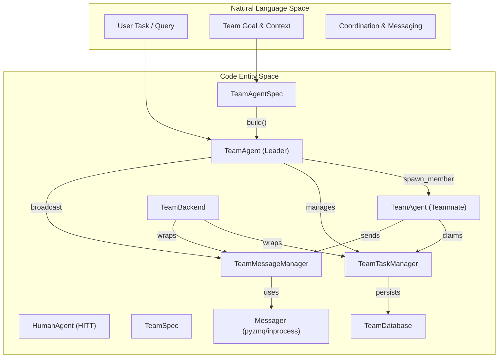
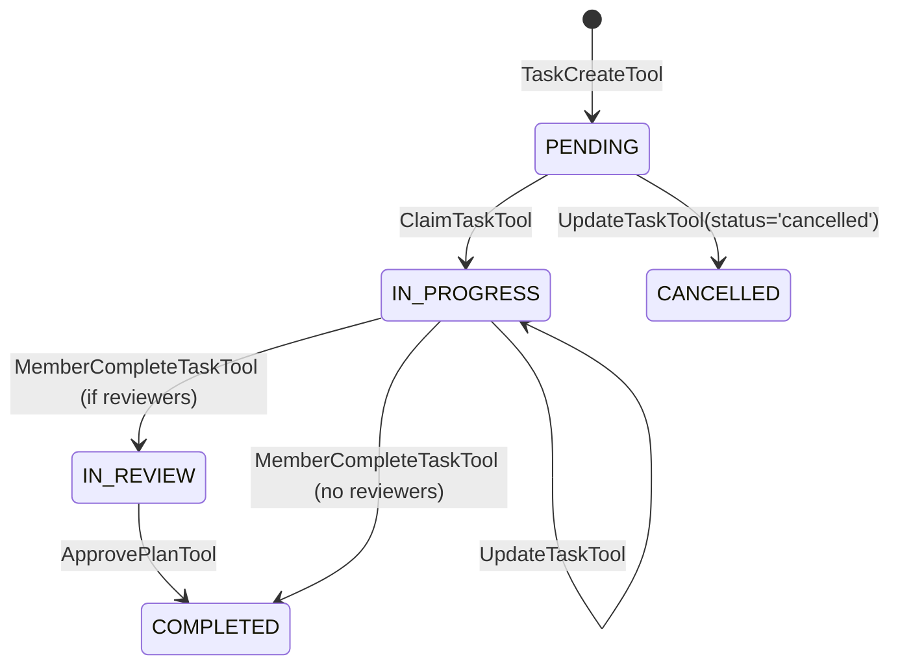

<!-- source: DeepWiki mcp.deepwiki.com · repo openJiuwen-ai/agent-core · page 9 Agent Teams · fetched 2026-11-02 -->

# Agent Teams

Relevant source files

The following files were used as context for generating this wiki page:

- [openjiuwen/agent_teams/agent/team_agent.py](openjiuwen/agent_teams/agent/team_agent.py)
- [openjiuwen/agent_teams/docs/features/F_22_external-cli-spawn-member-and-mcp-injection.md](openjiuwen/agent_teams/docs/features/F_22_external-cli-spawn-member-and-mcp-injection.md)
- [openjiuwen/agent_teams/external/cli_agent/session_cleanup.py](openjiuwen/agent_teams/external/cli_agent/session_cleanup.py)
- [openjiuwen/agent_teams/external/client.py](openjiuwen/agent_teams/external/client.py)
- [openjiuwen/agent_teams/external/descriptor.py](openjiuwen/agent_teams/external/descriptor.py)
- [openjiuwen/agent_teams/mcp/server.py](openjiuwen/agent_teams/mcp/server.py)
- [openjiuwen/agent_teams/schema/blueprint.py](openjiuwen/agent_teams/schema/blueprint.py)
- [openjiuwen/agent_teams/schema/team.py](openjiuwen/agent_teams/schema/team.py)
- [openjiuwen/agent_teams/tools/database/member_dao.py](openjiuwen/agent_teams/tools/database/member_dao.py)
- [openjiuwen/agent_teams/tools/locales/cn.py](openjiuwen/agent_teams/tools/locales/cn.py)
- [openjiuwen/agent_teams/tools/locales/descs/cn/send_message.md](openjiuwen/agent_teams/tools/locales/descs/cn/send_message.md)
- [openjiuwen/agent_teams/tools/locales/descs/en/send_message.md](openjiuwen/agent_teams/tools/locales/descs/en/send_message.md)
- [openjiuwen/agent_teams/tools/locales/en.py](openjiuwen/agent_teams/tools/locales/en.py)
- [openjiuwen/agent_teams/tools/member_options.py](openjiuwen/agent_teams/tools/member_options.py)
- [openjiuwen/agent_teams/tools/models.py](openjiuwen/agent_teams/tools/models.py)
- [openjiuwen/agent_teams/tools/team.py](openjiuwen/agent_teams/tools/team.py)
- [openjiuwen/agent_teams/tools/team_tools.py](openjiuwen/agent_teams/tools/team_tools.py)
- [openjiuwen/agent_teams/tools/tool_message.py](openjiuwen/agent_teams/tools/tool_message.py)
- [tests/system_tests/agent_swarm/agent_team_external_cli_e2e.py](tests/system_tests/agent_swarm/agent_team_external_cli_e2e.py)
- [tests/unit_tests/agent_teams/external/conftest.py](tests/unit_tests/agent_teams/external/conftest.py)
- [tests/unit_tests/agent_teams/external/test_cli.py](tests/unit_tests/agent_teams/external/test_cli.py)
- [tests/unit_tests/agent_teams/external/test_client.py](tests/unit_tests/agent_teams/external/test_client.py)
- [tests/unit_tests/agent_teams/external/test_descriptor.py](tests/unit_tests/agent_teams/external/test_descriptor.py)
- [tests/unit_tests/agent_teams/external/test_external_cli_spawn.py](tests/unit_tests/agent_teams/external/test_external_cli_spawn.py)
- [tests/unit_tests/agent_teams/external/test_mcp_server.py](tests/unit_tests/agent_teams/external/test_mcp_server.py)
- [tests/unit_tests/agent_teams/external/test_ssh_spawn.py](tests/unit_tests/agent_teams/external/test_ssh_spawn.py)
- [tests/unit_tests/agent_teams/test_database.py](tests/unit_tests/agent_teams/test_database.py)
- [tests/unit_tests/agent_teams/test_hitt.py](tests/unit_tests/agent_teams/test_hitt.py)
- [tests/unit_tests/agent_teams/test_policy.py](tests/unit_tests/agent_teams/test_policy.py)
- [tests/unit_tests/agent_teams/test_predefined_team.py](tests/unit_tests/agent_teams/test_predefined_team.py)
- [tests/unit_tests/agent_teams/test_team_agent.py](tests/unit_tests/agent_teams/test_team_agent.py)
- [tests/unit_tests/agent_teams/test_team_agent_coordination.py](tests/unit_tests/agent_teams/test_team_agent_coordination.py)
- [tests/unit_tests/agent_teams/test_team_agent_tools.py](tests/unit_tests/agent_teams/test_team_agent_tools.py)
- [tests/unit_tests/agent_teams/test_team_tools.py](tests/unit_tests/agent_teams/test_team_tools.py)
- [tests/unit_tests/agent_teams/tools/test_tool_message.py](tests/unit_tests/agent_teams/tools/test_tool_message.py)

The `agent_teams` package provides a multi-agent collaboration framework designed to solve complex tasks through coordinated work between a **Leader** and one or more **Teammates**. It extends the core agent capabilities with specialized coordination, task management, and communication layers.

## High-Level Overview

The framework follows a hierarchical structure where a `TeamAgent` can act as either a Leader or a Teammate [openjiuwen/agent_teams/agent/team_agent.py:62-68](). It uses composition to wrap an internal `DeepAgent` instance and delegates specific team behaviors to specialized managers for configuration, streaming, spawning, and session management [openjiuwen/agent_teams/agent/team_agent.py:75-98]().

### Team Roles and Collaboration Space

The team operates in a shared environment defined by a `TeamSpec` and a `TeamRuntimeContext` [openjiuwen/agent_teams/schema/team.py:42-50]().

| Role | Responsibility | Code Entity |
| :--- | :--- | :--- |
| **Leader** | Task decomposition, member lifecycle management, and user routing. | `TeamRole.LEADER` |
| **Teammate** | Domain-specific execution and reporting. | `TeamRole.TEAMMATE` |
| **Human (HITT)** | Human-in-the-Team collaborator for feedback and steering via an inbox. | `TeamRole.HUMAN_AGENT` |
| **Bridge** | Local teammate paired with a remote agent via pure-text protocols. | `TeamRole.BRIDGE_AGENT` |
| **Worker** | Single-shot, stateless member for Swarmflow execution. | `TeamRole.WORKER` |

Sources: [openjiuwen/agent_teams/schema/team.py:81-106](), [openjiuwen/agent_teams/agent/team_agent.py:62-68]()

### Conceptual Architecture: Natural Language to Code Entity

The following diagram bridges the high-level collaboration concepts to the underlying code entities.

**Team Architecture Mapping**

Sources: [openjiuwen/agent_teams/agent/team_agent.py:75-98](), [openjiuwen/agent_teams/schema/blueprint.py:159-200](), [openjiuwen/agent_teams/tools/team.py:85-122]()

---

## 9.1 TeamAgent and Blueprint

A team is declaratively defined using a `TeamAgentSpec`. This specification is JSON-serializable and can be materialized into a live `TeamAgent` instance.

- **Materialization Pipeline**: The `TeamAgentSpec` defines the `LeaderSpec`, `predefined_members`, and infrastructure requirements like `TransportSpec` and `StorageSpec` [openjiuwen/agent_teams/schema/blueprint.py:100-136]().
- **Model Allocation**: To avoid rate-limit contention, a `ModelAllocator` (e.g., `RoundRobinModelAllocator`) distributes LLM endpoints from a pool across team members [openjiuwen/agent_teams/schema/blueprint.py:35-39]().
- **Tiny Agents**: Teams can declare `TinyAgentSpec` entries for lightweight, specialized agents (e.g., for summarization) that are lazily built and cached on the team infrastructure [openjiuwen/agent_teams/agent/team_agent.py:143-164]().

For details, see [TeamAgent and Blueprint](#9.1).

Sources: [openjiuwen/agent_teams/schema/blueprint.py:159-200](), [openjiuwen/agent_teams/agent/team_agent.py:143-164]()

---

## 9.2 Team Coordination and Event Dispatch

The coordination layer manages the lifecycle of teammates and the flow of information between them via an event-driven kernel.

- **Event System**: Communication is driven by a `CoordinationKernel` and an `EventBus` [openjiuwen/agent_teams/agent/team_agent.py:19-22](). It handles events like `MemberSpawnedEvent`, `TaskClaimedEvent`, and `MessageEvent` [tests/unit_tests/agent_teams/test_team_agent_coordination.py:36-60]().
- **Lifecycle Management**: Teams support `TEMPORARY` and `PERSISTENT` lifecycles [openjiuwen/agent_teams/schema/team.py:74-79](). The `SpawnManager` and `RecoveryManager` ensure members can be restored after process restarts [openjiuwen/agent_teams/agent/team_agent.py:75-83]().
- **Human-in-the-Team (HITT)**: When `enable_hitt` is active, users interact as `HUMAN_AGENT` members, enqueuing input into a `HumanAgentInbox` which is consumed by the coordination loop [tests/unit_tests/agent_teams/test_team_agent_coordination.py:206-225]().

For details, see [Team Coordination and Event Dispatch](#9.2).

Sources: [openjiuwen/agent_teams/agent/team_agent.py:98](), [openjiuwen/agent_teams/schema/team.py:81-106](), [tests/unit_tests/agent_teams/test_team_agent_coordination.py:36-60]()

---

## 9.3 Team Database and Task Management

Shared state is maintained through a unified storage layer and a structured task system.

- **Storage Backends**: `TeamDatabase` supports `sqlite`, `postgresql`, and `mysql`. It uses session-specific dynamic tables (e.g., `team_task_<hash>`) to isolate data between different team runs [openjiuwen/agent_teams/tools/models.py:23-29]().
- **Task Manager**: The `TeamTaskManager` handles the lifecycle of tasks: creation, dependency management, claiming, and verification [openjiuwen/agent_teams/tools/team.py:64](). Tasks can be assigned `reviewer` roles, requiring a `IN_REVIEW` phase before completion [openjiuwen/agent_teams/tools/models.py:132-138]().
- **Static vs Dynamic**: Core team and member info live in static tables (`team_info`, `team_member`), while tasks and messages live in dynamic tables to allow for easy session cleanup [openjiuwen/agent_teams/tools/models.py:30-45]().

**Task State Machine**

Sources: [openjiuwen/agent_teams/tools/models.py:103-148](), [openjiuwen/agent_teams/tools/team_tools.py:39-47]()

For details, see [Team Database and Task Management](#9.3).

---

## 9.4 Team Workspace and Worktree

Multi-agent collaboration often requires shared or isolated file access managed via the `TeamWorkspaceConfig`.

- **Shared Workspace**: A `TeamWorkspaceManager` provides a common directory for team-wide files [openjiuwen/agent_teams/schema/blueprint.py:52]().
- **Isolated Worktrees**: For coding tasks, the `WorktreeManager` allows each member to operate in an isolated Git worktree, preventing concurrent file modification conflicts [openjiuwen/agent_teams/schema/blueprint.py:54]().
- **Permissions**: Teammate tool permissions can be narrowed at spawn time (e.g., denying `bash` or requiring `ask` for `write_file`) [openjiuwen/agent_teams/tools/locales/en.py:82-86]().

For details, see [Team Workspace and Worktree](#9.4).

Sources: [openjiuwen/agent_teams/schema/blueprint.py:52-54](), [openjiuwen/agent_teams/tools/locales/en.py:82-86]()

---

## 9.5 External CLI Agents and Swarmflow

The framework supports integrating third-party CLI agents (e.g., `claude-code`) and structured swarm workflows.

- **External CLI**: The `SpawnExternalCliTool` allows the team to pull in external agents, injecting MCP servers and specific work directories [openjiuwen/agent_teams/tools/locales/en.py:142-146]().
- **Bridge Agents**: `BRIDGE_AGENT` roles allow a local `DeepAgent` to act as a scheduler/relay for a remote agent reachable via pure-text protocols [openjiuwen/agent_teams/schema/team.py:87-91]().
- **Swarmflow**: A high-concurrency engine for structured multi-agent workflows, utilizing `WORKER` roles for single-shot, stateless execution [openjiuwen/agent_teams/schema/team.py:93-99]().

For details, see [External CLI Agents and Swarmflow](#9.5).

Sources: [openjiuwen/agent_teams/schema/team.py:87-106](), [openjiuwen/agent_teams/tools/locales/en.py:142-146]()

---

