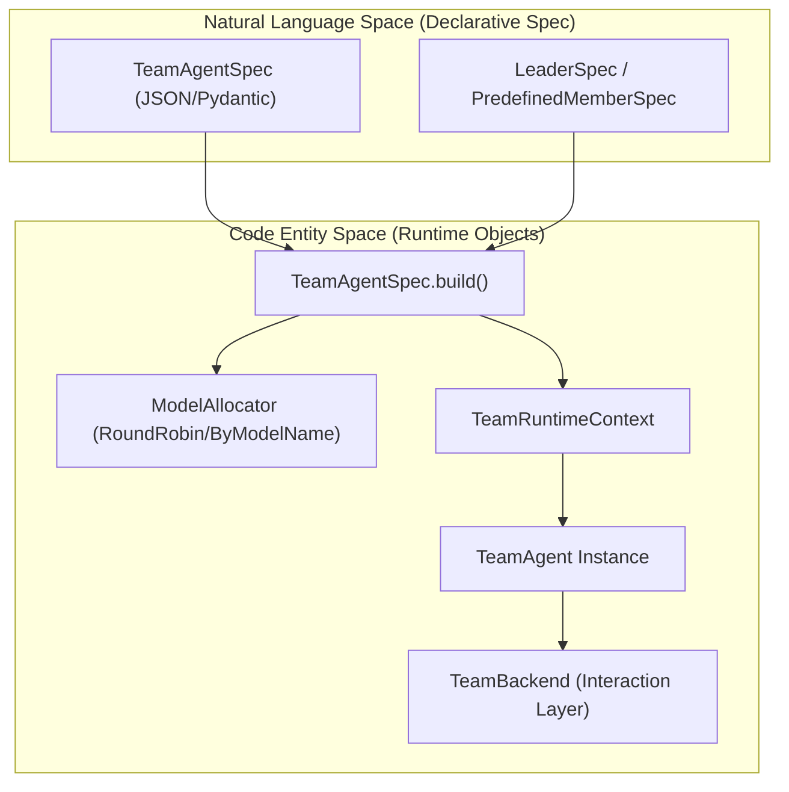
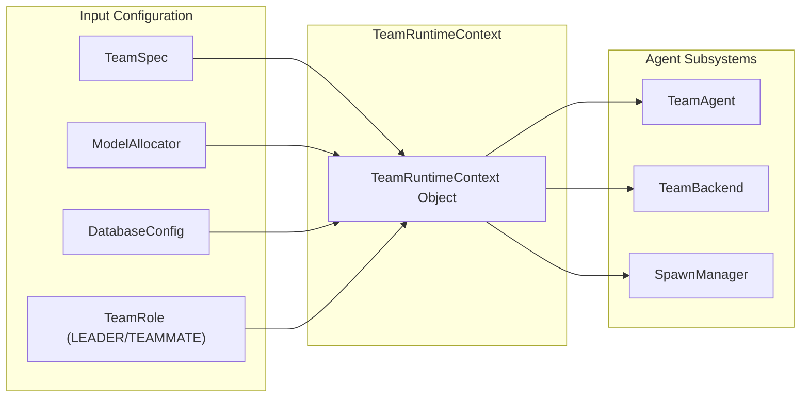

<!-- source: DeepWiki mcp.deepwiki.com · repo openJiuwen-ai/agent-core · page 9.1 TeamAgent and Blueprint · fetched 2026-11-02 -->

# TeamAgent and Blueprint

Relevant source files

The following files were used as context for generating this wiki page:

- [openjiuwen/agent_teams/agent/team_agent.py](openjiuwen/agent_teams/agent/team_agent.py)
- [openjiuwen/agent_teams/docs/features/F_22_external-cli-spawn-member-and-mcp-injection.md](openjiuwen/agent_teams/docs/features/F_22_external-cli-spawn-member-and-mcp-injection.md)
- [openjiuwen/agent_teams/docs/features/F_67_intelli-router-allocation-strategy.md](openjiuwen/agent_teams/docs/features/F_67_intelli-router-allocation-strategy.md)
- [openjiuwen/agent_teams/docs/specs/S_11_models-pool-and-allocation.md](openjiuwen/agent_teams/docs/specs/S_11_models-pool-and-allocation.md)
- [openjiuwen/agent_teams/external/cli_agent/session_cleanup.py](openjiuwen/agent_teams/external/cli_agent/session_cleanup.py)
- [openjiuwen/agent_teams/external/client.py](openjiuwen/agent_teams/external/client.py)
- [openjiuwen/agent_teams/external/descriptor.py](openjiuwen/agent_teams/external/descriptor.py)
- [openjiuwen/agent_teams/mcp/server.py](openjiuwen/agent_teams/mcp/server.py)
- [openjiuwen/agent_teams/models/__init__.py](openjiuwen/agent_teams/models/__init__.py)
- [openjiuwen/agent_teams/models/allocator.py](openjiuwen/agent_teams/models/allocator.py)
- [openjiuwen/agent_teams/models/pool.py](openjiuwen/agent_teams/models/pool.py)
- [openjiuwen/agent_teams/schema/blueprint.py](openjiuwen/agent_teams/schema/blueprint.py)
- [openjiuwen/agent_teams/schema/team.py](openjiuwen/agent_teams/schema/team.py)
- [openjiuwen/agent_teams/tools/database/member_dao.py](openjiuwen/agent_teams/tools/database/member_dao.py)
- [openjiuwen/agent_teams/tools/locales/cn.py](openjiuwen/agent_teams/tools/locales/cn.py)
- [openjiuwen/agent_teams/tools/locales/descs/cn/send_message.md](openjiuwen/agent_teams/tools/locales/descs/cn/send_message.md)
- [openjiuwen/agent_teams/tools/locales/descs/en/send_message.md](openjiuwen/agent_teams/tools/locales/descs/en/send_message.md)
- [openjiuwen/agent_teams/tools/locales/en.py](openjiuwen/agent_teams/tools/locales/en.py)
- [openjiuwen/agent_teams/tools/member_options.py](openjiuwen/agent_teams/tools/member_options.py)
- [openjiuwen/agent_teams/tools/models.py](openjiuwen/agent_teams/tools/models.py)
- [openjiuwen/agent_teams/tools/team.py](openjiuwen/agent_teams/tools/team.py)
- [openjiuwen/agent_teams/tools/team_tools.py](openjiuwen/agent_teams/tools/team_tools.py)
- [openjiuwen/agent_teams/tools/tool_message.py](openjiuwen/agent_teams/tools/tool_message.py)
- [tests/system_tests/agent_swarm/agent_team_external_cli_e2e.py](tests/system_tests/agent_swarm/agent_team_external_cli_e2e.py)
- [tests/system_tests/agent_swarm/agent_team_intelli_router_e2e.py](tests/system_tests/agent_swarm/agent_team_intelli_router_e2e.py)
- [tests/system_tests/agent_swarm/config_intelli_router.yaml](tests/system_tests/agent_swarm/config_intelli_router.yaml)
- [tests/system_tests/config_llm_local.example.yaml](tests/system_tests/config_llm_local.example.yaml)
- [tests/system_tests/llm_config.py](tests/system_tests/llm_config.py)
- [tests/unit_tests/agent_teams/external/conftest.py](tests/unit_tests/agent_teams/external/conftest.py)
- [tests/unit_tests/agent_teams/external/test_cli.py](tests/unit_tests/agent_teams/external/test_cli.py)
- [tests/unit_tests/agent_teams/external/test_client.py](tests/unit_tests/agent_teams/external/test_client.py)
- [tests/unit_tests/agent_teams/external/test_descriptor.py](tests/unit_tests/agent_teams/external/test_descriptor.py)
- [tests/unit_tests/agent_teams/external/test_external_cli_spawn.py](tests/unit_tests/agent_teams/external/test_external_cli_spawn.py)
- [tests/unit_tests/agent_teams/external/test_mcp_server.py](tests/unit_tests/agent_teams/external/test_mcp_server.py)
- [tests/unit_tests/agent_teams/external/test_ssh_spawn.py](tests/unit_tests/agent_teams/external/test_ssh_spawn.py)
- [tests/unit_tests/agent_teams/models/test_allocator.py](tests/unit_tests/agent_teams/models/test_allocator.py)
- [tests/unit_tests/agent_teams/test_database.py](tests/unit_tests/agent_teams/test_database.py)
- [tests/unit_tests/agent_teams/test_hitt.py](tests/unit_tests/agent_teams/test_hitt.py)
- [tests/unit_tests/agent_teams/test_policy.py](tests/unit_tests/agent_teams/test_policy.py)
- [tests/unit_tests/agent_teams/test_predefined_team.py](tests/unit_tests/agent_teams/test_predefined_team.py)
- [tests/unit_tests/agent_teams/test_team_agent.py](tests/unit_tests/agent_teams/test_team_agent.py)
- [tests/unit_tests/agent_teams/test_team_agent_coordination.py](tests/unit_tests/agent_teams/test_team_agent_coordination.py)
- [tests/unit_tests/agent_teams/test_team_agent_tools.py](tests/unit_tests/agent_teams/test_team_agent_tools.py)
- [tests/unit_tests/agent_teams/test_team_tools.py](tests/unit_tests/agent_teams/test_team_tools.py)
- [tests/unit_tests/agent_teams/tools/test_tool_message.py](tests/unit_tests/agent_teams/tools/test_tool_message.py)

The `TeamAgent` is the central orchestration entity for multi-agent collaboration within the `agent-core` SDK. It implements the `BaseAgent` interface and can function as either a **Leader** or a **Teammate** depending on its configuration. It leverages a composition-based architecture, wrapping a `DeepAgent` instance and delegating specialized logic to various managers for spawning, recovery, and session state.

## TeamAgent Core

`TeamAgent` acts as a unified implementation for all team roles [openjiuwen/agent_teams/agent/team_agent.py:62-68](). It manages the lifecycle of a team, from initial materialization via a `Blueprint` to runtime execution and eventual recovery.

### Key Components and Managers
The `TeamAgent` delegates its internal logic to several specialized managers:
*   **AgentConfigurator**: Handles the resolution of `DeepAgent` configurations and tool registrations [openjiuwen/agent_teams/agent/team_agent.py:72]().
*   **SpawnManager**: Manages the creation of teammate agents (either as sub-processes or in-process coroutines) [openjiuwen/agent_teams/agent/team_agent.py:75-79]().
*   **RecoveryManager**: Handles team restoration after process restarts or session interruptions [openjiuwen/agent_teams/agent/team_agent.py:80-83]().
*   **SessionManager**: Manages the `session_id` and coordinates state persistence with the `RecoveryManager` [openjiuwen/agent_teams/agent/team_agent.py:84-88]().
*   **StreamController**: Orchestrates the streaming of events and messages from the underlying `DeepAgent` to the team transport [openjiuwen/agent_teams/agent/team_agent.py:89-97]().
*   **CoordinationKernel**: The internal event loop driver that manages the `EventBus` and message routing [openjiuwen/agent_teams/agent/team_agent.py:98]().

### TeamAgent Lifecycle Methods
| Method | Description |
| :--- | :--- |
| `configure(spec, context)` | Materializes the agent's internal state and initializes the `DeepAgent` harness [openjiuwen/agent_teams/agent/team_agent.py:270-280](). |
| `invoke(input)` | Executes a blocking call to the agent. If it's a leader, it starts the coordination loop [openjiuwen/agent_teams/agent/team_agent.py:388-400](). |
| `stream(input)` | Provides an async iterator for real-time updates from the agent's execution [openjiuwen/agent_teams/agent/team_agent.py:440-450](). |
| `spawn_teammate(...)` | Dynamically creates a new team member at runtime via the `SpawnManager` [openjiuwen/agent_teams/agent/team_agent.py:1260](). |
| `from_spawn_payload(...)` | Reconstructs a `TeamAgent` instance from a payload received during a spawn event [openjiuwen/agent_teams/agent/team_agent.py:220-230](). |

**Sources:** [openjiuwen/agent_teams/agent/team_agent.py:62-101](), [openjiuwen/agent_teams/agent/team_agent.py:270-450]()

---

## TeamAgentSpec and Materialization

The `TeamAgentSpec` (Blueprint) is a JSON-serializable specification used to construct a `TeamAgent`. It defines the roles, models, transport, and storage layers for the team.

### Materialization Pipeline
The `build()` method in `TeamAgentSpec` triggers the materialization pipeline:
1.  **Infrastructure Resolution**: Resolves pluggable `TransportSpec` and `StorageSpec` via registries (e.g., `pyzmq`, `sqlite`, `memory`) [openjiuwen/agent_teams/schema/blueprint.py:110-135]().
2.  **Model Allocation**: If a `model_pool` is defined, a `ModelAllocator` is built to distribute LLM endpoints [openjiuwen/agent_teams/schema/blueprint.py:250-260]().
3.  **Context Construction**: A `TeamRuntimeContext` is created to hold the resolved `TeamSpec`, `DatabaseConfig`, and `ModelAllocator` [openjiuwen/agent_teams/schema/blueprint.py:261-274]().
4.  **Agent Instantiation**: The `TeamAgent` is instantiated with an `AgentCard` containing the materialized context [openjiuwen/agent_teams/schema/blueprint.py:275-280]().

### Natural Language to Code Entity Space: Blueprint Materialization
This diagram illustrates how a declarative specification is transformed into concrete code objects.

Title: TeamAgent Materialization Flow

**Sources:** [openjiuwen/agent_teams/schema/blueprint.py:100-280](), [openjiuwen/agent_teams/schema/team.py:140-165]()

---

## Model Allocation and Pool Management

The `ModelAllocator` governs how LLM endpoints from a `model_pool` are distributed among team members. This prevents rate-limiting contention by spreading requests across multiple credentials.

### Allocation Strategies
1.  **RoundRobinModelAllocator**: Linearly rotates through every entry in the pool, ignoring model names. Best for interchangeable endpoints.
2.  **ByModelNameAllocator**: Groups pool entries by their `model_name` and performs round-robin within those specific groups.
3.  **IntelliRouter**: An advanced strategy that uses unified routing (e.g., `*` entries) to resolve model requests [openjiuwen/agent_teams/schema/blueprint.py:36-39]().

### Model Pool and Credential Rotation
Each `ModelPoolEntry` contains credentials (`api_key`, `api_base_url`) and a `model_id`.
*   **Persistence**: The database stores a lightweight reference in the `options` column of the `team_member` table, specifically `model_ref: {model_name, model_index}` [openjiuwen/agent_teams/tools/models.py:90-94]().
*   **Credential Rotation**: The allocator maintains internal counters. When a new member is spawned, the `TeamBackend` calls the allocator to get a unique `Allocation`, ensuring that two members spawned sequentially don't hit the same credential immediately [openjiuwen/agent_teams/tools/team.py:107-108]().

**Sources:** [openjiuwen/agent_teams/models/pool.py:1-50](), [openjiuwen/agent_teams/tools/models.py:86-94](), [openjiuwen/agent_teams/tools/team.py:100-110]()

---

## TeamRuntimeContext

The `TeamRuntimeContext` is the shared state carrier for a `TeamAgent`. It encapsulates the team's identity, its members, and the underlying infrastructure.

### Data Flow and Interaction
The context is populated during the `TeamAgentSpec.build()` process and is passed to `TeamAgent.configure()`.

Title: TeamRuntimeContext Data Flow

### Context Attributes
*   **role**: The role of the current agent instance (e.g., `TeamRole.LEADER`) [openjiuwen/agent_teams/schema/team.py:102]().
*   **member_name**: The unique identifier for this member in the roster [openjiuwen/agent_teams/schema/team.py:65]().
*   **team_spec**: The `TeamSpec` containing metadata like `team_name` [openjiuwen/agent_teams/schema/team.py:42]().
*   **db_config**: The `DatabaseConfig` defining the storage backend (SQLite/MySQL/PostgreSQL) [openjiuwen/agent_teams/tools/database.py:26-29]().

**Sources:** [openjiuwen/agent_teams/schema/team.py:36-55](), [openjiuwen/agent_teams/tools/models.py:38-59]()

---

## Spawning and Recovery

### Spawning Teammates
The `SpawnManager` handles the creation of teammates via the `spawn_teammate` tool.
*   **Payload Generation**: When `spawn_teammate` is called, the manager generates a `SpawnPayload` containing the `AgentCard`, `TeamRuntimeContext`, and `SpawnConfig` [openjiuwen/agent_teams/agent/spawn_manager.py:29-40]().
*   **Member Types**: Supports spawning `TEAMMATE`, `HUMAN_AGENT` (HITT), `BRIDGE_AGENT` (remote protocols), and `EXTERNAL_CLI` (e.g., Claude CLI) [openjiuwen/agent_teams/tools/team_tools.py:20-29]().

### Recovery from Session
The `RecoveryManager` allows a `TeamAgent` to reconstruct its state from a persisted database session.
*   **Cold Recovery**: Rebuilds the leader backend from the `TeamAgentSpec` and re-attaches to the existing `TeamDatabase` [openjiuwen/agent_teams/agent/team_agent.py:80-83]().
*   **Status Restoration**: Re-fetches member statuses (READY, SHUTDOWN, etc.) and task states from the static and dynamic tables [openjiuwen/agent_teams/tools/models.py:38-148]().

**Sources:** [openjiuwen/agent_teams/agent/spawn_manager.py:20-50](), [openjiuwen/agent_teams/agent/recovery_manager.py:20-40](), [openjiuwen/agent_teams/tools/team.py:126-176]()

---

