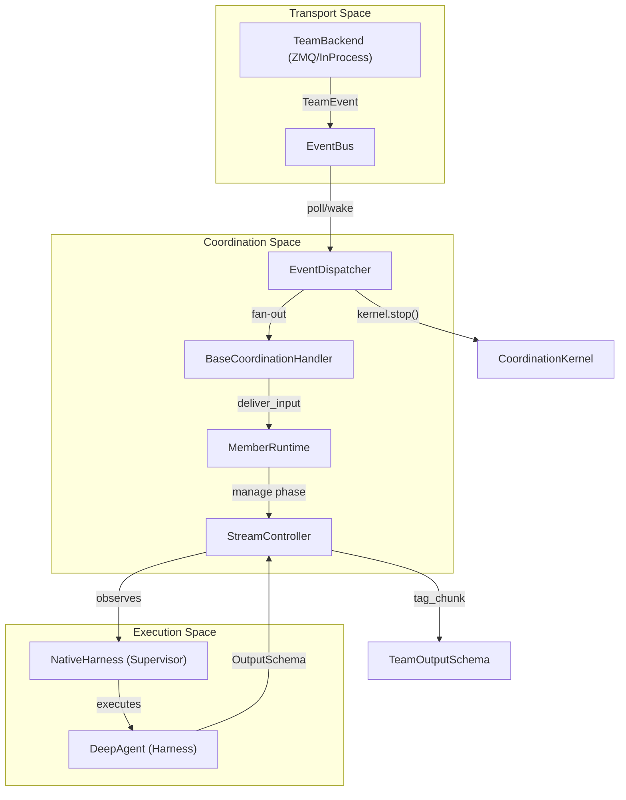
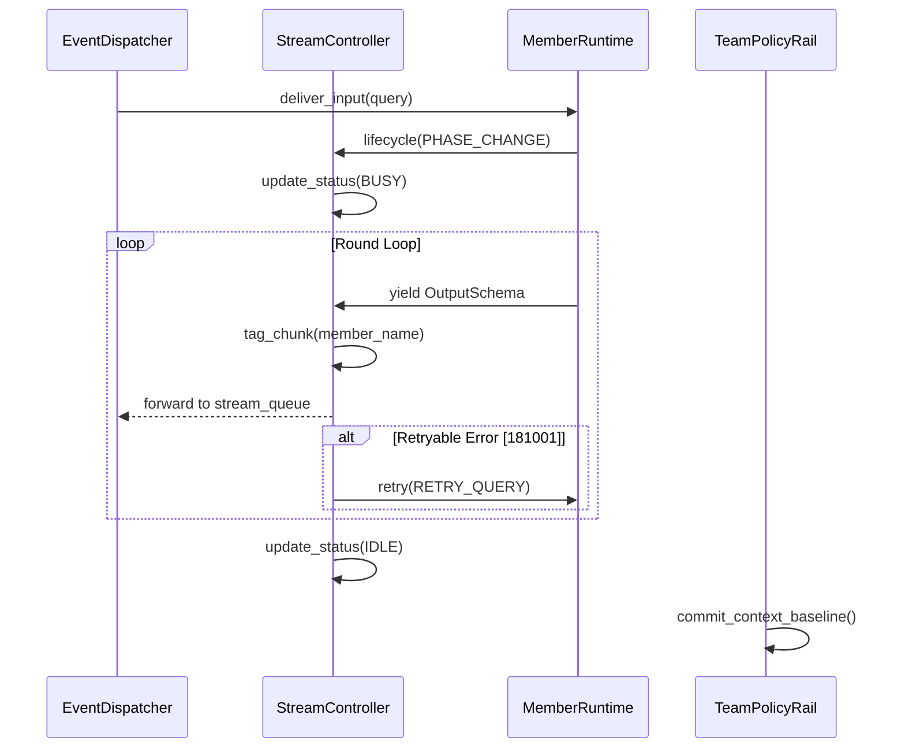

<!-- source: DeepWiki mcp.deepwiki.com · repo openJiuwen-ai/agent-core · page 9.2 Team Coordination and Event Dispatch · fetched 2026-11-02 -->

# Team Coordination and Event Dispatch

Relevant source files

The following files were used as context for generating this wiki page:

- [openjiuwen/agent_teams/AGENTS.md](openjiuwen/agent_teams/AGENTS.md)
- [openjiuwen/agent_teams/agent/coordination/AGENTS.md](openjiuwen/agent_teams/agent/coordination/AGENTS.md)
- [openjiuwen/agent_teams/agent/coordination/CLAUDE.md](openjiuwen/agent_teams/agent/coordination/CLAUDE.md)
- [openjiuwen/agent_teams/agent/coordination/dispatcher.py](openjiuwen/agent_teams/agent/coordination/dispatcher.py)
- [openjiuwen/agent_teams/agent/coordination/event_bus.py](openjiuwen/agent_teams/agent/coordination/event_bus.py)
- [openjiuwen/agent_teams/agent/coordination/handlers/member.py](openjiuwen/agent_teams/agent/coordination/handlers/member.py)
- [openjiuwen/agent_teams/agent/coordination/handlers/message.py](openjiuwen/agent_teams/agent/coordination/handlers/message.py)
- [openjiuwen/agent_teams/agent/coordination/handlers/stale_task.py](openjiuwen/agent_teams/agent/coordination/handlers/stale_task.py)
- [openjiuwen/agent_teams/agent/coordination/handlers/task_board.py](openjiuwen/agent_teams/agent/coordination/handlers/task_board.py)
- [openjiuwen/agent_teams/agent/coordination/handlers/team_completion.py](openjiuwen/agent_teams/agent/coordination/handlers/team_completion.py)
- [openjiuwen/agent_teams/agent/coordination/kernel.py](openjiuwen/agent_teams/agent/coordination/kernel.py)
- [openjiuwen/agent_teams/agent/session_manager.py](openjiuwen/agent_teams/agent/session_manager.py)
- [openjiuwen/agent_teams/agent/state.py](openjiuwen/agent_teams/agent/state.py)
- [openjiuwen/agent_teams/agent/stream_controller.py](openjiuwen/agent_teams/agent/stream_controller.py)
- [openjiuwen/agent_teams/docs/designs/architecture_cn.md](openjiuwen/agent_teams/docs/designs/architecture_cn.md)
- [openjiuwen/agent_teams/docs/features/F_02_member-attributed-streaming.md](openjiuwen/agent_teams/docs/features/F_02_member-attributed-streaming.md)
- [openjiuwen/agent_teams/docs/features/F_07_team-completion-events.md](openjiuwen/agent_teams/docs/features/F_07_team-completion-events.md)
- [openjiuwen/agent_teams/docs/features/F_21_team-completion-auto-pause.md](openjiuwen/agent_teams/docs/features/F_21_team-completion-auto-pause.md)
- [openjiuwen/agent_teams/docs/features/F_29_reliability-framework.md](openjiuwen/agent_teams/docs/features/F_29_reliability-framework.md)
- [openjiuwen/agent_teams/docs/features/F_30_reliability-self-monitor-and-result-aware-repeat.md](openjiuwen/agent_teams/docs/features/F_30_reliability-self-monitor-and-result-aware-repeat.md)
- [openjiuwen/agent_teams/docs/features/F_46_info-layering-attachment-and-inbound-xml.md](openjiuwen/agent_teams/docs/features/F_46_info-layering-attachment-and-inbound-xml.md)
- [openjiuwen/agent_teams/docs/features/F_49_member-desc-prompt-split-and-spec-unification.md](openjiuwen/agent_teams/docs/features/F_49_member-desc-prompt-split-and-spec-unification.md)
- [openjiuwen/agent_teams/docs/features/F_57_tool-variants-and-templated-descriptions.md](openjiuwen/agent_teams/docs/features/F_57_tool-variants-and-templated-descriptions.md)
- [openjiuwen/agent_teams/docs/features/F_59_condition-named-task-state-machine-with-verify-gate.md](openjiuwen/agent_teams/docs/features/F_59_condition-named-task-state-machine-with-verify-gate.md)
- [openjiuwen/agent_teams/docs/features/F_65_runtime-idle-clock-stall-nudge.md](openjiuwen/agent_teams/docs/features/F_65_runtime-idle-clock-stall-nudge.md)
- [openjiuwen/agent_teams/docs/features/F_69_stale-sweep-covers-assigned-unstarted-tasks.md](openjiuwen/agent_teams/docs/features/F_69_stale-sweep-covers-assigned-unstarted-tasks.md)
- [openjiuwen/agent_teams/docs/features/F_70_team-context-into-history.md](openjiuwen/agent_teams/docs/features/F_70_team-context-into-history.md)
- [openjiuwen/agent_teams/docs/features/F_71_input-batch-hook-and-superseded-board-drop.md](openjiuwen/agent_teams/docs/features/F_71_input-batch-hook-and-superseded-board-drop.md)
- [openjiuwen/agent_teams/docs/features/F_72_nested-team-note-inside-annotated-block.md](openjiuwen/agent_teams/docs/features/F_72_nested-team-note-inside-annotated-block.md)
- [openjiuwen/agent_teams/docs/specs/S_03_coordination-protocol.md](openjiuwen/agent_teams/docs/specs/S_03_coordination-protocol.md)
- [openjiuwen/agent_teams/docs/specs/S_08_team-tools-contract.md](openjiuwen/agent_teams/docs/specs/S_08_team-tools-contract.md)
- [openjiuwen/agent_teams/docs/specs/S_09_prompts-and-rails.md](openjiuwen/agent_teams/docs/specs/S_09_prompts-and-rails.md)
- [openjiuwen/agent_teams/docs/specs/S_12_schema-data-models.md](openjiuwen/agent_teams/docs/specs/S_12_schema-data-models.md)
- [openjiuwen/agent_teams/docs/specs/S_19_reliability-framework.md](openjiuwen/agent_teams/docs/specs/S_19_reliability-framework.md)
- [openjiuwen/agent_teams/i18n.py](openjiuwen/agent_teams/i18n.py)
- [openjiuwen/agent_teams/inbound_render.py](openjiuwen/agent_teams/inbound_render.py)
- [openjiuwen/agent_teams/interaction/__init__.py](openjiuwen/agent_teams/interaction/__init__.py)
- [openjiuwen/agent_teams/interaction/human_agent_inbox.py](openjiuwen/agent_teams/interaction/human_agent_inbox.py)
- [openjiuwen/agent_teams/prompts/AGENTS.md](openjiuwen/agent_teams/prompts/AGENTS.md)
- [openjiuwen/agent_teams/prompts/__init__.py](openjiuwen/agent_teams/prompts/__init__.py)
- [openjiuwen/agent_teams/prompts/cn/hitt_human_agent.md](openjiuwen/agent_teams/prompts/cn/hitt_human_agent.md)
- [openjiuwen/agent_teams/prompts/cn/inbound_tags.md](openjiuwen/agent_teams/prompts/cn/inbound_tags.md)
- [openjiuwen/agent_teams/prompts/en/hitt_human_agent.md](openjiuwen/agent_teams/prompts/en/hitt_human_agent.md)
- [openjiuwen/agent_teams/prompts/en/inbound_tags.md](openjiuwen/agent_teams/prompts/en/inbound_tags.md)
- [openjiuwen/agent_teams/prompts/sections.py](openjiuwen/agent_teams/prompts/sections.py)
- [openjiuwen/agent_teams/rails/team_policy_rail.py](openjiuwen/agent_teams/rails/team_policy_rail.py)
- [openjiuwen/agent_teams/schema/stream.py](openjiuwen/agent_teams/schema/stream.py)
- [openjiuwen/agent_teams/spawn/inprocess_handle.py](openjiuwen/agent_teams/spawn/inprocess_handle.py)
- [openjiuwen/agent_teams/spawn/inprocess_spawn.py](openjiuwen/agent_teams/spawn/inprocess_spawn.py)
- [openjiuwen/agent_teams/tools/AGENTS.md](openjiuwen/agent_teams/tools/AGENTS.md)
- [openjiuwen/agent_teams/tools/database/message_dao.py](openjiuwen/agent_teams/tools/database/message_dao.py)
- [openjiuwen/agent_teams/tools/message_manager.py](openjiuwen/agent_teams/tools/message_manager.py)
- [tests/unit_tests/agent_teams/agent/test_human_agent_setup.py](tests/unit_tests/agent_teams/agent/test_human_agent_setup.py)
- [tests/unit_tests/agent_teams/external/test_cli_runtime_team_context.py](tests/unit_tests/agent_teams/external/test_cli_runtime_team_context.py)
- [tests/unit_tests/agent_teams/interaction/test_human_agent_inbox.py](tests/unit_tests/agent_teams/interaction/test_human_agent_inbox.py)
- [tests/unit_tests/agent_teams/prompts/test_member_system_prompt.py](tests/unit_tests/agent_teams/prompts/test_member_system_prompt.py)
- [tests/unit_tests/agent_teams/prompts/test_team_messages.py](tests/unit_tests/agent_teams/prompts/test_team_messages.py)
- [tests/unit_tests/agent_teams/runtime/test_dispatch_payload.py](tests/unit_tests/agent_teams/runtime/test_dispatch_payload.py)
- [tests/unit_tests/agent_teams/test_coordination_lifecycle.py](tests/unit_tests/agent_teams/test_coordination_lifecycle.py)
- [tests/unit_tests/agent_teams/test_coordination_loop.py](tests/unit_tests/agent_teams/test_coordination_loop.py)
- [tests/unit_tests/agent_teams/test_harness.py](tests/unit_tests/agent_teams/test_harness.py)
- [tests/unit_tests/agent_teams/test_human_agent_role_restore.py](tests/unit_tests/agent_teams/test_human_agent_role_restore.py)
- [tests/unit_tests/agent_teams/test_inbound_render.py](tests/unit_tests/agent_teams/test_inbound_render.py)
- [tests/unit_tests/agent_teams/test_message_handler_render.py](tests/unit_tests/agent_teams/test_message_handler_render.py)
- [tests/unit_tests/agent_teams/test_message_manager.py](tests/unit_tests/agent_teams/test_message_manager.py)
- [tests/unit_tests/agent_teams/test_persistent_team.py](tests/unit_tests/agent_teams/test_persistent_team.py)
- [tests/unit_tests/agent_teams/test_spawn_manager_chunk_forward.py](tests/unit_tests/agent_teams/test_spawn_manager_chunk_forward.py)
- [tests/unit_tests/agent_teams/test_stream_controller.py](tests/unit_tests/agent_teams/test_stream_controller.py)
- [tests/unit_tests/agent_teams/test_team.py](tests/unit_tests/agent_teams/test_team.py)
- [tests/unit_tests/agent_teams/test_team_agent_retry.py](tests/unit_tests/agent_teams/test_team_agent_retry.py)
- [tests/unit_tests/agent_teams/test_team_policy_rail.py](tests/unit_tests/agent_teams/test_team_policy_rail.py)
- [tests/unit_tests/core/single_agent/rail/test_on_user_message.py](tests/unit_tests/core/single_agent/rail/test_on_user_message.py)

The coordination layer of the `agent_teams` package manages the lifecycle, event routing, and execution state of agents within a multi-agent team. It bridges the gap between the persistent storage (`TeamDatabase`), the message transport, and the underlying LLM execution engine (`DeepAgent`).

## Coordination Architecture

The coordination system is centered around the `CoordinationKernel`, which serves as the assembly point for the event bus, dispatcher, and scheduling engines [openjiuwen/agent_teams/agent/coordination/kernel.py:33-45](). The system adopts a decoupled handler-based approach to process both internal signals and team-wide messages.

### Key Components

| Class | Responsibility |
| :--- | :--- |
| `CoordinationKernel` | Owns the lifecycle state machine (`idle` -> `running` -> `paused` -> `stopped`) and wires transport to the dispatcher [openjiuwen/agent_teams/agent/coordination/kernel.py:56-61](). |
| `EventBus` | Provides the internal queue for `InnerEventMessage` and manages the asynchronous poll loop [openjiuwen/agent_teams/agent/coordination/event_bus.py:15-19](). |
| `EventDispatcher` | Orchestrates the fan-out of events to registered handlers based on stable priority sorting [openjiuwen/agent_teams/agent/coordination/dispatcher.py:81-89](). |
| `StreamController` | Adapts a `MemberRuntime` output stream, stamps chunks with member metadata, and manages transient retry logic [openjiuwen/agent_teams/agent/stream_controller.py:84-91](). |
| `TeamPolicyRail` | Injects team-specific system prompt sections and manages the delivery of "Team Context" (roster, identity) into conversation history [openjiuwen/agent_teams/rails/team_policy_rail.py:94-94](). |

### System Entity Map: Coordination Flow

The following diagram maps the relationship between coordination classes and the flow of an event from the transport layer to the execution engine.

**Diagram: "Coordination Entity Map"**

Sources: [openjiuwen/agent_teams/agent/coordination/kernel.py:33-45](), [openjiuwen/agent_teams/agent/coordination/dispatcher.py:81-89](), [openjiuwen/agent_teams/agent/stream_controller.py:84-91]()

## Event Dispatching and Handlers

The `EventDispatcher` processes three categories of events:
1.  **InnerEvent**: Local signals like `POLL_TASK`, `POLL_MAILBOX`, or `INTERACT` [openjiuwen/agent_teams/agent/coordination/event_bus.py:17-19]().
2.  **TransportEvent**: Team-wide broadcast or direct messages (e.g., `TASK_CREATED`, `MESSAGE`) [openjiuwen/agent_teams/docs/specs/S_12_schema-data-models.md:34-35]().
3.  **LifecycleEvent**: Infrastructure signals like `SHUTDOWN` [openjiuwen/agent_teams/agent/coordination/kernel.py:56-61]().

### Coordination Handlers
The dispatcher delegates logic to specialized handlers. The fan-out order is critical for correctness and is hardcoded:
*   `AgentLifecycleHandler`: Manages round starts and HITL interrupt resumes [openjiuwen/agent_teams/docs/specs/S_03_coordination-protocol.md:43-43]().
*   `MessageHandler`: Handles unicast and broadcast messaging, including `@mention` routing [openjiuwen/agent_teams/docs/specs/S_03_coordination-protocol.md:21-21]().
*   `TaskBoardHandler`: Monitors the task board for new assignments [openjiuwen/agent_teams/docs/specs/S_03_coordination-protocol.md:21-21]().
*   `StaleTaskHandler`: Executes "Nudge" logic for idle or neglected tasks [openjiuwen/agent_teams/agent/coordination/handlers/stale_task.py:1-10]().

### Stale Claim Nudging
To prevent deadlocks, the `StaleTaskHandler` implements two tiers of nudges:
*   **Self-Nudge**: If a member holds an active task (`PLANNING`, `IN_PROGRESS`) but stays idle for a configurable window, the dispatcher injects a steering nudge [openjiuwen/agent_teams/docs/specs/S_03_coordination-protocol.md:46-46]().
*   **Escalation**: If self-nudges fail repeatedly, the handler sends a message to the Leader reporting the stall [openjiuwen/agent_teams/i18n.py:84-88]().

## Team Context and History Injection

Unlike static system prompts, dynamic team state (identity, team metadata, and roster updates) is injected directly into the conversation history.

### The Team Context Tracker
The `TeamContextTracker` (driven by `TeamPolicyRail`) ensures members are aware of their surroundings without polluting the KV cache prefix [openjiuwen/agent_teams/docs/specs/S_09_prompts-and-rails.md:40-42]().
*   **Identity**: Injected once; includes `member_name`, `display_name`, and private workspace paths [openjiuwen/agent_teams/docs/specs/S_09_prompts-and-rails.md:67-67]().
*   **Roster Deltas**: Roster changes are delivered as incremental `<team-event kind="roster-change">` tags rather than full snapshots [openjiuwen/agent_teams/docs/specs/S_09_prompts-and-rails.md:60-61]().
*   **Superseded Dropping**: In the `on_user_message` hook, the rail can drop superseded task-board snapshots from a pending input batch to reduce token noise [openjiuwen/agent_teams/agent_teams/inbound_render.py:38-38]().

Sources: [openjiuwen/agent_teams/docs/specs/S_09_prompts-and-rails.md:60-70](), [openjiuwen/agent_teams/rails/team_policy_rail.py:94-94]()

## Execution and Streaming

The `StreamController` wraps the `MemberRuntime` (e.g., `NativeHarness`) and manages the flow of output chunks.

### Chunk Tagging and Observation
Every chunk produced by an agent is tagged as a `TeamOutputSchema`, which adds `source_member` and `role` metadata [openjiuwen/agent_teams/agent/stream_controller.py:151-167](). The `SpawnManager` uses `ChunkObserver` to forward chunks from in-process teammates into the Leader's stream [openjiuwen/agent_teams/agent/stream_controller.py:46-49]().

### Transient Retry Logic
The controller intercepts `task_failed` chunks. If the error code matches `_RETRYABLE_ERROR_CODES` (e.g., `181001`), the controller swallows the failed round's remaining chunks and re-drives the round automatically up to 10 times [openjiuwen/agent_teams/agent/stream_controller.py:51-60]().

**Diagram: "Execution Round Flow"**

Sources: [openjiuwen/agent_teams/agent/stream_controller.py:84-126](), [openjiuwen/agent_teams/docs/specs/S_03_coordination-protocol.md:50-52]()

## Lifecycle and Spawning

### Persistence Modes
*   **Temporary**: The team is dissolved (`clean_team`) automatically once the Leader completes the primary objective [openjiuwen/agent_teams/prompts/AGENTS.md:31-31]().
*   **Persistent**: Members enter a `STANDBY` state after completion, allowing for future session resumption [openjiuwen/agent_teams/prompts/AGENTS.md:30-30]().

### In-Process Spawning
The `inprocess_spawn.py` handles the instantiation of `TeamAgent` objects within the same Python process. The `SpawnManager` maintains a registry of these handles and manages their `stream_queue` forwarding to the Leader [openjiuwen/agent_teams/spawn/inprocess_spawn.py:1-10]().

### Recovery
Upon startup, the `CoordinationKernel` and associated managers restore state from the `TeamAgentSession`. The `TeamContextTracker` uses values persisted in the child session (e.g., `roster_mtime`) to decide which context messages need to be re-sent vs. what is already in history [openjiuwen/agent_teams/docs/specs/S_09_prompts-and-rails.md:68-68]().

Sources: [openjiuwen/agent_teams/agent/coordination/kernel.py:133-168](), [openjiuwen/agent_teams/spawn/inprocess_spawn.py:1-10](), [openjiuwen/agent_teams/docs/specs/S_12_schema-data-models.md:158-166]()

---

