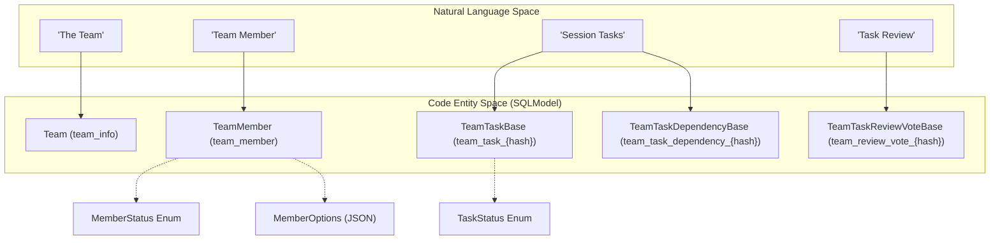
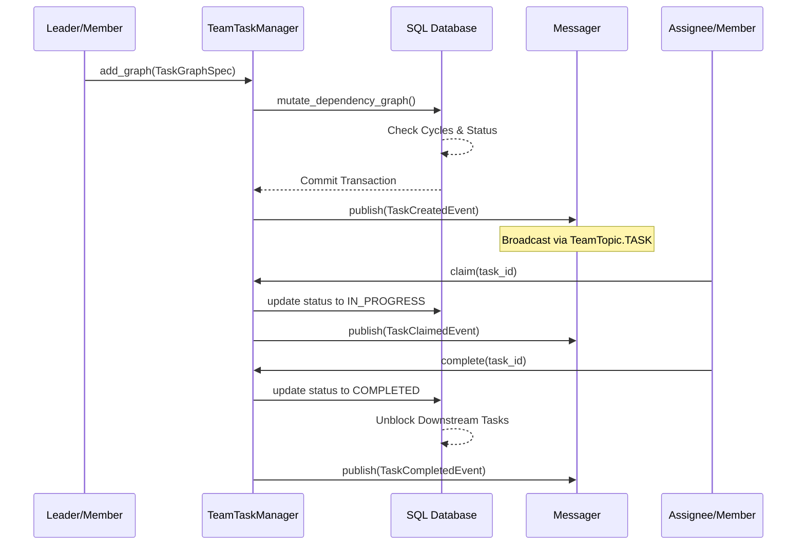

<!-- source: DeepWiki mcp.deepwiki.com · repo openJiuwen-ai/agent-core · page 9.3 Team Database and Task Management · fetched 2026-11-02 -->

# Team Database and Task Management

Relevant source files

The following files were used as context for generating this wiki page:

- [openjiuwen/agent_teams/agent/team_agent.py](openjiuwen/agent_teams/agent/team_agent.py)
- [openjiuwen/agent_teams/external/cli_agent/session_cleanup.py](openjiuwen/agent_teams/external/cli_agent/session_cleanup.py)
- [openjiuwen/agent_teams/schema/task.py](openjiuwen/agent_teams/schema/task.py)
- [openjiuwen/agent_teams/tools/database/__init__.py](openjiuwen/agent_teams/tools/database/__init__.py)
- [openjiuwen/agent_teams/tools/database/config.py](openjiuwen/agent_teams/tools/database/config.py)
- [openjiuwen/agent_teams/tools/database/engine.py](openjiuwen/agent_teams/tools/database/engine.py)
- [openjiuwen/agent_teams/tools/database/member_dao.py](openjiuwen/agent_teams/tools/database/member_dao.py)
- [openjiuwen/agent_teams/tools/database/task_dao.py](openjiuwen/agent_teams/tools/database/task_dao.py)
- [openjiuwen/agent_teams/tools/database/team_dao.py](openjiuwen/agent_teams/tools/database/team_dao.py)
- [openjiuwen/agent_teams/tools/locales/cn.py](openjiuwen/agent_teams/tools/locales/cn.py)
- [openjiuwen/agent_teams/tools/locales/descs/cn/send_message.md](openjiuwen/agent_teams/tools/locales/descs/cn/send_message.md)
- [openjiuwen/agent_teams/tools/locales/descs/en/send_message.md](openjiuwen/agent_teams/tools/locales/descs/en/send_message.md)
- [openjiuwen/agent_teams/tools/locales/en.py](openjiuwen/agent_teams/tools/locales/en.py)
- [openjiuwen/agent_teams/tools/member_options.py](openjiuwen/agent_teams/tools/member_options.py)
- [openjiuwen/agent_teams/tools/models.py](openjiuwen/agent_teams/tools/models.py)
- [openjiuwen/agent_teams/tools/task_manager.py](openjiuwen/agent_teams/tools/task_manager.py)
- [openjiuwen/agent_teams/tools/team.py](openjiuwen/agent_teams/tools/team.py)
- [openjiuwen/agent_teams/tools/team_tools.py](openjiuwen/agent_teams/tools/team_tools.py)
- [openjiuwen/agent_teams/tools/tool_message.py](openjiuwen/agent_teams/tools/tool_message.py)
- [openjiuwen/agent_teams/tools/tool_task.py](openjiuwen/agent_teams/tools/tool_task.py)
- [tests/system_tests/agent_swarm/agent_team_tools_db_stress_e2e.py](tests/system_tests/agent_swarm/agent_team_tools_db_stress_e2e.py)
- [tests/system_tests/agent_swarm/team_db_perf_optimizations.md](tests/system_tests/agent_swarm/team_db_perf_optimizations.md)
- [tests/unit_tests/agent_teams/test_database.py](tests/unit_tests/agent_teams/test_database.py)
- [tests/unit_tests/agent_teams/test_database_concurrency.py](tests/unit_tests/agent_teams/test_database_concurrency.py)
- [tests/unit_tests/agent_teams/test_hitt.py](tests/unit_tests/agent_teams/test_hitt.py)
- [tests/unit_tests/agent_teams/test_policy.py](tests/unit_tests/agent_teams/test_policy.py)
- [tests/unit_tests/agent_teams/test_predefined_team.py](tests/unit_tests/agent_teams/test_predefined_team.py)
- [tests/unit_tests/agent_teams/test_task_manager.py](tests/unit_tests/agent_teams/test_task_manager.py)
- [tests/unit_tests/agent_teams/test_team_agent.py](tests/unit_tests/agent_teams/test_team_agent.py)
- [tests/unit_tests/agent_teams/test_team_agent_coordination.py](tests/unit_tests/agent_teams/test_team_agent_coordination.py)
- [tests/unit_tests/agent_teams/test_team_agent_tools.py](tests/unit_tests/agent_teams/test_team_agent_tools.py)
- [tests/unit_tests/agent_teams/test_team_tools.py](tests/unit_tests/agent_teams/test_team_tools.py)
- [tests/unit_tests/agent_teams/tools/test_tool_message.py](tests/unit_tests/agent_teams/tools/test_tool_message.py)

The agent-core SDK provides a robust persistence and coordination layer for multi-agent teams. This system manages the lifecycle of teams, their members, and a complex DAG-based task dependency graph. It supports high-performance SQL backends for distributed production environments and uses session-specific table partitioning to ensure isolation.

## Team Database Architecture

The `TeamDatabase` serves as the central data access layer. It distinguishes between **static tables**, which persist across the lifetime of a team, and **dynamic tables**, which are partitioned per session to ensure isolation and performance.

### Static vs. Dynamic Storage
*   **Static Tables**: `team_info` and `team_member` store the foundational identity, roster, and configuration (such as `dispatch_mode`) of a team [openjiuwen/agent_teams/tools/models.py:38-100]().
*   **Dynamic Tables**: Tables for tasks (`team_task_`), dependencies (`team_task_dependency_`), messages (`team_message_`), and review votes (`team_review_vote_`) are created dynamically per session [openjiuwen/agent_teams/tools/models.py:23-29]().

### Session Partitioning and Table Naming
To prevent cross-session data leakage, dynamic table names are suffixed with a sanitized version of the `session_id`. The system uses a `blake2s` hash (8-byte digest) to generate a 16-character hex suffix that is SQL-safe and collision-resistant [openjiuwen/agent_teams/tools/models.py:175-185]().

### Write Serialization and Retries
For SQLite backends, `DbSessions` provides process-wide write serialization using an `asyncio.Lock` to prevent database locks [openjiuwen/agent_teams/tools/database/engine.py:64-92](). Additionally, `retry_on_locked` implements an exponential back-off strategy for transient "database is locked" errors [openjiuwen/agent_teams/tools/database/engine.py:141-168]().

**Team Storage Entity Mapping**

Sources: [openjiuwen/agent_teams/tools/models.py:38-150](), [openjiuwen/agent_teams/schema/status.py:40-47]()

---

## Task Management and DAG Coordination

The `TeamTaskManager` orchestrates the creation, assignment, and completion of tasks. It manages a Directed Acyclic Graph (DAG) where tasks can depend on the completion of others.

### Task Status State Machine
Tasks transition through a strictly defined state machine managed by `TASK_TRANSITIONS` [openjiuwen/agent_teams/schema/status.py:44-49]().

| Status | Description |
| :--- | :--- |
| `PENDING` | Ready to be claimed or assigned. |
| `BLOCKED` | Waiting on unresolved dependencies. |
| `IN_PROGRESS` | Currently being worked on (claimed or started) [openjiuwen/agent_teams/tools/database/engine.py:194-196](). |
| `IN_REVIEW` | Submitted for verification (requires `reviewer` list) [openjiuwen/agent_teams/tools/models.py:132-138](). |
| `COMPLETED` | Successfully finished; triggers downstream unblocking. |
| `CANCELLED` | Aborted; resolves dependencies to prevent deadlocks. |

### Dependency Management and Cycle Detection
When tasks are added via `add_graph`, the system processes a batch of `TaskGraphSpec` objects atomically [openjiuwen/agent_teams/tools/task_manager.py:174-183]().
1.  **Atomic Insertion**: Uses `mutate_dependency_graph` to land the whole batch or rollback on failure [openjiuwen/agent_teams/tools/task_manager.py:206-215]().
2.  **Cycle Detection**: Rejects batches that would introduce circular dependencies, surfacing a `TaskOpResult` with the failure reason [openjiuwen/agent_teams/tools/task_manager.py:218-222]().
3.  **Status Propagation**: When a task is completed, the system re-evaluates downstream `BLOCKED` tasks. If all their dependencies are satisfied, they are flipped to `PENDING` [openjiuwen/agent_teams/tools/task_manager.py:644-655]().

### Priority and Scheduling
*   **Priority**: `add_with_priority` allows injecting urgent work. It sets a higher `priority` value in the DB, influencing how agents perceive the task list [openjiuwen/agent_teams/tools/task_manager.py:246-260]().
*   **Dispatch Modes**: Supports `autonomous` (agents claim tasks) and `scheduled` (leader assigns tasks via `spec.assignee`) [openjiuwen/agent_teams/tools/task_manager.py:119-120]().

**Task Lifecycle and Messaging Flow**

Sources: [openjiuwen/agent_teams/tools/task_manager.py:174-230](), [openjiuwen/agent_teams/tools/task_manager.py:465-510](), [openjiuwen/agent_teams/tools/task_manager.py:612-660]()

---

## Team Messaging

Communication within a team is handled by the `TeamMessageManager`, supporting broadcast and direct routing.

### Message Routing
*   **Broadcast**: Messages sent with `to_member_name=None` are visible to all members. Read status is tracked via a high-water mark timestamp [openjiuwen/agent_teams/tools/models.py:26-27]().
*   **Direct**: Messages targeting a specific `member_name`.
*   **Event Bus**: The `EventBus` handles `InnerEventMessage` types (e.g., `USER_INPUT`, `MEMBER_SPAWNED`) for internal coordination [openjiuwen/agent_teams/agent/coordination/event_bus.py:20-23]().

### Message Persistence
Messages are stored in session-specific `team_message_{hash}` tables. Each message includes metadata such as `sender_name`, `receiver_name`, and `content` [openjiuwen/agent_teams/tools/models.py:114-124]().

## Key Classes Reference

### TeamDatabase
*   `initialize()`: Sets up the SQLAlchemy engine, performs schema migrations (e.g., backfilling `role` and `options` columns), and creates static tables [openjiuwen/agent_teams/tools/database/engine.py:1-35]().
*   `create_cur_session_tables()`: Generates dynamic tables using the `blake2s` hashed suffix for the current session [openjiuwen/agent_teams/tools/models.py:175-185]().

### TeamTaskManager
*   `add_graph(specs)`: Atomic creation of multiple tasks with inter-dependencies [openjiuwen/agent_teams/tools/task_manager.py:174-183]().
*   `claim(task_id)`: Transitions a task to `IN_PROGRESS` and assigns the caller as the `assignee` [openjiuwen/agent_teams/tools/task_manager.py:465-475]().
*   `complete(task_id)`: Marks completion and triggers dependency resolution for downstream tasks [openjiuwen/agent_teams/tools/task_manager.py:612-620]().

### TeamBackend
*   `spawn_member(...)`: Registers a new member in `team_member` and publishes a `MemberSpawnedEvent` [openjiuwen/agent_teams/tools/team.py:341-360]().
*   `shutdown_member(...)`: Updates member status to `SHUTDOWN_REQUESTED` to initiate teardown [openjiuwen/agent_teams/tools/team.py:550-565]().

Sources: [openjiuwen/agent_teams/tools/task_manager.py:96-145](), [openjiuwen/agent_teams/tools/models.py:103-150](), [openjiuwen/agent_teams/tools/team.py:85-120]()

---

