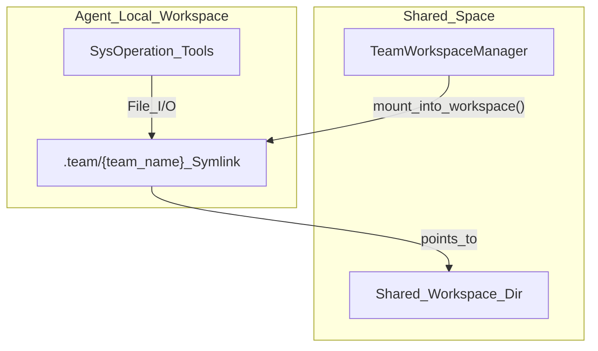
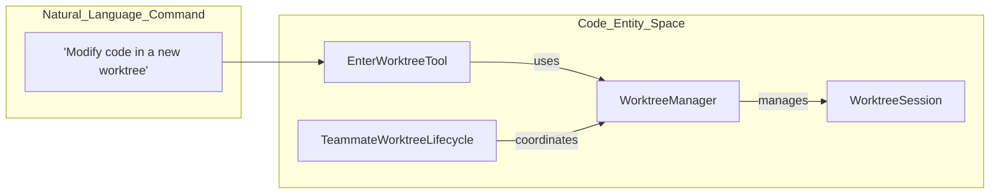

<!-- source: DeepWiki mcp.deepwiki.com · repo openJiuwen-ai/agent-core · page 9.4 Team Workspace and Worktree · fetched 2026-11-02 -->

# Team Workspace and Worktree

Relevant source files

The following files were used as context for generating this wiki page:

- [examples/harness/deepagent_with_worktree.py](examples/harness/deepagent_with_worktree.py)
- [examples/harness/worktree/__init__.py](examples/harness/worktree/__init__.py)
- [examples/harness/worktree/single_deepagent_e2e.py](examples/harness/worktree/single_deepagent_e2e.py)
- [openjiuwen/agent_teams/schema/__init__.py](openjiuwen/agent_teams/schema/__init__.py)
- [openjiuwen/agent_teams/schema/deep_agent_spec.py](openjiuwen/agent_teams/schema/deep_agent_spec.py)
- [openjiuwen/agent_teams/team_workspace/__init__.py](openjiuwen/agent_teams/team_workspace/__init__.py)
- [openjiuwen/agent_teams/team_workspace/manager.py](openjiuwen/agent_teams/team_workspace/manager.py)
- [openjiuwen/agent_teams/team_workspace/models.py](openjiuwen/agent_teams/team_workspace/models.py)
- [openjiuwen/agent_teams/team_workspace/rails.py](openjiuwen/agent_teams/team_workspace/rails.py)
- [openjiuwen/agent_teams/team_workspace/tools.py](openjiuwen/agent_teams/team_workspace/tools.py)
- [openjiuwen/agent_teams/workflow/worktree.py](openjiuwen/agent_teams/workflow/worktree.py)
- [openjiuwen/agent_teams/workspace_layout.py](openjiuwen/agent_teams/workspace_layout.py)
- [openjiuwen/agent_teams/worktree/__init__.py](openjiuwen/agent_teams/worktree/__init__.py)
- [openjiuwen/agent_teams/worktree/lifecycle.py](openjiuwen/agent_teams/worktree/lifecycle.py)
- [openjiuwen/agent_teams/worktree/member_state.py](openjiuwen/agent_teams/worktree/member_state.py)
- [openjiuwen/agent_teams/worktree/naming.py](openjiuwen/agent_teams/worktree/naming.py)
- [openjiuwen/agent_teams/worktree/session_scope.py](openjiuwen/agent_teams/worktree/session_scope.py)
- [openjiuwen/harness/prompts/tools/enter_worktree.py](openjiuwen/harness/prompts/tools/enter_worktree.py)
- [openjiuwen/harness/tools/shell/bash/_semantics.py](openjiuwen/harness/tools/shell/bash/_semantics.py)
- [openjiuwen/harness/tools/worktree/__init__.py](openjiuwen/harness/tools/worktree/__init__.py)
- [openjiuwen/harness/tools/worktree/backend.py](openjiuwen/harness/tools/worktree/backend.py)
- [openjiuwen/harness/tools/worktree/git.py](openjiuwen/harness/tools/worktree/git.py)
- [openjiuwen/harness/tools/worktree/manager.py](openjiuwen/harness/tools/worktree/manager.py)
- [openjiuwen/harness/tools/worktree/models.py](openjiuwen/harness/tools/worktree/models.py)
- [openjiuwen/harness/tools/worktree/session.py](openjiuwen/harness/tools/worktree/session.py)
- [openjiuwen/harness/tools/worktree/slug.py](openjiuwen/harness/tools/worktree/slug.py)
- [openjiuwen/harness/tools/worktree/tools.py](openjiuwen/harness/tools/worktree/tools.py)
- [openjiuwen/harness/workspace/workspace.py](openjiuwen/harness/workspace/workspace.py)
- [tests/system_tests/harness/tools/worktree/conftest.py](tests/system_tests/harness/tools/worktree/conftest.py)
- [tests/unit_tests/agent_teams/team_workspace/__init__.py](tests/unit_tests/agent_teams/team_workspace/__init__.py)
- [tests/unit_tests/agent_teams/team_workspace/test_manager.py](tests/unit_tests/agent_teams/team_workspace/test_manager.py)
- [tests/unit_tests/agent_teams/team_workspace/test_models.py](tests/unit_tests/agent_teams/team_workspace/test_models.py)
- [tests/unit_tests/agent_teams/test_paths.py](tests/unit_tests/agent_teams/test_paths.py)
- [tests/unit_tests/agent_teams/test_spawn_manager_worktree.py](tests/unit_tests/agent_teams/test_spawn_manager_worktree.py)
- [tests/unit_tests/agent_teams/test_workspace_layout.py](tests/unit_tests/agent_teams/test_workspace_layout.py)
- [tests/unit_tests/agent_teams/test_worktree_naming.py](tests/unit_tests/agent_teams/test_worktree_naming.py)
- [tests/unit_tests/agent_teams/workflow/test_runner.py](tests/unit_tests/agent_teams/workflow/test_runner.py)
- [tests/unit_tests/harness/test_deep_agent_workspace.py](tests/unit_tests/harness/test_deep_agent_workspace.py)
- [tests/unit_tests/harness/test_workspace_links.py](tests/unit_tests/harness/test_workspace_links.py)
- [tests/unit_tests/harness/tools/test_bash/test_semantics.py](tests/unit_tests/harness/tools/test_bash/test_semantics.py)
- [tests/unit_tests/harness/tools/worktree/test_manager.py](tests/unit_tests/harness/tools/worktree/test_manager.py)
- [tests/unit_tests/harness/tools/worktree/test_rails.py](tests/unit_tests/harness/tools/worktree/test_rails.py)
- [tests/unit_tests/harness/tools/worktree/test_session.py](tests/unit_tests/harness/tools/worktree/test_session.py)
- [tests/unit_tests/harness/tools/worktree/test_slug.py](tests/unit_tests/harness/tools/worktree/test_slug.py)
- [tests/unit_tests/harness/tools/worktree/test_tools.py](tests/unit_tests/harness/tools/worktree/test_tools.py)

The `agent_teams` package provides a dual-layer filesystem management system designed for multi-agent collaboration. It distinguishes between a **Shared Team Workspace** for persistent artifacts/coordination and **Git Worktrees** for isolated code development.

## Team Workspace Management

The `TeamWorkspaceManager` [openjiuwen/agent_teams/team_workspace/manager.py:49-58]() handles the lifecycle of a shared directory accessible by all team members. This workspace serves as a central repository for shared skills, artifacts, and memory.

### Operating Modes
The workspace operates in two distinct modes defined by `WorkspaceMode` [openjiuwen/agent_teams/team_workspace/models.py:33-37]():
1.  **LOCAL**: Uses a single directory on a shared filesystem. Members access it via symlinks. Locks are managed in-memory [openjiuwen/agent_teams/team_workspace/manager.py:56-56]().
2.  **DISTRIBUTED**: Each node maintains a clone. Synchronization is handled via Git push/pull, and locks are coordinated by the team leader via a messaging bus [openjiuwen/agent_teams/team_workspace/manager.py:57-58]().

### Conflict Resolution and Locking
Members can request file-level locks to prevent concurrent modification. The `TeamWorkspaceManager` tracks these via `WorkspaceFileLock` [openjiuwen/agent_teams/team_workspace/models.py:35-35](). In distributed mode, lock requests are broadcast as `WorkspaceLockRequestEvent` and confirmed via `WorkspaceLockResponseEvent` [openjiuwen/agent_teams/schema/events.py:30-32]().

### Workspace Path Mapping
The `TeamWorkspaceManager` exposes the shared workspace to individual agents by mounting it into their local agent workspace using the `_mount_directory` method [openjiuwen/agent_teams/team_workspace/manager.py:161-172](). 
*   **Linux/macOS**: Uses standard symlinks [openjiuwen/agent_teams/team_workspace/manager.py:174-174]().
*   **Windows**: If symlink privileges (`ERROR_PRIVILEGE_NOT_HELD`) are missing, it falls back to directory junctions (`mklink /J`) [openjiuwen/agent_teams/team_workspace/manager.py:176-181]().
*   **Fallback**: If all link methods fail, it performs a physical directory copy to ensure availability [openjiuwen/agent_teams/team_workspace/manager.py:182-187]().

**Workspace Data Flow: Shared Workspace to Agent Tools**

Sources: [openjiuwen/agent_teams/team_workspace/manager.py:49-80](), [openjiuwen/agent_teams/team_workspace/manager.py:161-187](), [openjiuwen/agent_teams/team_workspace/models.py:33-37]()

## Git Worktree Isolation

While the Team Workspace is for shared state, the `WorktreeManager` [openjiuwen/harness/tools/worktree/manager.py:59-69]() provides isolation for code modifications. Each member can enter a private worktree to work on specific tasks without interfering with the main repository or other agents.

### Worktree Lifecycle
The lifecycle is managed through the `EnterWorktreeTool` and `ExitWorktreeTool`:
*   **EnterWorktreeTool**: Resolves a unique slug (name) for the worktree. If the name is omitted, it generates a random one like "swift-fox-a3b1" [openjiuwen/harness/tools/worktree/tools.py:48-61](). It then creates or recovers a git worktree and switches the session's Working Directory (CWD) into it [openjiuwen/harness/tools/worktree/tools.py:165-181]().
*   **ExitWorktreeTool**: Allows the agent to leave the worktree. It can either "keep" the worktree for future sessions or "remove" it [openjiuwen/harness/prompts/tools/enter_worktree.py:60-60]().

### Teammate Worktree Automation
For `TeamAgent` deployments, the `TeammateWorktreeLifecycle` class [openjiuwen/agent_teams/worktree/lifecycle.py:74-80]() automates the creation of session-scoped worktrees for teammates. 
*   **Isolation**: It ensures teammates operate in directories like `.worktrees/{slug}` [openjiuwen/harness/prompts/tools/enter_worktree.py:49-51]().
*   **Clean-up**: Upon task completion, the leader checks for contributions. If no files were changed (excluding team runtime files like `AGENT.md` or `.team/`), the worktree is automatically removed to save space [openjiuwen/agent_teams/worktree/lifecycle.py:141-146]().

**Worktree Entity Mapping: Logic to Code**

Sources: [openjiuwen/harness/tools/worktree/tools.py:107-130](), [openjiuwen/agent_teams/worktree/lifecycle.py:74-115](), [openjiuwen/harness/tools/worktree/models.py:17-30]()

## Path Management

The `openjiuwen.agent_teams.paths` module provides a centralized source of truth for the on-disk layout of team resources.

| Function | Path Pattern | Purpose |
| :--- | :--- | :--- |
| `get_openjiuwen_home` | `~/.openjiuwen` | Global SDK home directory [openjiuwen/agent_teams/paths.py:17-23]() |
| `get_agent_teams_home` | `~/.openjiuwen/.agent_teams` | Root for all team-specific data [openjiuwen/agent_teams/paths.py:39-41]() |
| `team_session_worktrees_dir`| `.../sessions/{id}/worktrees` | Root for session-isolated worktrees [openjiuwen/agent_teams/paths.py:136-136]() |
| `independent_member_workspace`| `~/.openjiuwen/{member}_workspace` | Persistent workspace for standalone agents [openjiuwen/agent_teams/paths.py:72-86]() |

Sources: [openjiuwen/agent_teams/paths.py:1-140]()

## Swarmflow Worker Worktrees

For high-concurrency multi-agent workflows (Swarmflow), the `SwarmflowWorkerWorktrees` class [openjiuwen/agent_teams/workflow/worktree.py:20-22]() handles ephemeral worktree management.
*   **Dynamic Creation**: Triggered when an agent is called with `options={'isolation': 'worktree'}` [openjiuwen/agent_teams/workflow/worktree.py:40-42]().
*   **Hash-based Naming**: Uses `project_worktree_hash` to ensure agents working on the same project version share or distinguish worktrees correctly [openjiuwen/agent_teams/workflow/worktree.py:71-75]().
*   **Automatic Finalization**: After the worker finishes, the `finalize` method [openjiuwen/agent_teams/workflow/worktree.py:110-112]() uses `WorktreeChangeSummary` to decide if the worktree is "clean" and safe to delete [openjiuwen/agent_teams/workflow/worktree.py:143-168]().

Sources: [openjiuwen/agent_teams/workflow/worktree.py:20-170](), [openjiuwen/agent_teams/paths.py:142-155]()

---

