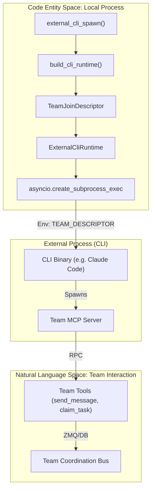
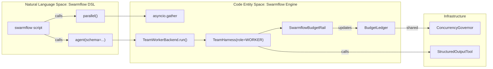

<!-- source: DeepWiki mcp.deepwiki.com · repo openJiuwen-ai/agent-core · page 9.5 External CLI Agents and Swarmflow · fetched 2026-11-02 -->

# External CLI Agents and Swarmflow

Relevant source files

The following files were used as context for generating this wiki page:

- [openjiuwen/agent_teams/agent/coordination/handlers/AGENTS.md](openjiuwen/agent_teams/agent/coordination/handlers/AGENTS.md)
- [openjiuwen/agent_teams/agent/coordination/handlers/CLAUDE.md](openjiuwen/agent_teams/agent/coordination/handlers/CLAUDE.md)
- [openjiuwen/agent_teams/agent/spawn_manager.py](openjiuwen/agent_teams/agent/spawn_manager.py)
- [openjiuwen/agent_teams/cli/CLAUDE.md](openjiuwen/agent_teams/cli/CLAUDE.md)
- [openjiuwen/agent_teams/docs/AGENTS.md](openjiuwen/agent_teams/docs/AGENTS.md)
- [openjiuwen/agent_teams/docs/features/F_21_external-agent-access.md](openjiuwen/agent_teams/docs/features/F_21_external-agent-access.md)
- [openjiuwen/agent_teams/docs/features/F_22_external-cli-spawn-member-and-mcp-injection.md](openjiuwen/agent_teams/docs/features/F_22_external-cli-spawn-member-and-mcp-injection.md)
- [openjiuwen/agent_teams/docs/features/F_37_swarmflow-stateful-sessions-and-human.md](openjiuwen/agent_teams/docs/features/F_37_swarmflow-stateful-sessions-and-human.md)
- [openjiuwen/agent_teams/docs/features/F_39_swarmflow-e2e-hardening.md](openjiuwen/agent_teams/docs/features/F_39_swarmflow-e2e-hardening.md)
- [openjiuwen/agent_teams/docs/features/F_41_async-tool-control-and-spill.md](openjiuwen/agent_teams/docs/features/F_41_async-tool-control-and-spill.md)
- [openjiuwen/agent_teams/docs/features/F_42_swarmflow-tool-claude-code-alignment.md](openjiuwen/agent_teams/docs/features/F_42_swarmflow-tool-claude-code-alignment.md)
- [openjiuwen/agent_teams/docs/features/F_43_swarmflow-pause-resume.md](openjiuwen/agent_teams/docs/features/F_43_swarmflow-pause-resume.md)
- [openjiuwen/agent_teams/docs/features/F_44_swarmflow-worker-not-teammate-no-db.md](openjiuwen/agent_teams/docs/features/F_44_swarmflow-worker-not-teammate-no-db.md)
- [openjiuwen/agent_teams/docs/features/F_48_swarmflow-inline-script-execution.md](openjiuwen/agent_teams/docs/features/F_48_swarmflow-inline-script-execution.md)
- [openjiuwen/agent_teams/docs/features/F_60_native-harness-pause-abort-resume.md](openjiuwen/agent_teams/docs/features/F_60_native-harness-pause-abort-resume.md)
- [openjiuwen/agent_teams/docs/features/F_61_cold-resume-across-stop-start.md](openjiuwen/agent_teams/docs/features/F_61_cold-resume-across-stop-start.md)
- [openjiuwen/agent_teams/docs/features/F_66_swarmflow-real-token-budget-enforcement.md](openjiuwen/agent_teams/docs/features/F_66_swarmflow-real-token-budget-enforcement.md)
- [openjiuwen/agent_teams/docs/specs/S_18_harness-interaction-contract.md](openjiuwen/agent_teams/docs/specs/S_18_harness-interaction-contract.md)
- [openjiuwen/agent_teams/docs/specs/S_18_swarmflow-engine-and-worker.md](openjiuwen/agent_teams/docs/specs/S_18_swarmflow-engine-and-worker.md)
- [openjiuwen/agent_teams/docs/specs/S_20_native-harness-async-tool-framework.md](openjiuwen/agent_teams/docs/specs/S_20_native-harness-async-tool-framework.md)
- [openjiuwen/agent_teams/docs/specs/S_21_swarmflow-concurrency-governor.md](openjiuwen/agent_teams/docs/specs/S_21_swarmflow-concurrency-governor.md)
- [openjiuwen/agent_teams/external/cli_agent/adapters.py](openjiuwen/agent_teams/external/cli_agent/adapters.py)
- [openjiuwen/agent_teams/external/cli_agent/claude/__init__.py](openjiuwen/agent_teams/external/cli_agent/claude/__init__.py)
- [openjiuwen/agent_teams/external/cli_agent/claude/options.py](openjiuwen/agent_teams/external/cli_agent/claude/options.py)
- [openjiuwen/agent_teams/external/cli_agent/claude/runtime.py](openjiuwen/agent_teams/external/cli_agent/claude/runtime.py)
- [openjiuwen/agent_teams/external/cli_agent/claude/sdk_mcp.py](openjiuwen/agent_teams/external/cli_agent/claude/sdk_mcp.py)
- [openjiuwen/agent_teams/external/cli_agent/claude/ssh_transport.py](openjiuwen/agent_teams/external/cli_agent/claude/ssh_transport.py)
- [openjiuwen/agent_teams/external/cli_agent/codex/options.py](openjiuwen/agent_teams/external/cli_agent/codex/options.py)
- [openjiuwen/agent_teams/external/cli_agent/codex/runtime.py](openjiuwen/agent_teams/external/cli_agent/codex/runtime.py)
- [openjiuwen/agent_teams/external/cli_agent/spawn.py](openjiuwen/agent_teams/external/cli_agent/spawn.py)
- [openjiuwen/agent_teams/external/client.py](openjiuwen/agent_teams/external/client.py)
- [openjiuwen/agent_teams/external/descriptor.py](openjiuwen/agent_teams/external/descriptor.py)
- [openjiuwen/agent_teams/external/runtime.py](openjiuwen/agent_teams/external/runtime.py)
- [openjiuwen/agent_teams/harness/AGENTS.md](openjiuwen/agent_teams/harness/AGENTS.md)
- [openjiuwen/agent_teams/mcp/server.py](openjiuwen/agent_teams/mcp/server.py)
- [openjiuwen/agent_teams/observability/claude/__init__.py](openjiuwen/agent_teams/observability/claude/__init__.py)
- [openjiuwen/agent_teams/observability/claude/bridge.py](openjiuwen/agent_teams/observability/claude/bridge.py)
- [openjiuwen/agent_teams/observability/codex/__init__.py](openjiuwen/agent_teams/observability/codex/__init__.py)
- [openjiuwen/agent_teams/observability/codex/bridge.py](openjiuwen/agent_teams/observability/codex/bridge.py)
- [openjiuwen/agent_teams/observability/codex/otel_receiver.py](openjiuwen/agent_teams/observability/codex/otel_receiver.py)
- [openjiuwen/agent_teams/observability/codex/rollout_trace.py](openjiuwen/agent_teams/observability/codex/rollout_trace.py)
- [openjiuwen/agent_teams/runtime/AGENTS.md](openjiuwen/agent_teams/runtime/AGENTS.md)
- [openjiuwen/agent_teams/schema/blueprint.py](openjiuwen/agent_teams/schema/blueprint.py)
- [openjiuwen/agent_teams/schema/events.py](openjiuwen/agent_teams/schema/events.py)
- [openjiuwen/agent_teams/schema/team.py](openjiuwen/agent_teams/schema/team.py)
- [openjiuwen/agent_teams/spawn/external_cli_spawn.py](openjiuwen/agent_teams/spawn/external_cli_spawn.py)
- [openjiuwen/agent_teams/tools/structured_output_tool.py](openjiuwen/agent_teams/tools/structured_output_tool.py)
- [openjiuwen/agent_teams/workflow/AGENTS.md](openjiuwen/agent_teams/workflow/AGENTS.md)
- [openjiuwen/agent_teams/workflow/backends/avatar_session_backend.py](openjiuwen/agent_teams/workflow/backends/avatar_session_backend.py)
- [openjiuwen/agent_teams/workflow/backends/team_worker_backend.py](openjiuwen/agent_teams/workflow/backends/team_worker_backend.py)
- [openjiuwen/agent_teams/workflow/engine/primitives.py](openjiuwen/agent_teams/workflow/engine/primitives.py)
- [openjiuwen/agent_teams/workflow/engine/progress.py](openjiuwen/agent_teams/workflow/engine/progress.py)
- [openjiuwen/agent_teams/workflow/engine/runner.py](openjiuwen/agent_teams/workflow/engine/runner.py)
- [openjiuwen/agent_teams/workflow/engine/runtime.py](openjiuwen/agent_teams/workflow/engine/runtime.py)
- [openjiuwen/agent_teams/workflow/runner.py](openjiuwen/agent_teams/workflow/runner.py)
- [openjiuwen/agent_teams/workflow/tool_swarmflow.py](openjiuwen/agent_teams/workflow/tool_swarmflow.py)
- [tests/system_tests/agent_swarm/agent_team_external_cli_e2e.py](tests/system_tests/agent_swarm/agent_team_external_cli_e2e.py)
- [tests/system_tests/agent_swarm/agent_team_external_cli_pause_resume_e2e.py](tests/system_tests/agent_swarm/agent_team_external_cli_pause_resume_e2e.py)
- [tests/unit_tests/agent_teams/agent/test_worktree_context_isolation.py](tests/unit_tests/agent_teams/agent/test_worktree_context_isolation.py)
- [tests/unit_tests/agent_teams/external/conftest.py](tests/unit_tests/agent_teams/external/conftest.py)
- [tests/unit_tests/agent_teams/external/test_claude_sdk_runtime.py](tests/unit_tests/agent_teams/external/test_claude_sdk_runtime.py)
- [tests/unit_tests/agent_teams/external/test_cli.py](tests/unit_tests/agent_teams/external/test_cli.py)
- [tests/unit_tests/agent_teams/external/test_cli_adapter_injection.py](tests/unit_tests/agent_teams/external/test_cli_adapter_injection.py)
- [tests/unit_tests/agent_teams/external/test_cli_agent.py](tests/unit_tests/agent_teams/external/test_cli_agent.py)
- [tests/unit_tests/agent_teams/external/test_client.py](tests/unit_tests/agent_teams/external/test_client.py)
- [tests/unit_tests/agent_teams/external/test_codex_sdk_options.py](tests/unit_tests/agent_teams/external/test_codex_sdk_options.py)
- [tests/unit_tests/agent_teams/external/test_codex_sdk_runtime.py](tests/unit_tests/agent_teams/external/test_codex_sdk_runtime.py)
- [tests/unit_tests/agent_teams/external/test_descriptor.py](tests/unit_tests/agent_teams/external/test_descriptor.py)
- [tests/unit_tests/agent_teams/external/test_external_cli_spawn.py](tests/unit_tests/agent_teams/external/test_external_cli_spawn.py)
- [tests/unit_tests/agent_teams/external/test_external_cli_spawn_wrapper.py](tests/unit_tests/agent_teams/external/test_external_cli_spawn_wrapper.py)
- [tests/unit_tests/agent_teams/external/test_mcp_server.py](tests/unit_tests/agent_teams/external/test_mcp_server.py)
- [tests/unit_tests/agent_teams/external/test_ssh_spawn.py](tests/unit_tests/agent_teams/external/test_ssh_spawn.py)
- [tests/unit_tests/agent_teams/observability/test_claude_bridge.py](tests/unit_tests/agent_teams/observability/test_claude_bridge.py)
- [tests/unit_tests/agent_teams/runtime/test_background_task_controller.py](tests/unit_tests/agent_teams/runtime/test_background_task_controller.py)
- [tests/unit_tests/agent_teams/tools/test_structured_output_tool.py](tests/unit_tests/agent_teams/tools/test_structured_output_tool.py)
- [tests/unit_tests/agent_teams/workflow/test_avatar_session_backend.py](tests/unit_tests/agent_teams/workflow/test_avatar_session_backend.py)
- [tests/unit_tests/agent_teams/workflow/test_budget.py](tests/unit_tests/agent_teams/workflow/test_budget.py)
- [tests/unit_tests/agent_teams/workflow/test_correlation_id.py](tests/unit_tests/agent_teams/workflow/test_correlation_id.py)
- [tests/unit_tests/agent_teams/workflow/test_engine.py](tests/unit_tests/agent_teams/workflow/test_engine.py)
- [tests/unit_tests/agent_teams/workflow/test_session_primitives.py](tests/unit_tests/agent_teams/workflow/test_session_primitives.py)
- [tests/unit_tests/agent_teams/workflow/test_swarmflow_human_routing.py](tests/unit_tests/agent_teams/workflow/test_swarmflow_human_routing.py)
- [tests/unit_tests/agent_teams/workflow/test_swarmflow_leader.py](tests/unit_tests/agent_teams/workflow/test_swarmflow_leader.py)
- [tests/unit_tests/agent_teams/workflow/test_worker_backend.py](tests/unit_tests/agent_teams/workflow/test_worker_backend.py)

This section documents the integration of third-party CLI agents (such as Claude Code, Codex, and Gemini) into the multi-agent team framework, alongside the **Swarmflow** engine—a structured, Python-native workflow system for orchestrating agent swarms with strict concurrency and budget controls.

## External CLI Agent Integration

External CLI agents allow third-party autonomous binaries to participate as first-class members of a `TeamAgent` team. Instead of driving a local `DeepAgent`, the framework spawns a subprocess and wraps it in a `MemberRuntime` implementation [openjiuwen/agent_teams/external/runtime.py:4-17]().

### CLI Runtimes and Adapters

The framework provides two primary runtime flavors to accommodate different CLI execution patterns:

| Runtime Class | Execution Pattern | Description |
| :--- | :--- | :--- |
| `ExternalCliRuntime` | **Streaming** | One long-lived subprocess. Inbound text is delivered to `stdin`, and `stdout` is read until an adapter signals turn completion. Supports mid-turn steering [openjiuwen/agent_teams/external/runtime.py:10-12](). |
| `ReinvokeCliRuntime` | **One-shot** | A fresh subprocess per turn. Prompt is passed via `argv`, and `stdout` is read to EOF. Used for CLIs like OpenClaw or Hermes that exit after one task [openjiuwen/agent_teams/external/runtime.py:13-17](). |
| `ClaudeSdkRuntime` | **SDK-based** | A specialized runtime that drives the `Claude Agent SDK` directly rather than through a raw subprocess, supporting advanced features like thinking blocks [openjiuwen/agent_teams/external/cli_agent/claude/runtime.py:34-48](). |

### The TeamJoinDescriptor and MCP Injection

To allow an external CLI to interact with the team (e.g., sending messages or claiming tasks), the framework injects team capabilities via the **Model Context Protocol (MCP)**.

1.  **Descriptor Construction**: The `descriptor_from_context` function builds a `TeamJoinDescriptor` containing the `session_id`, `transport_config`, and `db_config` [openjiuwen/agent_teams/external/cli_agent/spawn.py:42-101]().
2.  **Environment Injection**: This descriptor is serialized into the environment variables of the spawned process [openjiuwen/agent_teams/external/cli_agent/spawn.py:6-9]().
3.  **MCP Server Launch**: The CLI (or the framework's `StdinPipeInjector`) starts a team MCP server. This server uses the descriptor to connect to the team's message bus and database, exposing team tools (like `send_message`) to the external agent [openjiuwen/agent_teams/external/cli_agent/spawn.py:10-12]().

### Data Flow: External Agent Spawning

The following diagram illustrates how an external CLI is bridged into the team coordination space.

**Diagram: External CLI Bridging Logic**

**Sources:** [openjiuwen/agent_teams/external/cli_agent/spawn.py:6-13](), [openjiuwen/agent_teams/agent/spawn_manager.py:126-143](), [openjiuwen/agent_teams/external/descriptor.py:1-20]()

---

## Swarmflow Engine

Swarmflow is a Python-native DSL and execution engine designed for structured multi-agent workflows. It provides primitives for parallel execution, pipelining, and nested workflows while maintaining strict resource boundaries [openjiuwen/agent_teams/workflow/engine/primitives.py:4-35]().

### Core Primitives

Swarmflow scripts are valid Python modules containing an `async def run(args)` entry point and a `META` dictionary [openjiuwen/agent_teams/workflow/docs/specs/S_18_swarmflow-engine-and-worker.md:33-35]().

*   **`agent(prompt, ...)`**: The fundamental unit of work. It invokes a `TeamWorkerBackend` which spawns a stateless, single-shot `WORKER` agent [openjiuwen/agent_teams/workflow/docs/specs/S_18_swarmflow-engine-and-worker.md:72-73]().
*   **`parallel(thunks)`**: A fork-join barrier. It runs multiple thunks concurrently using `asyncio.gather`. If one thunk fails, it returns `None` rather than cancelling siblings [openjiuwen/agent_teams/workflow/engine/primitives.py:19-22]().
*   **`pipeline(items, stage_fn)`**: A streaming concurrency primitive where items move through stages independently without a global barrier [openjiuwen/agent_teams/workflow/engine/primitives.py:22-25]().
*   **`workflow(script_path, ...)`**: Executes a sub-workflow. The engine enforces a `_MAX_WORKFLOW_DEPTH` (default 1) to prevent infinite recursion [openjiuwen/agent_teams/workflow/engine/primitives.py:60-69]().

### Resource Governance

Swarmflow implements two critical enforcement layers for large-scale swarms:

1.  **Concurrency Governor**: Managed via `ConcurrencyLimits`, it controls the number of active `agent()` calls across the entire team to prevent resource exhaustion [openjiuwen/agent_teams/agent_teams/schema/blueprint.py:55]().
2.  **Budget Enforcement**: The `BudgetLedger` tracks token usage across all workers in a run.
    *   **Rail Enforcement**: The `SwarmflowBudgetRail` intercepts model calls. If the budget is exhausted, it triggers `request_force_finish` to terminate the current round gracefully [openjiuwen/agent_teams/workflow/docs/specs/S_18_swarmflow-engine-and-worker.md:59-60]().
    *   **Engine Enforcement**: The engine checks `rt.budget.exhausted` at every `agent()` entry and raises `BudgetExhausted` [openjiuwen/agent_teams/workflow/docs/specs/S_18_swarmflow-engine-and-worker.md:60-61]().

### Worker Backend (TeamWorkerBackend)

When a Swarmflow script calls `agent()`, the `TeamWorkerBackend` materializes a `TeamRole.WORKER` [openjiuwen/agent_teams/schema/team.py:106]().

*   **Statelessness**: Workers are "use-and-toss" (用完即弃). They do not subscribe to the message bus or persist context between calls [openjiuwen/agent_teams/schema/team.py:93-99]().
*   **Structured Output**: If a `schema` is provided to `agent()`, the backend injects a `StructuredOutputTool`. The worker must call this tool to return data, or the engine will treat the call as failed [openjiuwen/agent_teams/workflow/docs/specs/S_18_swarmflow-engine-and-worker.md:17-18]().

### Swarmflow Execution Model

The following diagram maps the Swarmflow DSL entities to their underlying runtime components.

**Diagram: Swarmflow DSL to Runtime Mapping**

**Sources:** [openjiuwen/agent_teams/workflow/engine/primitives.py:19-25](), [openjiuwen/agent_teams/workflow/docs/specs/S_18_swarmflow-engine-and-worker.md:53-63](), [openjiuwen/agent_teams/workflow/backends/team_worker_backend.py:1-20]()

### Pause and Resume

Swarmflow supports stateful persistence via a **Journal**.
*   **Journaling**: Every successful `agent()` call is recorded in a journal.
*   **Resume**: When a workflow is restarted with a `resume_id`, the engine re-executes the script but skips `agent()` calls that have matching signatures in the journal, returning the cached result instead [openjiuwen/agent_teams/workflow/docs/specs/S_18_swarmflow-engine-and-worker.md:21-22]().
*   **Human-in-the-Loop**: The `human()` primitive pauses execution and waits for external input, effectively creating a checkpoint in the journal [openjiuwen/agent_teams/workflow/docs/features/F_37_swarmflow-stateful-sessions-and-human.md:1-20]().

**Sources:**
- `openjiuwen/agent_teams/external/runtime.py`
- `openjiuwen/agent_teams/external/cli_agent/spawn.py`
- `openjiuwen/agent_teams/workflow/engine/primitives.py`
- `openjiuwen/agent_teams/workflow/docs/specs/S_18_swarmflow-engine-and-worker.md`
- `openjiuwen/agent_teams/workflow/tool_swarmflow.py`
- `openjiuwen/agent_teams/schema/team.py`
- `openjiuwen/agent_teams/agent/spawn_manager.py`

---

