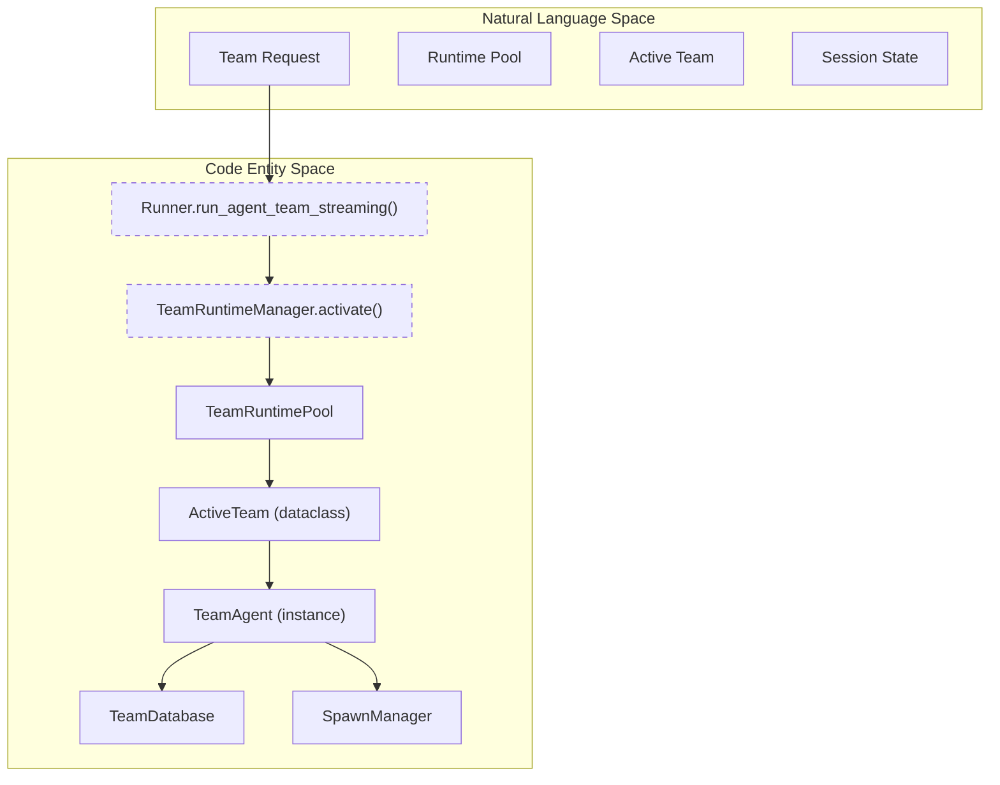
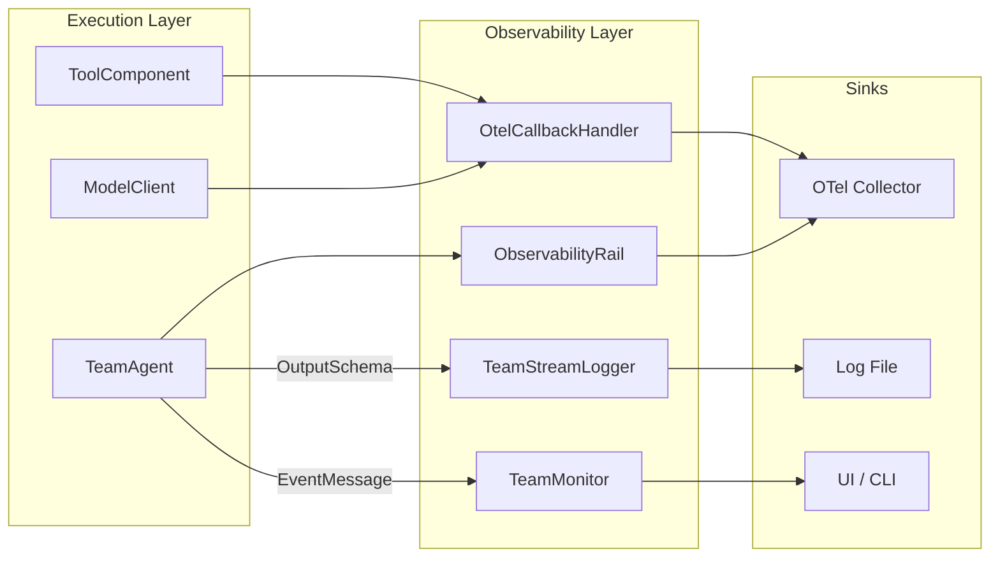

<!-- source: DeepWiki mcp.deepwiki.com · repo openJiuwen-ai/agent-core · page 9.6 Team Runtime and Observability · fetched 2026-11-02 -->

# Team Runtime and Observability

Relevant source files

The following files were used as context for generating this wiki page:

- [deploy/observability/README.md](deploy/observability/README.md)
- [deploy/observability/docker-compose.yml](deploy/observability/docker-compose.yml)
- [deploy/observability/otel-collector-config.yaml](deploy/observability/otel-collector-config.yaml)
- [openjiuwen/agent_teams/agent/recovery_manager.py](openjiuwen/agent_teams/agent/recovery_manager.py)
- [openjiuwen/agent_teams/docs/features/F_09_team-stream-logging.md](openjiuwen/agent_teams/docs/features/F_09_team-stream-logging.md)
- [openjiuwen/agent_teams/docs/features/F_19_monitor-hide-dm-switch.md](openjiuwen/agent_teams/docs/features/F_19_monitor-hide-dm-switch.md)
- [openjiuwen/agent_teams/docs/features/F_37_observability-otel-trace.md](openjiuwen/agent_teams/docs/features/F_37_observability-otel-trace.md)
- [openjiuwen/agent_teams/docs/specs/S_14_monitor-and-observability.md](openjiuwen/agent_teams/docs/specs/S_14_monitor-and-observability.md)
- [openjiuwen/agent_teams/monitor/__init__.py](openjiuwen/agent_teams/monitor/__init__.py)
- [openjiuwen/agent_teams/monitor/models.py](openjiuwen/agent_teams/monitor/models.py)
- [openjiuwen/agent_teams/monitor/stream_logger.py](openjiuwen/agent_teams/monitor/stream_logger.py)
- [openjiuwen/agent_teams/monitor/team_monitor.py](openjiuwen/agent_teams/monitor/team_monitor.py)
- [openjiuwen/agent_teams/observability/__init__.py](openjiuwen/agent_teams/observability/__init__.py)
- [openjiuwen/agent_teams/observability/callback_handler.py](openjiuwen/agent_teams/observability/callback_handler.py)
- [openjiuwen/agent_teams/observability/config.py](openjiuwen/agent_teams/observability/config.py)
- [openjiuwen/agent_teams/observability/monitor_handler.py](openjiuwen/agent_teams/observability/monitor_handler.py)
- [openjiuwen/agent_teams/observability/rail.py](openjiuwen/agent_teams/observability/rail.py)
- [openjiuwen/agent_teams/observability/semconv.py](openjiuwen/agent_teams/observability/semconv.py)
- [openjiuwen/agent_teams/observability/setup.py](openjiuwen/agent_teams/observability/setup.py)
- [openjiuwen/agent_teams/observability/span_context.py](openjiuwen/agent_teams/observability/span_context.py)
- [openjiuwen/agent_teams/runtime/manager.py](openjiuwen/agent_teams/runtime/manager.py)
- [openjiuwen/core/runner/runner.py](openjiuwen/core/runner/runner.py)
- [openjiuwen/core/runner/team_runner.py](openjiuwen/core/runner/team_runner.py)
- [openjiuwen/core/session/__init__.py](openjiuwen/core/session/__init__.py)
- [openjiuwen/core/session/agent.py](openjiuwen/core/session/agent.py)
- [openjiuwen/core/session/internal/workflow.py](openjiuwen/core/session/internal/workflow.py)
- [openjiuwen/core/session/session.py](openjiuwen/core/session/session.py)
- [openjiuwen/core/session/workflow.py](openjiuwen/core/session/workflow.py)
- [tests/unit_tests/agent_teams/monitor/__init__.py](tests/unit_tests/agent_teams/monitor/__init__.py)
- [tests/unit_tests/agent_teams/monitor/test_models.py](tests/unit_tests/agent_teams/monitor/test_models.py)
- [tests/unit_tests/agent_teams/monitor/test_stream_logger.py](tests/unit_tests/agent_teams/monitor/test_stream_logger.py)
- [tests/unit_tests/agent_teams/observability/test_observability.py](tests/unit_tests/agent_teams/observability/test_observability.py)
- [tests/unit_tests/agent_teams/test_runner_team_runtime.py](tests/unit_tests/agent_teams/test_runner_team_runtime.py)

The **Team Runtime and Observability** subsystem manages the execution lifecycle of multi-agent teams and provides comprehensive monitoring and tracing capabilities. It ensures robust team activation, recovery, and session management while integrating with OpenTelemetry for deep visibility into agent interactions.

## Team Runtime Management

The `TeamRuntimeManager` is the central coordinator for team execution within a `Runner` instance [openjiuwen/agent_teams/runtime/manager.py:104-106](). It maintains a `TeamRuntimePool` that tracks active `TeamAgent` instances and handles the logic for starting, pausing, and recovering teams [openjiuwen/agent_teams/runtime/manager.py:8-12]().

### Team Activation and Dispatch

When `Runner.run_agent_team_streaming` is called, the manager uses `decide_run_action` to determine how to handle the request based on the current state of the pool and the database [openjiuwen/agent_teams/runtime/manager.py:150-157]().

| Action Kind | Description |
| :--- | :--- |
| `COLD_START` | Brand new team; no existing state in DB or pool. |
| `COLD_RECOVER` | Team exists in DB but not in pool; requires full reconstruction from checkpoint. |
| `WARM_START` | Team is already in pool and ready for a new round. |
| `REJECT_RUNNING` | Call rejected because the team is already busy in an active run. |
| `REJECT_ORPHANED` | Team is in the pool but the session has become inconsistent. |

**Sources:** [openjiuwen/agent_teams/runtime/manager.py:49-65](), [openjiuwen/core/runner/team_runner.py:90-104]()

### Session Switching and Cold Recovery

The runtime enforces strict session isolation. If a request arrives for an active team but targeting a different `session_id`, the manager performs a "stop + remove + cold-rebuild" cycle [openjiuwen/agent_teams/runtime/manager.py:133-144](). This prevents context leakage between sessions.

Cold recovery involves:
1. Reading the `TeamAgentSpec` and `TeamRuntimeContext` from the session manifest [openjiuwen/agent_teams/runtime/metadata.py:54-59]().
2. Re-spawning teammates via the `SpawnManager` [openjiuwen/agent_teams/agent/recovery_manager.py:74-75]().
3. Restoring the `ModelAllocator` state and team roster from the `TeamDatabase` [openjiuwen/agent_teams/agent/recovery_manager.py:47-49]().

**Sources:** [openjiuwen/agent_teams/runtime/manager.py:126-149](), [openjiuwen/agent_teams/agent/recovery_manager.py:40-77]()

### Runtime Entity Mapping

The following diagram bridges the high-level runtime concepts to the specific code entities implementing them.

**Diagram: Runtime Entity Mapping**

**Sources:** [openjiuwen/core/runner/runner.py:62-101](), [openjiuwen/agent_teams/runtime/manager.py:104-113](), [openjiuwen/agent_teams/runtime/pool.py:60-65]()

## Team Observability

Observability is divided into two distinct paths: **Monitoring** (read-only views of current state) and **Telemetry** (distributed tracing via OpenTelemetry).

### TeamMonitor and Interaction Gate

The `TeamMonitor` provides a read-only observation surface for the leader `TeamAgent` [openjiuwen/agent_teams/monitor/team_monitor.py:43-56](). It allows external callers to query the team roster, task statuses, and message history without interfering with the coordination logic [openjiuwen/agent_teams/docs/specs/S_14_monitor-and-observability.md:42-43]().

*   **GodViewMessage Routing:** The monitor captures `EventMessage` objects from the leader's internal bus and flattens them into `MonitorEvent` objects for external consumption [openjiuwen/agent_teams/monitor/models.py:187-218]().
*   **InteractGate:** Interactions (like human-in-the-loop prompts) are routed through `InteractPayload` and `HumanAgentInbox` mechanisms, allowing the `TeamRuntimeManager` to deliver results back to the waiting agent [openjiuwen/agent_teams/runtime/manager.py:28-39]().

**Sources:** [openjiuwen/agent_teams/monitor/team_monitor.py:142-210](), [openjiuwen/agent_teams/docs/specs/S_14_monitor-and-observability.md:59-94]()

### OpenTelemetry Integration

The system uses OpenTelemetry (OTel) to trace the full lifecycle of a team run.

1.  **ObservabilityRail:** Intercepts agent lifecycle events (e.g., `before_task_iteration`) to manage `AgentSpanScope` [openjiuwen/agent_teams/docs/specs/S_14_monitor-and-observability.md:22-23]().
2.  **OtelCallbackHandler:** Manages spans for LLM calls and tool executions. It automatically captures metadata such as `gen_ai.request.model`, token usage, and Time-to-First-Token (TTFT) [openjiuwen/agent_teams/observability/callback_handler.py:134-136](), [openjiuwen/agent_teams/observability/callback_handler.py:201-213]().
3.  **OtelTeamMonitorHandler:** Specifically handles team-level events like task creation, member spawning, and message broadcasting, ensuring they are linked to the correct trace context [openjiuwen/agent_teams/observability/monitor_handler.py:32-35]().

**Sources:** [openjiuwen/agent_teams/observability/callback_handler.py:33-70](), [openjiuwen/agent_teams/docs/specs/S_14_monitor-and-observability.md:19-29]()

### Stream Logging

`TeamStreamLogger` provides aggregated diagnostic logging for streaming outputs [openjiuwen/agent_teams/monitor/stream_logger.py:8-13](). Unlike standard logs, it buffers tokens **per source** (member/role) to ensure that interleaved chunks from different agents are rendered as coherent blocks in the output file [openjiuwen/agent_teams/monitor/stream_logger.py:15-20]().

**Diagram: Observability Data Flow**

**Sources:** [openjiuwen/agent_teams/docs/specs/S_14_monitor-and-observability.md:16-27](), [openjiuwen/agent_teams/monitor/stream_logger.py:31-40](), [openjiuwen/agent_teams/monitor/team_monitor.py:101-107]()

### Observability Semantic Conventions

The SDK follows standardized semantic conventions for AI observability [openjiuwen/agent_teams/observability/semconv.py:1-5]():

| Attribute Key | Description |
| :--- | :--- |
| `gen_ai.system` | The name of the agent system (default: "openjiuwen") |
| `gen_ai.request.model` | The specific model requested for completion |
| `gen_ai.usage.total_tokens` | Total tokens consumed by the request |
| `at.session_id` | The team session identifier |
| `at.member_name` | The name of the specific team member involved |

**Sources:** [openjiuwen/agent_teams/observability/semconv.py:33-70](), [openjiuwen/agent_teams/observability/callback_handler.py:33-70]()

---

