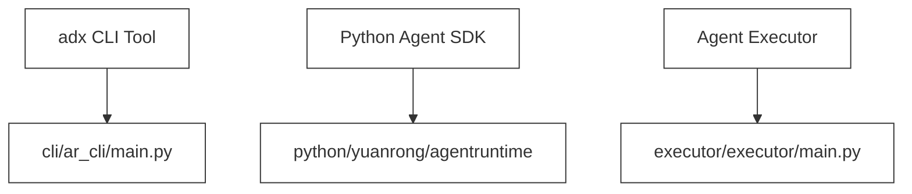
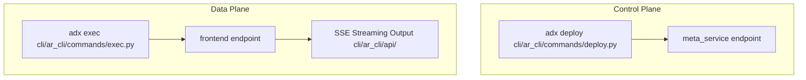

<!-- source: DeepWiki mcp.deepwiki.com · repo openJiuwen-ai/agent-dx · page 1 Overview · fetched 2026-11-02 -->

# Overview

<details>
<summary>Relevant source files</summary>

The following files were used as context for generating this wiki page:

- [AGENTS.md](AGENTS.md)
- [README.md](README.md)
- [README.zh.md](README.zh.md)
- [Third_Party_Open_Source_Software_Notice.txt](Third_Party_Open_Source_Software_Notice.txt)
- [VERSION](VERSION)
- [python/MANIFEST.in](python/MANIFEST.in)
- [python/VERSION](python/VERSION)

</details>


Agent Distributed Executor (`agent-dx`) is a distributed execution substrate designed for agents, providing developer tools for agent registration, invocation, and session management over `openYuanrong` [README.md:3-8]. The repository comprises three core components: the `adx` command-line interface (`cli/`), the independent Python Agent SDK (`python/`), and the platform-owned Agent Executor (`executor/`) [README.md:7, 59-65].

The following diagram bridges natural language functional concepts to their primary codebase implementations:



Sources: [README.md:3-8](), [AGENTS.md:21]()

## Repository Layout and Component Summary

The repository is organized into distinct packages that share a common versioning scheme defined at the root level [README.md:59-73]:

```text
cli/                 Python CLI package source and packaging config
cli/ar_cli/          adx command implementation
python/              Independent agent-dx Python SDK package
executor/            Independent platform Agent Executor package
tests/cli/           CLI unit tests
tests/python/        agent-dx SDK unit and integration tests
tests/executor/      Agent Executor unit tests
pytest.ini           Test configuration
```

The system interacts with `openYuanrong` services across both control and data planes, handled by the CLI commands and underlying API clients:



Sources: [README.md:11-17](), [AGENTS.md:21-34]()

## Architecture and Component Maps

For deeper technical details regarding how `cli/`, `python/`, `executor/` and `tests/` interact, the separation of the control plane (`meta_service`) versus data plane (`frontend`, SSE streaming), and shared versioning enforcement, see [Architecture and Component Map](#1.1) [README.md:13-17, 59-73].

Sources: [README.md:13-17](), [README.md:59-73]()

## Getting Started and Build

For instructions on building wheels using `build.sh`, configuring packages via `setup.py` / `pyproject.toml`, deploying configurations using an `agent.json` spec, and performing invocations via `adx exec`, see [Getting Started and Build](#1.2) [README.md:22-55].

Sources: [README.md:22-55](), [AGENTS.md:51-64]()

---

