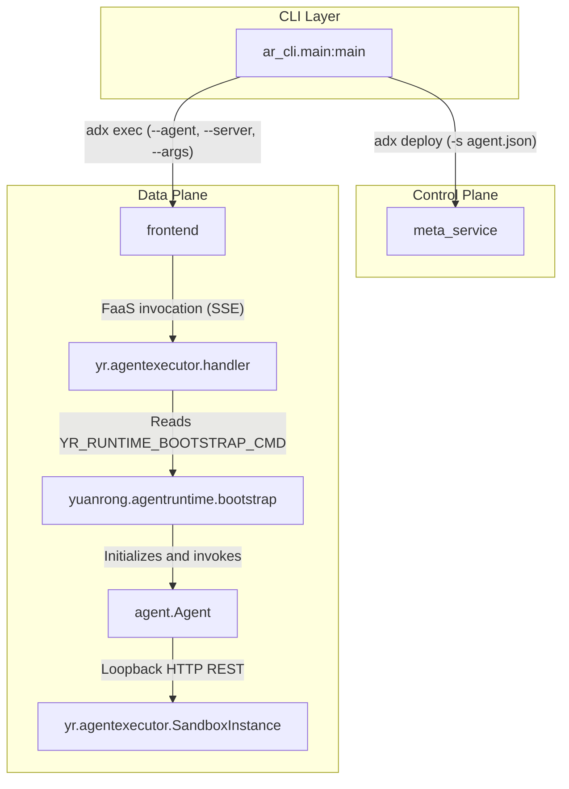
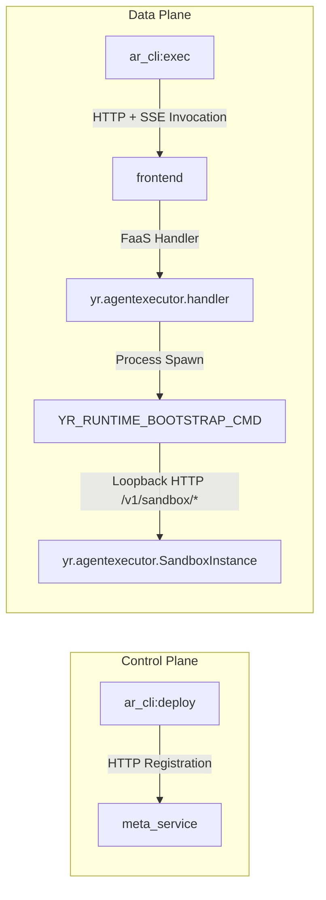

<!-- source: DeepWiki mcp.deepwiki.com · repo openJiuwen-ai/agent-dx · page 1.1 Architecture and Component Map · fetched 2026-11-02 -->

# Architecture and Component Map

<details>
<summary>Relevant source files</summary>

The following files were used as context for generating this wiki page:

- [README.md](README.md)
- [README.zh.md](README.zh.md)
- [Third_Party_Open_Source_Software_Notice.txt](Third_Party_Open_Source_Software_Notice.txt)
- [cli/ar_cli/__init__.py](cli/ar_cli/__init__.py)
- [cli/setup.py](cli/setup.py)
- [executor/README.md](executor/README.md)
- [executor/README.zh.md](executor/README.zh.md)
- [python/README.md](python/README.md)
- [python/pyproject.toml](python/pyproject.toml)

</details>


## Purpose and Scope
This document details the architectural layout, component boundaries, and inter-package relationships of the Agent Distributed Executor (`agent-dx`) codebase. It defines how the autonomous software packages (`cli/`, `python/`, `executor/`, and `tests/`) are structured, how the control plane (`meta_service`) separates from the data plane (`frontend` and SSE streaming), and how shared versioning is maintained across independent distributions.

Sources: [README.md:1-74](), [cli/setup.py:32-54](), [python/pyproject.toml:1-25](), [executor/README.md:5-36]()

---

## 1. Package Layout and Directory Architecture

The repository is divided into distinct Python packages and test suites, each managed independently while sharing a unified version number at the repository root.

```text
cli/                 Python CLI package source and packaging config
cli/ar_cli/          adx command implementation
python/              Independent agent-dx Python SDK package (`agent-dx-sdk`)
executor/            Independent platform Agent Executor package (`agent_dx_executor`)
tests/cli/           CLI unit tests
tests/python/        agent-dx SDK unit and integration tests
tests/executor/      Agent Executor unit tests
pytest.ini           Test configuration
```

- **`cli/`**: Contains the Click-based command-line interface (`ar_cli`), providing administrative registration (`adx deploy`) and execution (`adx exec`) facilities. Packaged via [cli/setup.py:32-54]().
- **`python/`**: Contains the user-facing Agent SDK and FaaS bootstrap runtime (`yuanrong.agentruntime`), defining the `AgentExecutor` programming model, session context, and `EventLog` persistence. Packaged via [python/pyproject.toml:1-25]().
- **`executor/`**: Contains the platform-owned FaaS code package (`yr.agentexecutor`) pre-installed in custom Agent base images, managing user process groups, std/stderr aggregation, and loopback sandbox operations. Described in [executor/README.md:5-36]().
- **`tests/`**: Contains mirrors of the component directory structure for unit and integration testing under `pytest`.

Sources: [README.md:59-74](), [cli/setup.py:32-54](), [python/pyproject.toml:1-25](), [executor/README.md:5-36]()

---

## 2. System Architecture and Component Map

The following diagram maps the structural units of `agent-dx` from Natural Language concepts to exact code entities, illustrating the flow from user commands through the control and data planes.

### System Architecture Diagram

Sources: [README.md:27-56](), [cli/setup.py:49-53](), [executor/README.md:28-48](), [python/README.md:12-31]()

---

## 3. Control Plane vs. Data Plane Separation

The `agent-dx` substrate cleanly separates administrative lifecycle management (control plane) from execution routing and telemetry streaming (data plane).

### Control Plane (`meta_service`)
- **Responsibility**: Agent and function registration, metadata validation, and state storage.
- **Interaction**: The `ar_cli` tool interacts with `meta_service` via HTTP during deployment commands (`adx deploy`), parsing configuration objects such as `agent.json` (specifying names, runtimes, handlers, CPU, memory, and code paths).
- **Code Entities**: CLI deployment logic maps to `ar_cli` modules targeting the `meta_service` API endpoint.

### Data Plane (`frontend`, SSE, and `yr.agentexecutor`)
- **Responsibility**: Invocation transport, Server-Sent Events (SSE) streaming, container lifecycle execution, and process isolation.
- **Interaction**: 
  1. The `ar_cli` invocation path (`adx exec`) routes through the openYuanrong `frontend` component using SSE streaming for output delivery [README.md:11-17]().
  2. The platform `yr.agentexecutor` runs inside the function instance container, starting user processes and exposing a loopback-only REST API (`/v1/sandbox/*`) for local operations [executor/README.md:33-48]().
  3. The `yuanrong.agentruntime.bootstrap` module handles FaaS entrypoints (`initialize`, `handle`, `pre_stop`), bridging openYuanrong runtime events to user-defined `agent.Agent` subclasses [python/README.md:36-52]().

### Component Interaction and Control/Data Plane Flow

Sources: [README.md:11-17](), [executor/README.md:28-48](), [python/README.md:36-52]()

---

## 4. Shared Versioning Mechanism

The CLI (`agent-dx-cli`), the Python SDK (`agent-dx-sdk`), and the Agent Executor (`agent_dx_executor`) are distributed as independent packages but maintain strict version synchronization via the repository root.

- **Source of Truth**: The single source of truth for release versions is the repository root `VERSION` file [README.md:72-73]().
- **Build Override**: Packaging scripts support environment overrides via `BUILD_VERSION` [cli/setup.py:26-30]().
- **Implementation**: 
  - The CLI package reads the version dynamically at runtime via `cli/ar_cli/__init__.py` [cli/ar_cli/__init__.py:23-30]() or falls back to package metadata via `importlib.metadata.version("agent-dx-cli")` [cli/ar_cli/__init__.py:19-26]().
  - Setuptools configurations in `cli/setup.py` and `python/pyproject.toml` reference or inherit these version definitions during wheel compilation [cli/setup.py:26-34](), [python/pyproject.toml:5-7]().

Sources: [README.md:72-73](), [cli/setup.py:26-34](), [cli/ar_cli/__init__.py:19-30](), [python/pyproject.toml:5-7]()

---

