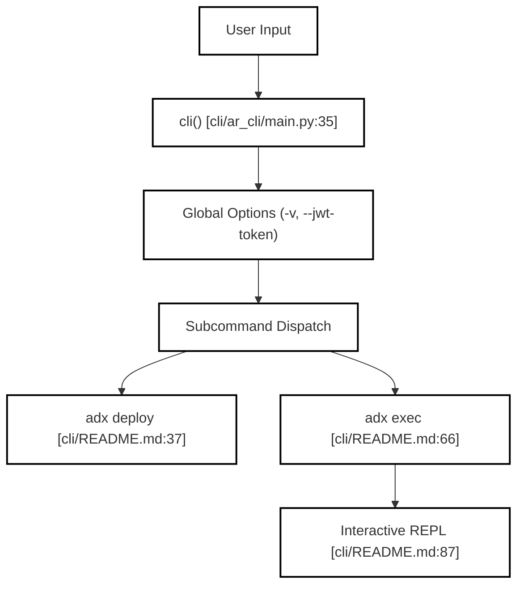
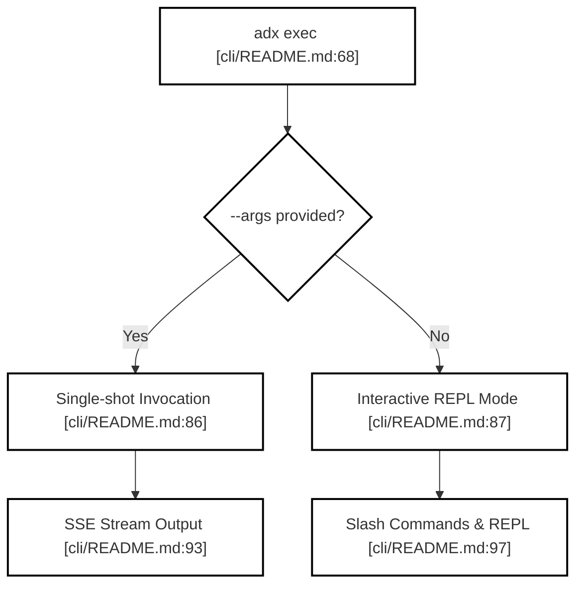

<!-- source: DeepWiki mcp.deepwiki.com · repo openJiuwen-ai/agent-dx · page 2 adx CLI · fetched 2026-11-02 -->

# adx CLI

Relevant source files

The following files were used as context for generating this wiki page:

- [cli/README.md](cli/README.md)
- [cli/ar_cli/const.py](cli/ar_cli/const.py)
- [cli/ar_cli/main.py](cli/ar_cli/main.py)

This page provides an overview of the Click-based `adx` command-line tool, which serves as the primary interface for deploying and invoking agents over the agent-dx distributed execution substrate.

## Purpose and Scope

The `adx` CLI packages function registration and invocation into convenient commands targeting the openYuanrong platform control and data planes [cli/README.md:1-7](). 

As a parent page, this document outlines the high-level architecture and structure of the CLI. For detailed specifications, refer to the following child pages:
- [Commands: deploy and exec](#2.1) — Registration flow, invocation flow, options, validation, and exit codes.
- [API Client, URNs and Utilities](#2.2) — HTTP layer, function invocation and SSE streaming, session context client, URN translation, shared utils and errors.
- [Interactive Mode](#2.3) — Interactive REPL: runner, lifecycle/session ids, line editing, command registry, state, query and rendering.

---

## Architecture and Command-Line Interface

The CLI is structured around a root `click.group` defined in `cli/ar_cli/main.py` [cli/ar_cli/main.py:35-56](). It accepts global options such as `-v/--verbose`, `--version`, and `--jwt-token` (which maps to the `YR_JWT_TOKEN` environment variable) [cli/ar_cli/main.py:36-55]() before delegating to specific subcommands registered via `COMMANDS` [cli/ar_cli/main.py:73-74]().

Sources: `cli/ar_cli/main.py:35-74`, `cli/README.md:37-87`

---

## Core Subcommands

### `adx deploy`
The `deploy` subcommand registers an agent function with the control plane (`meta_service`) [cli/README.md:5](). It accepts a specification via `-s/--spec` (supporting inline JSON strings or JSON file paths) and a target `--server` address (`host:port`) [cli/README.md:43-46](). It automatically injects default configuration values like `enableSessionCtx` if omitted [cli/README.md:52]().

### `adx exec`
The `exec` subcommand invokes an agent through the frontend data plane [cli/README.md:6](). When `--args` is provided, it performs a single-shot execution and streams the result via Server-Sent Events (SSE) [cli/README.md:86-93](). When `--args` is omitted, it launches the interactive REPL mode [cli/README.md:87]().

Sources: `cli/README.md:68-93`

---

## Global Constants and Exit Codes

Shared paths, headers, default timeouts, and exit codes are defined globally to ensure consistency across modules [cli/ar_cli/const.py:17-59]().

| Exit Code | Constant | Meaning |
| :--- | :--- | :--- |
| `0` | `EXIT_SUCCESS` | Success [cli/ar_cli/const.py:56] |
| `1` | `EXIT_FAILURE` | Server failure (non-2xx HTTP, response code != 0) [cli/ar_cli/const.py:57] |
| `2` | `EXIT_PARAM_ERROR` | Parameter error (invalid JSON, missing required arguments) [cli/ar_cli/const.py:58] |
| `3` | `EXIT_NETWORK_ERROR` | Network error (connection failure, timeout) [cli/ar_cli/const.py:59] |

Sources: `cli/ar_cli/const.py:55-60`

For further technical details, please proceed to the child pages:
- [Commands: deploy and exec](#2.1)
- [API Client, URNs and Utilities](#2.2)
- [Interactive Mode](#2.3)

---

