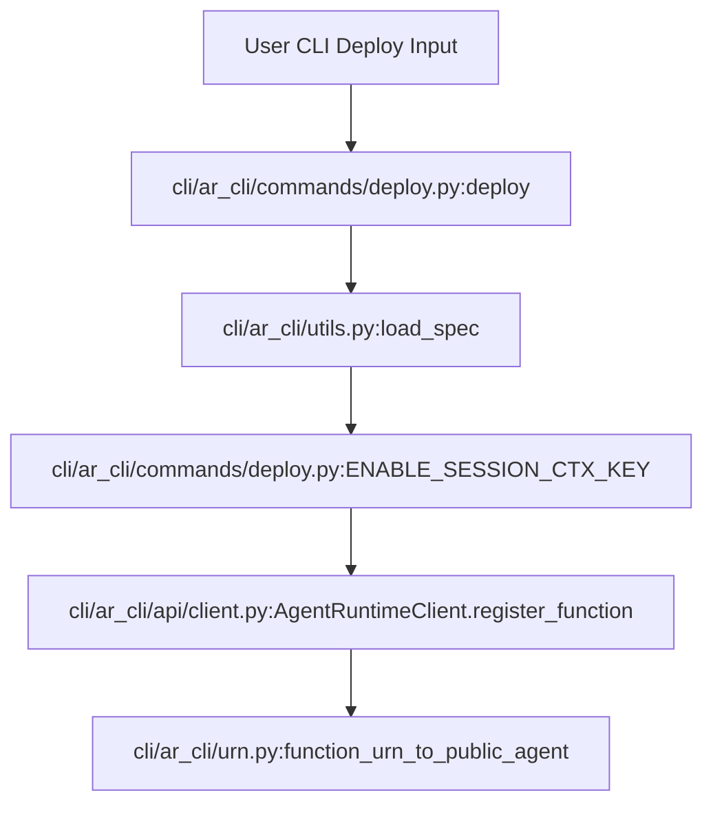
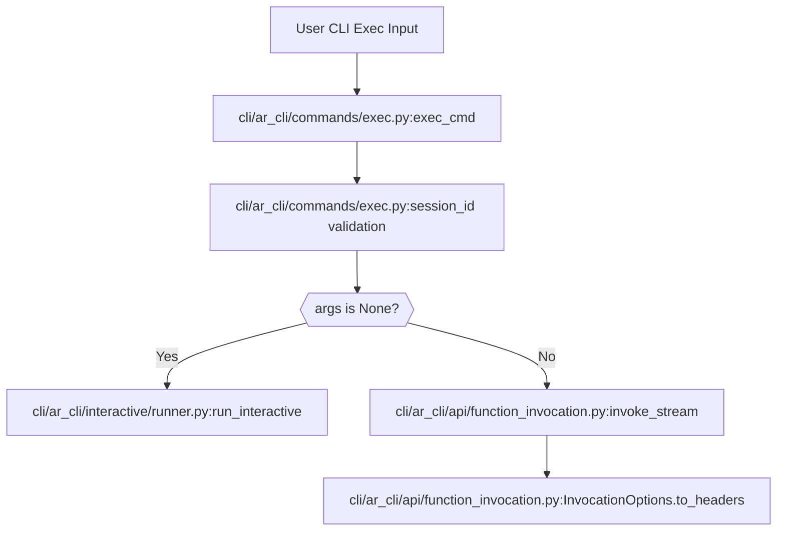

<!-- source: DeepWiki mcp.deepwiki.com · repo openJiuwen-ai/agent-dx · page 2.1 Commands: deploy and exec · fetched 2026-11-02 -->

# Commands: deploy and exec

Relevant source files

The following files were used as context for generating this wiki page:

- [cli/ar_cli/commands/deploy.py](cli/ar_cli/commands/deploy.py)
- [cli/ar_cli/commands/exec.py](cli/ar_cli/commands/exec.py)
- [tests/cli/test_deploy_inject.py](tests/cli/test_deploy_inject.py)
- [tests/cli/test_exec.py](tests/cli/test_exec.py)

Purpose and scope: This section documents the implementation, command-line options, validation rules, execution flows, and exit codes for the `adx deploy` and `adx exec` commands within the `agent-dx` CLI (`cli/ar_cli/commands/deploy.py` and `cli/ar_cli/commands/exec.py`). These commands manage agent registration with `meta_service` and handle single-shot or interactive agent function invocation through the frontend data plane.

Sources: `cli/ar_cli/commands/deploy.py:1-86` [cli/ar_cli/commands/deploy.py:1-85](), `cli/ar_cli/commands/exec.py:1-148` [cli/ar_cli/commands/exec.py:1-147]()

---

## 1. `adx deploy`: Registration Flow and Validation

The `adx deploy` command registers an agent function with the platform's `meta_service`. It accepts a function specification (either inline JSON string or a file path) and a target server address.

### Command Options and Parameters
* `--spec` (`-s`): Required option pointing to a JSON string or file path containing the function configuration [cli/ar_cli/commands/deploy.py:43-48]().
* `--server`: Required option specifying the `meta_service` address in `host:port` format [cli/ar_cli/commands/deploy.py:49-54]().

### Registration Pipeline
1. **Spec Loading**: `load_spec()` reads the input source. If it is a file path, it reads the file contents; if it is a JSON string, it parses it directly [cli/ar_cli/commands/deploy.py:57]().
2. **Field Injection**: The command checks for the presence of `enableSessionCtx` (`ENABLE_SESSION_CTX_KEY`). If omitted, it defaults to `True`. Explicit user values (`true` or `false`) are preserved [cli/ar_cli/commands/deploy.py:61-65]().
3. **Client Invocation**: `AgentRuntimeClient.register_function()` transmits the normalized server address and spec payload to the `meta_service` [cli/ar_cli/commands/deploy.py:67-69]().
4. **URN Translation**: The response is inspected for `functionVersionUrn` or `functionUrn`. `function_urn_to_public_agent()` translates this URN into a human-readable public agent format (`0@default@funcname`) before logging [cli/ar_cli/commands/deploy.py:74-78]().

Diagram: Deploy Registration Pipeline (Natural Language Space to Code Entity Space)

Sources: `cli/ar_cli/commands/deploy.py:32-86` [cli/ar_cli/commands/deploy.py:32-85](), `tests/cli/test_deploy_inject.py:30-162` [tests/cli/test_deploy_inject.py:30-161]()

---

## 2. `adx exec`: Invocation Flow and Interactive Mode

The `adx exec` command invokes an agent function and streams its Server-Sent Events (SSE) response [cli/ar_cli/commands/exec.py:17-43]().

### Command Options and Parameters
* `--agent`: Required agent identifier (`0@default@funcname[:version]`) [cli/ar_cli/commands/exec.py:54-59]().
* `--server`: Required frontend address as `host:port` [cli/ar_cli/commands/exec.py:60-65]().
* `--session-ctx`: Optional session context header value (`X-Session-Context`) [cli/ar_cli/commands/exec.py:66-71]().
* `--session-id`: Optional instance session identifier header value (`X-Instance-Session`) [cli/ar_cli/commands/exec.py:72-77]().
* `--session-ttl`: Instance session TTL (defaults to 90; 600 in interactive mode) [cli/ar_cli/commands/exec.py:78-83]().
* `--concurrency`: Instance session concurrency limit (defaults to 1) [cli/ar_cli/commands/exec.py:84-89]().
* `--args`: Handler arguments as a JSON string. Omitting this option enters interactive mode [cli/ar_cli/commands/exec.py:90-95]().

### Invocation Flow & Bifurcation
1. **Validation**: The command validates options, raising a `click.UsageError` if `--session-ttl` or `--concurrency` are supplied without `--session-id` [cli/ar_cli/commands/exec.py:107-109]().
2. **Mode Branching**:
   * **Interactive Mode (`args is None`)**: Delegates execution to `run_interactive()`, passing client, server URL, agent URN, and session configuration parameters [cli/ar_cli/commands/exec.py:116-125]().
   * **Single-Shot Mode (`args` provided)**: Validates JSON formatting via `parse_json_arg()`, constructs `InvocationOptions` (auto-generating a session context if omitted), and consumes the SSE stream via `invoke_stream()` [cli/ar_cli/commands/exec.py:128-142]().

Diagram: Exec Invocation Pipeline (Natural Language Space to Code Entity Space)

Sources: `cli/ar_cli/commands/exec.py:41-148` [cli/ar_cli/commands/exec.py:41-147](), `tests/cli/test_exec.py:65-211` [tests/cli/test_exec.py:65-211]()

---

## 3. Validation, Errors, and Exit Codes

Both `deploy` and `exec` catch runtime and client errors through strict exception handling and exit code propagation.

### Error Handling Strategy
* **ArError**: Captured from API interactions, logging the error message and exiting with the specific `exit_code` defined on the error object (`e.exit_code`) [cli/ar_cli/commands/deploy.py:70-72](), [cli/ar_cli/commands/exec.py:144-146]().
* **Click Usage & Parameter Errors**: Malformed JSON arguments, missing required options, or invalid combinations of options (such as session TTL without session ID) trigger Click parameter validation exceptions resulting in exit code `2`.

### Exit Code Summary
| Condition | Exit Code | Source / Trigger |
| :--- | :--- | :--- |
| Successful deployment or execution | `0` | `ctx.exit(0)` [cli/ar_cli/commands/deploy.py:85](), [cli/ar_cli/commands/exec.py:147]() |
| API runtime or client error (`ArError`) | `e.exit_code` | `ArError` subclasses [cli/ar_cli/commands/deploy.py:72](), [cli/ar_cli/commands/exec.py:146]() |
| Invalid JSON, missing options, or usage error | `2` | `click.UsageError` / `click.BadParameter` [cli/ar_cli/commands/exec.py:109](), [tests/cli/test_deploy_inject.py:74]() |

Sources: `cli/ar_cli/commands/deploy.py:68-73` [cli/ar_cli/commands/deploy.py:68-73](), `cli/ar_cli/commands/exec.py:107-110,144-147` [cli/ar_cli/commands/exec.py:107-110,144-147](), `tests/cli/test_deploy_inject.py:71-75` [tests/cli/test_deploy_inject.py:71-75]()

---

