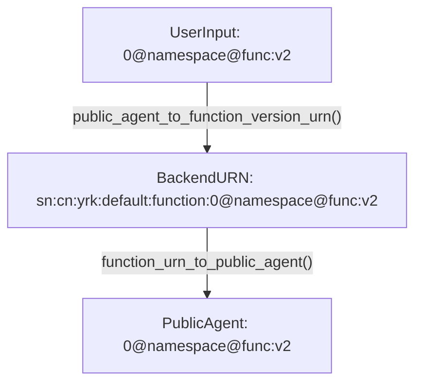

<!-- source: DeepWiki mcp.deepwiki.com · repo openJiuwen-ai/agent-dx · page 2.2 API Client, URNs and Utilities · fetched 2026-11-02 -->

# API Client, URNs and Utilities

<details>
<summary>Relevant source files</summary>

The following files were used as context for generating this wiki page:

- [cli/ar_cli/api/__init__.py](cli/ar_cli/api/__init__.py)
- [cli/ar_cli/api/client.py](cli/ar_cli/api/client.py)
- [cli/ar_cli/api/function_invocation.py](cli/ar_cli/api/function_invocation.py)
- [cli/ar_cli/api/http.py](cli/ar_cli/api/http.py)
- [cli/ar_cli/api/session_context.py](cli/ar_cli/api/session_context.py)
- [cli/ar_cli/commands/__init__.py](cli/ar_cli/commands/__init__.py)
- [cli/ar_cli/errors.py](cli/ar_cli/errors.py)
- [cli/ar_cli/interactive/__init__.py](cli/ar_cli/interactive/__init__.py)
- [cli/ar_cli/interactive/lineedit.py](cli/ar_cli/interactive/lineedit.py)
- [cli/ar_cli/interactive/runner.py](cli/ar_cli/interactive/runner.py)
- [cli/ar_cli/urn.py](cli/ar_cli/urn.py)
- [cli/ar_cli/utils.py](cli/ar_cli/utils.py)
- [cli/requirements.txt](cli/requirements.txt)
- [tests/cli/test_lineedit.py](tests/cli/test_lineedit.py)
- [tests/cli/test_session_context_client.py](tests/cli/test_session_context_client.py)
- [tests/cli/test_sse.py](tests/cli/test_sse.py)
- [tests/cli/test_utils.py](tests/cli/test_utils.py)

</details>


## Purpose and Scope
This section covers the core supporting modules of the `adx` CLI (`cli/ar_cli/`), providing the foundational infrastructure for HTTP communication with backend services, URN format translation, common command utilities, validation callbacks, and unified error handling. These components isolate network I/O, configuration parsing, and error translation from command logic.

Sources: `cli/ar_cli/api/http.py`, `cli/ar_cli/urn.py`, `cli/ar_cli/utils.py`, `cli/ar_cli/errors.py`

---

## HTTP Layer and Client Architecture
The HTTP layer is centered around `HttpClient` in `cli/ar_cli/api/http.py`, which wraps `requests.Session` to provide consistent JSON request handling, connection management, headers redaction, and error mapping [cli/ar_cli/api/http.py:31-43]().

### Core Request Methods
- `request_json`: Handles JSON payloads, validates response statuses via `response.ok`, parses response bodies, and checks service-level business error codes [cli/ar_cli/api/http.py:52-105]().
- `request_no_content`: Executes methods where successful responses carry no body content [cli/ar_cli/api/http.py:109-142]().
- `post_stream`: Opens a UTF-8 streaming response with `stream=True` for Server-Sent Events (SSE) and incremental output [cli/ar_cli/api/http.py:144-170]().

```mermaid
graph TD
    sub5[""ClientCaller""] -->|"request_json()"| sub6[""HttpClient.request_json""]
    sub5 -->|"post_stream()"| sub7[""HttpClient.post_stream""]
    sub6 -->|"_session.request()"| sub8[""requests.Session""]
    sub7 -->|"_session.post(stream=True)"| sub8
    sub8 -->|"response.ok check"| sub9[""build_api_error()""]
    sub9 -->|"raises"| sub10[""ApiError""]
```
Sources: `cli/ar_cli/api/http.py:31-170]()`

---

## URN Translation
The CLI translates between public-facing agent strings (`0@namespace@func[:version]`) and the backend function version URN format (`sn:cn:yrk:default:function:0@namespace@func:version`) [cli/ar_cli/urn.py:23-45]().

### Translation Functions
- `public_agent_to_function_version_urn`: Parses a public agent descriptor (defaulting version to `latest`) and formats it into the backend URN [cli/ar_cli/urn.py:27-30]().
- `function_urn_to_public_agent`: Validates a full backend URN and strips the prefix to return the public representation [cli/ar_cli/urn.py:33-45]().


Sources: `cli/ar_cli/urn.py:23-70]()`

---

## Shared Utilities and Validation
Common helpers in `cli/ar_cli/utils.py` provide address normalization, spec loading, and Click parameter validation callbacks [cli/ar_cli/utils.py:17-146]().

### Key Functions
- `normalize_addr`: Prepends `http://` to bare `host:port` addresses if no scheme is specified [cli/ar_cli/utils.py:100-110]().
- `load_spec`: Loads function specifications from inline JSON strings or JSON files on disk, raising `click.BadParameter` on failure [cli/ar_cli/utils.py:112-134]().
- `validate_server`: Click callback ensuring server addresses conform to `host:port` format [cli/ar_cli/utils.py:47-62]().
- `validate_session_field`: Click callback ensuring session identifiers or context strings do not exceed `SESSION_FIELD_MAX_LEN` [cli/ar_cli/utils.py:34-44]().

Sources: `cli/ar_cli/utils.py:34-134]()`

---

## Unified Error Handling
Errors are organized under a hierarchical exception structure in `cli/ar_cli/errors.py`, where each exception class defines an associated process exit code [cli/ar_cli/errors.py:17-42]().

| Exception Class | Parent | Associated Exit Code | Description |
| :--- | :--- | :--- | :--- |
| `ArError` | `Exception` | `EXIT_FAILURE` (1) | Base exception class for the `adx` CLI [cli/ar_cli/errors.py:22-25]() |
| `ApiError` | `ArError` | `EXIT_FAILURE` (1) | Raised when servers return non-2xx status codes or non-zero business codes [cli/ar_cli/errors.py:28-37]() |
| `NetworkError` | `ArError` | `EXIT_NETWORK_ERROR` (2) | Raised when connection establishment fails (timeouts, DNS, connection refused) [cli/ar_cli/errors.py:39-42]() |

Sources: `cli/ar_cli/errors.py:17-43]()`

---

