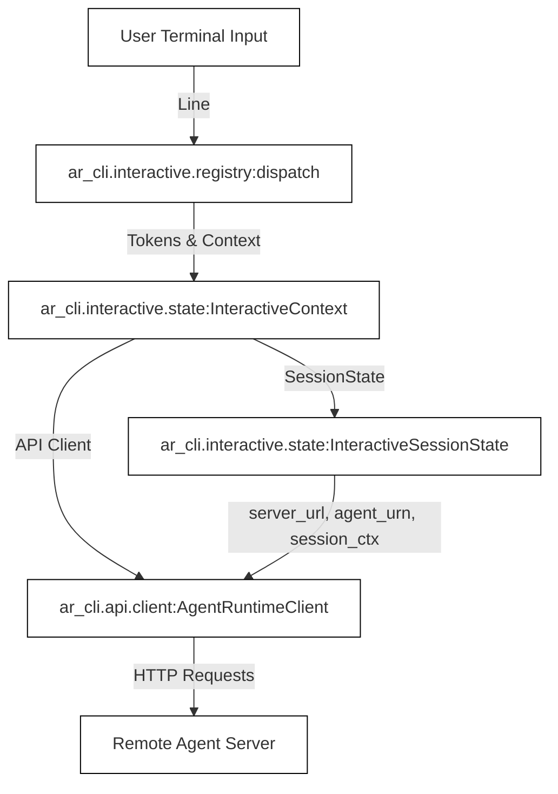
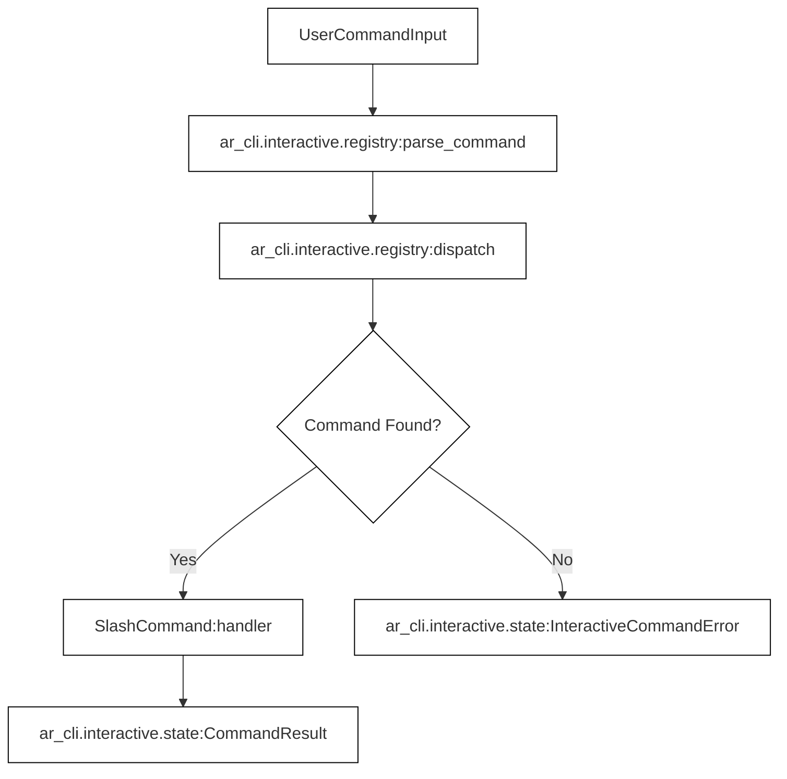

<!-- source: DeepWiki mcp.deepwiki.com · repo openJiuwen-ai/agent-dx · page 2.3 Interactive Mode · fetched 2026-11-02 -->

# Interactive Mode

Relevant source files

The following files were used as context for generating this wiki page:

- [cli/ar_cli/interactive/lifecycle.py](cli/ar_cli/interactive/lifecycle.py)
- [cli/ar_cli/interactive/query.py](cli/ar_cli/interactive/query.py)
- [cli/ar_cli/interactive/registry.py](cli/ar_cli/interactive/registry.py)
- [cli/ar_cli/interactive/render.py](cli/ar_cli/interactive/render.py)
- [cli/ar_cli/interactive/state.py](cli/ar_cli/interactive/state.py)
- [tests/cli/test_interactive.py](tests/cli/test_interactive.py)
- [tests/cli/test_session.py](tests/cli/test_session.py)

## Purpose and Scope
This page details the implementation of the interactive Read-Eval-Print Loop (REPL) within the `agent-dx` CLI (`ar_cli.interactive`). The interactive mode provides a terminal-based interface for managing `SessionCtx` instances, inspecting turn histories, forking execution contexts, and invoking agent operations dynamically through slash commands. 

Sources: `cli/ar_cli/interactive/lifecycle.py`, `cli/ar_cli/interactive/registry.py`, `cli/ar_cli/interactive/state.py`, `cli/ar_cli/interactive/query.py`, `cli/ar_cli/interactive/render.py`

---

## 1. State Management and Context Model

The interactive REPL maintains execution state using dataclasses defined in `ar_cli.interactive.state`. The primary structures are `InteractiveSessionState` and `InteractiveContext`.

- `InteractiveSessionState`: Tracks the active target server URL (`server_url`), the target agent URN (`agent_urn`), and the current local or remote session context ID (`session_ctx`) [cli/ar_cli/interactive/state.py:27-34]().
- `InteractiveContext`: Combines `InteractiveSessionState` with an instance of `AgentRuntimeClient` to provide slash-command handlers access to both local state and remote API capabilities [cli/ar_cli/interactive/state.py:36-42]().
- `CommandResult`: An enumeration (`CONTINUE`, `EXIT`) returned by command handlers to signal whether the REPL loop should proceed or terminate [cli/ar_cli/interactive/state.py:44-49]().
- `InteractiveCommandError`: A specialized exception raised for user-facing syntax errors or invalid API responses during command execution [cli/ar_cli/interactive/state.py:51-52]().

*Figure 1: State and Context Flow across CLI layers.*

Sources: `cli/ar_cli/interactive/state.py`

---

## 2. Command Registry and Dispatch

Slash commands are statically registered in `ar_cli.interactive.registry` via the `SlashCommand` dataclass collection (`_COMMANDS`). Each entry associates a command string (e.g., `/sessions`) with a summary description and a `CommandHandler` callable [cli/ar_cli/interactive/registry.py:36-50]().

### Supported Slash Commands

| Command | Summary | Handler Function |
| :--- | :--- | :--- |
| `/sessions` | List and switch `SessionCtx` | `ar_cli.interactive.query:show_sessions` [cli/ar_cli/interactive/registry.py:44]() |
| `/history` | Show Turns in the current `SessionCtx` | `ar_cli.interactive.query:show_history` [cli/ar_cli/interactive/registry.py:45]() |
| `/fork` | Fork a completed Turn into a `SessionCtx` | `ar_cli.interactive.lifecycle:fork_session` [cli/ar_cli/interactive/registry.py:46]() |
| `/delete` | Delete a non-current `SessionCtx` | `ar_cli.interactive.lifecycle:delete_session` [cli/ar_cli/interactive/registry.py:47]() |
| `/new` | Switch to a new local `SessionCtx` | `ar_cli.interactive.lifecycle:new_session` [cli/ar_cli/interactive/registry.py:48]() |
| `/quit` | Exit interactive mode | `ar_cli.interactive.lifecycle:quit_interactive` [cli/ar_cli/interactive/registry.py:49]() |

Input parsing is handled by `parse_command()`, which leverages `shlex.split()` to tokenize input lines securely while wrapping parser errors into `InteractiveCommandError` [cli/ar_cli/interactive/registry.py:76-83]().

*Figure 2: Command Dispatch Pipeline.*

Sources: `cli/ar_cli/interactive/registry.py`

---

## 3. Session Lifecycle and Mutation

Session lifecycle handlers in `ar_cli.interactive.lifecycle` execute core administrative transformations over session contexts:

- `fork_session`: Validates a source `<turn-id>` and target `<new-session-ctx-id>`, ensures the target differs from the current session, and calls `AgentRuntimeClient.fork_session_context()` [cli/ar_cli/interactive/lifecycle.py:28-52]() [cli/ar_cli/interactive/lifecycle.py:35-38](). Handles HTTP 409 conflict responses gracefully [cli/ar_cli/interactive/lifecycle.py:47-51]().
- `delete_session`: Prevents deletion of the currently active session context, then invokes `AgentRuntimeClient.delete_session_context()` [cli/ar_cli/interactive/lifecycle.py:63-78]().
- `new_session`: Instantiates a local session identifier via `new_session_ctx_id()` (generating `adx-<uuid>`) without immediately sending an allocation request to the remote substrate [cli/ar_cli/interactive/lifecycle.py:81-87]() [cli/ar_cli/interactive/lifecycle.py:106-107]().
- `quit_interactive`: Terminates the session by returning `CommandResult.EXIT` [cli/ar_cli/interactive/lifecycle.py:90-93]().

Resource IDs are strictly validated via `validate_resource_id()` to guard against empty or oversized identifiers exceeding `SESSION_FIELD_MAX_LEN` [cli/ar_cli/interactive/lifecycle.py:96-103]().

Sources: `cli/ar_cli/interactive/lifecycle.py`

---

## 4. Query and Terminal Rendering

Read-only commands retrieve and render remote state structures through functions implemented in `ar_cli.interactive.query` and `ar_cli.interactive.render`.

- `show_sessions`: Fetches session contexts using `AgentRuntimeClient.list_session_contexts()` up to `DEFAULT_SESSION_CONTEXT_LIST_LIMIT` [cli/ar_cli/interactive/query.py:29-37](). If running in an interactive TTY environment supporting selectors (`can_select_items()`), it delegates to `select_item()`; otherwise, it prints a static text table [cli/ar_cli/interactive/query.py:54-65]().
- `show_history`: Queries turns within the current session context via `AgentRuntimeClient.list_turns()` [cli/ar_cli/interactive/query.py:71-81](). Catches HTTP 404 errors to present a friendly notification if the session has not been initialized [cli/ar_cli/interactive/query.py:82-86]().
- Rendering Utilities: `ar_cli.interactive.render` provides robust layout formatters (`format_table`, `format_row`) and unicode-aware width calculation (`char_width_of`, `display_width`, `truncate_display`) to guarantee alignment across multi-byte character sets [cli/ar_cli/interactive/render.py:77-119]().

Sources: `cli/ar_cli/interactive/query.py`, `cli/ar_cli/interactive/render.py`

---

