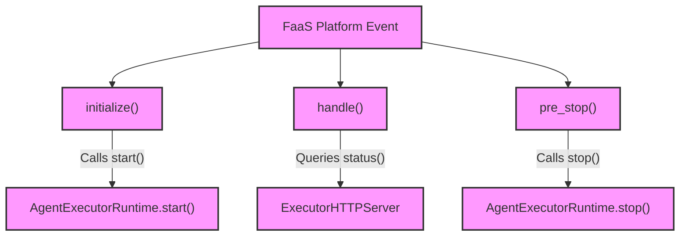
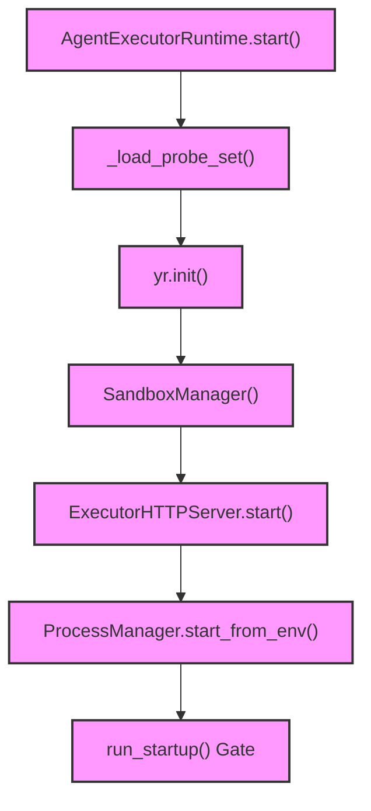

<!-- source: DeepWiki mcp.deepwiki.com · repo openJiuwen-ai/agent-dx · page 3.1 Runtime Lifecycle and FaaS Handlers · fetched 2026-11-02 -->

# Runtime Lifecycle and FaaS Handlers

Relevant source files

The following files were used as context for generating this wiki page:

- [executor/setup.py](executor/setup.py)
- [executor/src/yr/agentexecutor/__init__.py](executor/src/yr/agentexecutor/__init__.py)
- [executor/src/yr/agentexecutor/handler.py](executor/src/yr/agentexecutor/handler.py)
- [executor/src/yr/agentexecutor/runtime.py](executor/src/yr/agentexecutor/runtime.py)
- [tests/executor/test_runtime.py](tests/executor/test_runtime.py)

This document covers the process-local runtime lifecycle and standard FaaS (Function-as-a-Service) entrypoints for the platform-owned Agent Executor package within `agent-dx`. The Agent Executor bridges the underlying openYuanrong execution substrate with custom-image agent instances by managing HTTP routing, user process lifecycles, sandboxed environments, and platform health probes.

For detailed information on health probes and startup gating, refer to [Health Probes](#3.1.1). For details on process groups and logging wrappers, see [User Process Management](#3.1.2).

---

## FaaS Handlers and Entrypoints

The Agent Executor exposes standard YuanRong FaaS lifecycle hook functions through `executor/src/yr/agentexecutor/handler.py` [executor/src/yr/agentexecutor/handler.py:1-31](). These entrypoints map platform container lifecycle events directly to singleton process-local runtime operations controlled by `AgentExecutorRuntime`.

- `initialize(_context)`: Invoked upon container boot to bootstrap the runtime environment by calling `get_runtime().start()` [executor/src/yr/agentexecutor/handler.py:22-23]().
- `handle(_event, _context)`: Invoked to query container health or dispatch control requests, returning runtime status via `get_runtime().status()` [executor/src/yr/agentexecutor/handler.py:26-27]().
- `pre_stop()`: Invoked prior to container teardown to initiate graceful shutdown via `get_runtime().stop()` [executor/src/yr/agentexecutor/handler.py:30-31]().

Title: "FaaS Lifecycle Event Mapping to Runtime Operations"

Sources: `executor/src/yr/agentexecutor/handler.py:1-32`, `executor/src/yr/agentexecutor/runtime.py:121-173`

---

## AgentExecutorRuntime Startup Pipeline

The `AgentExecutorRuntime` class coordinates the sequential initialization of platform subsystems within `executor/src/yr/agentexecutor/runtime.py` [executor/src/yr/agentexecutor/runtime.py:121-173](). When `start()` is invoked, the runtime logs instance identification attributes (`YR_TRACE_ID`, `INSTANCE_ID`, `YR_RUNTIME_ID`), loads probe configurations, initializes the openYuanrong core module (`yr.init()`), and boots dependent services in a strict dependency order.

Title: "AgentExecutorRuntime Initialization Pipeline"

Sources: `executor/src/yr/agentexecutor/runtime.py:121-173`

If any component in the pipeline fails during startup (such as a user process failure or a startup probe timeout), the runtime executes a rollback cleanup sequence that stops the HTTP server, terminates active sandboxes, and cleans up child process groups before propagating the exception [executor/src/yr/agentexecutor/runtime.py:158-170]().

Sources: `executor/src/yr/agentexecutor/runtime.py:121-173`, `tests/executor/test_runtime.py:71-136`

---

## Environment Configuration

The runtime behavior is configured extensively via environment variables parsed during initialization. These variables govern network interfaces, file size limits, timeouts, and sandbox characteristics:

- `YR_AGENT_EXECUTOR_HOST` and `YR_AGENT_EXECUTOR_PORT`: Bind address and port for the `ExecutorHTTPServer` (defaults to `0.0.0.0:18093`) [executor/src/yr/agentexecutor/runtime.py:34-43]().
- `YR_AGENT_EXECUTOR_MAX_FILE_SIZE`: Maximum allowed file transfer size [executor/src/yr/agentexecutor/runtime.py:36]().
- `PRE_STOP_TIMEOUT`: FaaS pre-stop container timeout budget (defaults to `10.0` seconds) [executor/src/yr/agentexecutor/runtime.py:38]().
- `YR_AGENT_EXECUTOR_SHUTDOWN_GRACE_SECONDS`: Custom override for child process termination grace periods [executor/src/yr/agentexecutor/runtime.py:37]().
- `YR_AGENT_SANDBOX_*`: Parameters specifying container sandbox types, CPU/memory limits, ports, and idle timeouts [executor/src/yr/agentexecutor/runtime.py:47-56]().

Sources: `executor/src/yr/agentexecutor/runtime.py:34-88`

---

## Shutdown Grace Ordering and Cleanup

When container teardown is triggered via `pre_stop()`, shutdown operations must adhere to a strict ordering window to prevent hanging FaaS instances. The runtime first stops the `ExecutorHTTPServer` to reject incoming control traffic, and subsequently requests the `ProcessManager` to terminate user processes within an allocated shutdown grace budget [tests/executor/test_runtime.py:51-69]().

The child process shutdown grace period is calculated dynamically via `resolve_process_shutdown_grace()` [executor/src/yr/agentexecutor/runtime.py:102-119](). It fits within the container's `PRE_STOP_TIMEOUT` minus a safety reserve (`SHUTDOWN_CLEANUP_RESERVE_SECONDS = 2.0`), honoring optional configuration overrides without exceeding the available time budget [executor/src/yr/agentexecutor/runtime.py:44-45, 102-119]().

Sources: `executor/src/yr/agentexecutor/runtime.py:37-45, 102-119`, `tests/executor/test_runtime.py:35-69`

---

## Child Pages

For deeper technical implementation details, consult the following child pages:
- [Health Probes](#3.1.1) — ProbeSpec parsing, startup gate (`run_startup`), liveness aggregation states, and TCP/HTTP/exec probe actions.
- [User Process Management](#3.1.2) — Bootstrap command parsing, process groups, unified `.std` logging, and `SIGTERM`/`SIGKILL` shutdown flows.

---

