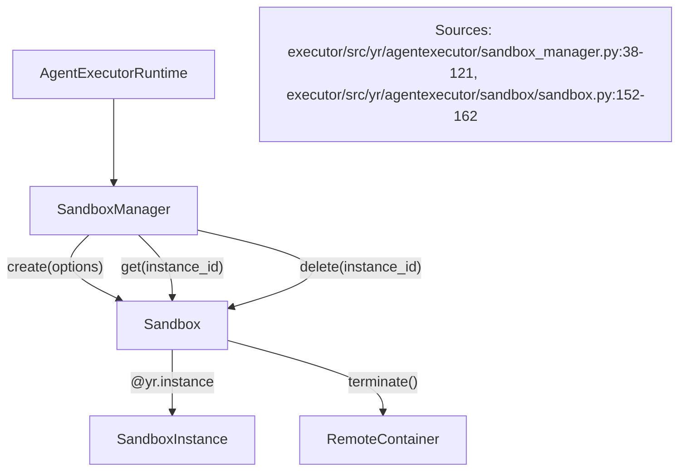
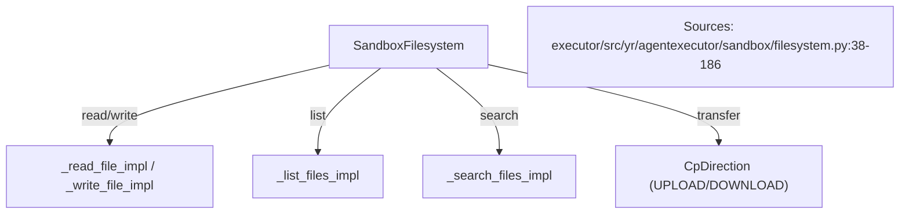

<!-- source: DeepWiki mcp.deepwiki.com · repo openJiuwen-ai/agent-dx · page 3.3 Sandbox Subsystem · fetched 2026-11-02 -->

# Sandbox Subsystem

Relevant source files

The following files were used as context for generating this wiki page:

- [executor/src/yr/agentexecutor/sandbox/__init__.py](executor/src/yr/agentexecutor/sandbox/__init__.py)
- [executor/src/yr/agentexecutor/sandbox/filesystem.py](executor/src/yr/agentexecutor/sandbox/filesystem.py)
- [executor/src/yr/agentexecutor/sandbox/sandbox.py](executor/src/yr/agentexecutor/sandbox/sandbox.py)
- [executor/src/yr/agentexecutor/sandbox/tunnel_server.py](executor/src/yr/agentexecutor/sandbox/tunnel_server.py)
- [executor/src/yr/agentexecutor/sandbox_manager.py](executor/src/yr/agentexecutor/sandbox_manager.py)

## Purpose and Scope

The sandbox subsystem provides isolated code execution environments for the `agent-dx` platform by leveraging openYuanrong's distributed instance runtime (`@yr.instance`) [executor/src/yr/agentexecutor/sandbox/sandbox.py:152-153](). It manages the full lifecycle of remote sandbox instances, handles sandboxed filesystem operations [executor/src/yr/agentexecutor/sandbox/filesystem.py:37-46](), exposes platform APIs under `/v1/sandbox`, and facilitates secure network tunneling into running sandboxes [executor/src/yr/agentexecutor/sandbox/tunnel_server.py:144-145]().

---

## 1. SandboxManager and Instance Lifecycles

The `SandboxManager` class acts as the central registry and controller for all active sandbox instances within the Agent Executor [executor/src/yr/agentexecutor/sandbox_manager.py:38-44](). It is instantiated and owned by `AgentExecutorRuntime`, providing thread-safe storage backed by a `threading.Lock` [executor/src/yr/agentexecutor/sandbox_manager.py:46-48]().

When a client requests a new sandbox via `SandboxManager.create()`, a remote child container is spawned using `Sandbox` and its parameters [executor/src/yr/agentexecutor/sandbox_manager.py:50-59](). If instance ID retrieval fails after container creation, the manager performs a best-effort rollback by calling `terminate()` to avoid leaking remote containers [executor/src/yr/agentexecutor/sandbox_manager.py:60-76](). `SandboxInstance` definitions are decorated with `@yr.instance` to execute inside isolated openYuanrong execution contexts [executor/src/yr/agentexecutor/sandbox/sandbox.py:152-153]().

*Figure 1: Relationship between SandboxManager, Sandbox, and SandboxInstance.*

Sources: `executor/src/yr/agentexecutor/sandbox_manager.py:38-121`, `executor/src/yr/agentexecutor/sandbox/sandbox.py:152-185`

---

## 2. Filesystem Operations

Filesystem manipulation inside sandboxes is managed by `SandboxFilesystem` [executor/src/yr/agentexecutor/sandbox/filesystem.py:207-211]() and helper utility modules. Transfers support two main directions specified by `CpDirection`: `UPLOAD` (local into sandbox) and `DOWNLOAD` (sandbox out to local) [executor/src/yr/agentexecutor/sandbox/filesystem.py:38-46]().

Core file operations include native reading/writing (`_read_file_impl`, `_write_file_impl`) [executor/src/yr/agentexecutor/sandbox/filesystem.py:86-102](), recursive directory scanning with depth and entry limits (`_list_files_impl`) [executor/src/yr/agentexecutor/sandbox/filesystem.py:108-156](), and glob-based pattern searching (`_search_files_impl`) [executor/src/yr/agentexecutor/sandbox/filesystem.py:159-186]().

*Figure 2: Filesystem operations map.*

Sources: `executor/src/yr/agentexecutor/sandbox/filesystem.py:37-211`

---

## 3. The `/v1/sandbox` API

The executor exposes RESTful HTTP endpoints under `/v1/sandbox` that map directly to `SandboxManager` operations. These endpoints allow external clients and agents to create, inspect, execute commands within, and terminate isolated sandbox containers. The HTTP routing layer delegates request payloads to the appropriate `Sandbox` wrapper stored in the manager, returning instance IDs and execution status codes accordingly.

Sources: `executor/src/yr/agentexecutor/sandbox_manager.py:38-93`, `executor/src/yr/agentexecutor/sandbox/sandbox.py:152-185`

---

## 4. Tunnel Protocol and Proxying

To support interactive debugging, port forwarding, and upstream service access inside running sandboxes, the subsystem implements a reverse WebSocket tunneling architecture (`TunnelServer` and `TunnelClient`). 

For details, see [Tunnel Protocol and Proxying](#3.3.1).

Sources: `executor/src/yr/agentexecutor/sandbox/tunnel_server.py:144-150`

---

