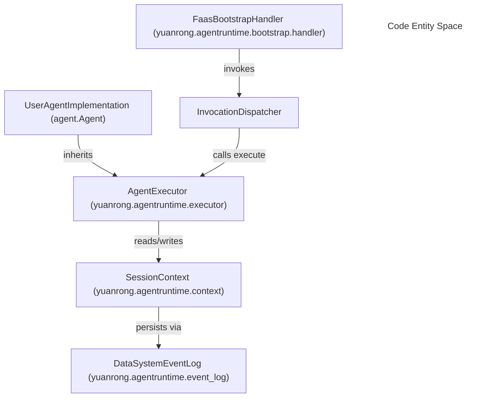

<!-- source: DeepWiki mcp.deepwiki.com · repo openJiuwen-ai/agent-dx · page 4 Python Agent SDK (yuanrong.agentruntime) · fetched 2026-11-02 -->

# Python Agent SDK (yuanrong.agentruntime)

<details>
<summary>Relevant source files</summary>

The following files were used as context for generating this wiki page:

- [cli/ar_cli/__init__.py](cli/ar_cli/__init__.py)
- [cli/setup.py](cli/setup.py)
- [python/README.md](python/README.md)
- [python/pyproject.toml](python/pyproject.toml)
- [python/src/yuanrong/agentruntime/__init__.py](python/src/yuanrong/agentruntime/__init__.py)

</details>


The `yuanrong.agentruntime` package provides the user-facing programming model and fixed FaaS bootstrap entrypoints for agent-dx [python/src/yuanrong/agentruntime/__init__.py:17](), [python/README.md:3](). It defines the abstract base class `AgentExecutor` that developers implement to build stateful agents [python/src/yuanrong/agentruntime/__init__.py:25](), [python/README.md:15](), and handles execution context management, SSE streaming output [python/README.md:24](), structured turn results [python/README.md:34](), and persistent event logging over openYuanrong's DataSystem [python/README.md:4]().


*Figure 1: SDK Component Mapping from Natural Language Concepts to Code Entities.*

Sources: `python/src/yuanrong/agentruntime/__init__.py`, `python/README.md`

---

## 4.1. Bootstrap and Dispatch

The bootstrap subsystem exposes fixed FaaS handlers that platform runtimes invoke directly, eliminating the need for developers to write boilerplate server code [python/README.md:3](), [python/README.md:38](). It provides entrypoints for request handling and asynchronous initialization (`yuanrong.agentruntime.bootstrap.handler` and `yuanrong.agentruntime.bootstrap.initialize`) [python/README.md:43](), [python/README.md:45](). 

Incoming invocations are dispatched serially to the user's `AgentExecutor` implementation while caching startup and initialization errors to ensure stable failure reporting across subsequent requests [python/README.md:71](). For a comprehensive technical breakdown of bootstrap hooks, error caching mechanics, and invocation serialization, see [Bootstrap and Dispatch](#4.1).

Sources: `python/src/yuanrong/agentruntime/__init__.py`, `python/README.md`

---

## 4.2. Context, Output and Results

During execution, agents interact with the runtime via rich context objects, including `RequestContext` containing message payloads and `SessionContext` managing persistent session state [python/src/yuanrong/agentruntime/__init__.py:22](), [python/README.md:19](), [python/README.md:25](). Streaming progress updates are written through `OutputWriter`, which persists messages before dispatching Server-Sent Events (SSE) [python/src/yuanrong/agentruntime/__init__.py:26](), [python/README.md:24](), [python/README.md:79]().

Agent turns conclude by explicitly returning either `Complete` or `InputRequired` execution result objects, signaling whether further user input is required or if the task has successfully finished [python/src/yuanrong/agentruntime/__init__.py:27](), [python/README.md:34](). For detailed specifications on context structures, the SSE output path, and result handling, see [Context, Output and Results](#4.2).

```mermaid
sequenceDiagram
    participant Client as "Client"
    participant Boot as "bootstrap.handler"
    participant Exec as "AgentExecutor"
    participant Out as "OutputWriter"
    participant Res as "Complete/InputRequired"

    Client->>Boot: "InvokeAgent(RequestInput)"
    Boot->>Exec: "execute(RequestContext)"
    Exec->>Out: "write(progress)"
    Out-->>Client: "SSE Stream Output"
    Exec-->>Boot: "Return ExecutionResult"
    Boot-->>Client: "SSE EOF / Result"
    
    sub4["Code Entity Space"]
    style sub4 fill:none,stroke:none
```
*Figure 2: Execution and Output Flow through SDK Code Entities.*

Sources: `python/src/yuanrong/agentruntime/__init__.py`, `python/README.md`

---

## 4.3. Event Log, Turns and Storage

The SDK models agent progression through discrete turns and events managed by the `Event` and `EventLog` classes [python/src/yuanrong/agentruntime/__init__.py:23](), [python/src/yuanrong/agentruntime/__init__.py:24](). `turn_writer` semantics ensure consistent serialization and key organization for events, turn inputs, and completions [python/README.md:75]().

Persistent storage is backed directly by openYuanrong's DataSystem Python SDK, leveraging cluster-level configurations like `YR_DATASYSTEM_DEFAULT_WRITE_MODE` [python/README.md:4](), [python/README.md:68](). For deep technical details regarding key schemes, serialization formats, and backend interaction, see [Event Log, Turns and Storage](#4.3).

Sources: `python/src/yuanrong/agentruntime/__init__.py`, `python/README.md`, `python/pyproject.toml`

---

