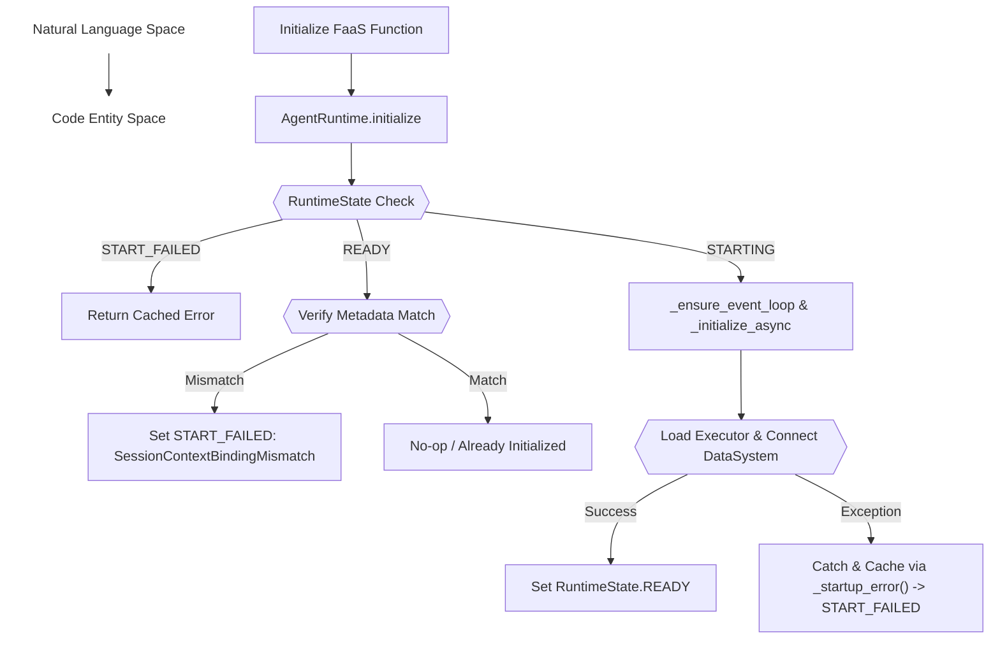
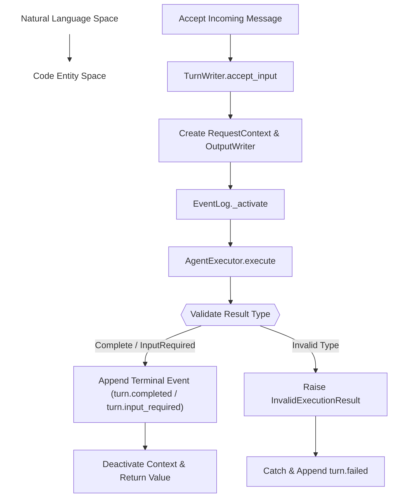

<!-- source: DeepWiki mcp.deepwiki.com · repo openJiuwen-ai/agent-dx · page 4.1 Bootstrap and Dispatch · fetched 2026-11-02 -->

# Bootstrap and Dispatch

Relevant source files

The following files were used as context for generating this wiki page:

- [python/src/yuanrong/__init__.py](python/src/yuanrong/__init__.py)
- [python/src/yuanrong/agentruntime/bootstrap.py](python/src/yuanrong/agentruntime/bootstrap.py)
- [python/src/yuanrong/agentruntime/dispatcher.py](python/src/yuanrong/agentruntime/dispatcher.py)
- [python/src/yuanrong/agentruntime/errors.py](python/src/yuanrong/agentruntime/errors.py)
- [python/src/yuanrong/agentruntime/executor.py](python/src/yuanrong/agentruntime/executor.py)
- [tests/python/unit/helpers.py](tests/python/unit/helpers.py)
- [tests/python/unit/test_bootstrap.py](tests/python/unit/test_bootstrap.py)
- [tests/python/unit/test_dispatcher.py](tests/python/unit/test_dispatcher.py)

## Purpose and Scope

This page documents the bootstrap, lifecycle management, and invocation dispatch mechanisms of the Python Agent SDK (`yuanrong.agentruntime`). It details how the FaaS container process initializes the agent runtime, how failures are cached and sanitized, how the `AgentExecutor` base class defines the agent programming interface, and how the `Dispatcher` serializes invocations, manages request contexts, validates execution results, and writes terminal events.

Sources:
* `python/src/yuanrong/agentruntime/bootstrap.py:1-280`
* `python/src/yuanrong/agentruntime/dispatcher.py:1-90`
* `python/src/yuanrong/agentruntime/executor.py:1-35`

---

## Agent Runtime Initialization and Error Caching

The process-local runtime is managed by the `AgentRuntime` class located in `python/src/yuanrong/agentruntime/bootstrap.py:53()`. It binds a single OS process to one `SessionContext` instance and coordinates thread-safe initialization across concurrent FaaS request threads using a reentrant or standard lock (`threading.Lock`).

### Runtime States and Initialization Flow

`AgentRuntime` tracks its lifecycle using the `RuntimeState` enumeration (`STARTING`, `READY`, `START_FAILED`) [python/src/yuanrong/agentruntime/bootstrap.py:47-51](). 

When `AgentRuntime.initialize()` is called [python/src/yuanrong/agentruntime/bootstrap.py:69-100]():
1. It acquires `self._lock`.
2. If state is `RuntimeState.START_FAILED`, it immediately returns, preventing redundant retries that might leak sensitive stack traces or overwhelm the system.
3. If state is `RuntimeState.READY`, it verifies that incoming function metadata matches the bound metadata (`RuntimeMetadata.from_function_context`). If there is a mismatch, it sets the state to `START_FAILED` with a `SessionContextBindingMismatch` error [python/src/yuanrong/agentruntime/bootstrap.py:82-86]().
4. Otherwise, it spawns or ensures a persistent background asyncio event loop via `_ensure_event_loop()` and runs `_initialize_async()` [python/src/yuanrong/agentruntime/bootstrap.py:88-95]().
5. If initialization raises an exception, it catches the error, wraps/sanitizes it via `_startup_error()`, caches `self._start_error`, and transitions to `RuntimeState.START_FAILED` [python/src/yuanrong/agentruntime/bootstrap.py:96-99]().

*Figure 1: Bridge from Natural Language initialization concepts to `AgentRuntime` code methods.*

Sources:
* `python/src/yuanrong/agentruntime/bootstrap.py:47-121`

---

## Executor Base Class

The user-facing agent interface is defined by the abstract base class `AgentExecutor` in `python/src/yuanrong/agentruntime/executor.py:27()`. All custom agent implementations must inherit from `AgentExecutor` and implement two abstract coroutine methods:

1. `async def init(self, session_context: SessionContext) -> None`: Called once during runtime initialization to recover or establish business state using the provided `SessionContext` [python/src/yuanrong/agentruntime/executor.py:28-30]().
2. `async def execute(self, request_context: RequestContext) -> ExecutionResult`: Called per turn to handle an incoming invocation message within the current `RequestContext` [python/src/yuanrong/agentruntime/executor.py:32-34]().

Sources:
* `python/src/yuanrong/agentruntime/executor.py:1-35`

---

## Invocation Serialization and Dispatcher

Invocations entering the FaaS handler are processed sequentially by the `Dispatcher` class (`python/src/yuanrong/agentruntime/dispatcher.py:34()`). The dispatcher ensures that each turn is cleanly bracketed with input acceptance, output streaming, event logging, and terminal state recording.

### Dispatch Execution Flow

When `Dispatcher.dispatch(message, stream)` is invoked [python/src/yuanrong/agentruntime/dispatcher.py:45-89]():
1. **Accept Input**: It calls `await self._writer.accept_input(message)` to allocate a new `turn_id` and persist the input message event [python/src/yuanrong/agentruntime/dispatcher.py:46]().
2. **Context Binding**: It initializes an `OutputWriter` and a `RequestContext`, binding them to the active turn [python/src/yuanrong/agentruntime/dispatcher.py:47-48]().
3. **Event Log Activation**: It activates the `EventLog` associated with the session context so that intermediate events can be appended during execution [python/src/yuanrong/agentruntime/dispatcher.py:50-51]().
4. **Agent Execution**: It awaits `self._executor.execute(request)` inside a `try...finally` block that guarantees context and event log deactivation even if cancellation or errors occur [python/src/yuanrong/agentruntime/dispatcher.py:53-58]().
5. **Result Validation**: It validates that the returned result is an instance of `Complete` or `InputRequired`; otherwise, it raises an `InvalidExecutionResult` [python/src/yuanrong/agentruntime/dispatcher.py:59-60]().
6. **Terminal Event Appending**: It appends a platform event (`turn.completed` or `turn.input_required`) containing the output value via the `TurnWriter` [python/src/yuanrong/agentruntime/dispatcher.py:62-73]().

*Figure 2: Dispatch execution data flow mapping business invocation steps to `Dispatcher` and `TurnWriter` operations.*

Sources:
* `python/src/yuanrong/agentruntime/dispatcher.py:34-90`

---

## Error Handling, Sanitization, and Validation

The SDK utilizes a structured error hierarchy rooted at `AgentRuntimeError` (`python/src/yuanrong/agentruntime/errors.py:22()`). Each error exception carries a stable, machine-readable `code` string and a descriptive `message`.

### Error Codes and Sanitization

Key error types include:
* `AGENT_RUNTIME_NOT_CONFIGURED`: Raised when `invoke()` is called before `initialize()` completes successfully [python/src/yuanrong/agentruntime/errors.py:31-33]() [python/src/yuanrong/agentruntime/bootstrap.py:113-116]().
* `SESSION_CONTEXT_BINDING_MISMATCH`: Raised when the incoming FaaS function context session ID does not match the runtime instance binding [python/src/yuanrong/agentruntime/errors.py:36-41]() [python/src/yuanrong/agentruntime/bootstrap.py:118-119]().
* `AGENT_EXECUTOR_LOAD_FAILED` / `AGENT_INIT_FAILED`: Raised when agent module loading or `init()` fails [python/src/yuanrong/agentruntime/errors.py:44-51]().
* `INVALID_EXECUTION_RESULT`: Raised when `execute()` returns an unrecognised type instead of `Complete` or `InputRequired` [python/src/yuanrong/agentruntime/errors.py:54-56]() [python/src/yuanrong/agentruntime/dispatcher.py:59-60]().
* `OUTPUT_NOT_ACTIVE` / `EVENT_APPEND_NOT_ACTIVE`: Raised if stream writing or event appending is attempted outside an active `execute()` window [python/src/yuanrong/agentruntime/errors.py:59-67]().

During initialization or storage failures, internal stack traces and storage paths (such as DataSystem or file paths) are sanitized before being cached in `AgentRuntime._start_error` to prevent internal system information disclosure to client invocations [python/src/yuanrong/agentruntime/bootstrap.py:96-99]().

Sources:
* `python/src/yuanrong/agentruntime/errors.py:1-77`
* `python/src/yuanrong/agentruntime/bootstrap.py:96-111`

---

