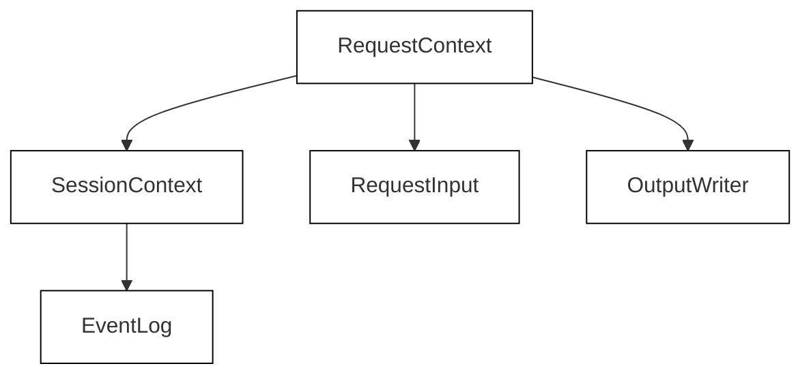
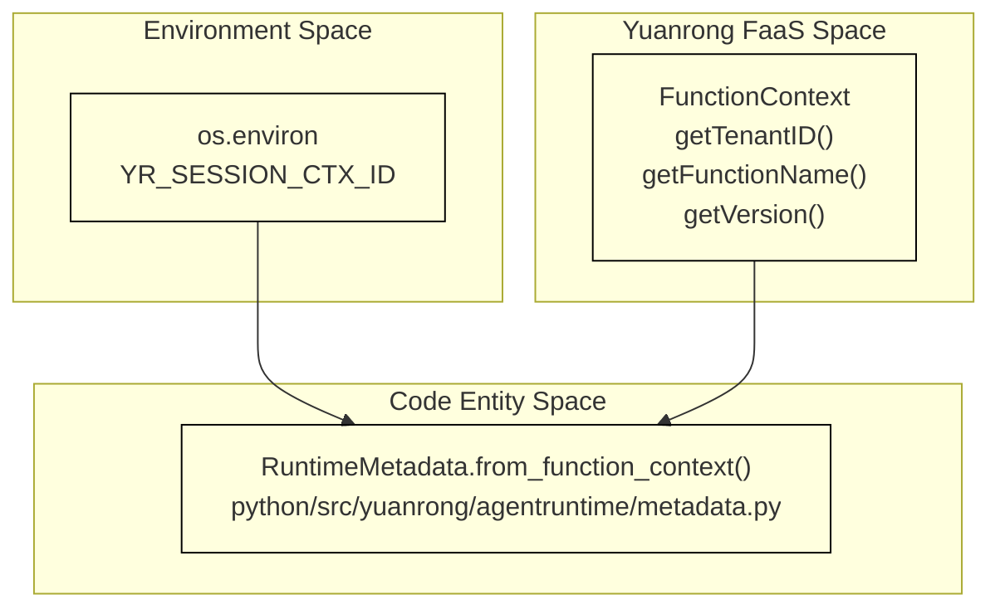
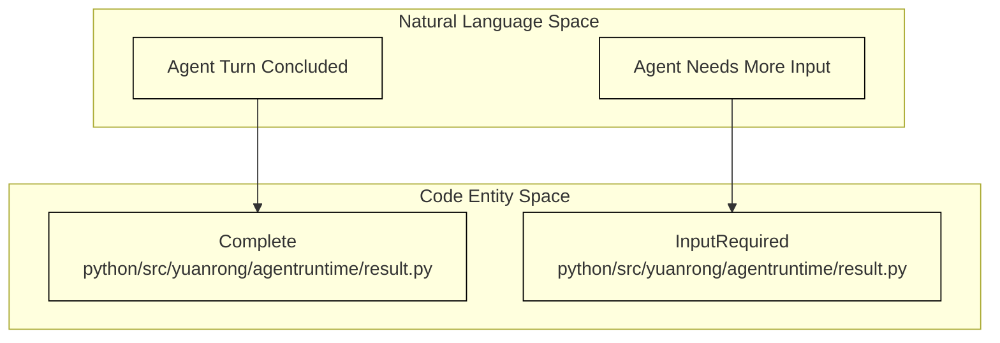

<!-- source: DeepWiki mcp.deepwiki.com · repo openJiuwen-ai/agent-dx · page 4.2 Context, Output and Results · fetched 2026-11-02 -->

# Context, Output and Results

Relevant source files

The following files were used as context for generating this wiki page:

- [python/src/yuanrong/agentruntime/context.py](python/src/yuanrong/agentruntime/context.py)
- [python/src/yuanrong/agentruntime/metadata.py](python/src/yuanrong/agentruntime/metadata.py)
- [python/src/yuanrong/agentruntime/output.py](python/src/yuanrong/agentruntime/output.py)
- [python/src/yuanrong/agentruntime/result.py](python/src/yuanrong/agentruntime/result.py)
- [tests/python/unit/test_metadata.py](tests/python/unit/test_metadata.py)
- [tests/python/unit/test_models.py](tests/python/unit/test_models.py)

This page details the execution context models, session context, output streaming via SSE (`OutputWriter`), terminal/yielding execution results (`Complete` and `InputRequired`), and environment/function metadata within the Python Agent SDK (`yuanrong.agentruntime`).

---

## 1. Context Subsystem (`RequestContext` and `SessionContext`)

The context subsystem manages the lifecycle of agent requests and sessions. When an agent function is invoked, the runtime establishes a `RequestContext` that pairs the input message with a session scope and an output channel.

- `RequestInput`: A frozen dataclass wrapping the incoming user message payload (`python/src/yuanrong/agentruntime/context.py:30-32`).
- `SessionContext`: Holds the session identifier (`_id`) and a reference to the underlying `EventLog` (`python/src/yuanrong/agentruntime/context.py:34-46`).
- `RequestContext`: Maintains the active turn state (`__turn_id`), input wrapper, `OutputWriter`, and an active flag (`_active`) that can be deactivated upon completion (`python/src/yuanrong/agentruntime/context.py:48-91`).

*Figure 1: Request and Session Context Hierarchy*

Sources: `python/src/yuanrong/agentruntime/context.py:30-92`

---

## 2. Runtime Metadata Extraction (`RuntimeMetadata`)

FaaS execution metadata is extracted from both the runtime environment variables and the openYuanrong `FunctionContext` provided by the execution platform.

- `RuntimeMetadata`: A frozen dataclass storing `tenant_id`, `function_name`, `function_version`, and `session_context_id` (`python/src/yuanrong/agentruntime/metadata.py:27-32`).
- `RuntimeMetadata.from_function_context()`: Reads `YR_SESSION_CTX_ID` from the environment map and queries `tenant_id`, `function_name`, and `function_version` from the `FunctionContext` object (`python/src/yuanrong/agentruntime/metadata.py:34-58`). Raises `AgentRuntimeNotConfigured` if any required metadata field is missing or empty (`python/src/yuanrong/agentruntime/metadata.py:41-42`, `python/src/yuanrong/agentruntime/metadata.py:60-66`).

*Figure 2: Metadata Extraction Flow from Environment and FaaS Context to Code Entities*

Sources: `python/src/yuanrong/agentruntime/metadata.py:27-66`, `tests/python/unit/test_metadata.py:25-57`

---

## 3. Streaming Output (`OutputWriter` and SSE Path)

The `OutputWriter` class implements a persist-before-send streaming mechanism, ensuring that all streamed agent messages are durably logged to the event stream before they are emitted over the Server-Sent Events (SSE) channel.

- `OutputWriter.__init__()`: Accepts a `TurnWriter` backend and an active `stream` object (`python/src/yuanrong/agentruntime/output.py:31-37`).
- `OutputWriter._bind()`: Associates the writer with a specific `RequestContext` and `turn_id` prior to execution (`python/src/yuanrong/agentruntime/output.py:38-41`).
- `OutputWriter.write()`: Verifies that the context is active, serializes the output via `to_stream_value()`, appends an `output.message` platform event to the `TurnWriter`, and writes the serialized bytes directly to the underlying stream (`python/src/yuanrong/agentruntime/output.py:42-52`). Raises `OutputNotActive` if called outside an active turn context (`python/src/yuanrong/agentruntime/output.py:44-45`).

Sources: `python/src/yuanrong/agentruntime/output.py:31-53`, `python/src/yuanrong/agentruntime/context.py:48-91`

---

## 4. Execution Results (`Complete` and `InputRequired`)

Agent execution handlers return explicit result types wrapped in immutable dataclasses to signal whether a turn has finished or requires further interaction.

- `Complete`: Indicates that agent execution has successfully concluded for the current turn, wrapping the final `value` (`python/src/yuanrong/agentruntime/result.py:23-26`).
- `InputRequired`: Indicates that the agent is yielding execution to prompt the user or external system for further input, wrapping the intermediate or request `value` (`python/src/yuanrong/agentruntime/result.py:28-31`).
- `ExecutionResult`: A type alias union of `Complete` and `InputRequired` (`python/src/yuanrong/agentruntime/result.py:33`).

*Figure 3: Mapping Agent Execution States to Result Classes*

Sources: `python/src/yuanrong/agentruntime/result.py:19-34`, `tests/python/unit/test_models.py:40-47`

---

