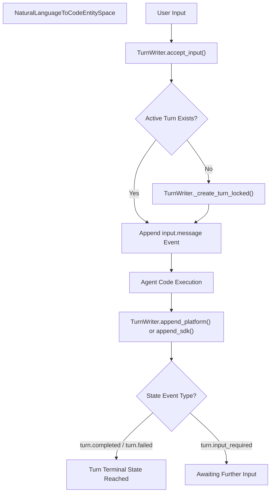
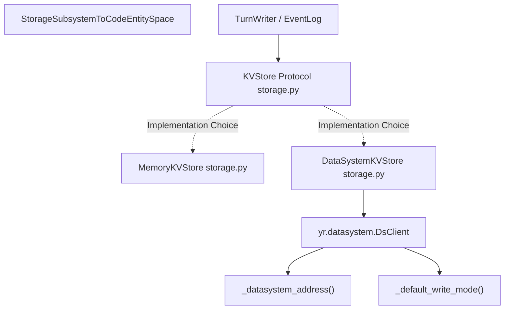

<!-- source: DeepWiki mcp.deepwiki.com · repo openJiuwen-ai/agent-dx · page 4.3 Event Log, Turns and Storage · fetched 2026-11-02 -->

# Event Log, Turns and Storage

Relevant source files

The following files were used as context for generating this wiki page:

- [python/src/yuanrong/agentruntime/event.py](python/src/yuanrong/agentruntime/event.py)
- [python/src/yuanrong/agentruntime/event_log.py](python/src/yuanrong/agentruntime/event_log.py)
- [python/src/yuanrong/agentruntime/keys.py](python/src/yuanrong/agentruntime/keys.py)
- [python/src/yuanrong/agentruntime/serialization.py](python/src/yuanrong/agentruntime/serialization.py)
- [python/src/yuanrong/agentruntime/storage.py](python/src/yuanrong/agentruntime/storage.py)
- [python/src/yuanrong/agentruntime/turn_writer.py](python/src/yuanrong/agentruntime/turn_writer.py)
- [tests/python/unit/test_storage.py](tests/python/unit/test_storage.py)
- [tests/python/unit/test_turn_writer.py](tests/python/unit/test_turn_writer.py)

## Purpose and Scope
This page details the event persistence architecture, turn management semantics, deterministic key generation, stable serialization rules, and the DataSystem storage backend implemented within the Python Agent SDK (`yuanrong.agentruntime`). These subsystems provide linearizability, recoverability, and multi-tenant isolation for agent execution sessions over the openYuanrong substrate.

Sources: 
- `python/src/yuanrong/agentruntime/event.py:1-35`
- `python/src/yuanrong/agentruntime/event_log.py:1-70`
- `python/src/yuanrong/agentruntime/turn_writer.py:1-203`
- `python/src/yuanrong/agentruntime/keys.py:1-52`
- `python/src/yuanrong/agentruntime/serialization.py:1-48`
- `python/src/yuanrong/agentruntime/storage.py:1-182`

---

## 1. Event Model and Public Facade (`Event`, `EventLog`)

The runtime tracks session progress via immutable `Event` objects and exposes a controlled event log interface to agent code through `EventLog`.

### `Event` Dataclass
An `Event` represents a single discrete occurrence during execution. It holds metadata such as the session context ID, turn ID, monotonic sequence number, UUID, source category, event type, payload data, schema version, and timestamp.
- Defined in: `python/src/yuanrong/agentruntime/event.py:24-34`

### `EventLog` Facade
The `EventLog` class controls access to event logs during agent execution:
- **`get(after_seq: int, limit: Optional[int])`**: Retrieves events sequentially starting after `after_seq` up to an optional `limit` [python/src/yuanrong/agentruntime/event_log.py:37-42]().
- **`append(request_context, event_type, data)`**: Appends custom SDK events. It enforces that the request context is active and rejects event types that use platform-reserved prefixes (`turn.`, `input.`, `output.`, `session.`, `runtime.`) [python/src/yuanrong/agentruntime/event_log.py:44-60]().
- **`_activate()` / `_deactivate()`**: Manages request binding state transitions [python/src/yuanrong/agentruntime/event_log.py:62-69]().

Sources:
- `python/src/yuanrong/agentruntime/event.py:24-35`
- `python/src/yuanrong/agentruntime/event_log.py:31-70`

---

## 2. Turn Management and `TurnWriter` Semantics

Agent interactions are grouped into *Turns*. A turn represents a cycle from user input submission to agent completion, failure, or a requirement for further input.

### `TurnRecord` and `TurnWriter`
- **`TurnRecord`**: Immutable record representing a turn, storing `session_context_id`, `turn_index`, `turn_id` (e.g., `turn-000001`), `start_seq`, `created_at`, and `schema_version` [python/src/yuanrong/agentruntime/turn_writer.py:41-49]().
- **`TurnWriter`**: Manages turn transitions, sequential log writing, concurrency locks, and state recovery from the storage backend [python/src/yuanrong/agentruntime/turn_writer.py:51-61]().

### Recovery and State Transitions
- **`recover()`**: Scans sequential keys from the `KVStore` until a missing key is encountered, rebuilding local `_turns` and `_events` lists [python/src/yuanrong/agentruntime/turn_writer.py:62-82]().
- **`accept_input()`**: Validates input, acquires an `asyncio.Lock`, and either reuses the active turn or invokes `_create_turn_locked()` [python/src/yuanrong/agentruntime/turn_writer.py:83-96]().
- **State Map (`_STATE_EVENTS`)**: Maps platform event types to high-level runtime states:
  - `input.message` $\rightarrow$ `"WORKING"` [python/src/yuanrong/agentruntime/turn_writer.py:33-34]()
  - `turn.input_required` $\rightarrow$ `"INPUT_REQUIRED"` [python/src/yuanrong/agentruntime/turn_writer.py:35-35]()
  - `turn.completed` $\rightarrow$ `"COMPLETED"` [python/src/yuanrong/agentruntime/turn_writer.py:36-36]()
  - `turn.failed` $\rightarrow$ `"FAILED"` [python/src/yuanrong/agentruntime/turn_writer.py:37-37]()

Sources:
- `python/src/yuanrong/agentruntime/turn_writer.py:33-190`

---

## 3. Key Scheme and Deterministic Hashing (`SessionKeys`)

DataSystem storage layout relies on deterministic key generation to avoid coordination bottlenecks while guaranteeing collision resistance.

### `_hash_parts` and `SessionKeys`
- **`_hash_parts(*parts: str)`**: Serializes parts to canonical JSON, normalizes Unicode line/paragraph separators (`\u2028`, `\u2029`), and computes a 128-bit SHA-256 truncation (`[:32]`) [python/src/yuanrong/agentruntime/keys.py:19-31]().
- **`SessionKeys`**: Constructs hierarchical storage keys [python/src/yuanrong/agentruntime/keys.py:34-45]():
  - Tenant and Function hash prefix: `ar:s:{tenant_func_hash}:{session_context_hash}`
  - Turn key pattern: `ar:s:{hash}:{hash}:t{index}` [python/src/yuanrong/agentruntime/keys.py:47-48]()
  - Event key pattern: `ar:s:{hash}:{hash}:e{seq}` [python/src/yuanrong/agentruntime/keys.py:50-51]()

Sources:
- `python/src/yuanrong/agentruntime/keys.py:1-52`

---

## 4. Stable Serialization Engine

To ensure consistent storage representation and robust SSE (Server-Sent Events) formatting, `serialization.py` provides strict JSON encoding/decoding helpers.

- **`to_json_bytes(value)`**: Serializes Python objects using `json.dumps` with `ensure_ascii=False`, compact `separators=(",", ":")`, and `sort_keys=True`, raising `EventSerializationFailed` on invalid types [python/src/yuanrong/agentruntime/serialization.py:25-34]().
- **`from_json_bytes(value)`**: Decodes UTF-8 bytes back into Python objects [python/src/yuanrong/agentruntime/serialization.py:37-42]().
- **`to_stream_value(value)`**: Prepares values for SSE streaming transmission [python/src/yuanrong/agentruntime/serialization.py:44-47]().

Sources:
- `python/src/yuanrong/agentruntime/serialization.py:1-48`

---

## 5. Storage Backend (`DataSystemKVStore`, `MemoryKVStore`, `KVStore`)

The storage layer abstracts underlying KV operations behind the asynchronous `KVStore` protocol [python/src/yuanrong/agentruntime/storage.py:32-44]().

### Backend Implementations
- **`MemoryKVStore`**: In-memory dictionary wrapper used for unit testing and deterministic local execution [python/src/yuanrong/agentruntime/storage.py:46-64]().
- **`DataSystemKVStore`**: Asynchronous adapter interfacing directly with openYuanrong's `yr.datasystem.DsClient` via `asyncio.to_thread` [python/src/yuanrong/agentruntime/storage.py:66-138](). It manages:
  - Client initialization and address parsing (`_datasystem_address`) [python/src/yuanrong/agentruntime/storage.py:74-82]().
  - Write mode configuration (`_default_write_mode` mapping environment variable `YR_DATASYSTEM_DEFAULT_WRITE_MODE` to caching policies like `NONE_L2_CACHE` or `WRITE_THROUGH_L2_CACHE`) [python/src/yuanrong/agentruntime/storage.py:156-181]().
  - Batch existence checks (`exist`) and multi-gets (`mget`) with bounds validation [python/src/yuanrong/agentruntime/storage.py:90-117]().

Sources:
- `python/src/yuanrong/agentruntime/storage.py:32-182`

---

