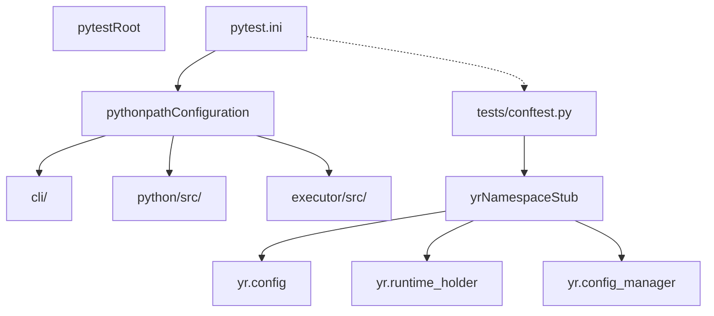
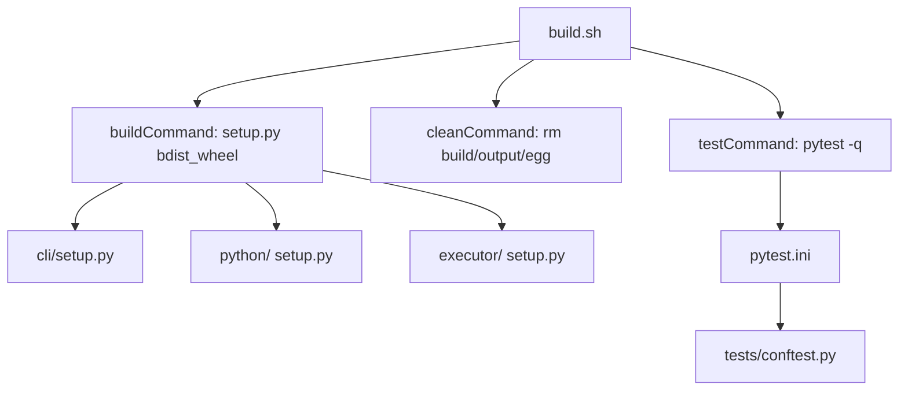

<!-- source: DeepWiki mcp.deepwiki.com · repo openJiuwen-ai/agent-dx · page 5 Testing and Tooling · fetched 2026-11-02 -->

# Testing and Tooling

Relevant source files

The following files were used as context for generating this wiki page:

- [AGENTS.md](AGENTS.md)
- [build.sh](build.sh)
- [pytest.ini](pytest.ini)
- [tests/conftest.py](tests/conftest.py)

The testing and tooling subsystem of `agent-dx` provides verification workflows, test configuration, runtime stubs, and build automation across the CLI, Agent Executor, and Python SDK packages. It mirrors the component layout of the codebase to maintain clean boundaries between packages while supporting isolated unit testing and data integration testing.

For details on specific test suites, see the child pages:
- [Executor and CLI Test Suites](#5.1)
- [SDK Unit and Integration Tests](#5.2)

---

## 5.1. Test Architecture and Pytest Configuration

The test infrastructure is rooted in the repository-level `[pytest.ini:1-8]()` configuration file, which establishes the shared Python import paths (`pythonpath`) for the source directories of all three primary packages: `cli`, `python/src`, and `executor/src` [[pytest.ini:4-7]()]. 

Because the `executor` package relies on the external, closed-source YuanRong (`yr`) SDK which is not present in standard CI environments, the test suite injects lightweight module-level stubs [[tests/conftest.py:19-41]()]. The `[tests/conftest.py:1-159]()` script automatically intercepts imports of `yr`, `yr.config`, `yr.runtime_holder`, and `yr.config_manager`, replacing them with mock-backed stand-ins [[tests/conftest.py:116-157]()]. This allows pure-Python executor unit tests to run locally and in CI without failing on missing platform dependencies.

*Figure 5.1: Pytest configuration and runtime stub injection architecture.*

Sources: `[pytest.ini:1-8]()`, `[tests/conftest.py:1-159]()`

---

## 5.2. Executor and CLI Test Suites

The test layout directly mirrors the implementation components under `cli/` and `executor/` [[AGENTS.md:8-16]()]. The CLI test suite validates `click`-based command line interactions, argument validation, and API client behaviors without hitting live services [[AGENTS.md:68-76]()]. The executor test suite exercises HTTP routing, health probes, process management, and sandbox controls.

For comprehensive details on how executor runtime tests and CLI session client tests are structured and stubbed, see [Executor and CLI Test Suites](#5.1).

Sources: `[AGENTS.md:8-16](), [AGENTS.md:68-76]()`

---

## 5.3. SDK Unit and Integration Tests

The Python SDK test suite covers the `yuanrong.agentruntime` programming model, bootstrap handlers, event log serialization, and turn management. Additionally, it provides DataSystem integration tests that verify event log persistence and retrieval semantics.

For comprehensive details on unit tests, DataSystem storage integration tests, and helper utilities for the SDK, see [SDK Unit and Integration Tests](#5.2).

Sources: `[AGENTS.md:50-76]()`

---

## 5.4. Build Automation and Repository Tooling

Repository packaging and test execution are unified via `[build.sh:1-115]`, which supports wheel compilation for `ar_cli`, `agent-dx` SDK, and `agentexecutor` packages [[build.sh:36-38](), [build.sh:104-111]()]. The script provides flags for cleaning intermediate artifacts (`-C`), executing the full `pytest` suite (`-t`), and customizing target versions (`-v`) or output directories (`-o`) [[build.sh:19-28](), [build.sh:60-92]()].

*Figure 5.2: Build script workflow and toolchain integration.*

Sources: `[build.sh:1-114]()`, `[pytest.ini:1-8]()`

---

