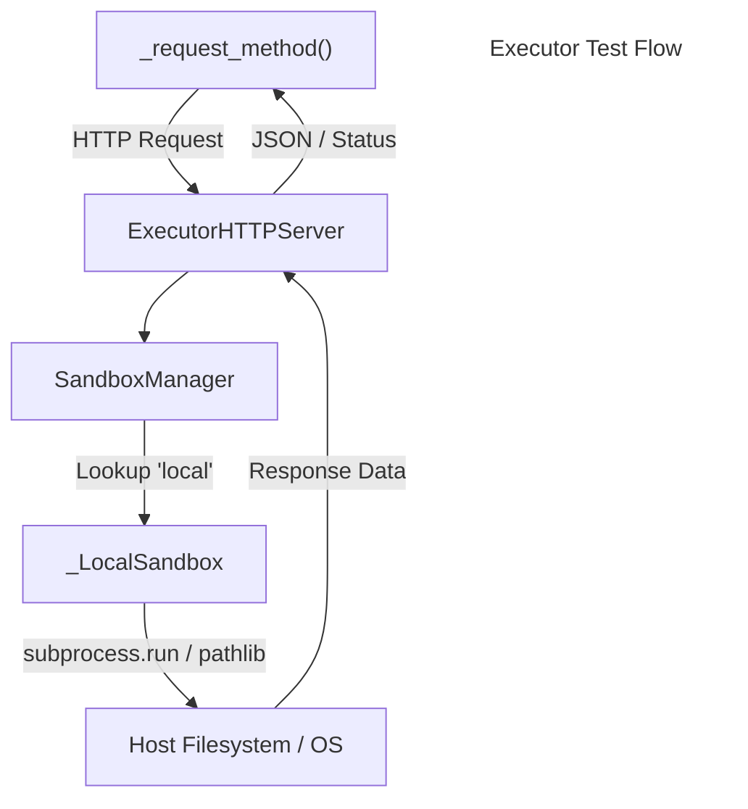
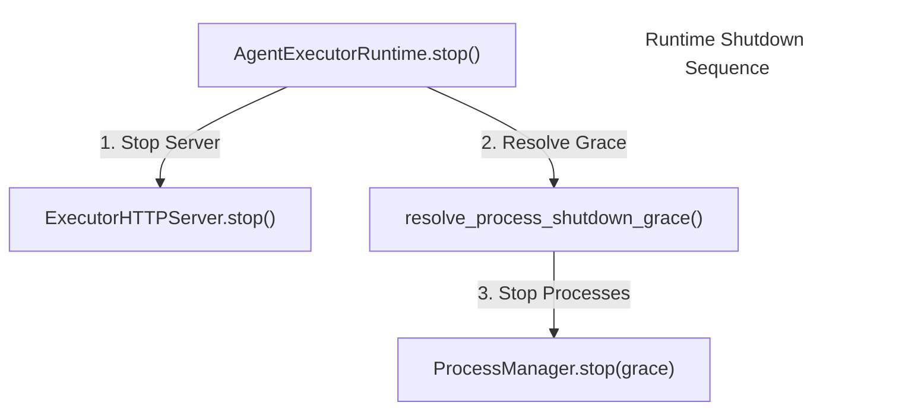
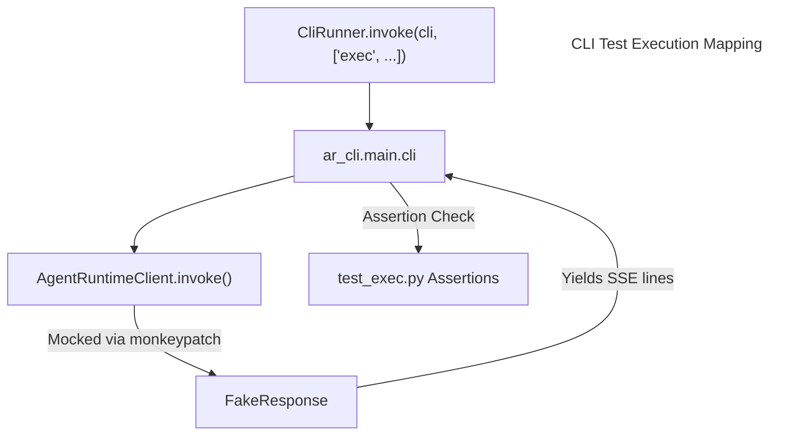

<!-- source: DeepWiki mcp.deepwiki.com · repo openJiuwen-ai/agent-dx · page 5.1 Executor and CLI Test Suites · fetched 2026-11-02 -->

# Executor and CLI Test Suites

Relevant source files

The following files were used as context for generating this wiki page:

- [tests/cli/test_exec.py](tests/cli/test_exec.py)
- [tests/executor/test_http_server.py](tests/executor/test_http_server.py)
- [tests/executor/test_runtime.py](tests/executor/test_runtime.py)

The purpose and scope of this section cover the testing architectures for both the platform Agent Executor (`yr.agentexecutor`) and the `adx` command-line interface (`ar_cli`). These suites utilize `pytest` alongside custom stubs, monkeypatching, and framework-specific testing harnesses (`click.testing.CliRunner`) to validate HTTP endpoints, runtime lifecycles, user process management, and CLI command/session behavior without requiring live distributed substrates or bare-metal container sandboxes.

---

## 1. Executor HTTP Server and Local Sandbox Stubs

The executor HTTP testing infrastructure verifies request routing, size/concurrency guardrails, method enforcement, and sandbox file/execution primitives. Because the platform-owned `ExecutorHTTPServer` relies on remote RPC packages or isolated sandboxes in production, unit tests inject a lightweight host-backed stub (`_LocalSandbox`) managed through `SandboxManager` [tests/executor/test_http_server.py:27-119]().

### Key Test Components and Data Flow

The helper function `_server()` initializes an `ExecutorHTTPServer` instance bound to a local loopback address (`127.0.0.1`) with a pre-loaded `SandboxManager` registration (`"local"` key pointing to `_LocalSandbox`) [tests/executor/test_http_server.py:106-119](). 

- **`_LocalSandbox`**: Implements raw host subprocess execution via `subprocess.run()`, file reads/writes, and recursive file listing using `pathlib.Path` to fulfill file and execution operations against a temporary directory [tests/executor/test_http_server.py:27-104]().
- **Method Enforcement Testing**: Tests like `test_patch_sandbox_url_returns_405_json()` verify that unsupported HTTP verbs on resource routes correctly return status code `405` with an `Allow` header and a JSON payload detailing the violation [tests/executor/test_http_server.py:171-189]().

*Sources: `tests/executor/test_http_server.py:27-189`*

Sources: `tests/executor/test_http_server.py:27-189`

---

## 2. Runtime Lifecycle and Process Management Tests

The runtime testing suite (`tests/executor/test_runtime.py`) validates the FaaS handler mappings, shutdown grace calculations, orderly shutdown sequences, and startup probe error handling [tests/executor/test_runtime.py:1-172]().

### Handler Lifecycle and Shutdown Budget

- **FaaS Lifecycle Entries**: `test_handler_exposes_all_faas_lifecycle_entries()` uses `monkeypatch` to substitute a mock runtime into `yr.agentexecutor.handler`, asserting that FaaS entrypoints (`initialize`, `handle`, `pre_stop`) invoke corresponding runtime actions [tests/executor/test_runtime.py:13-33]().
- **Shutdown Grace Resolution**: `resolve_process_shutdown_grace()` computes termination timeouts by scaling against the `PRE_STOP_TIMEOUT` environment variable while respecting explicit overrides (`YR_AGENT_EXECUTOR_SHUTDOWN_GRACE_SECONDS`) without violating the overall budget [tests/executor/test_runtime.py:35-49]().
- **Shutdown Order**: `test_runtime_stops_http_before_user_processes()` ensures that `AgentExecutorRuntime.stop()` halts the `ExecutorHTTPServer` before signaling the `ProcessManager` to drain user processes [tests/executor/test_runtime.py:51-69]().

*Sources: `tests/executor/test_runtime.py:10-69`*

Sources: `tests/executor/test_runtime.py:10-69`

---

## 3. CLI Command and Session Test Suites

The CLI test suite (`tests/cli/test_exec.py`) exercises command-line parsing, options validation, interactive mode input loops, and header injection for agent/instance session contexts using Click's `CliRunner` [tests/cli/test_exec.py:1-211]().

### Mocking API Client Invocations

To test invocation workflows without an active remote service, tests utilize `_capture_invocations()` to monkeypatch `ar_cli.api.client.AgentRuntimeClient.invoke()` [tests/cli/test_exec.py:47-62](). 

- **Session Context Injection**: `test_exec_with_args_invokes_once_and_preserves_json_body()` verifies that when a user runs `adx exec`, a session context ID is automatically generated (or accepted via `--session-ctx`) and packed into the `ar_cli.const.HEADER_AGENT_SESSION` header as JSON [tests/cli/test_exec.py:65-83]().
- **Interactive Mode**: `test_exec_without_args_enters_interactive_mode_and_wraps_messages()` simulates multi-turn REPL input (e.g., passing `input="你好\n下一轮\n/quit\n"`) and verifies that sequential invocations maintain session continuity while the final release invocation sets `sessionTTL` to `0` [tests/cli/test_exec.py:140-180]().

*Sources: `tests/cli/test_exec.py:26-83`, `tests/cli/test_exec.py:140-180`*

Sources: `tests/cli/test_exec.py:26-83`, `tests/cli/test_exec.py:140-180`

---

