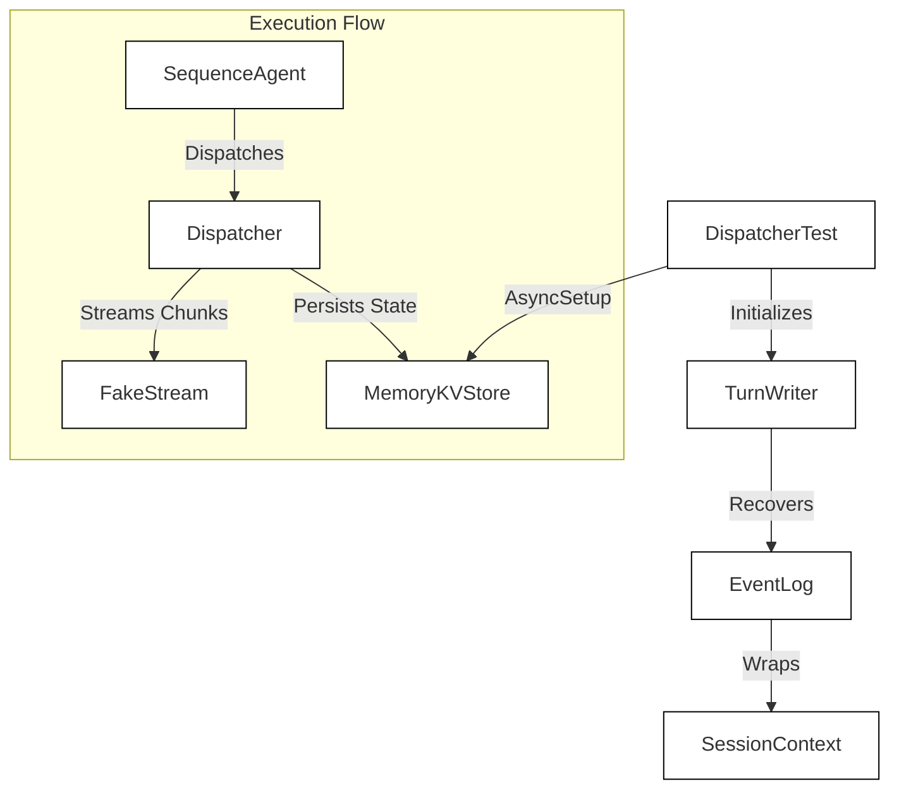
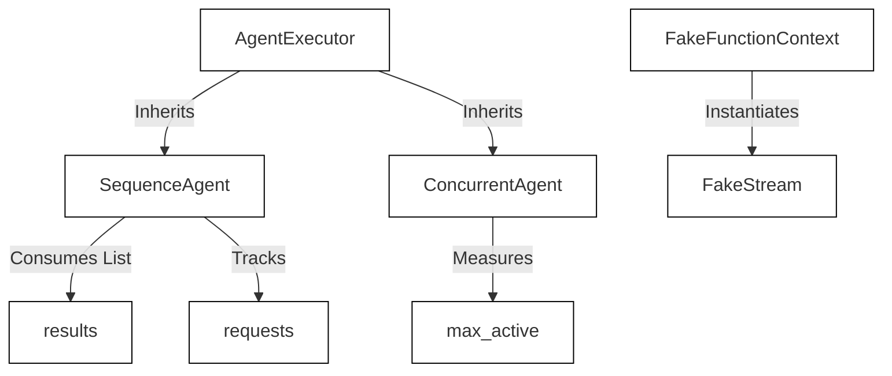
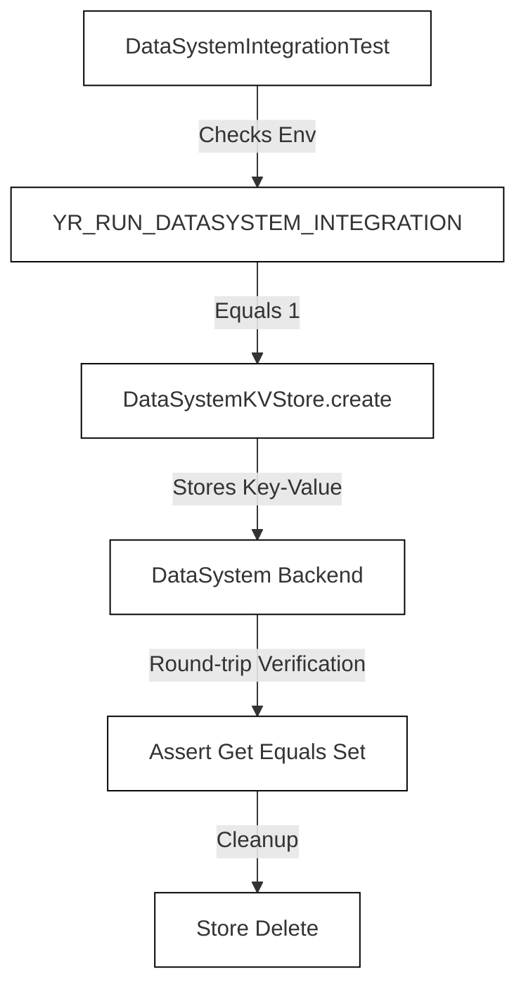

<!-- source: DeepWiki mcp.deepwiki.com · repo openJiuwen-ai/agent-dx · page 5.2 SDK Unit and Integration Tests · fetched 2026-11-02 -->

# SDK Unit and Integration Tests

<details>
<summary>Relevant source files</summary>

The following files were used as context for generating this wiki page:

- [python/src/yuanrong/__init__.py](python/src/yuanrong/__init__.py)
- [tests/python/__init__.py](tests/python/__init__.py)
- [tests/python/integration/test_datasystem.py](tests/python/integration/test_datasystem.py)
- [tests/python/unit/__init__.py](tests/python/unit/__init__.py)
- [tests/python/unit/helpers.py](tests/python/unit/helpers.py)
- [tests/python/unit/test_dispatcher.py](tests/python/unit/test_dispatcher.py)

</details>


This page details the unit tests, mock infrastructure, and storage integration tests for the Python Agent SDK (`yuanrong.agentruntime`). The testing suite validates agent dispatch logic, session state transitions, exception handling, output persistence ordering, and backend key-value storage contracts.

---

## 1. Python SDK Unit Test Architecture

The core unit tests for the Python SDK reside under `tests/python/unit/` and utilize Python's `unittest.IsolatedAsyncioTestCase` to execute asynchronous test routines. The primary test suite is implemented in `tests/python/unit/test_dispatcher.py`, focusing on the `Dispatcher` class and its interactions with `TurnWriter`, `EventLog`, and `SessionContext`.

Each unit test initializes an isolated memory-backed key-value store (`MemoryKVStore`) and a fresh session context within the `asyncSetUp` method:

```python
async def asyncSetUp(self):
    self.store = MemoryKVStore()
    keys = SessionKeys("tenant", "function", "v1", "session")
    self.writer = TurnWriter(self.store, keys, "session")
    await self.writer.recover()
    self.event_log = EventLog(self.writer)
    self.session = SessionContext("session", self.event_log)
```
[tests/python/unit/test_dispatcher.py:36-44]()

### Key Dispatcher Test Scenarios

The test suite covers critical behavioral guarantees of the agent execution runtime:
* **Terminal Events:** `test_complete_persists_single_terminal_event_and_returns_value` ensures that returning `Complete` stores a single terminal turn event and correctly bubbles up the return payload [tests/python/unit/test_dispatcher.py:45-54]().
* **Turn Allocation:** `test_input_required_does_not_allocate_new_turn` verifies that yielding `InputRequired` pauses execution without advancing or allocating a separate turn identifier for subsequent inputs [tests/python/unit/test_dispatcher.py:55-63]().
* **Write Ordering:** `test_output_is_persisted_before_stream_write` enforces that output data is persistently committed to storage *before* it is written to the streaming channel [tests/python/unit/test_dispatcher.py:65-94]().
* **Context Inactivity:** `test_context_is_inactive_after_execute` and `test_context_is_inactive_after_cancellation` verify that once an execution handler terminates or raises `asyncio.CancelledError`, further attempts to append events or write output raise `EventAppendNotActive` or `OutputNotActive` [tests/python/unit/test_dispatcher.py:95-129]().
* **Turn ID Immutability:** `test_turn_id_cannot_be_reassigned_or_forged_by_another_context` ensures agent code cannot tamper with or override system-assigned turn IDs [tests/python/unit/test_dispatcher.py:130-144]().
* **Concurrent Writes:** `test_concurrent_writes_share_one_contiguous_sequence` handles concurrent output writes and event appends, guaranteeing a single contiguous sequence in the event log [tests/python/unit/test_dispatcher.py:146-163]().


*Figure 1: Dispatcher unit test harness initialization and data flow.*

Sources: `tests/python/unit/test_dispatcher.py:36-167`

---

## 2. Test Helpers and Mocking Infrastructure

To isolate the SDK from external FaaS platforms and runtime environments, `tests/python/unit/helpers.py` provides robust mock implementations of streams, function contexts, and agent executors.

### Helper Classes

| Class Name | File Location | Role and Behavior |
| :--- | :--- | :--- |
| `FakeStream` | `tests/python/unit/helpers.py:23-32` | Simulates the Server-Sent Events (SSE) write channel, capturing values and tracking operation sequences for assertion checks. |
| `FakeFunctionContext` | `tests/python/unit/helpers.py:34-52` | Mocks openYuanrong's native function context, providing static tenant IDs, function names, versions, and stream handles. |
| `SequenceAgent` | `tests/python/unit/helpers.py:54-71` | An `AgentExecutor` subclass that steps through a predefined sequence of return values, exceptions, or callables during `execute()` [tests/python/unit/helpers.py:54-71](). |
| `ConcurrentAgent` | `tests/python/unit/helpers.py:73-86` | An `AgentExecutor` subclass designed for concurrency stress tests, tracking active execution counts and concurrency limits [tests/python/unit/helpers.py:73-86](). |


*Figure 2: Relationship between test helpers and agent executor base classes.*

Sources: `tests/python/unit/helpers.py:23-86`

---

## 3. DataSystem Integration Tests

Integration tests validate that the Python SDK correctly interacts with the underlying platform storage layer (`DataSystemKVStore`). These tests are conditionally executed depending on environment configurations.

### DataSystem Integration Harness

The integration test suite is located in `tests/python/integration/test_datasystem.py`. It uses a decorator to skip integration checks unless `YR_RUN_DATASYSTEM_INTEGRATION=1` is explicitly set in the test runner environment:

```python
@unittest.skipUnless(
    os.getenv("YR_RUN_DATASYSTEM_INTEGRATION") == "1",
    "set YR_RUN_DATASYSTEM_INTEGRATION=1 in a configured FaaS/DataSystem environment",
)
class DataSystemIntegrationTest(unittest.IsolatedAsyncioTestCase):
    async def test_public_sdk_round_trip(self):
        store = await DataSystemKVStore.create(os.getenv("DATASYSTEM_TENANT_ID", "default"))
        key = f"ar:integration:{uuid4().hex}"
        try:
            await store.set(key, b"value")
            self.assertEqual(await store.get(key), b"value")
        finally:
            await store.delete([key])
```
[tests/python/integration/test_datasystem.py:24-36]()


*Figure 3: DataSystem integration test execution pipeline.*

Sources: `tests/python/integration/test_datasystem.py:21-37`

---

