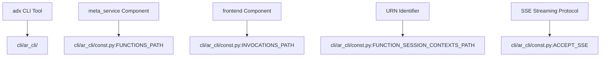
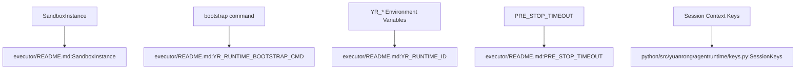

<!-- source: DeepWiki mcp.deepwiki.com · repo openJiuwen-ai/agent-dx · page 6 Glossary · fetched 2026-11-02 -->

# Glossary

Relevant source files

The following files were used as context for generating this wiki page:

- [README.md](README.md)
- [README.zh.md](README.zh.md)
- [Third_Party_Open_Source_Software_Notice.txt](Third_Party_Open_Source_Software_Notice.txt)
- [cli/ar_cli/const.py](cli/ar_cli/const.py)
- [executor/README.md](executor/README.md)
- [executor/README.zh.md](executor/README.zh.md)
- [python/src/yuanrong/agentruntime/keys.py](python/src/yuanrong/agentruntime/keys.py)

## Purpose and Scope

This page provides comprehensive technical definitions for core terms, architectural components, protocol elements, and environment variables used across the `agent-dx` codebase (`cli/`, `python/`, and `executor/`). Each definition includes architectural context, operational semantics, and direct code pointers to facilitate navigation of the repository.

---

## Term Definitions

### adx
The command-line interface (CLI) tool for `agent-dx`, implemented using Click, providing developer workflows for agent deployment, function invocation, and interactive session management.
* Code pointers: `[README.md:7-18]()`, `[cli/README.md:1-20]()`
* Sources: `[README.md]()`, `[README.zh.md]()`

### openYuanrong
The underlying distributed serverless and function execution platform substrate upon which `agent-dx` executes agents and manages runtime lifecycles.
* Code pointers: `[README.md:25-27]()`, `[executor/README.md:5-12]()`
* Sources: `[README.md]()`, `[executor/README.md]()`

### meta_service
The openYuanrong control plane component responsible for function registration, metadata storage, and deployment validation invoked via the `adx deploy` command.
* Code pointers: `[cli/ar_cli/const.py:20-25]()`, `[README.md:13-14]()`
* Sources: `[README.md]()`, `[cli/ar_cli/const.py]()`

### frontend
The openYuanrong data plane gateway component that routes synchronous and streaming invocations to function instances and handles Server-Sent Events (SSE) translation.
* Code pointers: `[cli/ar_cli/const.py:21]()`, `[README.md:14-16]()`
* Sources: `[README.md]()`, `[cli/ar_cli/const.py]()`

### SandboxInstance
A process-local sandbox environment initialized within each function instance container by the Executor, enabling isolated execution and file operations without external actors.
* Code pointers: `[executor/README.md:33-41]()`, `[executor/README.zh.md:33-36]()`
* Sources: `[executor/README.md]()`, `[executor/README.zh.md]()`

### SandboxManager
The subsystem component responsible for coordinating and dispatching requests across sandbox instances and maintaining isolated filesystem access.
* Code pointers: `[executor/README.md:38-48]()`
* Sources: `[executor/README.md]()`

### ProcessManager
The component managing user subprocess lifecycles, process groups, unified standard output logging, and group termination signals.
* Code pointers: `[executor/README.md:57-61]()`, `[executor/README.zh.md:52-54]()`
* Sources: `[executor/README.md]()`

### ProbeSpec
The specification structure defining health check parameters, timeout thresholds, and action types for container startup and liveness probes.
* Code pointers: `[executor/README.md]()`
* Sources: `[executor/README.md]()`

### AggregateState
The liveness and readiness state evaluation model combining multiple probe results into a unified container health assessment.
* Code pointers: `[executor/README.md]()`
* Sources: `[executor/README.md]()`

### bootstrap command
The command-line execution instructions read from `YR_RUNTIME_BOOTSTRAP_CMD` used by the Executor to launch user agent processes with best-effort parsing and error logging.
* Code pointers: `[executor/README.md:72-76]()`, `[executor/README.zh.md:63-66]()`
* Sources: `[executor/README.md]()`

### YR_* env vars
OpenYuanrong and Executor environment variables used for runtime configuration, including `YR_RUNTIME_BOOTSTRAP_CMD`, `YR_RUNTIME_ID`, and `GLOG_log_dir`.
* Code pointers: `[executor/README.md:72-82]()`, `[executor/README.zh.md:63-70]()`
* Sources: `[executor/README.md]()`

### URN
Uniform Resource Name format used to identify functions and agents uniquely within openYuanrong service paths.
* Code pointers: `[cli/ar_cli/const.py:21-25]()`
* Sources: `[cli/ar_cli/const.py]()`

### session context
The logical session state container tracking multi-turn interactions, identified via session IDs and persisted in DataSystem via deterministic key schemes.
* Code pointers: `[cli/ar_cli/const.py:22-24]()`, `[python/src/yuanrong/agentruntime/keys.py:34-51]()`
* Sources: `[cli/ar_cli/const.py()`, `[python/src/yuanrong/agentruntime/keys.py]()`

### instance session
The instance-level routing header (`X-Instance-Session`) used to pin requests to specific function execution instances.
* Code pointers: `[cli/ar_cli/const.py:46]()`
* Sources: `[cli/ar_cli/const.py]()`

### Turn
An individual user-agent interaction unit within a session context, serialized and stored with a deterministic index key.
* Code pointers: `[python/src/yuanrong/agentruntime/keys.py:47-48]()`
* Sources: `[python/src/yuanrong/agentruntime/keys.py]()`

### EventLog
The sequenced stream of execution events emitted during an agent turn, indexed sequentially within DataSystem storage.
* Code pointers: `[python/src/yuanrong/agentruntime/keys.py:50-51]()`
* Sources: `[python/src/yuanrong/agentruntime/keys.py]()`

### Complete/InputRequired
Terminal and intermediate execution states returned by agents indicating whether a turn has finished or requires further user input.
* Code pointers: `[README.md:7-20]()`
* Sources: `[README.md]()`

### SSE
Server-Sent Events streaming protocol used over HTTP (`text/event-stream`) to deliver real-time agent execution events to clients.
* Code pointers: `[cli/ar_cli/const.py:49-54]()`, `[README.md:14-15]()`
* Sources: `[cli/ar_cli/const.py()`, `[README.md]()`

### loopback enforcement
Security restriction ensuring that sandbox HTTP APIs are accessible exclusively via local loopback communication from user processes inside the same container.
* Code pointers: `[executor/README.md:38-40]()`, `[executor/README.zh.md:33-36]()`
* Sources: `[executor/README.md]()`

### PRE_STOP_TIMEOUT
The FaaS shutdown configuration parameter bounding container termination, allocating a grace period for child process SIGTERM handling followed by forced cleanup.
* Code pointers: `[executor/README.md:84-86]()`, `[executor/README.zh.md:72-73]()`
* Sources: `[executor/README.md]()`

---

## Architectural Mappings

### Diagram 1: Control Plane and Data Plane Entity Mapping
The following diagram bridges natural language concepts of the control and data plane components to their corresponding code constants and routing definitions.

Sources: `[README.md:7-18]()`, `[cli/ar_cli/const.py:20-54]()`

### Diagram 2: Executor and Runtime Subsystem Entity Mapping
The following diagram bridges natural language executor subsystems to their specific implementation constructs and runtime environment variables.

Sources: `[executor/README.md:33-86]()`, `[python/src/yuanrong/agentruntime/keys.py:34-51]()`