# Page: Overview

# Overview

<details>
<summary>Relevant source files</summary>

The following files were used as context for generating this wiki page:

- [AGENTS.md](AGENTS.md)
- [README.md](README.md)
- [README.zh.md](README.zh.md)
- [Third_Party_Open_Source_Software_Notice.txt](Third_Party_Open_Source_Software_Notice.txt)
- [VERSION](VERSION)
- [python/MANIFEST.in](python/MANIFEST.in)
- [python/VERSION](python/VERSION)

</details>


Agent Distributed Executor (`agent-dx`) is a distributed execution substrate designed for agents, providing developer tools for agent registration, invocation, and session management over `openYuanrong` [README.md:3-8]. The repository comprises three core components: the `adx` command-line interface (`cli/`), the independent Python Agent SDK (`python/`), and the platform-owned Agent Executor (`executor/`) [README.md:7, 59-65].

The following diagram bridges natural language functional concepts to their primary codebase implementations:

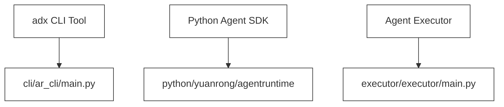

Sources: [README.md:3-8](), [AGENTS.md:21]()

## Repository Layout and Component Summary

The repository is organized into distinct packages that share a common versioning scheme defined at the root level [README.md:59-73]:

```text
cli/                 Python CLI package source and packaging config
cli/ar_cli/          adx command implementation
python/              Independent agent-dx Python SDK package
executor/            Independent platform Agent Executor package
tests/cli/           CLI unit tests
tests/python/        agent-dx SDK unit and integration tests
tests/executor/      Agent Executor unit tests
pytest.ini           Test configuration
```

The system interacts with `openYuanrong` services across both control and data planes, handled by the CLI commands and underlying API clients:

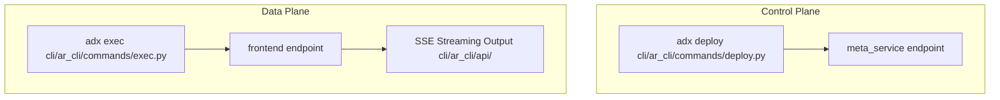

Sources: [README.md:11-17](), [AGENTS.md:21-34]()

## Architecture and Component Maps

For deeper technical details regarding how `cli/`, `python/`, `executor/` and `tests/` interact, the separation of the control plane (`meta_service`) versus data plane (`frontend`, SSE streaming), and shared versioning enforcement, see [Architecture and Component Map](#1.1) [README.md:13-17, 59-73].

Sources: [README.md:13-17](), [README.md:59-73]()

## Getting Started and Build

For instructions on building wheels using `build.sh`, configuring packages via `setup.py` / `pyproject.toml`, deploying configurations using an `agent.json` spec, and performing invocations via `adx exec`, see [Getting Started and Build](#1.2) [README.md:22-55].

Sources: [README.md:22-55](), [AGENTS.md:51-64]()

---

# Page: Architecture and Component Map

# Architecture and Component Map

<details>
<summary>Relevant source files</summary>

The following files were used as context for generating this wiki page:

- [README.md](README.md)
- [README.zh.md](README.zh.md)
- [Third_Party_Open_Source_Software_Notice.txt](Third_Party_Open_Source_Software_Notice.txt)
- [cli/ar_cli/__init__.py](cli/ar_cli/__init__.py)
- [cli/setup.py](cli/setup.py)
- [executor/README.md](executor/README.md)
- [executor/README.zh.md](executor/README.zh.md)
- [python/README.md](python/README.md)
- [python/pyproject.toml](python/pyproject.toml)

</details>


## Purpose and Scope
This document details the architectural layout, component boundaries, and inter-package relationships of the Agent Distributed Executor (`agent-dx`) codebase. It defines how the autonomous software packages (`cli/`, `python/`, `executor/`, and `tests/`) are structured, how the control plane (`meta_service`) separates from the data plane (`frontend` and SSE streaming), and how shared versioning is maintained across independent distributions.

Sources: [README.md:1-74](), [cli/setup.py:32-54](), [python/pyproject.toml:1-25](), [executor/README.md:5-36]()

---

## 1. Package Layout and Directory Architecture

The repository is divided into distinct Python packages and test suites, each managed independently while sharing a unified version number at the repository root.

```text
cli/                 Python CLI package source and packaging config
cli/ar_cli/          adx command implementation
python/              Independent agent-dx Python SDK package (`agent-dx-sdk`)
executor/            Independent platform Agent Executor package (`agent_dx_executor`)
tests/cli/           CLI unit tests
tests/python/        agent-dx SDK unit and integration tests
tests/executor/      Agent Executor unit tests
pytest.ini           Test configuration
```

- **`cli/`**: Contains the Click-based command-line interface (`ar_cli`), providing administrative registration (`adx deploy`) and execution (`adx exec`) facilities. Packaged via [cli/setup.py:32-54]().
- **`python/`**: Contains the user-facing Agent SDK and FaaS bootstrap runtime (`yuanrong.agentruntime`), defining the `AgentExecutor` programming model, session context, and `EventLog` persistence. Packaged via [python/pyproject.toml:1-25]().
- **`executor/`**: Contains the platform-owned FaaS code package (`yr.agentexecutor`) pre-installed in custom Agent base images, managing user process groups, std/stderr aggregation, and loopback sandbox operations. Described in [executor/README.md:5-36]().
- **`tests/`**: Contains mirrors of the component directory structure for unit and integration testing under `pytest`.

Sources: [README.md:59-74](), [cli/setup.py:32-54](), [python/pyproject.toml:1-25](), [executor/README.md:5-36]()

---

## 2. System Architecture and Component Map

The following diagram maps the structural units of `agent-dx` from Natural Language concepts to exact code entities, illustrating the flow from user commands through the control and data planes.

### System Architecture Diagram
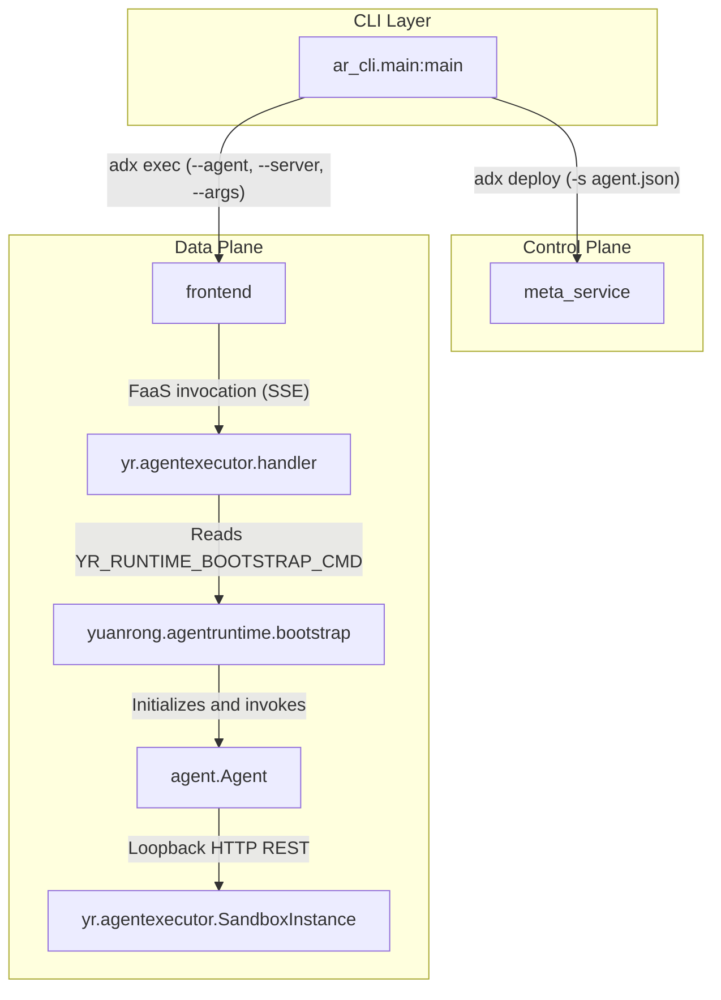
Sources: [README.md:27-56](), [cli/setup.py:49-53](), [executor/README.md:28-48](), [python/README.md:12-31]()

---

## 3. Control Plane vs. Data Plane Separation

The `agent-dx` substrate cleanly separates administrative lifecycle management (control plane) from execution routing and telemetry streaming (data plane).

### Control Plane (`meta_service`)
- **Responsibility**: Agent and function registration, metadata validation, and state storage.
- **Interaction**: The `ar_cli` tool interacts with `meta_service` via HTTP during deployment commands (`adx deploy`), parsing configuration objects such as `agent.json` (specifying names, runtimes, handlers, CPU, memory, and code paths).
- **Code Entities**: CLI deployment logic maps to `ar_cli` modules targeting the `meta_service` API endpoint.

### Data Plane (`frontend`, SSE, and `yr.agentexecutor`)
- **Responsibility**: Invocation transport, Server-Sent Events (SSE) streaming, container lifecycle execution, and process isolation.
- **Interaction**: 
  1. The `ar_cli` invocation path (`adx exec`) routes through the openYuanrong `frontend` component using SSE streaming for output delivery [README.md:11-17]().
  2. The platform `yr.agentexecutor` runs inside the function instance container, starting user processes and exposing a loopback-only REST API (`/v1/sandbox/*`) for local operations [executor/README.md:33-48]().
  3. The `yuanrong.agentruntime.bootstrap` module handles FaaS entrypoints (`initialize`, `handle`, `pre_stop`), bridging openYuanrong runtime events to user-defined `agent.Agent` subclasses [python/README.md:36-52]().

### Component Interaction and Control/Data Plane Flow
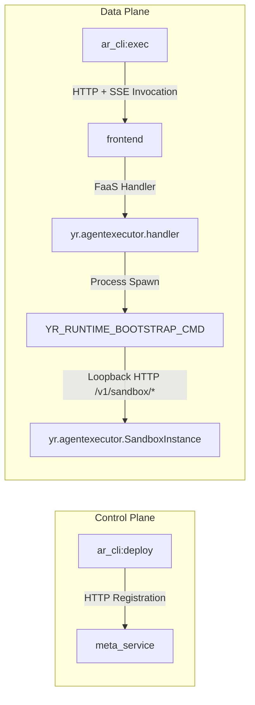
Sources: [README.md:11-17](), [executor/README.md:28-48](), [python/README.md:36-52]()

---

## 4. Shared Versioning Mechanism

The CLI (`agent-dx-cli`), the Python SDK (`agent-dx-sdk`), and the Agent Executor (`agent_dx_executor`) are distributed as independent packages but maintain strict version synchronization via the repository root.

- **Source of Truth**: The single source of truth for release versions is the repository root `VERSION` file [README.md:72-73]().
- **Build Override**: Packaging scripts support environment overrides via `BUILD_VERSION` [cli/setup.py:26-30]().
- **Implementation**: 
  - The CLI package reads the version dynamically at runtime via `cli/ar_cli/__init__.py` [cli/ar_cli/__init__.py:23-30]() or falls back to package metadata via `importlib.metadata.version("agent-dx-cli")` [cli/ar_cli/__init__.py:19-26]().
  - Setuptools configurations in `cli/setup.py` and `python/pyproject.toml` reference or inherit these version definitions during wheel compilation [cli/setup.py:26-34](), [python/pyproject.toml:5-7]().

Sources: [README.md:72-73](), [cli/setup.py:26-34](), [cli/ar_cli/__init__.py:19-30](), [python/pyproject.toml:5-7]()

---

# Page: Getting Started and Build

# Getting Started and Build

<details>
<summary>Relevant source files</summary>

The following files were used as context for generating this wiki page:

- [VERSION](VERSION)
- [build.sh](build.sh)
- [cli/ar_cli/__init__.py](cli/ar_cli/__init__.py)
- [cli/setup.py](cli/setup.py)
- [executor/pyproject.toml](executor/pyproject.toml)
- [pytest.ini](pytest.ini)
- [python/MANIFEST.in](python/MANIFEST.in)
- [python/README.md](python/README.md)
- [python/VERSION](python/VERSION)
- [python/pyproject.toml](python/pyproject.toml)
- [python/setup.py](python/setup.py)

</details>


The purpose and scope of this page cover the end-to-end process of building distribution wheels for the `agent-dx` component packages using `build.sh` and setuptools configurations, configuring an agent package via `agent.json`, and executing agent invocations using the `adx` command-line interface.

Sources: [build.sh:1-29](), [python/README.md:1-53]()

---

## 1. Wheel Building and Packaging Pipeline

The repository provides a top-level `build.sh` script to orchestrate building Python wheels for the three core sub-packages: `agent-dx-cli` (`cli/`), `agent-dx-sdk` (`python/`), and `agent-dx-executor` (`executor/`). 

### Build Script Implementation

The script parses options such as `-v` for wheel version overrides, `-o` for output directory specification, `-p` for the Python interpreter path, `-C` for cleaning artifacts, and `-t` for running pytest units [build.sh:19-76](). It invokes `setup.py bdist_wheel` for each package subdirectory while setting intermediate build directories [build.sh:102-111]().

```mermaid
graph TD
    A["UserCommand"] -->|"-v, -o, -p, -C, -t"| B["build.sh"]
    B -->|"clean"| C["CleanArtifacts"]
    B -->|"test"| D["RunPytest"]
    B -->|"build"| E["BuildWheels"]
    
    E --> F["cli/setup.py"]
    E --> G["python/setup.py"]
    E --> H["executor/setup.py"]
    
    F -->|"-b build/ -d output/"| I["agent_dx_cli.whl"]
    G -->|"-b build/sdk -d output/"| J["agent_dx_sdk.whl"]
    H -->|"-b build/executor -d output/"| K["agent_dx_executor.whl"]

    sub:CodeEntities
    classDef default stroke:#000,fill:#fff;
end
```
*Figure 1: Wheel Building and Packaging Flow bridging build execution to packaging scripts.*

Sources: [build.sh:1-114]()

### Package Configurations (`setup.py` and `pyproject.toml`)

Each sub-package defines its metadata and build backends via `pyproject.toml` or `setup.py`:
- **CLI Package**: Defined in `cli/setup.py`, depending on `click>=8.1` and `requests>=2.28`, and exposing the `adx` console script entry point pointing to `ar_cli.main:main` [cli/setup.py:32-54](). The version is resolved via `ar_cli/__init__.py` reading `VERSION` or package metadata [cli/ar_cli/__init__.py:19-30]().
- **SDK Package**: Defined in `python/pyproject.toml`, utilizing `setuptools.build_meta` with source layout under `src/` [python/pyproject.toml:1-25](). The package setup reads the repository-wide version [python/setup.py:19-24]().
- **Executor Package**: Defined in `executor/pyproject.toml`, listing runtime dependencies such as `aiohttp`, `websockets`, `httpx`, and `multidict` [executor/pyproject.toml:1-30]().

Sources: [cli/setup.py:32-54](), [cli/ar_cli/__init__.py:19-30](), [python/pyproject.toml:1-25](), [python/setup.py:19-24](), [executor/pyproject.toml:1-30]()

---

## 2. Agent Deployment and FaaS Configuration (`agent.json`)

To deploy and execute an agent on the `agent-dx` substrate, the agent code package must include a structured FaaS configuration (`agent.json`) and an entry module named `agent.py` defining an `Agent` class that subclasses `AgentExecutor` [python/README.md:9-52]().

### Configuration Schema

The FaaS configuration specifies the runtime version, bootstrap handlers, initialization timeouts, and session context enforcement flags:

```json
{
  "runtime": "python3.11",
  "handler": "yuanrong.agentruntime.bootstrap.handler",
  "extendedHandler": {
    "initializer": "yuanrong.agentruntime.bootstrap.initialize"
  },
  "extendedTimeout": {
    "initializer": 60
  },
  "enableSessionCtx": true
}
```

- `handler`: Set to `yuanrong.agentruntime.bootstrap.handler` to invoke the SDK dispatch loop.
- `extendedHandler.initializer`: Points to `yuanrong.agentruntime.bootstrap.initialize` for setting up state and initializing the connection to DataSystem.
- `enableSessionCtx`: Must be set to `true` to bind and inject `YR_SESSION_CTX_ID` into the runtime context.

Sources: [python/README.md:36-52]()

### Agent Programming Model

The user writes `agent.py` implementing `init()` and `execute()` hooks:

```python
from yuanrong.agentruntime import AgentExecutor, Complete, InputRequired

class Agent(AgentExecutor):
    async def init(self, session_context):
        self.history = await session_context.event_log.get()

    async def execute(self, ctx):
        message = ctx.input.message
        if message == {"action": "confirm"}:
            return Complete({"accepted": True})

        await ctx.output.write({"progress": "waiting"})
        await ctx.session_context.event_log.append(
            ctx,
            "agent.confirmation.requested",
            {"input": message},
        )
        return InputRequired({"question": "Continue?"})
```

Sources: [python/README.md:11-31]()

---

## 3. Invocation Flow and Execution Architecture

Invoking an agent involves packaging the code along with the `agent-dx-sdk` wheel (`pip install --target <codePath> agent_dx_sdk-*.whl`), registering the deployment via `adx deploy`, and executing requests using `adx exec` [python/README.md:54-66]().

```mermaid
graph TD
    A["adxExecCommand"] -->|"POST /v1/invoke (SSE)"| B["ar_cli/client.py"]
    B -->|"HTTP Request"| C["ExecutorHTTPServer"]
    C -->|"bootstrap.handler"| D["yuanrong.agentruntime.bootstrap"]
    D -->|"init() / execute()"| E["agent.Agent"]
    E -->|"event_log.append()"| F["DataSystem"]

    sub:CodeEntities
    classDef default stroke:#000,fill:#fff;
end
```
*Figure 2: Execution Architecture bridging CLI invocation to FaaS bootstrap and SDK execution.*

### Execution Details
1. **Packaging**: The user installs the built SDK wheel directly into the code path containing `agent.py` and `agent.json` [python/README.md:54-59]().
2. **Invocation**: The `adx exec` command communicates via Server-Sent Events (SSE) to stream execution progress, writing input messages and capturing `Complete` or `InputRequired` states [python/README.md:65-82]().
3. **Session Management**: Session context IDs ensure continuity across turns, allowing the event log to track turns and state changes deterministically [python/README.md:65-88]().

Sources: [python/README.md:54-88]()

---

# Page: adx CLI

# adx CLI

<details>
<summary>Relevant source files</summary>

The following files were used as context for generating this wiki page:

- [cli/README.md](cli/README.md)
- [cli/ar_cli/const.py](cli/ar_cli/const.py)
- [cli/ar_cli/main.py](cli/ar_cli/main.py)

</details>


This page provides an overview of the Click-based `adx` command-line tool, which serves as the primary interface for deploying and invoking agents over the agent-dx distributed execution substrate.

## Purpose and Scope

The `adx` CLI packages function registration and invocation into convenient commands targeting the openYuanrong platform control and data planes [cli/README.md:1-7](). 

As a parent page, this document outlines the high-level architecture and structure of the CLI. For detailed specifications, refer to the following child pages:
- [Commands: deploy and exec](#2.1) — Registration flow, invocation flow, options, validation, and exit codes.
- [API Client, URNs and Utilities](#2.2) — HTTP layer, function invocation and SSE streaming, session context client, URN translation, shared utils and errors.
- [Interactive Mode](#2.3) — Interactive REPL: runner, lifecycle/session ids, line editing, command registry, state, query and rendering.

---

## Architecture and Command-Line Interface

The CLI is structured around a root `click.group` defined in `cli/ar_cli/main.py` [cli/ar_cli/main.py:35-56](). It accepts global options such as `-v/--verbose`, `--version`, and `--jwt-token` (which maps to the `YR_JWT_TOKEN` environment variable) [cli/ar_cli/main.py:36-55]() before delegating to specific subcommands registered via `COMMANDS` [cli/ar_cli/main.py:73-74]().

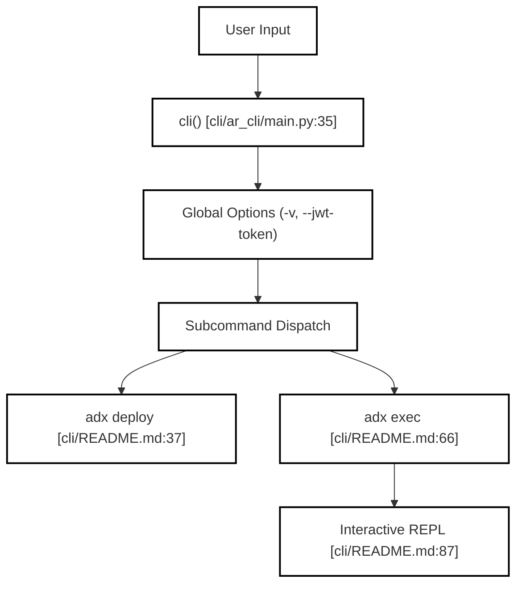
Sources: `cli/ar_cli/main.py:35-74`, `cli/README.md:37-87`

---

## Core Subcommands

### `adx deploy`
The `deploy` subcommand registers an agent function with the control plane (`meta_service`) [cli/README.md:5](). It accepts a specification via `-s/--spec` (supporting inline JSON strings or JSON file paths) and a target `--server` address (`host:port`) [cli/README.md:43-46](). It automatically injects default configuration values like `enableSessionCtx` if omitted [cli/README.md:52]().

### `adx exec`
The `exec` subcommand invokes an agent through the frontend data plane [cli/README.md:6](). When `--args` is provided, it performs a single-shot execution and streams the result via Server-Sent Events (SSE) [cli/README.md:86-93](). When `--args` is omitted, it launches the interactive REPL mode [cli/README.md:87]().

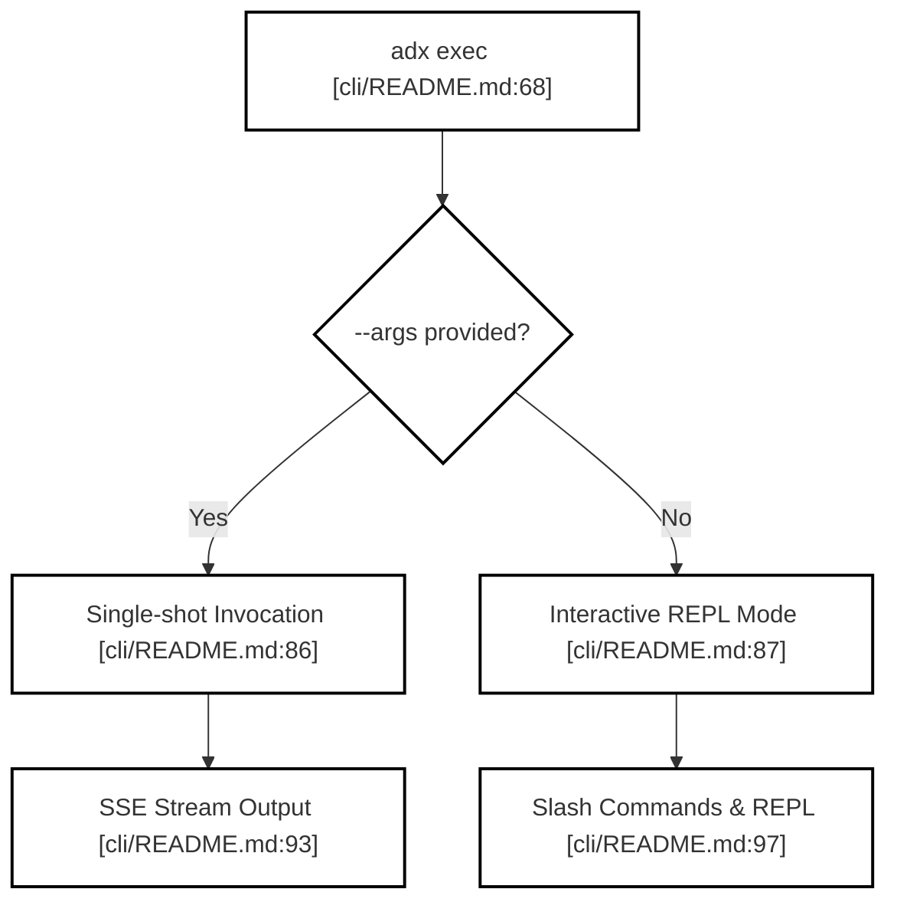
Sources: `cli/README.md:68-93`

---

## Global Constants and Exit Codes

Shared paths, headers, default timeouts, and exit codes are defined globally to ensure consistency across modules [cli/ar_cli/const.py:17-59]().

| Exit Code | Constant | Meaning |
| :--- | :--- | :--- |
| `0` | `EXIT_SUCCESS` | Success [cli/ar_cli/const.py:56] |
| `1` | `EXIT_FAILURE` | Server failure (non-2xx HTTP, response code != 0) [cli/ar_cli/const.py:57] |
| `2` | `EXIT_PARAM_ERROR` | Parameter error (invalid JSON, missing required arguments) [cli/ar_cli/const.py:58] |
| `3` | `EXIT_NETWORK_ERROR` | Network error (connection failure, timeout) [cli/ar_cli/const.py:59] |

Sources: `cli/ar_cli/const.py:55-60`

For further technical details, please proceed to the child pages:
- [Commands: deploy and exec](#2.1)
- [API Client, URNs and Utilities](#2.2)
- [Interactive Mode](#2.3)

---

# Page: Commands: deploy and exec

# Commands: deploy and exec

<details>
<summary>Relevant source files</summary>

The following files were used as context for generating this wiki page:

- [cli/ar_cli/commands/deploy.py](cli/ar_cli/commands/deploy.py)
- [cli/ar_cli/commands/exec.py](cli/ar_cli/commands/exec.py)
- [tests/cli/test_deploy_inject.py](tests/cli/test_deploy_inject.py)
- [tests/cli/test_exec.py](tests/cli/test_exec.py)

</details>


Purpose and scope: This section documents the implementation, command-line options, validation rules, execution flows, and exit codes for the `adx deploy` and `adx exec` commands within the `agent-dx` CLI (`cli/ar_cli/commands/deploy.py` and `cli/ar_cli/commands/exec.py`). These commands manage agent registration with `meta_service` and handle single-shot or interactive agent function invocation through the frontend data plane.

Sources: `cli/ar_cli/commands/deploy.py:1-86` [cli/ar_cli/commands/deploy.py:1-85](), `cli/ar_cli/commands/exec.py:1-148` [cli/ar_cli/commands/exec.py:1-147]()

---

## 1. `adx deploy`: Registration Flow and Validation

The `adx deploy` command registers an agent function with the platform's `meta_service`. It accepts a function specification (either inline JSON string or a file path) and a target server address.

### Command Options and Parameters
* `--spec` (`-s`): Required option pointing to a JSON string or file path containing the function configuration [cli/ar_cli/commands/deploy.py:43-48]().
* `--server`: Required option specifying the `meta_service` address in `host:port` format [cli/ar_cli/commands/deploy.py:49-54]().

### Registration Pipeline
1. **Spec Loading**: `load_spec()` reads the input source. If it is a file path, it reads the file contents; if it is a JSON string, it parses it directly [cli/ar_cli/commands/deploy.py:57]().
2. **Field Injection**: The command checks for the presence of `enableSessionCtx` (`ENABLE_SESSION_CTX_KEY`). If omitted, it defaults to `True`. Explicit user values (`true` or `false`) are preserved [cli/ar_cli/commands/deploy.py:61-65]().
3. **Client Invocation**: `AgentRuntimeClient.register_function()` transmits the normalized server address and spec payload to the `meta_service` [cli/ar_cli/commands/deploy.py:67-69]().
4. **URN Translation**: The response is inspected for `functionVersionUrn` or `functionUrn`. `function_urn_to_public_agent()` translates this URN into a human-readable public agent format (`0@default@funcname`) before logging [cli/ar_cli/commands/deploy.py:74-78]().

Diagram: Deploy Registration Pipeline (Natural Language Space to Code Entity Space)
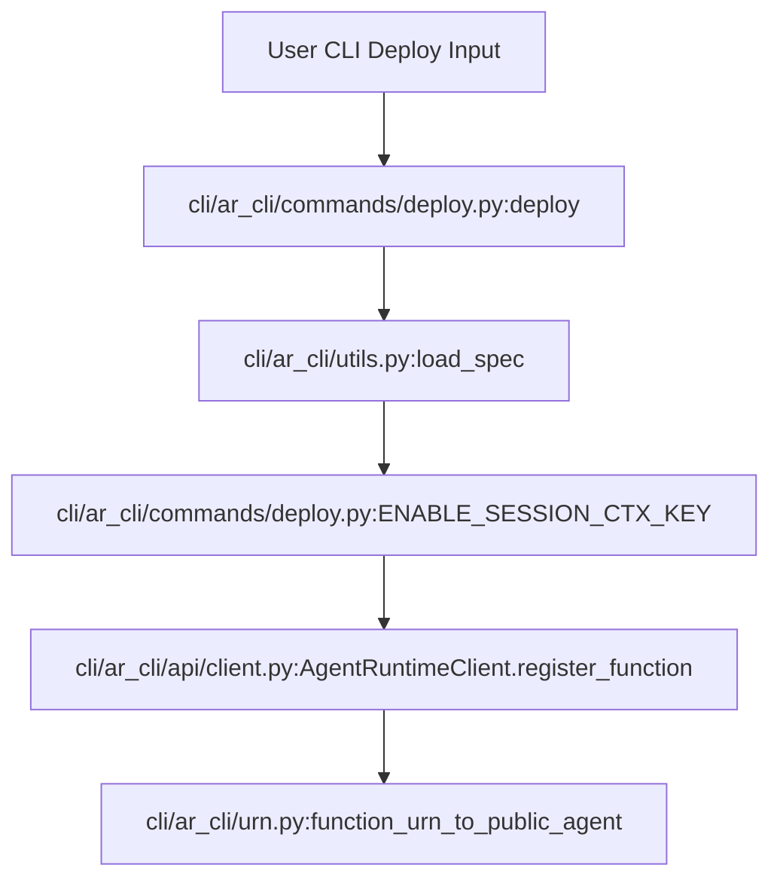
Sources: `cli/ar_cli/commands/deploy.py:32-86` [cli/ar_cli/commands/deploy.py:32-85](), `tests/cli/test_deploy_inject.py:30-162` [tests/cli/test_deploy_inject.py:30-161]()

---

## 2. `adx exec`: Invocation Flow and Interactive Mode

The `adx exec` command invokes an agent function and streams its Server-Sent Events (SSE) response [cli/ar_cli/commands/exec.py:17-43]().

### Command Options and Parameters
* `--agent`: Required agent identifier (`0@default@funcname[:version]`) [cli/ar_cli/commands/exec.py:54-59]().
* `--server`: Required frontend address as `host:port` [cli/ar_cli/commands/exec.py:60-65]().
* `--session-ctx`: Optional session context header value (`X-Session-Context`) [cli/ar_cli/commands/exec.py:66-71]().
* `--session-id`: Optional instance session identifier header value (`X-Instance-Session`) [cli/ar_cli/commands/exec.py:72-77]().
* `--session-ttl`: Instance session TTL (defaults to 90; 600 in interactive mode) [cli/ar_cli/commands/exec.py:78-83]().
* `--concurrency`: Instance session concurrency limit (defaults to 1) [cli/ar_cli/commands/exec.py:84-89]().
* `--args`: Handler arguments as a JSON string. Omitting this option enters interactive mode [cli/ar_cli/commands/exec.py:90-95]().

### Invocation Flow & Bifurcation
1. **Validation**: The command validates options, raising a `click.UsageError` if `--session-ttl` or `--concurrency` are supplied without `--session-id` [cli/ar_cli/commands/exec.py:107-109]().
2. **Mode Branching**:
   * **Interactive Mode (`args is None`)**: Delegates execution to `run_interactive()`, passing client, server URL, agent URN, and session configuration parameters [cli/ar_cli/commands/exec.py:116-125]().
   * **Single-Shot Mode (`args` provided)**: Validates JSON formatting via `parse_json_arg()`, constructs `InvocationOptions` (auto-generating a session context if omitted), and consumes the SSE stream via `invoke_stream()` [cli/ar_cli/commands/exec.py:128-142]().

Diagram: Exec Invocation Pipeline (Natural Language Space to Code Entity Space)
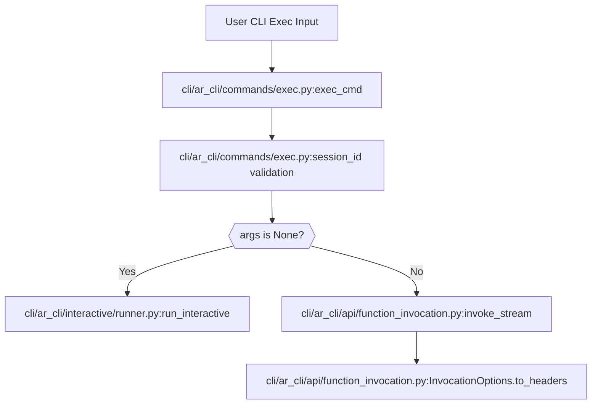
Sources: `cli/ar_cli/commands/exec.py:41-148` [cli/ar_cli/commands/exec.py:41-147](), `tests/cli/test_exec.py:65-211` [tests/cli/test_exec.py:65-211]()

---

## 3. Validation, Errors, and Exit Codes

Both `deploy` and `exec` catch runtime and client errors through strict exception handling and exit code propagation.

### Error Handling Strategy
* **ArError**: Captured from API interactions, logging the error message and exiting with the specific `exit_code` defined on the error object (`e.exit_code`) [cli/ar_cli/commands/deploy.py:70-72](), [cli/ar_cli/commands/exec.py:144-146]().
* **Click Usage & Parameter Errors**: Malformed JSON arguments, missing required options, or invalid combinations of options (such as session TTL without session ID) trigger Click parameter validation exceptions resulting in exit code `2`.

### Exit Code Summary
| Condition | Exit Code | Source / Trigger |
| :--- | :--- | :--- |
| Successful deployment or execution | `0` | `ctx.exit(0)` [cli/ar_cli/commands/deploy.py:85](), [cli/ar_cli/commands/exec.py:147]() |
| API runtime or client error (`ArError`) | `e.exit_code` | `ArError` subclasses [cli/ar_cli/commands/deploy.py:72](), [cli/ar_cli/commands/exec.py:146]() |
| Invalid JSON, missing options, or usage error | `2` | `click.UsageError` / `click.BadParameter` [cli/ar_cli/commands/exec.py:109](), [tests/cli/test_deploy_inject.py:74]() |

Sources: `cli/ar_cli/commands/deploy.py:68-73` [cli/ar_cli/commands/deploy.py:68-73](), `cli/ar_cli/commands/exec.py:107-110,144-147` [cli/ar_cli/commands/exec.py:107-110,144-147](), `tests/cli/test_deploy_inject.py:71-75` [tests/cli/test_deploy_inject.py:71-75]()

---

# Page: API Client, URNs and Utilities

# API Client, URNs and Utilities

<details>
<summary>Relevant source files</summary>

The following files were used as context for generating this wiki page:

- [cli/ar_cli/api/__init__.py](cli/ar_cli/api/__init__.py)
- [cli/ar_cli/api/client.py](cli/ar_cli/api/client.py)
- [cli/ar_cli/api/function_invocation.py](cli/ar_cli/api/function_invocation.py)
- [cli/ar_cli/api/http.py](cli/ar_cli/api/http.py)
- [cli/ar_cli/api/session_context.py](cli/ar_cli/api/session_context.py)
- [cli/ar_cli/commands/__init__.py](cli/ar_cli/commands/__init__.py)
- [cli/ar_cli/errors.py](cli/ar_cli/errors.py)
- [cli/ar_cli/interactive/__init__.py](cli/ar_cli/interactive/__init__.py)
- [cli/ar_cli/interactive/lineedit.py](cli/ar_cli/interactive/lineedit.py)
- [cli/ar_cli/interactive/runner.py](cli/ar_cli/interactive/runner.py)
- [cli/ar_cli/urn.py](cli/ar_cli/urn.py)
- [cli/ar_cli/utils.py](cli/ar_cli/utils.py)
- [cli/requirements.txt](cli/requirements.txt)
- [tests/cli/test_lineedit.py](tests/cli/test_lineedit.py)
- [tests/cli/test_session_context_client.py](tests/cli/test_session_context_client.py)
- [tests/cli/test_sse.py](tests/cli/test_sse.py)
- [tests/cli/test_utils.py](tests/cli/test_utils.py)

</details>


## Purpose and Scope
This section covers the core supporting modules of the `adx` CLI (`cli/ar_cli/`), providing the foundational infrastructure for HTTP communication with backend services, URN format translation, common command utilities, validation callbacks, and unified error handling. These components isolate network I/O, configuration parsing, and error translation from command logic.

Sources: `cli/ar_cli/api/http.py`, `cli/ar_cli/urn.py`, `cli/ar_cli/utils.py`, `cli/ar_cli/errors.py`

---

## HTTP Layer and Client Architecture
The HTTP layer is centered around `HttpClient` in `cli/ar_cli/api/http.py`, which wraps `requests.Session` to provide consistent JSON request handling, connection management, headers redaction, and error mapping [cli/ar_cli/api/http.py:31-43]().

### Core Request Methods
- `request_json`: Handles JSON payloads, validates response statuses via `response.ok`, parses response bodies, and checks service-level business error codes [cli/ar_cli/api/http.py:52-105]().
- `request_no_content`: Executes methods where successful responses carry no body content [cli/ar_cli/api/http.py:109-142]().
- `post_stream`: Opens a UTF-8 streaming response with `stream=True` for Server-Sent Events (SSE) and incremental output [cli/ar_cli/api/http.py:144-170]().

```mermaid
graph TD
    sub5[""ClientCaller""] -->|"request_json()"| sub6[""HttpClient.request_json""]
    sub5 -->|"post_stream()"| sub7[""HttpClient.post_stream""]
    sub6 -->|"_session.request()"| sub8[""requests.Session""]
    sub7 -->|"_session.post(stream=True)"| sub8
    sub8 -->|"response.ok check"| sub9[""build_api_error()""]
    sub9 -->|"raises"| sub10[""ApiError""]
```
Sources: `cli/ar_cli/api/http.py:31-170]()`

---

## URN Translation
The CLI translates between public-facing agent strings (`0@namespace@func[:version]`) and the backend function version URN format (`sn:cn:yrk:default:function:0@namespace@func:version`) [cli/ar_cli/urn.py:23-45]().

### Translation Functions
- `public_agent_to_function_version_urn`: Parses a public agent descriptor (defaulting version to `latest`) and formats it into the backend URN [cli/ar_cli/urn.py:27-30]().
- `function_urn_to_public_agent`: Validates a full backend URN and strips the prefix to return the public representation [cli/ar_cli/urn.py:33-45]().

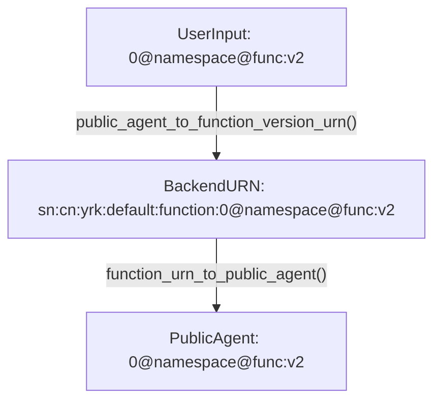
Sources: `cli/ar_cli/urn.py:23-70]()`

---

## Shared Utilities and Validation
Common helpers in `cli/ar_cli/utils.py` provide address normalization, spec loading, and Click parameter validation callbacks [cli/ar_cli/utils.py:17-146]().

### Key Functions
- `normalize_addr`: Prepends `http://` to bare `host:port` addresses if no scheme is specified [cli/ar_cli/utils.py:100-110]().
- `load_spec`: Loads function specifications from inline JSON strings or JSON files on disk, raising `click.BadParameter` on failure [cli/ar_cli/utils.py:112-134]().
- `validate_server`: Click callback ensuring server addresses conform to `host:port` format [cli/ar_cli/utils.py:47-62]().
- `validate_session_field`: Click callback ensuring session identifiers or context strings do not exceed `SESSION_FIELD_MAX_LEN` [cli/ar_cli/utils.py:34-44]().

Sources: `cli/ar_cli/utils.py:34-134]()`

---

## Unified Error Handling
Errors are organized under a hierarchical exception structure in `cli/ar_cli/errors.py`, where each exception class defines an associated process exit code [cli/ar_cli/errors.py:17-42]().

| Exception Class | Parent | Associated Exit Code | Description |
| :--- | :--- | :--- | :--- |
| `ArError` | `Exception` | `EXIT_FAILURE` (1) | Base exception class for the `adx` CLI [cli/ar_cli/errors.py:22-25]() |
| `ApiError` | `ArError` | `EXIT_FAILURE` (1) | Raised when servers return non-2xx status codes or non-zero business codes [cli/ar_cli/errors.py:28-37]() |
| `NetworkError` | `ArError` | `EXIT_NETWORK_ERROR` (2) | Raised when connection establishment fails (timeouts, DNS, connection refused) [cli/ar_cli/errors.py:39-42]() |

Sources: `cli/ar_cli/errors.py:17-43]()`

---

# Page: Interactive Mode

# Interactive Mode

<details>
<summary>Relevant source files</summary>

The following files were used as context for generating this wiki page:

- [cli/ar_cli/interactive/lifecycle.py](cli/ar_cli/interactive/lifecycle.py)
- [cli/ar_cli/interactive/query.py](cli/ar_cli/interactive/query.py)
- [cli/ar_cli/interactive/registry.py](cli/ar_cli/interactive/registry.py)
- [cli/ar_cli/interactive/render.py](cli/ar_cli/interactive/render.py)
- [cli/ar_cli/interactive/state.py](cli/ar_cli/interactive/state.py)
- [tests/cli/test_interactive.py](tests/cli/test_interactive.py)
- [tests/cli/test_session.py](tests/cli/test_session.py)

</details>


## Purpose and Scope
This page details the implementation of the interactive Read-Eval-Print Loop (REPL) within the `agent-dx` CLI (`ar_cli.interactive`). The interactive mode provides a terminal-based interface for managing `SessionCtx` instances, inspecting turn histories, forking execution contexts, and invoking agent operations dynamically through slash commands. 

Sources: `cli/ar_cli/interactive/lifecycle.py`, `cli/ar_cli/interactive/registry.py`, `cli/ar_cli/interactive/state.py`, `cli/ar_cli/interactive/query.py`, `cli/ar_cli/interactive/render.py`

---

## 1. State Management and Context Model

The interactive REPL maintains execution state using dataclasses defined in `ar_cli.interactive.state`. The primary structures are `InteractiveSessionState` and `InteractiveContext`.

- `InteractiveSessionState`: Tracks the active target server URL (`server_url`), the target agent URN (`agent_urn`), and the current local or remote session context ID (`session_ctx`) [cli/ar_cli/interactive/state.py:27-34]().
- `InteractiveContext`: Combines `InteractiveSessionState` with an instance of `AgentRuntimeClient` to provide slash-command handlers access to both local state and remote API capabilities [cli/ar_cli/interactive/state.py:36-42]().
- `CommandResult`: An enumeration (`CONTINUE`, `EXIT`) returned by command handlers to signal whether the REPL loop should proceed or terminate [cli/ar_cli/interactive/state.py:44-49]().
- `InteractiveCommandError`: A specialized exception raised for user-facing syntax errors or invalid API responses during command execution [cli/ar_cli/interactive/state.py:51-52]().

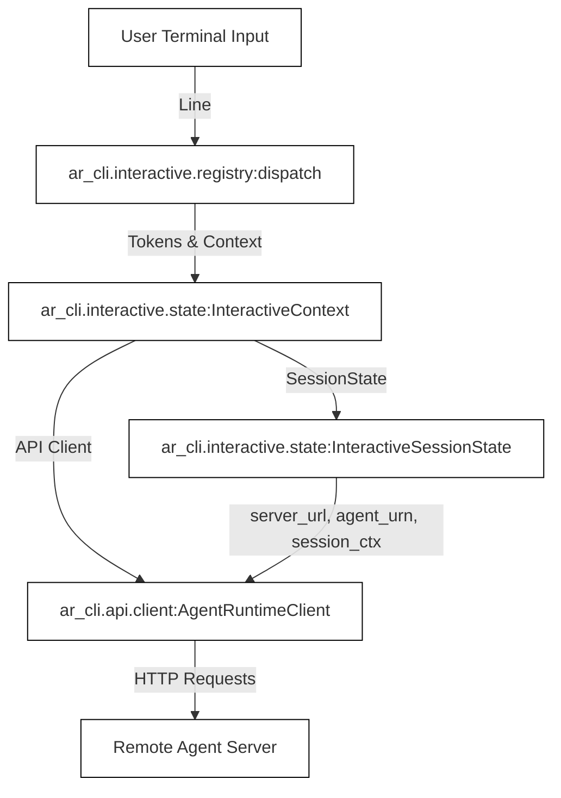
*Figure 1: State and Context Flow across CLI layers.*

Sources: `cli/ar_cli/interactive/state.py`

---

## 2. Command Registry and Dispatch

Slash commands are statically registered in `ar_cli.interactive.registry` via the `SlashCommand` dataclass collection (`_COMMANDS`). Each entry associates a command string (e.g., `/sessions`) with a summary description and a `CommandHandler` callable [cli/ar_cli/interactive/registry.py:36-50]().

### Supported Slash Commands

| Command | Summary | Handler Function |
| :--- | :--- | :--- |
| `/sessions` | List and switch `SessionCtx` | `ar_cli.interactive.query:show_sessions` [cli/ar_cli/interactive/registry.py:44]() |
| `/history` | Show Turns in the current `SessionCtx` | `ar_cli.interactive.query:show_history` [cli/ar_cli/interactive/registry.py:45]() |
| `/fork` | Fork a completed Turn into a `SessionCtx` | `ar_cli.interactive.lifecycle:fork_session` [cli/ar_cli/interactive/registry.py:46]() |
| `/delete` | Delete a non-current `SessionCtx` | `ar_cli.interactive.lifecycle:delete_session` [cli/ar_cli/interactive/registry.py:47]() |
| `/new` | Switch to a new local `SessionCtx` | `ar_cli.interactive.lifecycle:new_session` [cli/ar_cli/interactive/registry.py:48]() |
| `/quit` | Exit interactive mode | `ar_cli.interactive.lifecycle:quit_interactive` [cli/ar_cli/interactive/registry.py:49]() |

Input parsing is handled by `parse_command()`, which leverages `shlex.split()` to tokenize input lines securely while wrapping parser errors into `InteractiveCommandError` [cli/ar_cli/interactive/registry.py:76-83]().

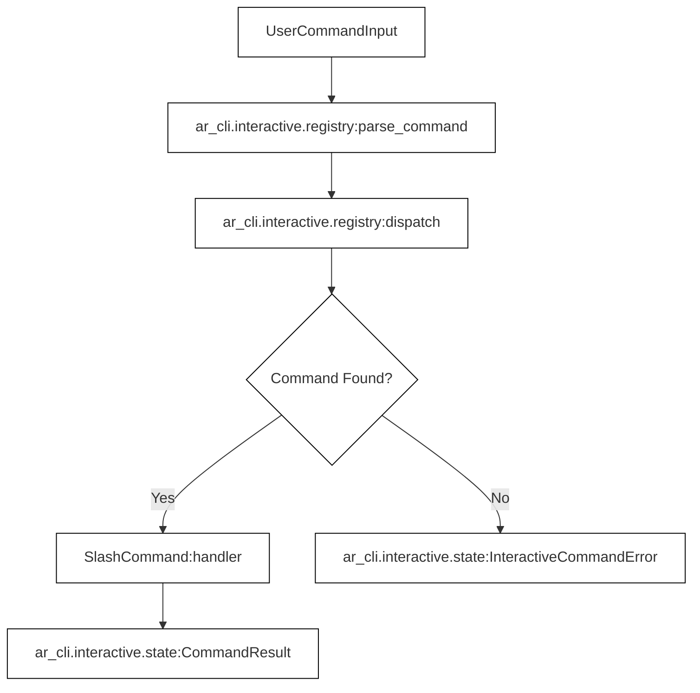
*Figure 2: Command Dispatch Pipeline.*

Sources: `cli/ar_cli/interactive/registry.py`

---

## 3. Session Lifecycle and Mutation

Session lifecycle handlers in `ar_cli.interactive.lifecycle` execute core administrative transformations over session contexts:

- `fork_session`: Validates a source `<turn-id>` and target `<new-session-ctx-id>`, ensures the target differs from the current session, and calls `AgentRuntimeClient.fork_session_context()` [cli/ar_cli/interactive/lifecycle.py:28-52]() [cli/ar_cli/interactive/lifecycle.py:35-38](). Handles HTTP 409 conflict responses gracefully [cli/ar_cli/interactive/lifecycle.py:47-51]().
- `delete_session`: Prevents deletion of the currently active session context, then invokes `AgentRuntimeClient.delete_session_context()` [cli/ar_cli/interactive/lifecycle.py:63-78]().
- `new_session`: Instantiates a local session identifier via `new_session_ctx_id()` (generating `adx-<uuid>`) without immediately sending an allocation request to the remote substrate [cli/ar_cli/interactive/lifecycle.py:81-87]() [cli/ar_cli/interactive/lifecycle.py:106-107]().
- `quit_interactive`: Terminates the session by returning `CommandResult.EXIT` [cli/ar_cli/interactive/lifecycle.py:90-93]().

Resource IDs are strictly validated via `validate_resource_id()` to guard against empty or oversized identifiers exceeding `SESSION_FIELD_MAX_LEN` [cli/ar_cli/interactive/lifecycle.py:96-103]().

Sources: `cli/ar_cli/interactive/lifecycle.py`

---

## 4. Query and Terminal Rendering

Read-only commands retrieve and render remote state structures through functions implemented in `ar_cli.interactive.query` and `ar_cli.interactive.render`.

- `show_sessions`: Fetches session contexts using `AgentRuntimeClient.list_session_contexts()` up to `DEFAULT_SESSION_CONTEXT_LIST_LIMIT` [cli/ar_cli/interactive/query.py:29-37](). If running in an interactive TTY environment supporting selectors (`can_select_items()`), it delegates to `select_item()`; otherwise, it prints a static text table [cli/ar_cli/interactive/query.py:54-65]().
- `show_history`: Queries turns within the current session context via `AgentRuntimeClient.list_turns()` [cli/ar_cli/interactive/query.py:71-81](). Catches HTTP 404 errors to present a friendly notification if the session has not been initialized [cli/ar_cli/interactive/query.py:82-86]().
- Rendering Utilities: `ar_cli.interactive.render` provides robust layout formatters (`format_table`, `format_row`) and unicode-aware width calculation (`char_width_of`, `display_width`, `truncate_display`) to guarantee alignment across multi-byte character sets [cli/ar_cli/interactive/render.py:77-119]().

Sources: `cli/ar_cli/interactive/query.py`, `cli/ar_cli/interactive/render.py`

---

# Page: Agent Executor (executor/)

# Agent Executor (executor/)

<details>
<summary>Relevant source files</summary>

The following files were used as context for generating this wiki page:

- [executor/README.md](executor/README.md)
- [executor/README.zh.md](executor/README.zh.md)
- [executor/setup.py](executor/setup.py)
- [executor/src/yr/agentexecutor/__init__.py](executor/src/yr/agentexecutor/__init__.py)
- [executor/src/yr/agentexecutor/handler.py](executor/src/yr/agentexecutor/handler.py)

</details>


## Purpose and Scope

The `executor/` package provides a platform-owned FaaS code package installed into custom-image Agent base images [executor/README.md:5-8](). It initializes the runtime, HTTP server, and user processes through standard openYuanRong FaaS hooks [executor/README.md:5-6]() without depending on the `yr` package or the Python Agent SDK [executor/README.md:10](). 

The package is installed into the Python environment used by the runtime [executor/README.md:14]() and serves as image infrastructure rather than a user-facing SDK [executor/README.md:7-15]().

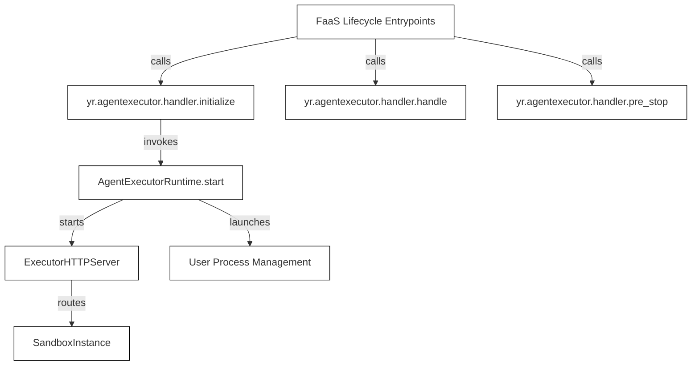
Sources: [executor/src/yr/agentexecutor/handler.py:22-31](), [executor/README.md:33-40]()

---

## 3.1 Runtime Lifecycle and FaaS Handlers

The FaaS entrypoints bridge the openYuanRong runtime lifecycle to the `AgentExecutorRuntime` singleton. These hooks handle container initialization, status inspection, and pre-stop cleanup [executor/README.md:30-36]().

For details, see [Runtime Lifecycle and FaaS Handlers](#3.1).

### 3.1.1 Health Probes
Startup gates and liveness aggregation states parse `ProbeSpec` definitions and evaluate tcp, http, or exec actions to ensure container health.

For details, see [Health Probes](#3.1.1).

### 3.1.2 User Process Management
User processes are initialized using `YR_RUNTIME_BOOTSTRAP_CMD` configuration with best-effort semantics, process group isolation, unified `.std` logging under `${GLOG_log_dir}`, and `SIGTERM`/`SIGKILL` signal handling [executor/README.md:72-86]().

For details, see [User Process Management](#3.1.2).

Sources: [executor/README.md:30-36](), [executor/README.md:72-86](), [executor/src/yr/agentexecutor/handler.py:22-31]()

---

## 3.2 Executor HTTP Server and APIs

The `ExecutorHTTPServer` routes internal requests over a loopback interface, enforcing concurrency caps (maximum 64 concurrent requests) [executor/README.md:60](), strict size limits (512 MiB default JSON body limits) [executor/README.md:63](), request tracing, and payload stream parsing.

For details, see [Executor HTTP Server and APIs](#3.2).

### 3.2.1 File Management API
Management-plane file transfers are handled via `/v1/files/upload`, `/v1/files/download` (supporting `Range` headers), listing, directory creation, and the underlying `FileHandler` implementation [executor/README.md:68-70]().

For details, see [File Management API](#3.2.1).

Sources: [executor/README.md:42-70]()

---

## 3.3 Sandbox Subsystem

The sandbox subsystem instantiates a process-local `SandboxInstance` [executor/README.md:38]() providing isolated execution and file operations through `/v1/sandbox/*` REST endpoints [executor/README.md:42-48]() without requiring remote `@yr.instance` actors [executor/README.md:34]().

For details, see [Sandbox Subsystem](#3.3).

### 3.3.1 Tunnel Protocol and Proxying
Port proxying and stream framing are managed by `tunnel_protocol` primitives, `tunnel_client`, and `tunnel_server` to route upstream traffic securely into sandboxed environments.

For details, see [Tunnel Protocol and Proxying](#3.3.1).

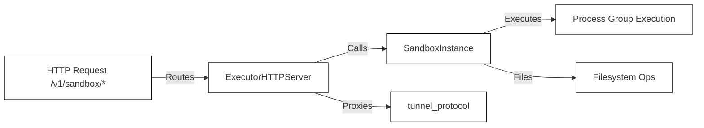
Sources: [executor/README.md:33-56]()

---

# Page: Runtime Lifecycle and FaaS Handlers

# Runtime Lifecycle and FaaS Handlers

<details>
<summary>Relevant source files</summary>

The following files were used as context for generating this wiki page:

- [executor/setup.py](executor/setup.py)
- [executor/src/yr/agentexecutor/__init__.py](executor/src/yr/agentexecutor/__init__.py)
- [executor/src/yr/agentexecutor/handler.py](executor/src/yr/agentexecutor/handler.py)
- [executor/src/yr/agentexecutor/runtime.py](executor/src/yr/agentexecutor/runtime.py)
- [tests/executor/test_runtime.py](tests/executor/test_runtime.py)

</details>


This document covers the process-local runtime lifecycle and standard FaaS (Function-as-a-Service) entrypoints for the platform-owned Agent Executor package within `agent-dx`. The Agent Executor bridges the underlying openYuanrong execution substrate with custom-image agent instances by managing HTTP routing, user process lifecycles, sandboxed environments, and platform health probes.

For detailed information on health probes and startup gating, refer to [Health Probes](#3.1.1). For details on process groups and logging wrappers, see [User Process Management](#3.1.2).

---

## FaaS Handlers and Entrypoints

The Agent Executor exposes standard YuanRong FaaS lifecycle hook functions through `executor/src/yr/agentexecutor/handler.py` [executor/src/yr/agentexecutor/handler.py:1-31](). These entrypoints map platform container lifecycle events directly to singleton process-local runtime operations controlled by `AgentExecutorRuntime`.

- `initialize(_context)`: Invoked upon container boot to bootstrap the runtime environment by calling `get_runtime().start()` [executor/src/yr/agentexecutor/handler.py:22-23]().
- `handle(_event, _context)`: Invoked to query container health or dispatch control requests, returning runtime status via `get_runtime().status()` [executor/src/yr/agentexecutor/handler.py:26-27]().
- `pre_stop()`: Invoked prior to container teardown to initiate graceful shutdown via `get_runtime().stop()` [executor/src/yr/agentexecutor/handler.py:30-31]().

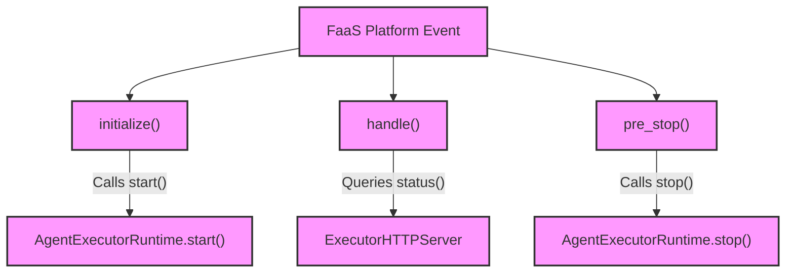

Title: "FaaS Lifecycle Event Mapping to Runtime Operations"

Sources: `executor/src/yr/agentexecutor/handler.py:1-32`, `executor/src/yr/agentexecutor/runtime.py:121-173`

---

## AgentExecutorRuntime Startup Pipeline

The `AgentExecutorRuntime` class coordinates the sequential initialization of platform subsystems within `executor/src/yr/agentexecutor/runtime.py` [executor/src/yr/agentexecutor/runtime.py:121-173](). When `start()` is invoked, the runtime logs instance identification attributes (`YR_TRACE_ID`, `INSTANCE_ID`, `YR_RUNTIME_ID`), loads probe configurations, initializes the openYuanrong core module (`yr.init()`), and boots dependent services in a strict dependency order.

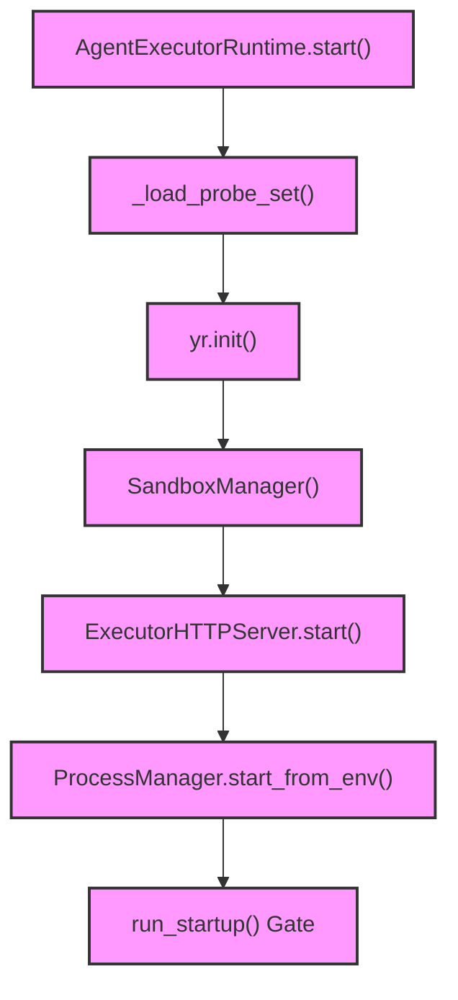

Title: "AgentExecutorRuntime Initialization Pipeline"

Sources: `executor/src/yr/agentexecutor/runtime.py:121-173`

If any component in the pipeline fails during startup (such as a user process failure or a startup probe timeout), the runtime executes a rollback cleanup sequence that stops the HTTP server, terminates active sandboxes, and cleans up child process groups before propagating the exception [executor/src/yr/agentexecutor/runtime.py:158-170]().

Sources: `executor/src/yr/agentexecutor/runtime.py:121-173`, `tests/executor/test_runtime.py:71-136`

---

## Environment Configuration

The runtime behavior is configured extensively via environment variables parsed during initialization. These variables govern network interfaces, file size limits, timeouts, and sandbox characteristics:

- `YR_AGENT_EXECUTOR_HOST` and `YR_AGENT_EXECUTOR_PORT`: Bind address and port for the `ExecutorHTTPServer` (defaults to `0.0.0.0:18093`) [executor/src/yr/agentexecutor/runtime.py:34-43]().
- `YR_AGENT_EXECUTOR_MAX_FILE_SIZE`: Maximum allowed file transfer size [executor/src/yr/agentexecutor/runtime.py:36]().
- `PRE_STOP_TIMEOUT`: FaaS pre-stop container timeout budget (defaults to `10.0` seconds) [executor/src/yr/agentexecutor/runtime.py:38]().
- `YR_AGENT_EXECUTOR_SHUTDOWN_GRACE_SECONDS`: Custom override for child process termination grace periods [executor/src/yr/agentexecutor/runtime.py:37]().
- `YR_AGENT_SANDBOX_*`: Parameters specifying container sandbox types, CPU/memory limits, ports, and idle timeouts [executor/src/yr/agentexecutor/runtime.py:47-56]().

Sources: `executor/src/yr/agentexecutor/runtime.py:34-88`

---

## Shutdown Grace Ordering and Cleanup

When container teardown is triggered via `pre_stop()`, shutdown operations must adhere to a strict ordering window to prevent hanging FaaS instances. The runtime first stops the `ExecutorHTTPServer` to reject incoming control traffic, and subsequently requests the `ProcessManager` to terminate user processes within an allocated shutdown grace budget [tests/executor/test_runtime.py:51-69]().

The child process shutdown grace period is calculated dynamically via `resolve_process_shutdown_grace()` [executor/src/yr/agentexecutor/runtime.py:102-119](). It fits within the container's `PRE_STOP_TIMEOUT` minus a safety reserve (`SHUTDOWN_CLEANUP_RESERVE_SECONDS = 2.0`), honoring optional configuration overrides without exceeding the available time budget [executor/src/yr/agentexecutor/runtime.py:44-45, 102-119]().

Sources: `executor/src/yr/agentexecutor/runtime.py:37-45, 102-119`, `tests/executor/test_runtime.py:35-69`

---

## Child Pages

For deeper technical implementation details, consult the following child pages:
- [Health Probes](#3.1.1) — ProbeSpec parsing, startup gate (`run_startup`), liveness aggregation states, and TCP/HTTP/exec probe actions.
- [User Process Management](#3.1.2) — Bootstrap command parsing, process groups, unified `.std` logging, and `SIGTERM`/`SIGKILL` shutdown flows.

---

# Page: Health Probes

# Health Probes

<details>
<summary>Relevant source files</summary>

The following files were used as context for generating this wiki page:

- [executor/src/yr/agentexecutor/probe.py](executor/src/yr/agentexecutor/probe.py)
- [tests/executor/test_probe.py](tests/executor/test_probe.py)

</details>


## Purpose and Scope
This document specifies the technical design and implementation of instance-level startup and liveness probes within the `agent-dx` Agent Executor runtime (`executor/src/yr/agentexecutor/probe.py` [executor/src/yr/agentexecutor/probe.py:1-182]()). The probe subsystem is responsible for parsing probe specifications from container environment variables, enforcing startup synchronization gates via `run_startup`, evaluating actionable target checks (`tcpSocket`, `httpGet`, and `exec`), and maintaining real-time liveness aggregation states (`AggregateState`) through consecutive failure thresholds.

---

## 1. ProbeSpec Parsing and Configuration Loading

The probe configuration is injected into the container runtime via environment variables. Two primary variables govern probe discovery:
* `YR_RUNTIME_BOOTSTRAP_PROBE` (`PROBE_SPEC_ENV`): Contains a JSON payload defining `startup` and `liveness` configuration mappings [executor/src/yr/agentexecutor/probe.py:35-35]().
* `SANDBOX_IP` (`SANDBOX_IP_ENV`): Supplies the isolated sandbox veth IPv4 address or egress IPv4 host, falling back to `127.0.0.1` (`DEFAULT_PROBE_HOST`) if absent [executor/src/yr/agentexecutor/probe.py:36-40]().

The `ProbeSpec` class encapsulates timing parameters, thresholds, and target actions [executor/src/yr/agentexecutor/probe.py:65-88](). The helper function `_extract_action` validates raw dictionaries and enforces that exactly one probe action (`tcpSocket`, `httpGet`, or `exec`) is specified per probe role [executor/src/yr/agentexecutor/probe.py:103-145](). Target host resolution follows a strict precedence: explicit spec host > `SANDBOX_IP` environment variable > loopback address (`127.0.0.1`) [executor/src/yr/agentexecutor/probe.py:104-107]().

```mermaid
graph TD
  Env["Environment Variables YR_RUNTIME_BOOTSTR_PROBE & SANDBOX_IP"] --> Load["_load_probe_set()"]
  Load --> RawMap["Raw JSON Mapping"]
  RawMap --> Extract["_extract_action()"]
  Extract --> CheckType{"Action Type?"}
  CheckType -->|tcpSocket| TCP["TCP Action (Host, Port)"]
  CheckType -->|httpGet| HTTP["HTTP Action (Scheme, Host, Port, Path)"]
  CheckType -->|exec| EXEC["Exec Action (Command List)"]
  TCP --> Spec["ProbeSpec Class Instantiation"]
  HTTP --> Spec
  EXEC --> Spec
  
  subclass CodeEntities
    Load -.-> LS["_load_probe_set in yr.agentexecutor.probe"]
    Extract -.-> EA["_extract_action in yr.agentexecutor.probe"]
    Spec -.-> PS["ProbeSpec in yr.agentexecutor.probe"]
  end
```
*Title: Probe Configuration Parsing Pipeline*

Sources: `executor/src/yr/agentexecutor/probe.py:35-145()`, `tests/executor/test_probe.py:105-140()`

---

## 2. Probe Action Execution (TCP, HTTP, and Exec)

Once a `ProbeSpec` is instantiated, individual probe attempts are executed by `_probe_once`, which dispatches to action-specific handlers [executor/src/yr/agentexecutor/probe.py:148-157]():

* **TCP Probes (`_probe_tcp`)**: Opens a socket connection to the target host and port using `socket.create_connection` within the designated timeout window [executor/src/yr/agentexecutor/probe.py:160-167](). Success is indicated by a connected socket; any `OSError` triggers failure recording [executor/src/yr/agentexecutor/probe.py:164-166]().
* **HTTP Probes (`_probe_http`)**: Construct a target URL using the configured scheme, host, port, and path, dispatching an HTTP GET request via `urllib.request.urlopen` [executor/src/yr/agentexecutor/probe.py:169-178](). HTTP status codes in the `2xx` range (`200 <= code < 300`) signify success [executor/src/yr/agentexecutor/probe.py:180-181]().
* **Exec Probes (`_probe_exec`)**: Executes a subprocess command list within the container environment, returning success if the process exit code is zero.

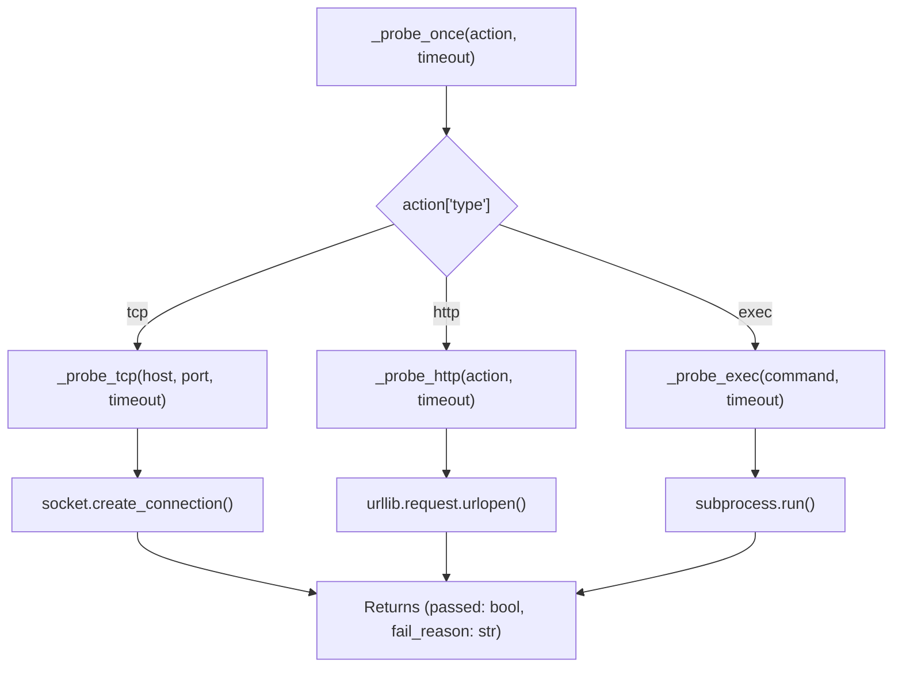
*Title: Probe Action Dispatch and Execution Flow*

Sources: `executor/src/yr/agentexecutor/probe.py:148-182()`, `tests/executor/test_probe.py:146-198()`

---

## 3. Liveness Aggregation States and Startup Gate

Liveness checking aggregates consecutive execution outcomes against a configured `failure_threshold` [executor/src/yr/agentexecutor/probe.py:65-88](). The health state is represented by the `AggregateState` enumeration [executor/src/yr/agentexecutor/probe.py:50-54]():

* `DISABLED`: No liveness probe has been configured.
* `HEALTHY`: The probe passed, or intermittent failures are below the failure threshold (consecutive failure counter resets to zero on success) [tests/executor/test_probe.py:146-154]().
* `SUBHEALTH`: A probe failure occurred, but the consecutive failure count has not yet reached `failure_threshold` [tests/executor/test_probe.py:156-163]().
* `FAILED`: The number of consecutive failures has met or exceeded `failure_threshold` [tests/executor/test_probe.py:165-173]().

The startup gate (`run_startup`) blocks executor request handling until the startup probe successfully validates instance readiness or times out.

```mermaid
graph TD
  Call["probe_liveness()"] --> CheckCfg{"Is Liveness Configured?"}
  CheckCfg -->|No| StateDisabled["AggregateState.DISABLED"]
  CheckCfg -->|Yes| RunProbe["_probe_once()"]
  
  RunProbe -->|Passed| Reset["Reset Failure Counter = 0"]
  Reset --> StateHealthy["AggregateState.HEALTHY"]
  
  RunProbe -->|Failed / Exception| Incr["Increment Failure Counter"]
  Incr --> CheckThresh{"Failures >= failure_threshold?"}
  CheckThresh -->|No| StateSub["AggregateState.SUBHEALTH"]
  CheckThresh -->|Yes| StateFail["AggregateState.FAILED"]
```
*Title: Liveness State Aggregation Flow*

Sources: `executor/src/yr/agentexecutor/probe.py:50-54()`, `tests/executor/test_probe.py:142-198()`

---

# Page: User Process Management

# User Process Management

<details>
<summary>Relevant source files</summary>

The following files were used as context for generating this wiki page:

- [executor/src/yr/agentexecutor/process_manager.py](executor/src/yr/agentexecutor/process_manager.py)
- [tests/executor/test_process_manager.py](tests/executor/test_process_manager.py)

</details>


## Purpose and Scope

The User Process Management subsystem (implemented in `executor/src/yr/agentexecutor/process_manager.py` [executor/src/yr/agentexecutor/process_manager.py:1-167]()) is responsible for bootstrapping, monitoring, logging, and cleanly shutting down user-defined agent processes inside an Agent instance. It parses execution parameters from environment variables, spawns independent process groups, aggregates standard output and error streams into a unified traversal-safe `.std` log file, and enforces graceful termination sequences using `SIGTERM` followed by `SIGKILL`.

Sources: `executor/src/yr/agentexecutor/process_manager.py` [executor/src/yr/agentexecutor/process_manager.py:1-167]()

---

## Environment Variables and Bootstrap Configuration

The `ProcessManager` relies on several environment variables configured in the execution container runtime to determine which commands to run, where to store logs, and how to tag diagnostic output.

| Environment Variable | Constant Name | Default Value | Description |
|---|---|---|---|
| `YR_RUNTIME_BOOTSTRAP_CMD` | `BOOTSTRAP_COMMAND_ENV` | `""` | JSON-encoded array of command argument lists to execute. |
| `GLOG_log_dir` | `PROCESS_LOG_DIR_ENV` | `/home/snuser/log/` | Directory path where unified `.std` runtime log files are written. |
| `YR_RUNTIME_ID` | `RUNTIME_ID_ENV` | `""` | Unique identifier for the runtime instance, used to name log files. |
| `YR_TRACE_ID` | `TRACE_ID_ENV` | `""` | Optional trace identifier included in audit and startup logs. |
| `INSTANCE_ID` | `INSTANCE_ID_ENV` | `""` | Optional instance identifier included in startup logs. |

Sources: `executor/src/yr/agentexecutor/process_manager.py` [executor/src/yr/agentexecutor/process_manager.py:34-40]()

---

## Bootstrap Command Parsing

The `parse_bootstrap_commands(value: str)` function processes raw environment strings containing JSON arrays of argument vectors (`argv`). 

### Parsing Logic and Validation Rules
1. **JSON Decoding**: The input string is passed to `json.loads(value)` [executor/src/yr/agentexecutor/process_manager.py:56](). Non-JSON values or non-list payloads generate a warning and return an empty list [executor/src/yr/agentexecutor/process_manager.py:57-62]().
2. **Command Limit Enforcement**: If the parsed list contains more than `MAX_BOOTSTRAP_COMMANDS` (64) entries, it is truncated, and a warning is emitted [executor/src/yr/agentexecutor/process_manager.py:40,63-70]().
3. **Type Checking**: Each entry in the command array must be a non-empty list consisting exclusively of string arguments [executor/src/yr/agentexecutor/process_manager.py:72-76](). Invalid entries are skipped individually without invalidating the entire batch.

```mermaid
title "Bootstrap Command Parsing Flow"
graph TD
    A["parse_bootstrap_commands(value)"] --> B{"Is value empty?"}
    B -- Yes --> C["Return empty list []"]
    B -- No --> D["json.loads(value)"]
    D -- "ValueError / TypeError" --> E["Log warning, return []"]
    D -- "Valid JSON" --> F{"Is instance list?"}
    F -- No --> G["Log warning, return []"]
    F -- Yes --> H{"len > MAX_BOOTSTRAP_COMMANDS"}
    H -- Yes --> I["Truncate to 64 commands"]
    H -- No --> J["Iterate commands"]
    I --> J
    J --> K{"Valid argv list of strings?"}
    K -- No --> L["Skip invalid command index"]
    K -- Yes --> M["Append to validated list"]
    M --> N["Return validated list"]
    L --> N
```

Sources: `executor/src/yr/agentexecutor/process_manager.py` [executor/src/yr/agentexecutor/process_manager.py:51-77](), `tests/executor/test_process_manager.py` [tests/executor/test_process_manager.py:12-40]()

---

## Process Spawning and Unified Logging

The `ProcessManager` class manages the lifecycle of spawned commands. The method `start_from_env(environ)` reads active environment configurations and delegates to `start(commands, log_dir, runtime_id)` [executor/src/yr/agentexecutor/process_manager.py:90-97]().

### Log File Path Sanitization
Log files are consolidated per runtime instance into a single `.std` file. The helper function `_runtime_log_file(log_dir, runtime_id)` sanitizes the `runtime_id` to prevent directory traversal attacks:
- Characters outside of `[A-Za-z0-9._-]` are substituted with underscores (`_`) [executor/src/yr/agentexecutor/process_manager.py:45]().
- Blank or traversal-only names (`.`, `..`) fallback to `unknown-runtime` [executor/src/yr/agentexecutor/process_manager.py:46-47]().
- The resulting filename format is `<sanitized_runtime_id>.std` [executor/src/yr/agentexecutor/process_manager.py:48]().

### Process Group Creation and Stream Merging
When `ProcessManager.start(...)` executes:
1. It acquires an internal `threading.Lock()` to protect process state [executor/src/yr/agentexecutor/process_manager.py:101]().
2. It opens the unified log file with binary append mode (`ab`) and unbuffered output (`buffering=0`) [executor/src/yr/agentexecutor/process_manager.py:108]().
3. For each command, it spawns a subprocess via `subprocess.Popen` with:
   - `stdin=subprocess.DEVNULL` [executor/src/yr/agentexecutor/process_manager.py:117]()
   - `stdout=log_file` (merging stdout and stderr to the same file descriptor) [executor/src/yr/agentexecutor/process_manager.py:118]()
   - `stderr=subprocess.STDOUT` [executor/src/yr/agentexecutor/process_manager.py:119]()
   - `start_new_session=True` to create a distinct POSIX process group for clean signal propagation [executor/src/yr/agentexecutor/process_manager.py:120]().

```mermaid
title "Process Initialization and Logging Architecture"
graph TD
    A["ProcessManager.start_from_env()"] --> B["ProcessManager.start()"]
    B --> C["_runtime_log_file(log_dir, runtime_id)"]
    C --> D["Sanitize runtime_id and resolve Path"]
    D --> E["Open .std log file (ab, unbuffered)"]
    B --> F["Loop over validated commands"]
    F --> G["subprocess.Popen(start_new_session=True)"]
    G --> H["Redirect stdout & stderr to .std"]
    G --> I["Record subprocess.Popen handle"]
    I --> J["Log startup (pid, bootstrap_index, trace_id, instance_id)"]
```

Sources: `executor/src/yr/agentexecutor/process_manager.py` [executor/src/yr/agentexecutor/process_manager.py:43-137](), `tests/executor/test_process_manager.py` [tests/executor/test_process_manager.py:53-155]()

---

## Shutdown Procedure and Graceful Termination

To tear down user processes, `ProcessManager.stop(grace_period_seconds)` invokes `_stop_locked(grace_period_seconds)` under thread synchronization [executor/src/yr/agentexecutor/process_manager.py:145-149]().

### Shutdown Sequence
1. **SIGTERM Broadcast**: All active processes (those where `process.poll() is None`) receive a `signal.SIGTERM` signal targeted at their independent process group (`_signal_process_group`) [executor/src/yr/agentexecutor/process_manager.py:150-152]().
2. **Grace Period Wait**: The manager waits up to `grace_period_seconds` for processes to exit using `process.wait(timeout=remaining)` [executor/src/yr/agentexecutor/process_manager.py:154-162]().
3. **SIGKILL Escalation**: Any processes remaining active after the deadline expire are forcibly terminated by sending `signal.SIGKILL` to their process group [executor/src/yr/agentexecutor/process_manager.py:164-166]().

Sources: `executor/src/yr/agentexecutor/process_manager.py` [executor/src/yr/agentexecutor/process_manager.py:145-167]()

---

# Page: Executor HTTP Server and APIs

# Executor HTTP Server and APIs

<details>
<summary>Relevant source files</summary>

The following files were used as context for generating this wiki page:

- [executor/src/yr/agentexecutor/http_server.py](executor/src/yr/agentexecutor/http_server.py)
- [tests/executor/test_http_server.py](tests/executor/test_http_server.py)

</details>


## Purpose and Scope

The `ExecutorHTTPServer` is an internal HTTP server exposed through the platform TCP tunnel inside the agent execution substrate. It provides the REST surface for sandbox management, file operations, process execution, and diagnostics. 

This page describes core server mechanics, including routing structures, concurrency throttling, size constraints, tracing, and body readers. For details on the file management subsystem, see [File Management API](#3.2.1).

Sources: `[executor/src/yr/agentexecutor/http_server.py:17-45]()`, `[executor/src/yr/agentexecutor/http_server.py:181-190]()`

---

## Server Architecture and Routing

The HTTP server relies on a customized threading HTTP server class, `_ExecutorThreadingHTTPServer`, which manages worker threads and enforces concurrency bounds [executor/src/yr/agentexecutor/http_server.py:117-132](). 

Routing for sandbox operations is driven by a declarative tuple table, `_SANDBOX_ROUTES`, which pairs HTTP methods and path shapes with route keys [executor/src/yr/agentexecutor/http_server.py:71-79](). This structure guarantees that `Allow` headers and method-not-allowed responses (HTTP 405) remain consistent with supported operations without maintaining duplicate validation logic [executor/src/yr/agentexecutor/http_server.py:67-70]().

```mermaid
title "Request Processing and Concurrency Control in _ExecutorThreadingHTTPServer"

graph TD
    Client["HTTP Client Request"] --> ThreadServer["_ExecutorThreadingHTTPServer"]
    ThreadServer --> AcquireSlot["_request_slots.acquire(blocking=False)"]
    AcquireSlot -->|Slots Exhausted| Reject["_reject_overloaded (HTTP 503)"]
    AcquireSlot -->|Slot Acquired| Process["process_request / process_request_thread"]
    Process --> Handler["ExecutorHTTPServer Request Dispatcher"]
```

Sources: `[executor/src/yr/agentexecutor/http_server.py:71-115]`, `[executor/src/yr/agentexecutor/http_server.py:117-164]`

---

## Route Resolution and Method Dispatch

Incoming requests to sandbox endpoints are evaluated against `_SANDBOX_ROUTES` using `_match_sandbox_route` and `_shape_matches` helpers [executor/src/yr/agentexecutor/http_server.py:82-105](). If a route matches the URL path shape but the HTTP method is incorrect, the server raises `SandboxMethodNotAllowedError`, translating to an HTTP 405 response with an automatically populated `Allow` header [executor/src/yr/agentexecutor/http_server.py:55-65](), `[executor/src/yr/agentexecutor/http_server.py:108-114]()`.

```mermaid
title "Sandbox Route Resolution Code Entities"

graph TD
    Req["HTTP Method & Path"] --> Match["_match_sandbox_route"]
    Match --> Table["_SANDBOX_ROUTES"]
    Table --> Shape["_shape_matches"]
    Shape -->|Match Found| RouteKey["Return Route Key"]
    Shape -->|No Method Match| Allowed["_allowed_sandbox_methods"]
    Allowed --> Raise405["SandboxMethodNotAllowedError (HTTP 405)"]
```

Sources: `[executor/src/yr/agentexecutor/http_server.py:71-115]()`, `[executor/src/yr/agentexecutor/http_server.py:55-65]()`

---

## Concurrency, Size Limits, and Overload Handling

To prevent resource exhaustion under heavy workloads, `_ExecutorThreadingHTTPServer` implements bounded concurrency via a `threading.BoundedSemaphore` initialized with `DEFAULT_MAX_CONCURRENT_REQUESTS` (default: `64`) [executor/src/yr/agentexecutor/http_server.py:39](), `[executor/src/yr/agentexecutor/http_server.py:130]`. 

When all concurrency slots are occupied, incoming requests are immediately rejected with an HTTP `503 Service Unavailable` status and a JSON payload `{"message":"executor is busy"}` without blocking worker threads [executor/src/yr/agentexecutor/http_server.py:134-136](), `[executor/src/yr/agentexecutor/http_server.py:149-163]()`.

Request and response payloads enforce upper bounds through constants:
* `DEFAULT_MAX_SANDBOX_REQUEST_SIZE`: `512 * 1024 * 1024` bytes [executor/src/yr/agentexecutor/http_server.py:40]()
* `DEFAULT_MAX_SANDBOX_RESPONSE_SIZE`: `512 * 1024 * 1024` bytes [executor/src/yr/agentexecutor/http_server.py:41]()

Exceeding these limits raises `SandboxRequestTooLargeError` or `SandboxResponseTooLargeError` [executor/src/yr/agentexecutor/http_server.py:47-53]().

Sources: `[executor/src/yr/agentexecutor/http_server.py:39-53]`, `[executor/src/yr/agentexecutor/http_server.py:117-164]`

---

## Tracing and Body Readers

Distributed tracing is supported via the `X-Trace-ID` header (`TRACE_HEADER`), ensuring request lineage is propagated across execution logs and sandbox actions [executor/src/yr/agentexecutor/http_server.py:43]() [tests/executor/test_http_server.py:37-63](). Body readers handle chunked transfer encodings and stream processing safely within configured size limits.

Sources: `[executor/src/yr/agentexecutor/http_server.py:43]()`, `[tests/executor/test_http_server.py:23-25]`

---

## File Management API

File upload, download with HTTP `Range` headers, directory listing, creation (`mkdir`), and path searching are implemented in the file handling layer [executor/src/yr/agentexecutor/http_server.py:34]() [executor/src/yr/agentexecutor/http_server.py:166-178](). 

For full technical details on file endpoints, parameter validation, and the `FileHandler` implementation, see [File Management API](#3.2.1).

Sources: `[executor/src/yr/agentexecutor/http_server.py:34]`, `[executor/src/yr/agentexecutor/http_server.py:166-178]`

---

# Page: File Management API

# File Management API

<details>
<summary>Relevant source files</summary>

The following files were used as context for generating this wiki page:

- [executor/src/yr/agentexecutor/file_handler.py](executor/src/yr/agentexecutor/file_handler.py)
- [executor/src/yr/agentexecutor/http_server.py](executor/src/yr/agentexecutor/http_server.py)
- [tests/executor/test_file_handler.py](tests/executor/test_file_handler.py)

</details>


The File Management API provides robust, secure, and streaming filesystem operations within the `agent-dx` executor subsystem. It handles file uploads with atomic guarantees, ranged downloads, recursive directory listing with strict resource bounds, and directory creation. All file operations are coordinated by the `FileHandler` class and exposed through the internal `ExecutorHTTPServer`.

Sources: `executor/src/yr/agentexecutor/file_handler.py:1-79`, `executor/src/yr/agentexecutor/http_server.py:1-45`

---

## 1. `FileHandler` Core Architecture and Safeguards

The `FileHandler` class acts as the central execution engine for filesystem operations. To protect the executor environment against denial-of-service vectors (such as disk exhaustion, recursive symlink loops, or deeply nested directory explosions), `FileHandler` enforces configurable constraints on file sizes, traversal depth, entry counts, and execution timeouts.

Input paths and file permission strings undergo strict validation prior to execution using `validate_path()` and `validate_permissions()`.

```mermaid
graph TD
    ClientReq["Incoming API Request"] -->|Passes path & mode| FileHandlerCls["FileHandler"]
    FileHandlerCls -->|Calls| ValPath["validate_path"]
    FileHandlerCls -->|Calls| ValPerm["validate_permissions"]
    ValPath -->|Returns Path obj| TargetPath["Path"]
    ValPerm -->|Returns octal int| FileMode["Permissions Mode"]
    FileHandlerCls -->|Enforces Limits| Limits["max_file_size / max_list_depth / list_timeout_seconds"]

    sub-1["Sources: executor/src/yr/agentexecutor/file_handler.py:43-79"]
    style sub-1 fill:none,stroke:none
```
Sources: `executor/src/yr/agentexecutor/file_handler.py:43-79`

---

## 2. File Operations API Implementation

The file subsystem supports four primary primitives: atomic uploads, ranged downloads, directory listing, and directory creation (`mkdir`).

### File Upload (`upload`)
The `upload()` method implements an atomic write strategy. It streams incoming binary data into a temporary file (`tempfile.mkstemp()`) inside the target directory, enforcing `max_file_size` limits chunk-by-chunk. Once fully written, file permissions are applied via `os.chmod()` before an atomic rename operation (`os.replace()`) moves the temporary file to its final destination.

Sources: `executor/src/yr/agentexecutor/file_handler.py:80-107`, `tests/executor/test_file_handler.py:12-52`

### Download and Range Resolution (`open_download`, `resolve_download_range`)
Downloads are handled by opening a binary stream to the target file. HTTP `Range` headers are parsed using `parse_range()` in the HTTP server layer and resolved against the file size using `FileHandler.resolve_download_range()`. This calculates the effective end byte and content length, supporting partial content streaming.

Sources: `executor/src/yr/agentexecutor/file_handler.py:126-151`, `executor/src/yr/agentexecutor/http_server.py:166-178`, `tests/executor/test_file_handler.py:54-63`

### Directory Listing (`list`)
Directory enumeration scans paths recursively or non-recursively. To prevent runaway resource consumption, `list()` tracks traversal depth against `max_list_depth`, entry counts against `max_list_entries`, and enforces a hard time budget using `time.monotonic()` against `list_timeout_seconds`. Exceeding these bounds raises `FileListTimeoutError`.

Sources: `executor/src/yr/agentexecutor/file_handler.py:39-42,153-174`, `tests/executor/test_file_handler.py:65-105`

### Directory Creation (`mkdir`)
The `mkdir()` method creates directories idempotently. When `recursive=True` is specified, intermediate parent directories are created. Explicit permission modes are applied directly to the target directory, bypassing system umask settings.

Sources: `executor/src/yr/agentexecutor/file_handler.py:110-124`, `tests/executor/test_file_handler.py:107-160`

```mermaid
graph TD
    Client["HTTP Client"] -->|Upload Stream| UploadMethod["FileHandler.upload"]
    UploadMethod -->|Checks Size & Mode| TempCreate["tempfile.mkstemp"]
    TempCreate -->|Writes Chunks| DiskWrite["os.fsync & os.chmod"]
    DiskWrite -->|Atomic Swap| FinalFile["os.replace"]

    Client -->|GET Request with Range| ParseRange["parse_range"]
    ParseRange -->|Validates Bounds| ResolveRange["FileHandler.resolve_download_range"]
    ResolveRange -->|Opens Stream| StreamOut["FileHandler.open_download"]

    sub-2["Sources: executor/src/yr/agentexecutor/file_handler.py:80-151, executor/src/yr/agentexecutor/http_server.py:166-178"]
    style sub-2 fill:none,stroke:none
```
Sources: `executor/src/yr/agentexecutor/file_handler.py:80-151`, `executor/src/yr/agentexecutor/http_server.py:166-178`

---

## 3. HTTP Server and Route Integration

The `ExecutorHTTPServer` maps incoming endpoint requests to sandbox and file management primitives. While specific sandbox file routes are defined in `_SANDBOX_ROUTES`, file operations leverage `FileHandler` instances configured with default payload size and timeout thresholds.

| Parameter / Constant | Default Value | Description |
| :--- | :--- | :--- |
| `DEFAULT_MAX_FILE_SIZE` | `512 * 1024 * 1024` (512 MB) | Maximum allowed size for uploaded files. |
| `DEFAULT_MAX_LIST_ENTRIES` | `10000` | Maximum entries returned during directory scans. |
| `DEFAULT_MAX_LIST_DEPTH` | `20` | Maximum recursion depth for directory listings. |
| `DEFAULT_LIST_TIMEOUT_SECONDS` | `30` | Time budget limit for recursive directory scans. |

Sources: `executor/src/yr/agentexecutor/http_server.py:39-45`, `executor/src/yr/agentexecutor/file_handler.py:30-36`

---

# Page: Sandbox Subsystem

# Sandbox Subsystem

<details>
<summary>Relevant source files</summary>

The following files were used as context for generating this wiki page:

- [executor/src/yr/agentexecutor/sandbox/__init__.py](executor/src/yr/agentexecutor/sandbox/__init__.py)
- [executor/src/yr/agentexecutor/sandbox/filesystem.py](executor/src/yr/agentexecutor/sandbox/filesystem.py)
- [executor/src/yr/agentexecutor/sandbox/sandbox.py](executor/src/yr/agentexecutor/sandbox/sandbox.py)
- [executor/src/yr/agentexecutor/sandbox/tunnel_server.py](executor/src/yr/agentexecutor/sandbox/tunnel_server.py)
- [executor/src/yr/agentexecutor/sandbox_manager.py](executor/src/yr/agentexecutor/sandbox_manager.py)

</details>


## Purpose and Scope

The sandbox subsystem provides isolated code execution environments for the `agent-dx` platform by leveraging openYuanrong's distributed instance runtime (`@yr.instance`) [executor/src/yr/agentexecutor/sandbox/sandbox.py:152-153](). It manages the full lifecycle of remote sandbox instances, handles sandboxed filesystem operations [executor/src/yr/agentexecutor/sandbox/filesystem.py:37-46](), exposes platform APIs under `/v1/sandbox`, and facilitates secure network tunneling into running sandboxes [executor/src/yr/agentexecutor/sandbox/tunnel_server.py:144-145]().

---

## 1. SandboxManager and Instance Lifecycles

The `SandboxManager` class acts as the central registry and controller for all active sandbox instances within the Agent Executor [executor/src/yr/agentexecutor/sandbox_manager.py:38-44](). It is instantiated and owned by `AgentExecutorRuntime`, providing thread-safe storage backed by a `threading.Lock` [executor/src/yr/agentexecutor/sandbox_manager.py:46-48]().

When a client requests a new sandbox via `SandboxManager.create()`, a remote child container is spawned using `Sandbox` and its parameters [executor/src/yr/agentexecutor/sandbox_manager.py:50-59](). If instance ID retrieval fails after container creation, the manager performs a best-effort rollback by calling `terminate()` to avoid leaking remote containers [executor/src/yr/agentexecutor/sandbox_manager.py:60-76](). `SandboxInstance` definitions are decorated with `@yr.instance` to execute inside isolated openYuanrong execution contexts [executor/src/yr/agentexecutor/sandbox/sandbox.py:152-153]().

```mermaid
graph TD
    A["AgentExecutorRuntime"] --> B["SandboxManager"]
    B -->|"create(options)"| C["Sandbox"]
    C -->|"@yr.instance"| D["SandboxInstance"]
    B -->|"get(instance_id)"| C
    B -->|"delete(instance_id)"| C
    C -->|"terminate()"| E["RemoteContainer"]

    sub5["Sources: executor/src/yr/agentexecutor/sandbox_manager.py:38-121, executor/src/yr/agentexecutor/sandbox/sandbox.py:152-162"]
```
*Figure 1: Relationship between SandboxManager, Sandbox, and SandboxInstance.*

Sources: `executor/src/yr/agentexecutor/sandbox_manager.py:38-121`, `executor/src/yr/agentexecutor/sandbox/sandbox.py:152-185`

---

## 2. Filesystem Operations

Filesystem manipulation inside sandboxes is managed by `SandboxFilesystem` [executor/src/yr/agentexecutor/sandbox/filesystem.py:207-211]() and helper utility modules. Transfers support two main directions specified by `CpDirection`: `UPLOAD` (local into sandbox) and `DOWNLOAD` (sandbox out to local) [executor/src/yr/agentexecutor/sandbox/filesystem.py:38-46]().

Core file operations include native reading/writing (`_read_file_impl`, `_write_file_impl`) [executor/src/yr/agentexecutor/sandbox/filesystem.py:86-102](), recursive directory scanning with depth and entry limits (`_list_files_impl`) [executor/src/yr/agentexecutor/sandbox/filesystem.py:108-156](), and glob-based pattern searching (`_search_files_impl`) [executor/src/yr/agentexecutor/sandbox/filesystem.py:159-186]().

```mermaid
graph TD
    A["SandboxFilesystem"] -->|"read/write"| B["_read_file_impl / _write_file_impl"]
    A -->|"list"| C["_list_files_impl"]
    A -->|"search"| D["_search_files_impl"]
    A -->|"transfer"| E["CpDirection (UPLOAD/DOWNLOAD)"]

    sub6["Sources: executor/src/yr/agentexecutor/sandbox/filesystem.py:38-186"]
```
*Figure 2: Filesystem operations map.*

Sources: `executor/src/yr/agentexecutor/sandbox/filesystem.py:37-211`

---

## 3. The `/v1/sandbox` API

The executor exposes RESTful HTTP endpoints under `/v1/sandbox` that map directly to `SandboxManager` operations. These endpoints allow external clients and agents to create, inspect, execute commands within, and terminate isolated sandbox containers. The HTTP routing layer delegates request payloads to the appropriate `Sandbox` wrapper stored in the manager, returning instance IDs and execution status codes accordingly.

Sources: `executor/src/yr/agentexecutor/sandbox_manager.py:38-93`, `executor/src/yr/agentexecutor/sandbox/sandbox.py:152-185`

---

## 4. Tunnel Protocol and Proxying

To support interactive debugging, port forwarding, and upstream service access inside running sandboxes, the subsystem implements a reverse WebSocket tunneling architecture (`TunnelServer` and `TunnelClient`). 

For details, see [Tunnel Protocol and Proxying](#3.3.1).

Sources: `executor/src/yr/agentexecutor/sandbox/tunnel_server.py:144-150`

---

# Page: Tunnel Protocol and Proxying

# Tunnel Protocol and Proxying

<details>
<summary>Relevant source files</summary>

The following files were used as context for generating this wiki page:

- [executor/src/yr/agentexecutor/sandbox/tunnel_client.py](executor/src/yr/agentexecutor/sandbox/tunnel_client.py)
- [executor/src/yr/agentexecutor/sandbox/tunnel_protocol.py](executor/src/yr/agentexecutor/sandbox/tunnel_protocol.py)
- [executor/src/yr/agentexecutor/sandbox/tunnel_server.py](executor/src/yr/agentexecutor/sandbox/tunnel_server.py)
- [executor/src/yr/agentexecutor/sandbox_manager.py](executor/src/yr/agentexecutor/sandbox_manager.py)

</details>


## Purpose and Scope
This section details the reverse tunnel subsystem in `agent-dx`, which enables bidirectional HTTP and WebSocket proxying between local upstream services and remote sandboxes. It covers the wire framing protocol (`tunnel_protocol.py`), the sandbox-side reverse tunnel server (`tunnel_server.py`), the client-side proxy bridge (`tunnel_client.py`), and how sandbox instances are managed (`sandbox_manager.py`).

---

## 1. Tunnel Wire Protocol and Framing
The tunnel protocol defines the wire format used over the reverse WebSocket connection between the sandbox and the client. Version 2 of the protocol (`PROTOCOL_VERSION = 2`) introduces a hybrid model supporting both JSON-encoded control/header frames and compact binary envelopes (`BinaryEnvelope`) for high-throughput streaming data bodies [executor/src/yr/agentexecutor/sandbox/tunnel_protocol.py:28-97]().

Key protocol elements include:
- **`BinaryEnvelope`**: A compact binary format used for bounded binary chunks (HTTP request/response data and WebSocket binary frames). It embeds magic bytes (`YD`), versioning, request UUIDs, and optional byte offsets [executor/src/yr/agentexecutor/sandbox/tunnel_protocol.py:30-129]().
- **`BinaryKind`**: Enum specifying payload types such as `HTTP_REQUEST_DATA` (0x01), `HTTP_RESPONSE_DATA` (0x02), and `WS_BINARY_DATA` (0x03) [executor/src/yr/agentexecutor/sandbox/tunnel_protocol.py:85-89]().
- **`ProtocolError`**: Raised when a frame violates negotiated constraints, such as exceeding maximum chunk sizes or parsing invalid header structures [executor/src/yr/agentexecutor/sandbox/tunnel_protocol.py:81-84]().

```mermaid
graph TD
    subgraph NaturalLanguageSpace
        A["Binary Payload Chunk"] --> B["Compact Wire Framing"]
    end
    subgraph CodeEntitySpace
        C["BinaryEnvelope.encode"] --> D["BinaryKind"]
        D --> E["BinaryEnvelope.decode"]
    end
    A --> C
    B --> E

    classDef default fill:#fff,stroke:#333,stroke-width:2px;
```
*Figure 1: Protocol framing mapping from data structures to `tunnel_protocol.py` entities.*

Sources: `executor/src/yr/agentexecutor/sandbox/tunnel_protocol.py:1-192`

---

## 2. Sandbox-Side Reverse Tunnel Server
The `TunnelServer` class runs inside the sandbox, exposing an internal HTTP port and a WebSocket server port. It accepts an incoming reverse WebSocket connection from the external `TunnelClient`, and then acts as a reverse proxy gateway [executor/src/yr/agentexecutor/sandbox/tunnel_server.py:144-205]().

When an HTTP request hits the sandbox application endpoint, `TunnelServer` encapsulates the request headers and body into tunnel control and data frames, sends them across the WebSocket connection to the client, and streams the response back to the local caller.

```mermaid
graph TD
    subgraph NaturalLanguageSpace
        F["Incoming Sandbox HTTP Request"] --> G["TunnelServer Http Handler"]
        G --> H["WebSocket Reverse Tunnel Relay"]
    end
    subgraph CodeEntitySpace
        F --> I["TunnelServer._handle_request"]
        G --> J["_HttpExchange"]
        H --> K["TunnelServer._handle_tunnel_conn"]
    end
    I --> J
    J --> K

    classDef default fill:#fff,stroke:#333,stroke-width:2px;
```
*Figure 2: Sandbox request handling flow and corresponding `tunnel_server.py` classes.*

Sources: `executor/src/yr/agentexecutor/sandbox/tunnel_server.py:144-205`

---

## 3. Client-Side Proxy and Tunnel Client
The `TunnelClient` executes on the local developer or client machine. It connects outward to the sandbox's tunnel WebSocket port (routed through frontend gateways or routers) and bridges incoming tunnel requests to local upstream services (such as `127.0.0.1:8000`) [executor/src/yr/agentexecutor/sandbox/tunnel_client.py:14-30]().

Key mechanisms implemented in `TunnelClient`:
- **Header Rebuilding**: `_headers_for_rebuilt_request()` filters hop-by-hop headers, connection tokens, and host headers before forwarding requests to the local upstream server [executor/src/yr/agentexecutor/sandbox/tunnel_client.py:135-162]().
- **Target Validation**: `_validated_request_target()` ensures incoming request methods are valid HTTP verbs and paths use origin-form without path traversal risks (`..`) [executor/src/yr/agentexecutor/sandbox/tunnel_client.py:165-174]().
- **TLS and Cookie Isolation**: Manages secure WebSocket configurations with `_ssl_context_for_tunnel()` and strips ambient cookie jars using `_NoCookieJar` [executor/src/yr/agentexecutor/sandbox/tunnel_client.py:176-201]().

Sources: `executor/src/yr/agentexecutor/sandbox/tunnel_client.py:14-201`

---

## 4. Sandbox Lifecycle and Integration with `SandboxManager`
Sandboxes hosting the tunnel endpoints are tracked and managed centrally via `SandboxManager`. The manager maintains a thread-safe registry mapping platform instance IDs to `Sandbox` instances [executor/src/yr/agentexecutor/sandbox_manager.py:38-48]().

- **`create()`**: Instantiates a new remote sandbox, retrieves its platform instance ID, registers it, and performs best-effort rollback termination if creation or registration fails [executor/src/yr/agentexecutor/sandbox_manager.py:50-77]().
- **`delete()`**: Safely terminates and pops the sandbox from the active dictionary [executor/src/yr/agentexecutor/sandbox_manager.py:78-92]().
- **`terminate_all()`**: Shuts down all active sandboxes during runtime teardown [executor/src/yr/agentexecutor/sandbox_manager.py:111-120]().

Sources: `executor/src/yr/agentexecutor/sandbox_manager.py:38-121`

---

# Page: Python Agent SDK (yuanrong.agentruntime)

# Python Agent SDK (yuanrong.agentruntime)

<details>
<summary>Relevant source files</summary>

The following files were used as context for generating this wiki page:

- [cli/ar_cli/__init__.py](cli/ar_cli/__init__.py)
- [cli/setup.py](cli/setup.py)
- [python/README.md](python/README.md)
- [python/pyproject.toml](python/pyproject.toml)
- [python/src/yuanrong/agentruntime/__init__.py](python/src/yuanrong/agentruntime/__init__.py)

</details>


The `yuanrong.agentruntime` package provides the user-facing programming model and fixed FaaS bootstrap entrypoints for agent-dx [python/src/yuanrong/agentruntime/__init__.py:17](), [python/README.md:3](). It defines the abstract base class `AgentExecutor` that developers implement to build stateful agents [python/src/yuanrong/agentruntime/__init__.py:25](), [python/README.md:15](), and handles execution context management, SSE streaming output [python/README.md:24](), structured turn results [python/README.md:34](), and persistent event logging over openYuanrong's DataSystem [python/README.md:4]().

```mermaid
graph TD
    UserCode["UserAgentImplementation (agent.Agent)"] -->|inherits| BaseExec["AgentExecutor (yuanrong.agentruntime.executor)"]
    FaasEntry["FaasBootstrapHandler (yuanrong.agentruntime.bootstrap.handler)"] -->|invokes| Dispatcher["InvocationDispatcher"]
    Dispatcher -->|calls execute| BaseExec
    BaseExec -->|reads/writes| SessCtx["SessionContext (yuanrong.agentruntime.context)"]
    SessCtx -->|persists via| DataSys["DataSystemEventLog (yuanrong.agentruntime.event_log)"]

    sub5["Code Entity Space"]
    style sub5 fill:none,stroke:none
```
*Figure 1: SDK Component Mapping from Natural Language Concepts to Code Entities.*

Sources: `python/src/yuanrong/agentruntime/__init__.py`, `python/README.md`

---

## 4.1. Bootstrap and Dispatch

The bootstrap subsystem exposes fixed FaaS handlers that platform runtimes invoke directly, eliminating the need for developers to write boilerplate server code [python/README.md:3](), [python/README.md:38](). It provides entrypoints for request handling and asynchronous initialization (`yuanrong.agentruntime.bootstrap.handler` and `yuanrong.agentruntime.bootstrap.initialize`) [python/README.md:43](), [python/README.md:45](). 

Incoming invocations are dispatched serially to the user's `AgentExecutor` implementation while caching startup and initialization errors to ensure stable failure reporting across subsequent requests [python/README.md:71](). For a comprehensive technical breakdown of bootstrap hooks, error caching mechanics, and invocation serialization, see [Bootstrap and Dispatch](#4.1).

Sources: `python/src/yuanrong/agentruntime/__init__.py`, `python/README.md`

---

## 4.2. Context, Output and Results

During execution, agents interact with the runtime via rich context objects, including `RequestContext` containing message payloads and `SessionContext` managing persistent session state [python/src/yuanrong/agentruntime/__init__.py:22](), [python/README.md:19](), [python/README.md:25](). Streaming progress updates are written through `OutputWriter`, which persists messages before dispatching Server-Sent Events (SSE) [python/src/yuanrong/agentruntime/__init__.py:26](), [python/README.md:24](), [python/README.md:79]().

Agent turns conclude by explicitly returning either `Complete` or `InputRequired` execution result objects, signaling whether further user input is required or if the task has successfully finished [python/src/yuanrong/agentruntime/__init__.py:27](), [python/README.md:34](). For detailed specifications on context structures, the SSE output path, and result handling, see [Context, Output and Results](#4.2).

```mermaid
sequenceDiagram
    participant Client as "Client"
    participant Boot as "bootstrap.handler"
    participant Exec as "AgentExecutor"
    participant Out as "OutputWriter"
    participant Res as "Complete/InputRequired"

    Client->>Boot: "InvokeAgent(RequestInput)"
    Boot->>Exec: "execute(RequestContext)"
    Exec->>Out: "write(progress)"
    Out-->>Client: "SSE Stream Output"
    Exec-->>Boot: "Return ExecutionResult"
    Boot-->>Client: "SSE EOF / Result"
    
    sub4["Code Entity Space"]
    style sub4 fill:none,stroke:none
```
*Figure 2: Execution and Output Flow through SDK Code Entities.*

Sources: `python/src/yuanrong/agentruntime/__init__.py`, `python/README.md`

---

## 4.3. Event Log, Turns and Storage

The SDK models agent progression through discrete turns and events managed by the `Event` and `EventLog` classes [python/src/yuanrong/agentruntime/__init__.py:23](), [python/src/yuanrong/agentruntime/__init__.py:24](). `turn_writer` semantics ensure consistent serialization and key organization for events, turn inputs, and completions [python/README.md:75]().

Persistent storage is backed directly by openYuanrong's DataSystem Python SDK, leveraging cluster-level configurations like `YR_DATASYSTEM_DEFAULT_WRITE_MODE` [python/README.md:4](), [python/README.md:68](). For deep technical details regarding key schemes, serialization formats, and backend interaction, see [Event Log, Turns and Storage](#4.3).

Sources: `python/src/yuanrong/agentruntime/__init__.py`, `python/README.md`, `python/pyproject.toml`

---

# Page: Bootstrap and Dispatch

# Bootstrap and Dispatch

<details>
<summary>Relevant source files</summary>

The following files were used as context for generating this wiki page:

- [python/src/yuanrong/__init__.py](python/src/yuanrong/__init__.py)
- [python/src/yuanrong/agentruntime/bootstrap.py](python/src/yuanrong/agentruntime/bootstrap.py)
- [python/src/yuanrong/agentruntime/dispatcher.py](python/src/yuanrong/agentruntime/dispatcher.py)
- [python/src/yuanrong/agentruntime/errors.py](python/src/yuanrong/agentruntime/errors.py)
- [python/src/yuanrong/agentruntime/executor.py](python/src/yuanrong/agentruntime/executor.py)
- [tests/python/unit/helpers.py](tests/python/unit/helpers.py)
- [tests/python/unit/test_bootstrap.py](tests/python/unit/test_bootstrap.py)
- [tests/python/unit/test_dispatcher.py](tests/python/unit/test_dispatcher.py)

</details>


## Purpose and Scope

This page documents the bootstrap, lifecycle management, and invocation dispatch mechanisms of the Python Agent SDK (`yuanrong.agentruntime`). It details how the FaaS container process initializes the agent runtime, how failures are cached and sanitized, how the `AgentExecutor` base class defines the agent programming interface, and how the `Dispatcher` serializes invocations, manages request contexts, validates execution results, and writes terminal events.

Sources:
* `python/src/yuanrong/agentruntime/bootstrap.py:1-280`
* `python/src/yuanrong/agentruntime/dispatcher.py:1-90`
* `python/src/yuanrong/agentruntime/executor.py:1-35`

---

## Agent Runtime Initialization and Error Caching

The process-local runtime is managed by the `AgentRuntime` class located in `python/src/yuanrong/agentruntime/bootstrap.py:53()`. It binds a single OS process to one `SessionContext` instance and coordinates thread-safe initialization across concurrent FaaS request threads using a reentrant or standard lock (`threading.Lock`).

### Runtime States and Initialization Flow

`AgentRuntime` tracks its lifecycle using the `RuntimeState` enumeration (`STARTING`, `READY`, `START_FAILED`) [python/src/yuanrong/agentruntime/bootstrap.py:47-51](). 

When `AgentRuntime.initialize()` is called [python/src/yuanrong/agentruntime/bootstrap.py:69-100]():
1. It acquires `self._lock`.
2. If state is `RuntimeState.START_FAILED`, it immediately returns, preventing redundant retries that might leak sensitive stack traces or overwhelm the system.
3. If state is `RuntimeState.READY`, it verifies that incoming function metadata matches the bound metadata (`RuntimeMetadata.from_function_context`). If there is a mismatch, it sets the state to `START_FAILED` with a `SessionContextBindingMismatch` error [python/src/yuanrong/agentruntime/bootstrap.py:82-86]().
4. Otherwise, it spawns or ensures a persistent background asyncio event loop via `_ensure_event_loop()` and runs `_initialize_async()` [python/src/yuanrong/agentruntime/bootstrap.py:88-95]().
5. If initialization raises an exception, it catches the error, wraps/sanitizes it via `_startup_error()`, caches `self._start_error`, and transitions to `RuntimeState.START_FAILED` [python/src/yuanrong/agentruntime/bootstrap.py:96-99]().

```mermaid
graph TD
    sub0["Natural Language Space"]:::nls
    sub1["Code Entity Space"]:::ces

    sub0 --> sub1

    A["Initialize FaaS Function"] --> B["AgentRuntime.initialize"]
    B --> C{{"RuntimeState Check"}}
    C -->|"START_FAILED"| D["Return Cached Error"]
    C -->|"READY"| E{{"Verify Metadata Match"}}
    C -->|"STARTING"| F["_ensure_event_loop & _initialize_async"]
    E -->|"Mismatch"| G["Set START_FAILED: SessionContextBindingMismatch"]
    E -->|"Match"| H["No-op / Already Initialized"]
    F --> I{{"Load Executor & Connect DataSystem"}}
    I -->|"Success"| J["Set RuntimeState.READY"]
    I -->|"Exception"| K["Catch & Cache via _startup_error() -> START_FAILED"]

    classDef nls fill:none,stroke:none;
    classDef ces fill:none,stroke:none;
```
*Figure 1: Bridge from Natural Language initialization concepts to `AgentRuntime` code methods.*

Sources:
* `python/src/yuanrong/agentruntime/bootstrap.py:47-121`

---

## Executor Base Class

The user-facing agent interface is defined by the abstract base class `AgentExecutor` in `python/src/yuanrong/agentruntime/executor.py:27()`. All custom agent implementations must inherit from `AgentExecutor` and implement two abstract coroutine methods:

1. `async def init(self, session_context: SessionContext) -> None`: Called once during runtime initialization to recover or establish business state using the provided `SessionContext` [python/src/yuanrong/agentruntime/executor.py:28-30]().
2. `async def execute(self, request_context: RequestContext) -> ExecutionResult`: Called per turn to handle an incoming invocation message within the current `RequestContext` [python/src/yuanrong/agentruntime/executor.py:32-34]().

Sources:
* `python/src/yuanrong/agentruntime/executor.py:1-35`

---

## Invocation Serialization and Dispatcher

Invocations entering the FaaS handler are processed sequentially by the `Dispatcher` class (`python/src/yuanrong/agentruntime/dispatcher.py:34()`). The dispatcher ensures that each turn is cleanly bracketed with input acceptance, output streaming, event logging, and terminal state recording.

### Dispatch Execution Flow

When `Dispatcher.dispatch(message, stream)` is invoked [python/src/yuanrong/agentruntime/dispatcher.py:45-89]():
1. **Accept Input**: It calls `await self._writer.accept_input(message)` to allocate a new `turn_id` and persist the input message event [python/src/yuanrong/agentruntime/dispatcher.py:46]().
2. **Context Binding**: It initializes an `OutputWriter` and a `RequestContext`, binding them to the active turn [python/src/yuanrong/agentruntime/dispatcher.py:47-48]().
3. **Event Log Activation**: It activates the `EventLog` associated with the session context so that intermediate events can be appended during execution [python/src/yuanrong/agentruntime/dispatcher.py:50-51]().
4. **Agent Execution**: It awaits `self._executor.execute(request)` inside a `try...finally` block that guarantees context and event log deactivation even if cancellation or errors occur [python/src/yuanrong/agentruntime/dispatcher.py:53-58]().
5. **Result Validation**: It validates that the returned result is an instance of `Complete` or `InputRequired`; otherwise, it raises an `InvalidExecutionResult` [python/src/yuanrong/agentruntime/dispatcher.py:59-60]().
6. **Terminal Event Appending**: It appends a platform event (`turn.completed` or `turn.input_required`) containing the output value via the `TurnWriter` [python/src/yuanrong/agentruntime/dispatcher.py:62-73]().

```mermaid
graph TD
    sub0["Natural Language Space"]:::nls
    sub1["Code Entity Space"]:::ces

    sub0 --> sub1

    A["Accept Incoming Message"] --> B["TurnWriter.accept_input"]
    B --> C["Create RequestContext & OutputWriter"]
    C --> D["EventLog._activate"]
    D --> E["AgentExecutor.execute"]
    E --> F{{"Validate Result Type"}}
    F -->|"Complete / InputRequired"| G["Append Terminal Event (turn.completed / turn.input_required)"]
    F -->|"Invalid Type"| H["Raise InvalidExecutionResult"]
    G --> I["Deactivate Context & Return Value"]
    H --> J["Catch & Append turn.failed"]

    classDef nls fill:none,stroke:none;
    classDef ces fill:none,stroke:none;
```
*Figure 2: Dispatch execution data flow mapping business invocation steps to `Dispatcher` and `TurnWriter` operations.*

Sources:
* `python/src/yuanrong/agentruntime/dispatcher.py:34-90`

---

## Error Handling, Sanitization, and Validation

The SDK utilizes a structured error hierarchy rooted at `AgentRuntimeError` (`python/src/yuanrong/agentruntime/errors.py:22()`). Each error exception carries a stable, machine-readable `code` string and a descriptive `message`.

### Error Codes and Sanitization

Key error types include:
* `AGENT_RUNTIME_NOT_CONFIGURED`: Raised when `invoke()` is called before `initialize()` completes successfully [python/src/yuanrong/agentruntime/errors.py:31-33]() [python/src/yuanrong/agentruntime/bootstrap.py:113-116]().
* `SESSION_CONTEXT_BINDING_MISMATCH`: Raised when the incoming FaaS function context session ID does not match the runtime instance binding [python/src/yuanrong/agentruntime/errors.py:36-41]() [python/src/yuanrong/agentruntime/bootstrap.py:118-119]().
* `AGENT_EXECUTOR_LOAD_FAILED` / `AGENT_INIT_FAILED`: Raised when agent module loading or `init()` fails [python/src/yuanrong/agentruntime/errors.py:44-51]().
* `INVALID_EXECUTION_RESULT`: Raised when `execute()` returns an unrecognised type instead of `Complete` or `InputRequired` [python/src/yuanrong/agentruntime/errors.py:54-56]() [python/src/yuanrong/agentruntime/dispatcher.py:59-60]().
* `OUTPUT_NOT_ACTIVE` / `EVENT_APPEND_NOT_ACTIVE`: Raised if stream writing or event appending is attempted outside an active `execute()` window [python/src/yuanrong/agentruntime/errors.py:59-67]().

During initialization or storage failures, internal stack traces and storage paths (such as DataSystem or file paths) are sanitized before being cached in `AgentRuntime._start_error` to prevent internal system information disclosure to client invocations [python/src/yuanrong/agentruntime/bootstrap.py:96-99]().

Sources:
* `python/src/yuanrong/agentruntime/errors.py:1-77`
* `python/src/yuanrong/agentruntime/bootstrap.py:96-111`

---

# Page: Context, Output and Results

# Context, Output and Results

<details>
<summary>Relevant source files</summary>

The following files were used as context for generating this wiki page:

- [python/src/yuanrong/agentruntime/context.py](python/src/yuanrong/agentruntime/context.py)
- [python/src/yuanrong/agentruntime/metadata.py](python/src/yuanrong/agentruntime/metadata.py)
- [python/src/yuanrong/agentruntime/output.py](python/src/yuanrong/agentruntime/output.py)
- [python/src/yuanrong/agentruntime/result.py](python/src/yuanrong/agentruntime/result.py)
- [tests/python/unit/test_metadata.py](tests/python/unit/test_metadata.py)
- [tests/python/unit/test_models.py](tests/python/unit/test_models.py)

</details>


This page details the execution context models, session context, output streaming via SSE (`OutputWriter`), terminal/yielding execution results (`Complete` and `InputRequired`), and environment/function metadata within the Python Agent SDK (`yuanrong.agentruntime`).

---

## 1. Context Subsystem (`RequestContext` and `SessionContext`)

The context subsystem manages the lifecycle of agent requests and sessions. When an agent function is invoked, the runtime establishes a `RequestContext` that pairs the input message with a session scope and an output channel.

- `RequestInput`: A frozen dataclass wrapping the incoming user message payload (`python/src/yuanrong/agentruntime/context.py:30-32`).
- `SessionContext`: Holds the session identifier (`_id`) and a reference to the underlying `EventLog` (`python/src/yuanrong/agentruntime/context.py:34-46`).
- `RequestContext`: Maintains the active turn state (`__turn_id`), input wrapper, `OutputWriter`, and an active flag (`_active`) that can be deactivated upon completion (`python/src/yuanrong/agentruntime/context.py:48-91`).

```mermaid
graph TD
    A["RequestContext"] --> B["SessionContext"]
    A --> C["RequestInput"]
    A --> D["OutputWriter"]
    B --> E["EventLog"]
    
    classDef default fill:none,stroke:black,stroke-width:1px;
```
*Figure 1: Request and Session Context Hierarchy*

Sources: `python/src/yuanrong/agentruntime/context.py:30-92`

---

## 2. Runtime Metadata Extraction (`RuntimeMetadata`)

FaaS execution metadata is extracted from both the runtime environment variables and the openYuanrong `FunctionContext` provided by the execution platform.

- `RuntimeMetadata`: A frozen dataclass storing `tenant_id`, `function_name`, `function_version`, and `session_context_id` (`python/src/yuanrong/agentruntime/metadata.py:27-32`).
- `RuntimeMetadata.from_function_context()`: Reads `YR_SESSION_CTX_ID` from the environment map and queries `tenant_id`, `function_name`, and `function_version` from the `FunctionContext` object (`python/src/yuanrong/agentruntime/metadata.py:34-58`). Raises `AgentRuntimeNotConfigured` if any required metadata field is missing or empty (`python/src/yuanrong/agentruntime/metadata.py:41-42`, `python/src/yuanrong/agentruntime/metadata.py:60-66`).

```mermaid
graph TD
    subgraph "Environment Space"
        Env["os.environ\nYR_SESSION_CTX_ID"]
    end
    subgraph "Yuanrong FaaS Space"
        FC["FunctionContext\ngetTenantID()\ngetFunctionName()\ngetVersion()"]
    end
    subgraph "Code Entity Space"
        RM["RuntimeMetadata.from_function_context()\npython/src/yuanrong/agentruntime/metadata.py"]
    end
    
    Env --> RM
    FC --> RM

    classDef default fill:none,stroke:black,stroke-width:1px;
```
*Figure 2: Metadata Extraction Flow from Environment and FaaS Context to Code Entities*

Sources: `python/src/yuanrong/agentruntime/metadata.py:27-66`, `tests/python/unit/test_metadata.py:25-57`

---

## 3. Streaming Output (`OutputWriter` and SSE Path)

The `OutputWriter` class implements a persist-before-send streaming mechanism, ensuring that all streamed agent messages are durably logged to the event stream before they are emitted over the Server-Sent Events (SSE) channel.

- `OutputWriter.__init__()`: Accepts a `TurnWriter` backend and an active `stream` object (`python/src/yuanrong/agentruntime/output.py:31-37`).
- `OutputWriter._bind()`: Associates the writer with a specific `RequestContext` and `turn_id` prior to execution (`python/src/yuanrong/agentruntime/output.py:38-41`).
- `OutputWriter.write()`: Verifies that the context is active, serializes the output via `to_stream_value()`, appends an `output.message` platform event to the `TurnWriter`, and writes the serialized bytes directly to the underlying stream (`python/src/yuanrong/agentruntime/output.py:42-52`). Raises `OutputNotActive` if called outside an active turn context (`python/src/yuanrong/agentruntime/output.py:44-45`).

Sources: `python/src/yuanrong/agentruntime/output.py:31-53`, `python/src/yuanrong/agentruntime/context.py:48-91`

---

## 4. Execution Results (`Complete` and `InputRequired`)

Agent execution handlers return explicit result types wrapped in immutable dataclasses to signal whether a turn has finished or requires further interaction.

- `Complete`: Indicates that agent execution has successfully concluded for the current turn, wrapping the final `value` (`python/src/yuanrong/agentruntime/result.py:23-26`).
- `InputRequired`: Indicates that the agent is yielding execution to prompt the user or external system for further input, wrapping the intermediate or request `value` (`python/src/yuanrong/agentruntime/result.py:28-31`).
- `ExecutionResult`: A type alias union of `Complete` and `InputRequired` (`python/src/yuanrong/agentruntime/result.py:33`).

```mermaid
graph TD
    subgraph "Natural Language Space"
        A["Agent Turn Concluded"]
        B["Agent Needs More Input"]
    end
    subgraph "Code Entity Space"
        C["Complete\npython/src/yuanrong/agentruntime/result.py"]
        D["InputRequired\npython/src/yuanrong/agentruntime/result.py"]
    end
    
    A --> C
    B --> D

    classDef default fill:none,stroke:black,stroke-width:1px;
```
*Figure 3: Mapping Agent Execution States to Result Classes*

Sources: `python/src/yuanrong/agentruntime/result.py:19-34`, `tests/python/unit/test_models.py:40-47`

---

# Page: Event Log, Turns and Storage

# Event Log, Turns and Storage

<details>
<summary>Relevant source files</summary>

The following files were used as context for generating this wiki page:

- [python/src/yuanrong/agentruntime/event.py](python/src/yuanrong/agentruntime/event.py)
- [python/src/yuanrong/agentruntime/event_log.py](python/src/yuanrong/agentruntime/event_log.py)
- [python/src/yuanrong/agentruntime/keys.py](python/src/yuanrong/agentruntime/keys.py)
- [python/src/yuanrong/agentruntime/serialization.py](python/src/yuanrong/agentruntime/serialization.py)
- [python/src/yuanrong/agentruntime/storage.py](python/src/yuanrong/agentruntime/storage.py)
- [python/src/yuanrong/agentruntime/turn_writer.py](python/src/yuanrong/agentruntime/turn_writer.py)
- [tests/python/unit/test_storage.py](tests/python/unit/test_storage.py)
- [tests/python/unit/test_turn_writer.py](tests/python/unit/test_turn_writer.py)

</details>


## Purpose and Scope
This page details the event persistence architecture, turn management semantics, deterministic key generation, stable serialization rules, and the DataSystem storage backend implemented within the Python Agent SDK (`yuanrong.agentruntime`). These subsystems provide linearizability, recoverability, and multi-tenant isolation for agent execution sessions over the openYuanrong substrate.

Sources: 
- `python/src/yuanrong/agentruntime/event.py:1-35`
- `python/src/yuanrong/agentruntime/event_log.py:1-70`
- `python/src/yuanrong/agentruntime/turn_writer.py:1-203`
- `python/src/yuanrong/agentruntime/keys.py:1-52`
- `python/src/yuanrong/agentruntime/serialization.py:1-48`
- `python/src/yuanrong/agentruntime/storage.py:1-182`

---

## 1. Event Model and Public Facade (`Event`, `EventLog`)

The runtime tracks session progress via immutable `Event` objects and exposes a controlled event log interface to agent code through `EventLog`.

### `Event` Dataclass
An `Event` represents a single discrete occurrence during execution. It holds metadata such as the session context ID, turn ID, monotonic sequence number, UUID, source category, event type, payload data, schema version, and timestamp.
- Defined in: `python/src/yuanrong/agentruntime/event.py:24-34`

### `EventLog` Facade
The `EventLog` class controls access to event logs during agent execution:
- **`get(after_seq: int, limit: Optional[int])`**: Retrieves events sequentially starting after `after_seq` up to an optional `limit` [python/src/yuanrong/agentruntime/event_log.py:37-42]().
- **`append(request_context, event_type, data)`**: Appends custom SDK events. It enforces that the request context is active and rejects event types that use platform-reserved prefixes (`turn.`, `input.`, `output.`, `session.`, `runtime.`) [python/src/yuanrong/agentruntime/event_log.py:44-60]().
- **`_activate()` / `_deactivate()`**: Manages request binding state transitions [python/src/yuanrong/agentruntime/event_log.py:62-69]().

Sources:
- `python/src/yuanrong/agentruntime/event.py:24-35`
- `python/src/yuanrong/agentruntime/event_log.py:31-70`

---

## 2. Turn Management and `TurnWriter` Semantics

Agent interactions are grouped into *Turns*. A turn represents a cycle from user input submission to agent completion, failure, or a requirement for further input.

### `TurnRecord` and `TurnWriter`
- **`TurnRecord`**: Immutable record representing a turn, storing `session_context_id`, `turn_index`, `turn_id` (e.g., `turn-000001`), `start_seq`, `created_at`, and `schema_version` [python/src/yuanrong/agentruntime/turn_writer.py:41-49]().
- **`TurnWriter`**: Manages turn transitions, sequential log writing, concurrency locks, and state recovery from the storage backend [python/src/yuanrong/agentruntime/turn_writer.py:51-61]().

### Recovery and State Transitions
- **`recover()`**: Scans sequential keys from the `KVStore` until a missing key is encountered, rebuilding local `_turns` and `_events` lists [python/src/yuanrong/agentruntime/turn_writer.py:62-82]().
- **`accept_input()`**: Validates input, acquires an `asyncio.Lock`, and either reuses the active turn or invokes `_create_turn_locked()` [python/src/yuanrong/agentruntime/turn_writer.py:83-96]().
- **State Map (`_STATE_EVENTS`)**: Maps platform event types to high-level runtime states:
  - `input.message` $\rightarrow$ `"WORKING"` [python/src/yuanrong/agentruntime/turn_writer.py:33-34]()
  - `turn.input_required` $\rightarrow$ `"INPUT_REQUIRED"` [python/src/yuanrong/agentruntime/turn_writer.py:35-35]()
  - `turn.completed` $\rightarrow$ `"COMPLETED"` [python/src/yuanrong/agentruntime/turn_writer.py:36-36]()
  - `turn.failed` $\rightarrow$ `"FAILED"` [python/src/yuanrong/agentruntime/turn_writer.py:37-37]()

```mermaid
graph TD
    sub5["NaturalLanguageToCodeEntitySpace"]
    Input["User Input"] --> AcceptInput["TurnWriter.accept_input()"]
    AcceptInput --> CheckActive{"Active Turn Exists?"}
    CheckActive -- "No" --> CreateTurn["TurnWriter._create_turn_locked()"]
    CheckActive -- "Yes" --> AppendInput["Append input.message Event"]
    CreateTurn --> AppendInput
    AppendInput --> Execute["Agent Code Execution"]
    Execute --> EmitEvent["TurnWriter.append_platform() or append_sdk()"]
    EmitEvent --> CheckState{"State Event Type?"}
    CheckState -- "turn.completed / turn.failed" --> Terminal["Turn Terminal State Reached"]
    CheckState -- "turn.input_required" --> Waiting["Awaiting Further Input"]
```

Sources:
- `python/src/yuanrong/agentruntime/turn_writer.py:33-190`

---

## 3. Key Scheme and Deterministic Hashing (`SessionKeys`)

DataSystem storage layout relies on deterministic key generation to avoid coordination bottlenecks while guaranteeing collision resistance.

### `_hash_parts` and `SessionKeys`
- **`_hash_parts(*parts: str)`**: Serializes parts to canonical JSON, normalizes Unicode line/paragraph separators (`\u2028`, `\u2029`), and computes a 128-bit SHA-256 truncation (`[:32]`) [python/src/yuanrong/agentruntime/keys.py:19-31]().
- **`SessionKeys`**: Constructs hierarchical storage keys [python/src/yuanrong/agentruntime/keys.py:34-45]():
  - Tenant and Function hash prefix: `ar:s:{tenant_func_hash}:{session_context_hash}`
  - Turn key pattern: `ar:s:{hash}:{hash}:t{index}` [python/src/yuanrong/agentruntime/keys.py:47-48]()
  - Event key pattern: `ar:s:{hash}:{hash}:e{seq}` [python/src/yuanrong/agentruntime/keys.py:50-51]()

Sources:
- `python/src/yuanrong/agentruntime/keys.py:1-52`

---

## 4. Stable Serialization Engine

To ensure consistent storage representation and robust SSE (Server-Sent Events) formatting, `serialization.py` provides strict JSON encoding/decoding helpers.

- **`to_json_bytes(value)`**: Serializes Python objects using `json.dumps` with `ensure_ascii=False`, compact `separators=(",", ":")`, and `sort_keys=True`, raising `EventSerializationFailed` on invalid types [python/src/yuanrong/agentruntime/serialization.py:25-34]().
- **`from_json_bytes(value)`**: Decodes UTF-8 bytes back into Python objects [python/src/yuanrong/agentruntime/serialization.py:37-42]().
- **`to_stream_value(value)`**: Prepares values for SSE streaming transmission [python/src/yuanrong/agentruntime/serialization.py:44-47]().

Sources:
- `python/src/yuanrong/agentruntime/serialization.py:1-48`

---

## 5. Storage Backend (`DataSystemKVStore`, `MemoryKVStore`, `KVStore`)

The storage layer abstracts underlying KV operations behind the asynchronous `KVStore` protocol [python/src/yuanrong/agentruntime/storage.py:32-44]().

### Backend Implementations
- **`MemoryKVStore`**: In-memory dictionary wrapper used for unit testing and deterministic local execution [python/src/yuanrong/agentruntime/storage.py:46-64]().
- **`DataSystemKVStore`**: Asynchronous adapter interfacing directly with openYuanrong's `yr.datasystem.DsClient` via `asyncio.to_thread` [python/src/yuanrong/agentruntime/storage.py:66-138](). It manages:
  - Client initialization and address parsing (`_datasystem_address`) [python/src/yuanrong/agentruntime/storage.py:74-82]().
  - Write mode configuration (`_default_write_mode` mapping environment variable `YR_DATASYSTEM_DEFAULT_WRITE_MODE` to caching policies like `NONE_L2_CACHE` or `WRITE_THROUGH_L2_CACHE`) [python/src/yuanrong/agentruntime/storage.py:156-181]().
  - Batch existence checks (`exist`) and multi-gets (`mget`) with bounds validation [python/src/yuanrong/agentruntime/storage.py:90-117]().

```mermaid
graph TD
    sub6["StorageSubsystemToCodeEntitySpace"]
    SDK["TurnWriter / EventLog"] --> Protocol["KVStore Protocol storage.py"]
    Protocol -. "Implementation Choice" .-> Mem["MemoryKVStore storage.py"]
    Protocol -. "Implementation Choice" .-> DS["DataSystemKVStore storage.py"]
    DS --> Client["yr.datasystem.DsClient"]
    Client --> Addr["_datasystem_address()"]
    Client --> Mode["_default_write_mode()"]
```

Sources:
- `python/src/yuanrong/agentruntime/storage.py:32-182`

---

# Page: Testing and Tooling

# Testing and Tooling

<details>
<summary>Relevant source files</summary>

The following files were used as context for generating this wiki page:

- [AGENTS.md](AGENTS.md)
- [build.sh](build.sh)
- [pytest.ini](pytest.ini)
- [tests/conftest.py](tests/conftest.py)

</details>


The testing and tooling subsystem of `agent-dx` provides verification workflows, test configuration, runtime stubs, and build automation across the CLI, Agent Executor, and Python SDK packages. It mirrors the component layout of the codebase to maintain clean boundaries between packages while supporting isolated unit testing and data integration testing.

For details on specific test suites, see the child pages:
- [Executor and CLI Test Suites](#5.1)
- [SDK Unit and Integration Tests](#5.2)

---

## 5.1. Test Architecture and Pytest Configuration

The test infrastructure is rooted in the repository-level `[pytest.ini:1-8]()` configuration file, which establishes the shared Python import paths (`pythonpath`) for the source directories of all three primary packages: `cli`, `python/src`, and `executor/src` [[pytest.ini:4-7]()]. 

Because the `executor` package relies on the external, closed-source YuanRong (`yr`) SDK which is not present in standard CI environments, the test suite injects lightweight module-level stubs [[tests/conftest.py:19-41]()]. The `[tests/conftest.py:1-159]()` script automatically intercepts imports of `yr`, `yr.config`, `yr.runtime_holder`, and `yr.config_manager`, replacing them with mock-backed stand-ins [[tests/conftest.py:116-157]()]. This allows pure-Python executor unit tests to run locally and in CI without failing on missing platform dependencies.

```mermaid
graph TD
    sub5_1_root["pytestRoot"]
    sub5_1_ini["pytest.ini"] --> sub5_1_pythonpath["pythonpathConfiguration"]
    sub5_1_pythonpath --> sub5_1_cli["cli/"]
    sub5_1_pythonpath --> sub5_1_py["python/src/"]
    sub5_1_pythonpath --> sub5_1_exec["executor/src/"]
    
    sub5_1_conf["tests/conftest.py"] --> sub5_1_yr["yrNamespaceStub"]
    sub5_1_yr --> sub5_1_cfg["yr.config"]
    sub5_1_yr --> sub5_1_rh["yr.runtime_holder"]
    sub5_1_yr --> sub5_1_cm["yr.config_manager"]

    sub5_1_ini -.-> sub5_1_conf
```
*Figure 5.1: Pytest configuration and runtime stub injection architecture.*

Sources: `[pytest.ini:1-8]()`, `[tests/conftest.py:1-159]()`

---

## 5.2. Executor and CLI Test Suites

The test layout directly mirrors the implementation components under `cli/` and `executor/` [[AGENTS.md:8-16]()]. The CLI test suite validates `click`-based command line interactions, argument validation, and API client behaviors without hitting live services [[AGENTS.md:68-76]()]. The executor test suite exercises HTTP routing, health probes, process management, and sandbox controls.

For comprehensive details on how executor runtime tests and CLI session client tests are structured and stubbed, see [Executor and CLI Test Suites](#5.1).

Sources: `[AGENTS.md:8-16](), [AGENTS.md:68-76]()`

---

## 5.3. SDK Unit and Integration Tests

The Python SDK test suite covers the `yuanrong.agentruntime` programming model, bootstrap handlers, event log serialization, and turn management. Additionally, it provides DataSystem integration tests that verify event log persistence and retrieval semantics.

For comprehensive details on unit tests, DataSystem storage integration tests, and helper utilities for the SDK, see [SDK Unit and Integration Tests](#5.2).

Sources: `[AGENTS.md:50-76]()`

---

## 5.4. Build Automation and Repository Tooling

Repository packaging and test execution are unified via `[build.sh:1-115]`, which supports wheel compilation for `ar_cli`, `agent-dx` SDK, and `agentexecutor` packages [[build.sh:36-38](), [build.sh:104-111]()]. The script provides flags for cleaning intermediate artifacts (`-C`), executing the full `pytest` suite (`-t`), and customizing target versions (`-v`) or output directories (`-o`) [[build.sh:19-28](), [build.sh:60-92]()].

```mermaid
graph TD
    sub5_4_cli["build.sh"] --> sub5_4_test["testCommand: pytest -q"]
    sub5_4_cli --> sub5_4_clean["cleanCommand: rm build/output/egg"]
    sub5_4_cli --> sub5_4_build["buildCommand: setup.py bdist_wheel"]
    
    sub5_4_build --> sub5_4_w1["cli/setup.py"]
    sub5_4_build --> sub5_4_w2["python/ setup.py"]
    sub5_4_build --> sub5_4_w3["executor/ setup.py"]

    sub5_4_test --> sub5_4_pytest["pytest.ini"]
    sub5_4_pytest --> sub5_4_cfg["tests/conftest.py"]
```
*Figure 5.2: Build script workflow and toolchain integration.*

Sources: `[build.sh:1-114]()`, `[pytest.ini:1-8]()`

---

# Page: Executor and CLI Test Suites

# Executor and CLI Test Suites

<details>
<summary>Relevant source files</summary>

The following files were used as context for generating this wiki page:

- [tests/cli/test_exec.py](tests/cli/test_exec.py)
- [tests/executor/test_http_server.py](tests/executor/test_http_server.py)
- [tests/executor/test_runtime.py](tests/executor/test_runtime.py)

</details>


The purpose and scope of this section cover the testing architectures for both the platform Agent Executor (`yr.agentexecutor`) and the `adx` command-line interface (`ar_cli`). These suites utilize `pytest` alongside custom stubs, monkeypatching, and framework-specific testing harnesses (`click.testing.CliRunner`) to validate HTTP endpoints, runtime lifecycles, user process management, and CLI command/session behavior without requiring live distributed substrates or bare-metal container sandboxes.

---

## 1. Executor HTTP Server and Local Sandbox Stubs

The executor HTTP testing infrastructure verifies request routing, size/concurrency guardrails, method enforcement, and sandbox file/execution primitives. Because the platform-owned `ExecutorHTTPServer` relies on remote RPC packages or isolated sandboxes in production, unit tests inject a lightweight host-backed stub (`_LocalSandbox`) managed through `SandboxManager` [tests/executor/test_http_server.py:27-119]().

### Key Test Components and Data Flow

The helper function `_server()` initializes an `ExecutorHTTPServer` instance bound to a local loopback address (`127.0.0.1`) with a pre-loaded `SandboxManager` registration (`"local"` key pointing to `_LocalSandbox`) [tests/executor/test_http_server.py:106-119](). 

- **`_LocalSandbox`**: Implements raw host subprocess execution via `subprocess.run()`, file reads/writes, and recursive file listing using `pathlib.Path` to fulfill file and execution operations against a temporary directory [tests/executor/test_http_server.py:27-104]().
- **Method Enforcement Testing**: Tests like `test_patch_sandbox_url_returns_405_json()` verify that unsupported HTTP verbs on resource routes correctly return status code `405` with an `Allow` header and a JSON payload detailing the violation [tests/executor/test_http_server.py:171-189]().

```mermaid
graph TD
    A["_request_method()"] -->|HTTP Request| B["ExecutorHTTPServer"]
    B --> C["SandboxManager"]
    C -->|Lookup 'local'| D["_LocalSandbox"]
    D -->|subprocess.run / pathlib| E["Host Filesystem / OS"]
    E -->|Response Data| B
    B -->|JSON / Status| A

    subcol["Executor Test Flow"]
    style subcol fill:none,stroke:none
```
*Sources: `tests/executor/test_http_server.py:27-189`*

Sources: `tests/executor/test_http_server.py:27-189`

---

## 2. Runtime Lifecycle and Process Management Tests

The runtime testing suite (`tests/executor/test_runtime.py`) validates the FaaS handler mappings, shutdown grace calculations, orderly shutdown sequences, and startup probe error handling [tests/executor/test_runtime.py:1-172]().

### Handler Lifecycle and Shutdown Budget

- **FaaS Lifecycle Entries**: `test_handler_exposes_all_faas_lifecycle_entries()` uses `monkeypatch` to substitute a mock runtime into `yr.agentexecutor.handler`, asserting that FaaS entrypoints (`initialize`, `handle`, `pre_stop`) invoke corresponding runtime actions [tests/executor/test_runtime.py:13-33]().
- **Shutdown Grace Resolution**: `resolve_process_shutdown_grace()` computes termination timeouts by scaling against the `PRE_STOP_TIMEOUT` environment variable while respecting explicit overrides (`YR_AGENT_EXECUTOR_SHUTDOWN_GRACE_SECONDS`) without violating the overall budget [tests/executor/test_runtime.py:35-49]().
- **Shutdown Order**: `test_runtime_stops_http_before_user_processes()` ensures that `AgentExecutorRuntime.stop()` halts the `ExecutorHTTPServer` before signaling the `ProcessManager` to drain user processes [tests/executor/test_runtime.py:51-69]().

```mermaid
graph TD
    A["AgentExecutorRuntime.stop()"] -->|1. Stop Server| B["ExecutorHTTPServer.stop()"]
    A -->|2. Resolve Grace| C["resolve_process_shutdown_grace()"]
    C -->|3. Stop Processes| D["ProcessManager.stop(grace)"]

    subcol["Runtime Shutdown Sequence"]
    style subcol fill:none,stroke:none
```
*Sources: `tests/executor/test_runtime.py:10-69`*

Sources: `tests/executor/test_runtime.py:10-69`

---

## 3. CLI Command and Session Test Suites

The CLI test suite (`tests/cli/test_exec.py`) exercises command-line parsing, options validation, interactive mode input loops, and header injection for agent/instance session contexts using Click's `CliRunner` [tests/cli/test_exec.py:1-211]().

### Mocking API Client Invocations

To test invocation workflows without an active remote service, tests utilize `_capture_invocations()` to monkeypatch `ar_cli.api.client.AgentRuntimeClient.invoke()` [tests/cli/test_exec.py:47-62](). 

- **Session Context Injection**: `test_exec_with_args_invokes_once_and_preserves_json_body()` verifies that when a user runs `adx exec`, a session context ID is automatically generated (or accepted via `--session-ctx`) and packed into the `ar_cli.const.HEADER_AGENT_SESSION` header as JSON [tests/cli/test_exec.py:65-83]().
- **Interactive Mode**: `test_exec_without_args_enters_interactive_mode_and_wraps_messages()` simulates multi-turn REPL input (e.g., passing `input="你好\n下一轮\n/quit\n"`) and verifies that sequential invocations maintain session continuity while the final release invocation sets `sessionTTL` to `0` [tests/cli/test_exec.py:140-180]().

```mermaid
graph TD
    A["CliRunner.invoke(cli, ['exec', ...])"] --> B["ar_cli.main.cli"]
    B --> C["AgentRuntimeClient.invoke()"]
    C -->|Mocked via monkeypatch| D["FakeResponse"]
    D -->|Yields SSE lines| B
    B -->|Assertion Check| E["test_exec.py Assertions"]

    subcol["CLI Test Execution Mapping"]
    style subcol fill:none,stroke:none
```
*Sources: `tests/cli/test_exec.py:26-83`, `tests/cli/test_exec.py:140-180`*

Sources: `tests/cli/test_exec.py:26-83`, `tests/cli/test_exec.py:140-180`

---

# Page: SDK Unit and Integration Tests

# SDK Unit and Integration Tests

<details>
<summary>Relevant source files</summary>

The following files were used as context for generating this wiki page:

- [python/src/yuanrong/__init__.py](python/src/yuanrong/__init__.py)
- [tests/python/__init__.py](tests/python/__init__.py)
- [tests/python/integration/test_datasystem.py](tests/python/integration/test_datasystem.py)
- [tests/python/unit/__init__.py](tests/python/unit/__init__.py)
- [tests/python/unit/helpers.py](tests/python/unit/helpers.py)
- [tests/python/unit/test_dispatcher.py](tests/python/unit/test_dispatcher.py)

</details>


This page details the unit tests, mock infrastructure, and storage integration tests for the Python Agent SDK (`yuanrong.agentruntime`). The testing suite validates agent dispatch logic, session state transitions, exception handling, output persistence ordering, and backend key-value storage contracts.

---

## 1. Python SDK Unit Test Architecture

The core unit tests for the Python SDK reside under `tests/python/unit/` and utilize Python's `unittest.IsolatedAsyncioTestCase` to execute asynchronous test routines. The primary test suite is implemented in `tests/python/unit/test_dispatcher.py`, focusing on the `Dispatcher` class and its interactions with `TurnWriter`, `EventLog`, and `SessionContext`.

Each unit test initializes an isolated memory-backed key-value store (`MemoryKVStore`) and a fresh session context within the `asyncSetUp` method:

```python
async def asyncSetUp(self):
    self.store = MemoryKVStore()
    keys = SessionKeys("tenant", "function", "v1", "session")
    self.writer = TurnWriter(self.store, keys, "session")
    await self.writer.recover()
    self.event_log = EventLog(self.writer)
    self.session = SessionContext("session", self.event_log)
```
[tests/python/unit/test_dispatcher.py:36-44]()

### Key Dispatcher Test Scenarios

The test suite covers critical behavioral guarantees of the agent execution runtime:
* **Terminal Events:** `test_complete_persists_single_terminal_event_and_returns_value` ensures that returning `Complete` stores a single terminal turn event and correctly bubbles up the return payload [tests/python/unit/test_dispatcher.py:45-54]().
* **Turn Allocation:** `test_input_required_does_not_allocate_new_turn` verifies that yielding `InputRequired` pauses execution without advancing or allocating a separate turn identifier for subsequent inputs [tests/python/unit/test_dispatcher.py:55-63]().
* **Write Ordering:** `test_output_is_persisted_before_stream_write` enforces that output data is persistently committed to storage *before* it is written to the streaming channel [tests/python/unit/test_dispatcher.py:65-94]().
* **Context Inactivity:** `test_context_is_inactive_after_execute` and `test_context_is_inactive_after_cancellation` verify that once an execution handler terminates or raises `asyncio.CancelledError`, further attempts to append events or write output raise `EventAppendNotActive` or `OutputNotActive` [tests/python/unit/test_dispatcher.py:95-129]().
* **Turn ID Immutability:** `test_turn_id_cannot_be_reassigned_or_forged_by_another_context` ensures agent code cannot tamper with or override system-assigned turn IDs [tests/python/unit/test_dispatcher.py:130-144]().
* **Concurrent Writes:** `test_concurrent_writes_share_one_contiguous_sequence` handles concurrent output writes and event appends, guaranteeing a single contiguous sequence in the event log [tests/python/unit/test_dispatcher.py:146-163]().

```mermaid
graph TD
    A["DispatcherTest"] -->|AsyncSetup| B["MemoryKVStore"]
    A -->|Initializes| C["TurnWriter"]
    C -->|Recovers| D["EventLog"]
    D -->|Wraps| E["SessionContext"]
    
    subgraph "Execution Flow"
    F["SequenceAgent"] -->|Dispatches| G["Dispatcher"]
    G -->|Persists State| B
    G -->|Streams Chunks| H["FakeStream"]
    end

    classDef default fill:#FFFFFF,stroke:#000000,stroke-width:1px;
```
*Figure 1: Dispatcher unit test harness initialization and data flow.*

Sources: `tests/python/unit/test_dispatcher.py:36-167`

---

## 2. Test Helpers and Mocking Infrastructure

To isolate the SDK from external FaaS platforms and runtime environments, `tests/python/unit/helpers.py` provides robust mock implementations of streams, function contexts, and agent executors.

### Helper Classes

| Class Name | File Location | Role and Behavior |
| :--- | :--- | :--- |
| `FakeStream` | `tests/python/unit/helpers.py:23-32` | Simulates the Server-Sent Events (SSE) write channel, capturing values and tracking operation sequences for assertion checks. |
| `FakeFunctionContext` | `tests/python/unit/helpers.py:34-52` | Mocks openYuanrong's native function context, providing static tenant IDs, function names, versions, and stream handles. |
| `SequenceAgent` | `tests/python/unit/helpers.py:54-71` | An `AgentExecutor` subclass that steps through a predefined sequence of return values, exceptions, or callables during `execute()` [tests/python/unit/helpers.py:54-71](). |
| `ConcurrentAgent` | `tests/python/unit/helpers.py:73-86` | An `AgentExecutor` subclass designed for concurrency stress tests, tracking active execution counts and concurrency limits [tests/python/unit/helpers.py:73-86](). |

```mermaid
graph TD
    A["AgentExecutor"] -->|Inherits| B["SequenceAgent"]
    A -->|Inherits| C["ConcurrentAgent"]
    B -->|Consumes List| D["results"]
    B -->|Tracks| E["requests"]
    C -->|Measures| F["max_active"]
    
    G["FakeFunctionContext"] -->|Instantiates| H["FakeStream"]
    
    classDef default fill:#FFFFFF,stroke:#000000,stroke-width:1px;
```
*Figure 2: Relationship between test helpers and agent executor base classes.*

Sources: `tests/python/unit/helpers.py:23-86`

---

## 3. DataSystem Integration Tests

Integration tests validate that the Python SDK correctly interacts with the underlying platform storage layer (`DataSystemKVStore`). These tests are conditionally executed depending on environment configurations.

### DataSystem Integration Harness

The integration test suite is located in `tests/python/integration/test_datasystem.py`. It uses a decorator to skip integration checks unless `YR_RUN_DATASYSTEM_INTEGRATION=1` is explicitly set in the test runner environment:

```python
@unittest.skipUnless(
    os.getenv("YR_RUN_DATASYSTEM_INTEGRATION") == "1",
    "set YR_RUN_DATASYSTEM_INTEGRATION=1 in a configured FaaS/DataSystem environment",
)
class DataSystemIntegrationTest(unittest.IsolatedAsyncioTestCase):
    async def test_public_sdk_round_trip(self):
        store = await DataSystemKVStore.create(os.getenv("DATASYSTEM_TENANT_ID", "default"))
        key = f"ar:integration:{uuid4().hex}"
        try:
            await store.set(key, b"value")
            self.assertEqual(await store.get(key), b"value")
        finally:
            await store.delete([key])
```
[tests/python/integration/test_datasystem.py:24-36]()

```mermaid
graph TD
    A["DataSystemIntegrationTest"] -->|Checks Env| B["YR_RUN_DATASYSTEM_INTEGRATION"]
    B -->|Equals 1| C["DataSystemKVStore.create"]
    C -->|Stores Key-Value| D["DataSystem Backend"]
    D -->|Round-trip Verification| E["Assert Get Equals Set"]
    E -->|Cleanup| F["Store Delete"]

    classDef default fill:#FFFFFF,stroke:#000000,stroke-width:1px;
```
*Figure 3: DataSystem integration test execution pipeline.*

Sources: `tests/python/integration/test_datasystem.py:21-37`

---

# Page: Glossary

# Glossary

<details>
<summary>Relevant source files</summary>

The following files were used as context for generating this wiki page:

- [README.md](README.md)
- [README.zh.md](README.zh.md)
- [Third_Party_Open_Source_Software_Notice.txt](Third_Party_Open_Source_Software_Notice.txt)
- [cli/ar_cli/const.py](cli/ar_cli/const.py)
- [executor/README.md](executor/README.md)
- [executor/README.zh.md](executor/README.zh.md)
- [python/src/yuanrong/agentruntime/keys.py](python/src/yuanrong/agentruntime/keys.py)

</details>


## Purpose and Scope

This page provides comprehensive technical definitions for core terms, architectural components, protocol elements, and environment variables used across the `agent-dx` codebase (`cli/`, `python/`, and `executor/`). Each definition includes architectural context, operational semantics, and direct code pointers to facilitate navigation of the repository.

---

## Term Definitions

### adx
The command-line interface (CLI) tool for `agent-dx`, implemented using Click, providing developer workflows for agent deployment, function invocation, and interactive session management.
* Code pointers: `[README.md:7-18]()`, `[cli/README.md:1-20]()`
* Sources: `[README.md]()`, `[README.zh.md]()`

### openYuanrong
The underlying distributed serverless and function execution platform substrate upon which `agent-dx` executes agents and manages runtime lifecycles.
* Code pointers: `[README.md:25-27]()`, `[executor/README.md:5-12]()`
* Sources: `[README.md]()`, `[executor/README.md]()`

### meta_service
The openYuanrong control plane component responsible for function registration, metadata storage, and deployment validation invoked via the `adx deploy` command.
* Code pointers: `[cli/ar_cli/const.py:20-25]()`, `[README.md:13-14]()`
* Sources: `[README.md]()`, `[cli/ar_cli/const.py]()`

### frontend
The openYuanrong data plane gateway component that routes synchronous and streaming invocations to function instances and handles Server-Sent Events (SSE) translation.
* Code pointers: `[cli/ar_cli/const.py:21]()`, `[README.md:14-16]()`
* Sources: `[README.md]()`, `[cli/ar_cli/const.py]()`

### SandboxInstance
A process-local sandbox environment initialized within each function instance container by the Executor, enabling isolated execution and file operations without external actors.
* Code pointers: `[executor/README.md:33-41]()`, `[executor/README.zh.md:33-36]()`
* Sources: `[executor/README.md]()`, `[executor/README.zh.md]()`

### SandboxManager
The subsystem component responsible for coordinating and dispatching requests across sandbox instances and maintaining isolated filesystem access.
* Code pointers: `[executor/README.md:38-48]()`
* Sources: `[executor/README.md]()`

### ProcessManager
The component managing user subprocess lifecycles, process groups, unified standard output logging, and group termination signals.
* Code pointers: `[executor/README.md:57-61]()`, `[executor/README.zh.md:52-54]()`
* Sources: `[executor/README.md]()`

### ProbeSpec
The specification structure defining health check parameters, timeout thresholds, and action types for container startup and liveness probes.
* Code pointers: `[executor/README.md]()`
* Sources: `[executor/README.md]()`

### AggregateState
The liveness and readiness state evaluation model combining multiple probe results into a unified container health assessment.
* Code pointers: `[executor/README.md]()`
* Sources: `[executor/README.md]()`

### bootstrap command
The command-line execution instructions read from `YR_RUNTIME_BOOTSTRAP_CMD` used by the Executor to launch user agent processes with best-effort parsing and error logging.
* Code pointers: `[executor/README.md:72-76]()`, `[executor/README.zh.md:63-66]()`
* Sources: `[executor/README.md]()`

### YR_* env vars
OpenYuanrong and Executor environment variables used for runtime configuration, including `YR_RUNTIME_BOOTSTRAP_CMD`, `YR_RUNTIME_ID`, and `GLOG_log_dir`.
* Code pointers: `[executor/README.md:72-82]()`, `[executor/README.zh.md:63-70]()`
* Sources: `[executor/README.md]()`

### URN
Uniform Resource Name format used to identify functions and agents uniquely within openYuanrong service paths.
* Code pointers: `[cli/ar_cli/const.py:21-25]()`
* Sources: `[cli/ar_cli/const.py]()`

### session context
The logical session state container tracking multi-turn interactions, identified via session IDs and persisted in DataSystem via deterministic key schemes.
* Code pointers: `[cli/ar_cli/const.py:22-24]()`, `[python/src/yuanrong/agentruntime/keys.py:34-51]()`
* Sources: `[cli/ar_cli/const.py()`, `[python/src/yuanrong/agentruntime/keys.py]()`

### instance session
The instance-level routing header (`X-Instance-Session`) used to pin requests to specific function execution instances.
* Code pointers: `[cli/ar_cli/const.py:46]()`
* Sources: `[cli/ar_cli/const.py]()`

### Turn
An individual user-agent interaction unit within a session context, serialized and stored with a deterministic index key.
* Code pointers: `[python/src/yuanrong/agentruntime/keys.py:47-48]()`
* Sources: `[python/src/yuanrong/agentruntime/keys.py]()`

### EventLog
The sequenced stream of execution events emitted during an agent turn, indexed sequentially within DataSystem storage.
* Code pointers: `[python/src/yuanrong/agentruntime/keys.py:50-51]()`
* Sources: `[python/src/yuanrong/agentruntime/keys.py]()`

### Complete/InputRequired
Terminal and intermediate execution states returned by agents indicating whether a turn has finished or requires further user input.
* Code pointers: `[README.md:7-20]()`
* Sources: `[README.md]()`

### SSE
Server-Sent Events streaming protocol used over HTTP (`text/event-stream`) to deliver real-time agent execution events to clients.
* Code pointers: `[cli/ar_cli/const.py:49-54]()`, `[README.md:14-15]()`
* Sources: `[cli/ar_cli/const.py()`, `[README.md]()`

### loopback enforcement
Security restriction ensuring that sandbox HTTP APIs are accessible exclusively via local loopback communication from user processes inside the same container.
* Code pointers: `[executor/README.md:38-40]()`, `[executor/README.zh.md:33-36]()`
* Sources: `[executor/README.md]()`

### PRE_STOP_TIMEOUT
The FaaS shutdown configuration parameter bounding container termination, allocating a grace period for child process SIGTERM handling followed by forced cleanup.
* Code pointers: `[executor/README.md:84-86]()`, `[executor/README.zh.md:72-73]()`
* Sources: `[executor/README.md]()`

---

## Architectural Mappings

### Diagram 1: Control Plane and Data Plane Entity Mapping
The following diagram bridges natural language concepts of the control and data plane components to their corresponding code constants and routing definitions.

```mermaid
graph TD
    NaturalLanguageCLI["adx CLI Tool"] --> CodeCLI["cli/ar_cli/"]
    NaturalLanguageMeta["meta_service Component"] --> CodeMeta["cli/ar_cli/const.py:FUNCTIONS_PATH"]
    NaturalLanguageFrontend["frontend Component"] --> CodeFront["cli/ar_cli/const.py:INVOCATIONS_PATH"]
    NaturalLanguageURN["URN Identifier"] --> CodeURN["cli/ar_cli/const.py:FUNCTION_SESSION_CONTEXTS_PATH"]
    NaturalLanguageSSE["SSE Streaming Protocol"] --> CodeSSE["cli/ar_cli/const.py:ACCEPT_SSE"]
```
Sources: `[README.md:7-18]()`, `[cli/ar_cli/const.py:20-54]()`

### Diagram 2: Executor and Runtime Subsystem Entity Mapping
The following diagram bridges natural language executor subsystems to their specific implementation constructs and runtime environment variables.

```mermaid
graph TD
    NaturalLanguageSandbox["SandboxInstance"] --> CodeSandbox["executor/README.md:SandboxInstance"]
    NaturalLanguageBootstrap["bootstrap command"] --> CodeBootstrap["executor/README.md:YR_RUNTIME_BOOTSTRAP_CMD"]
    NaturalLanguageEnv["YR_* Environment Variables"] --> CodeEnv["executor/README.md:YR_RUNTIME_ID"]
    NaturalLanguageTimeout["PRE_STOP_TIMEOUT"] --> CodeTimeout["executor/README.md:PRE_STOP_TIMEOUT"]
    NaturalLanguageSessionKeys["Session Context Keys"] --> CodeKeys["python/src/yuanrong/agentruntime/keys.py:SessionKeys"]
```
Sources: `[executor/README.md:33-86]()`, `[python/src/yuanrong/agentruntime/keys.py:34-51]()`