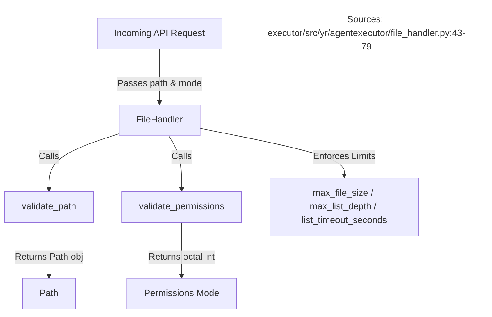
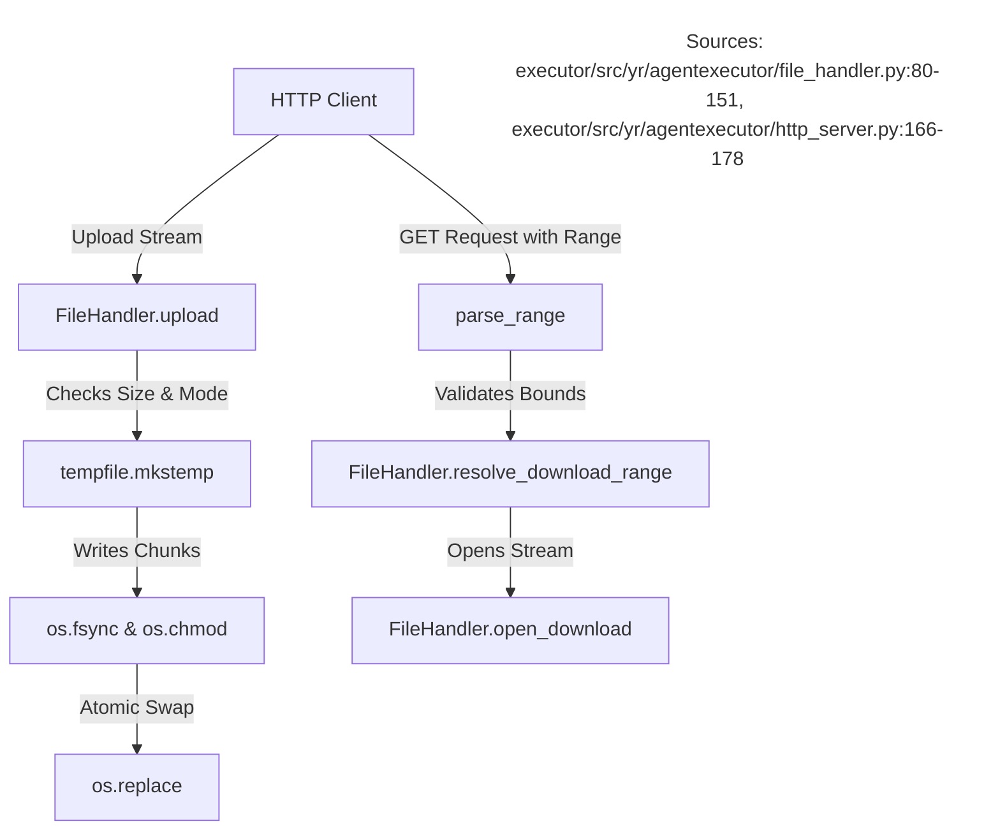

<!-- source: DeepWiki mcp.deepwiki.com · repo openJiuwen-ai/agent-dx · extra page File Management API · fetched 2026-11-02 -->

# File Management API

Relevant source files

The following files were used as context for generating this wiki page:

- [executor/src/yr/agentexecutor/file_handler.py](executor/src/yr/agentexecutor/file_handler.py)
- [executor/src/yr/agentexecutor/http_server.py](executor/src/yr/agentexecutor/http_server.py)
- [tests/executor/test_file_handler.py](tests/executor/test_file_handler.py)

The File Management API provides robust, secure, and streaming filesystem operations within the `agent-dx` executor subsystem. It handles file uploads with atomic guarantees, ranged downloads, recursive directory listing with strict resource bounds, and directory creation. All file operations are coordinated by the `FileHandler` class and exposed through the internal `ExecutorHTTPServer`.

Sources: `executor/src/yr/agentexecutor/file_handler.py:1-79`, `executor/src/yr/agentexecutor/http_server.py:1-45`

---

## 1. `FileHandler` Core Architecture and Safeguards

The `FileHandler` class acts as the central execution engine for filesystem operations. To protect the executor environment against denial-of-service vectors (such as disk exhaustion, recursive symlink loops, or deeply nested directory explosions), `FileHandler` enforces configurable constraints on file sizes, traversal depth, entry counts, and execution timeouts.

Input paths and file permission strings undergo strict validation prior to execution using `validate_path()` and `validate_permissions()`.

Sources: `executor/src/yr/agentexecutor/file_handler.py:43-79`

---

## 2. File Operations API Implementation

The file subsystem supports four primary primitives: atomic uploads, ranged downloads, directory listing, and directory creation (`mkdir`).

### File Upload (`upload`)
The `upload()` method implements an atomic write strategy. It streams incoming binary data into a temporary file (`tempfile.mkstemp()`) inside the target directory, enforcing `max_file_size` limits chunk-by-chunk. Once fully written, file permissions are applied via `os.chmod()` before an atomic rename operation (`os.replace()`) moves the temporary file to its final destination.

Sources: `executor/src/yr/agentexecutor/file_handler.py:80-107`, `tests/executor/test_file_handler.py:12-52`

### Download and Range Resolution (`open_download`, `resolve_download_range`)
Downloads are handled by opening a binary stream to the target file. HTTP `Range` headers are parsed using `parse_range()` in the HTTP server layer and resolved against the file size using `FileHandler.resolve_download_range()`. This calculates the effective end byte and content length, supporting partial content streaming.

Sources: `executor/src/yr/agentexecutor/file_handler.py:126-151`, `executor/src/yr/agentexecutor/http_server.py:166-178`, `tests/executor/test_file_handler.py:54-63`

### Directory Listing (`list`)
Directory enumeration scans paths recursively or non-recursively. To prevent runaway resource consumption, `list()` tracks traversal depth against `max_list_depth`, entry counts against `max_list_entries`, and enforces a hard time budget using `time.monotonic()` against `list_timeout_seconds`. Exceeding these bounds raises `FileListTimeoutError`.

Sources: `executor/src/yr/agentexecutor/file_handler.py:39-42,153-174`, `tests/executor/test_file_handler.py:65-105`

### Directory Creation (`mkdir`)
The `mkdir()` method creates directories idempotently. When `recursive=True` is specified, intermediate parent directories are created. Explicit permission modes are applied directly to the target directory, bypassing system umask settings.

Sources: `executor/src/yr/agentexecutor/file_handler.py:110-124`, `tests/executor/test_file_handler.py:107-160`

Sources: `executor/src/yr/agentexecutor/file_handler.py:80-151`, `executor/src/yr/agentexecutor/http_server.py:166-178`

---

## 3. HTTP Server and Route Integration

The `ExecutorHTTPServer` maps incoming endpoint requests to sandbox and file management primitives. While specific sandbox file routes are defined in `_SANDBOX_ROUTES`, file operations leverage `FileHandler` instances configured with default payload size and timeout thresholds.

| Parameter / Constant | Default Value | Description |
| :--- | :--- | :--- |
| `DEFAULT_MAX_FILE_SIZE` | `512 * 1024 * 1024` (512 MB) | Maximum allowed size for uploaded files. |
| `DEFAULT_MAX_LIST_ENTRIES` | `10000` | Maximum entries returned during directory scans. |
| `DEFAULT_MAX_LIST_DEPTH` | `20` | Maximum recursion depth for directory listings. |
| `DEFAULT_LIST_TIMEOUT_SECONDS` | `30` | Time budget limit for recursive directory scans. |

Sources: `executor/src/yr/agentexecutor/http_server.py:39-45`, `executor/src/yr/agentexecutor/file_handler.py:30-36`

---

