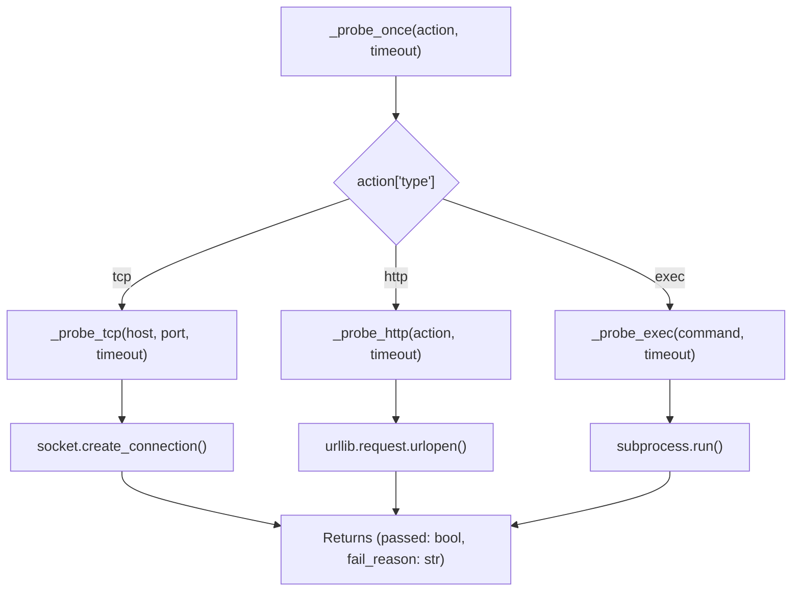
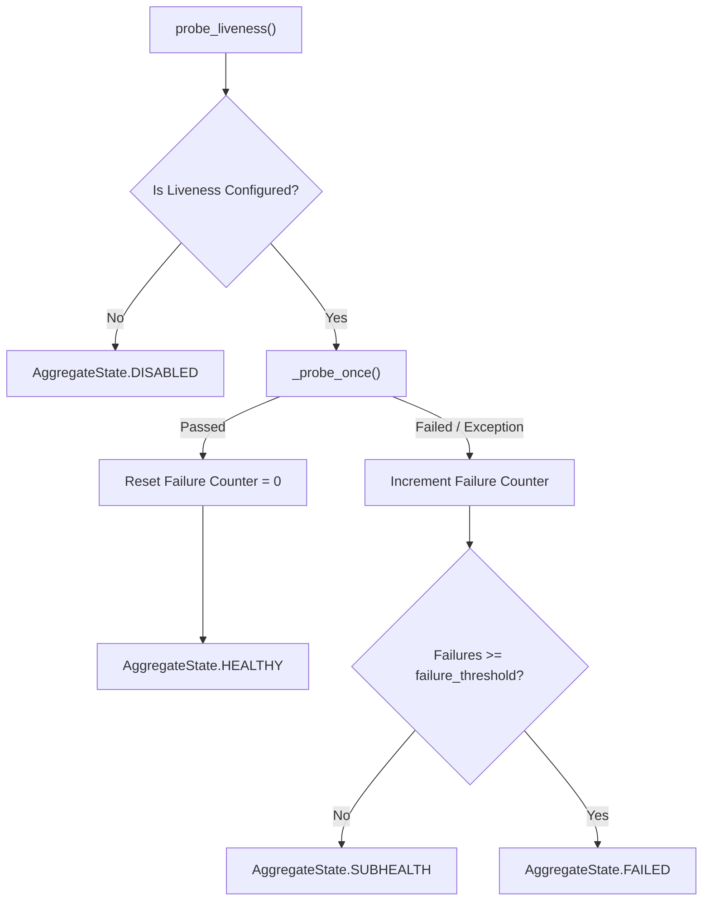

<!-- source: DeepWiki mcp.deepwiki.com · repo openJiuwen-ai/agent-dx · extra page Health Probes · fetched 2026-11-02 -->

# Health Probes

<details>
<summary>Relevant source files</summary>

The following files were used as context for generating this wiki page:

- [executor/src/yr/agentexecutor/probe.py](executor/src/yr/agentexecutor/probe.py)
- [tests/executor/test_probe.py](tests/executor/test_probe.py)

</details>


## Purpose and Scope
This document specifies the technical design and implementation of instance-level startup and liveness probes within the `agent-dx` Agent Executor runtime (`executor/src/yr/agentexecutor/probe.py` [executor/src/yr/agentexecutor/probe.py:1-182]()). The probe subsystem is responsible for parsing probe specifications from container environment variables, enforcing startup synchronization gates via `run_startup`, evaluating actionable target checks (`tcpSocket`, `httpGet`, and `exec`), and maintaining real-time liveness aggregation states (`AggregateState`) through consecutive failure thresholds.

---

## 1. ProbeSpec Parsing and Configuration Loading

The probe configuration is injected into the container runtime via environment variables. Two primary variables govern probe discovery:
* `YR_RUNTIME_BOOTSTRAP_PROBE` (`PROBE_SPEC_ENV`): Contains a JSON payload defining `startup` and `liveness` configuration mappings [executor/src/yr/agentexecutor/probe.py:35-35]().
* `SANDBOX_IP` (`SANDBOX_IP_ENV`): Supplies the isolated sandbox veth IPv4 address or egress IPv4 host, falling back to `127.0.0.1` (`DEFAULT_PROBE_HOST`) if absent [executor/src/yr/agentexecutor/probe.py:36-40]().

The `ProbeSpec` class encapsulates timing parameters, thresholds, and target actions [executor/src/yr/agentexecutor/probe.py:65-88](). The helper function `_extract_action` validates raw dictionaries and enforces that exactly one probe action (`tcpSocket`, `httpGet`, or `exec`) is specified per probe role [executor/src/yr/agentexecutor/probe.py:103-145](). Target host resolution follows a strict precedence: explicit spec host > `SANDBOX_IP` environment variable > loopback address (`127.0.0.1`) [executor/src/yr/agentexecutor/probe.py:104-107]().

```mermaid
graph TD
  Env["Environment Variables YR_RUNTIME_BOOTSTR_PROBE & SANDBOX_IP"] --> Load["_load_probe_set()"]
  Load --> RawMap["Raw JSON Mapping"]
  RawMap --> Extract["_extract_action()"]
  Extract --> CheckType{"Action Type?"}
  CheckType -->|tcpSocket| TCP["TCP Action (Host, Port)"]
  CheckType -->|httpGet| HTTP["HTTP Action (Scheme, Host, Port, Path)"]
  CheckType -->|exec| EXEC["Exec Action (Command List)"]
  TCP --> Spec["ProbeSpec Class Instantiation"]
  HTTP --> Spec
  EXEC --> Spec
  
  subclass CodeEntities
    Load -.-> LS["_load_probe_set in yr.agentexecutor.probe"]
    Extract -.-> EA["_extract_action in yr.agentexecutor.probe"]
    Spec -.-> PS["ProbeSpec in yr.agentexecutor.probe"]
  end
```
*Title: Probe Configuration Parsing Pipeline*

Sources: `executor/src/yr/agentexecutor/probe.py:35-145()`, `tests/executor/test_probe.py:105-140()`

---

## 2. Probe Action Execution (TCP, HTTP, and Exec)

Once a `ProbeSpec` is instantiated, individual probe attempts are executed by `_probe_once`, which dispatches to action-specific handlers [executor/src/yr/agentexecutor/probe.py:148-157]():

* **TCP Probes (`_probe_tcp`)**: Opens a socket connection to the target host and port using `socket.create_connection` within the designated timeout window [executor/src/yr/agentexecutor/probe.py:160-167](). Success is indicated by a connected socket; any `OSError` triggers failure recording [executor/src/yr/agentexecutor/probe.py:164-166]().
* **HTTP Probes (`_probe_http`)**: Construct a target URL using the configured scheme, host, port, and path, dispatching an HTTP GET request via `urllib.request.urlopen` [executor/src/yr/agentexecutor/probe.py:169-178](). HTTP status codes in the `2xx` range (`200 <= code < 300`) signify success [executor/src/yr/agentexecutor/probe.py:180-181]().
* **Exec Probes (`_probe_exec`)**: Executes a subprocess command list within the container environment, returning success if the process exit code is zero.


*Title: Probe Action Dispatch and Execution Flow*

Sources: `executor/src/yr/agentexecutor/probe.py:148-182()`, `tests/executor/test_probe.py:146-198()`

---

## 3. Liveness Aggregation States and Startup Gate

Liveness checking aggregates consecutive execution outcomes against a configured `failure_threshold` [executor/src/yr/agentexecutor/probe.py:65-88](). The health state is represented by the `AggregateState` enumeration [executor/src/yr/agentexecutor/probe.py:50-54]():

* `DISABLED`: No liveness probe has been configured.
* `HEALTHY`: The probe passed, or intermittent failures are below the failure threshold (consecutive failure counter resets to zero on success) [tests/executor/test_probe.py:146-154]().
* `SUBHEALTH`: A probe failure occurred, but the consecutive failure count has not yet reached `failure_threshold` [tests/executor/test_probe.py:156-163]().
* `FAILED`: The number of consecutive failures has met or exceeded `failure_threshold` [tests/executor/test_probe.py:165-173]().

The startup gate (`run_startup`) blocks executor request handling until the startup probe successfully validates instance readiness or times out.


*Title: Liveness State Aggregation Flow*

Sources: `executor/src/yr/agentexecutor/probe.py:50-54()`, `tests/executor/test_probe.py:142-198()`

---

