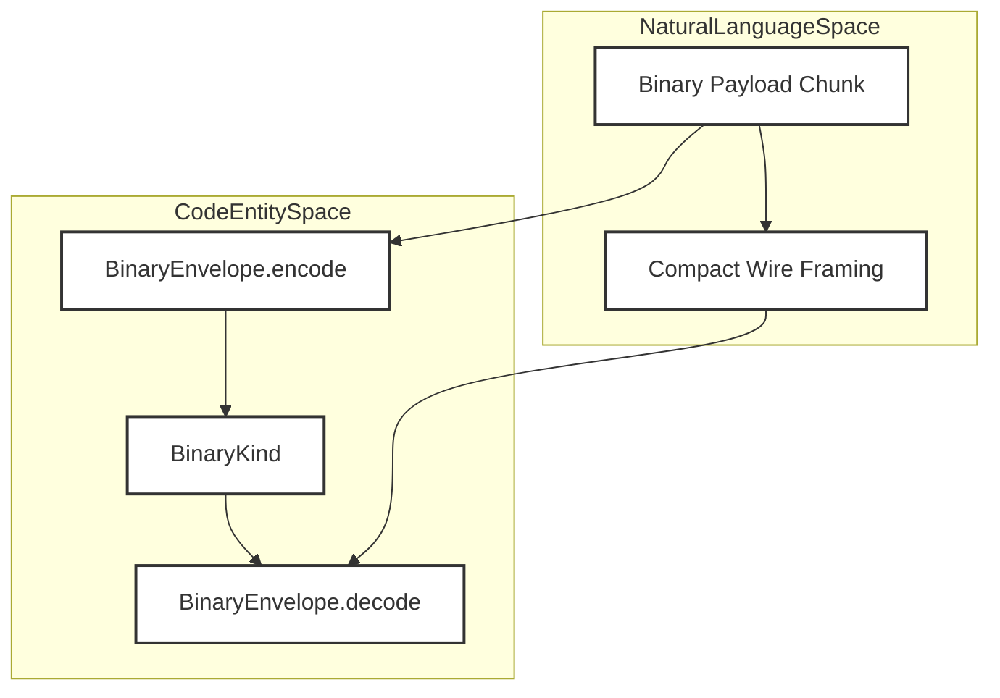
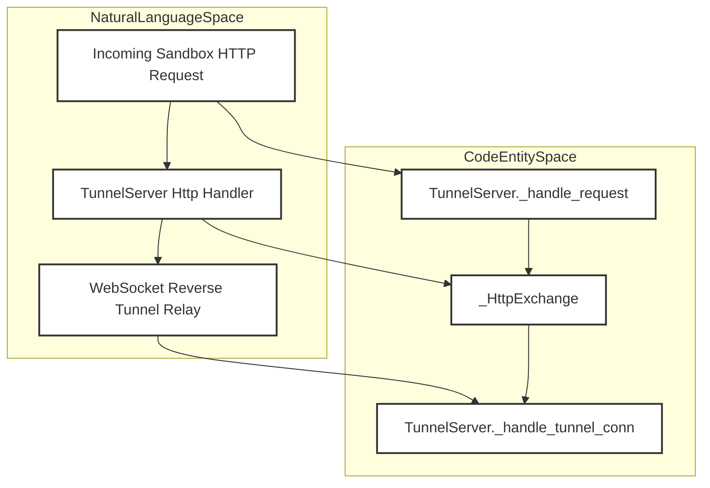

<!-- source: DeepWiki mcp.deepwiki.com · repo openJiuwen-ai/agent-dx · extra page Tunnel Protocol and Proxying · fetched 2026-11-02 -->

# Tunnel Protocol and Proxying

Relevant source files

The following files were used as context for generating this wiki page:

- [executor/src/yr/agentexecutor/sandbox/tunnel_client.py](executor/src/yr/agentexecutor/sandbox/tunnel_client.py)
- [executor/src/yr/agentexecutor/sandbox/tunnel_protocol.py](executor/src/yr/agentexecutor/sandbox/tunnel_protocol.py)
- [executor/src/yr/agentexecutor/sandbox/tunnel_server.py](executor/src/yr/agentexecutor/sandbox/tunnel_server.py)
- [executor/src/yr/agentexecutor/sandbox_manager.py](executor/src/yr/agentexecutor/sandbox_manager.py)

## Purpose and Scope
This section details the reverse tunnel subsystem in `agent-dx`, which enables bidirectional HTTP and WebSocket proxying between local upstream services and remote sandboxes. It covers the wire framing protocol (`tunnel_protocol.py`), the sandbox-side reverse tunnel server (`tunnel_server.py`), the client-side proxy bridge (`tunnel_client.py`), and how sandbox instances are managed (`sandbox_manager.py`).

---

## 1. Tunnel Wire Protocol and Framing
The tunnel protocol defines the wire format used over the reverse WebSocket connection between the sandbox and the client. Version 2 of the protocol (`PROTOCOL_VERSION = 2`) introduces a hybrid model supporting both JSON-encoded control/header frames and compact binary envelopes (`BinaryEnvelope`) for high-throughput streaming data bodies [executor/src/yr/agentexecutor/sandbox/tunnel_protocol.py:28-97]().

Key protocol elements include:
- **`BinaryEnvelope`**: A compact binary format used for bounded binary chunks (HTTP request/response data and WebSocket binary frames). It embeds magic bytes (`YD`), versioning, request UUIDs, and optional byte offsets [executor/src/yr/agentexecutor/sandbox/tunnel_protocol.py:30-129]().
- **`BinaryKind`**: Enum specifying payload types such as `HTTP_REQUEST_DATA` (0x01), `HTTP_RESPONSE_DATA` (0x02), and `WS_BINARY_DATA` (0x03) [executor/src/yr/agentexecutor/sandbox/tunnel_protocol.py:85-89]().
- **`ProtocolError`**: Raised when a frame violates negotiated constraints, such as exceeding maximum chunk sizes or parsing invalid header structures [executor/src/yr/agentexecutor/sandbox/tunnel_protocol.py:81-84]().

*Figure 1: Protocol framing mapping from data structures to `tunnel_protocol.py` entities.*

Sources: `executor/src/yr/agentexecutor/sandbox/tunnel_protocol.py:1-192`

---

## 2. Sandbox-Side Reverse Tunnel Server
The `TunnelServer` class runs inside the sandbox, exposing an internal HTTP port and a WebSocket server port. It accepts an incoming reverse WebSocket connection from the external `TunnelClient`, and then acts as a reverse proxy gateway [executor/src/yr/agentexecutor/sandbox/tunnel_server.py:144-205]().

When an HTTP request hits the sandbox application endpoint, `TunnelServer` encapsulates the request headers and body into tunnel control and data frames, sends them across the WebSocket connection to the client, and streams the response back to the local caller.

*Figure 2: Sandbox request handling flow and corresponding `tunnel_server.py` classes.*

Sources: `executor/src/yr/agentexecutor/sandbox/tunnel_server.py:144-205`

---

## 3. Client-Side Proxy and Tunnel Client
The `TunnelClient` executes on the local developer or client machine. It connects outward to the sandbox's tunnel WebSocket port (routed through frontend gateways or routers) and bridges incoming tunnel requests to local upstream services (such as `127.0.0.1:8000`) [executor/src/yr/agentexecutor/sandbox/tunnel_client.py:14-30]().

Key mechanisms implemented in `TunnelClient`:
- **Header Rebuilding**: `_headers_for_rebuilt_request()` filters hop-by-hop headers, connection tokens, and host headers before forwarding requests to the local upstream server [executor/src/yr/agentexecutor/sandbox/tunnel_client.py:135-162]().
- **Target Validation**: `_validated_request_target()` ensures incoming request methods are valid HTTP verbs and paths use origin-form without path traversal risks (`..`) [executor/src/yr/agentexecutor/sandbox/tunnel_client.py:165-174]().
- **TLS and Cookie Isolation**: Manages secure WebSocket configurations with `_ssl_context_for_tunnel()` and strips ambient cookie jars using `_NoCookieJar` [executor/src/yr/agentexecutor/sandbox/tunnel_client.py:176-201]().

Sources: `executor/src/yr/agentexecutor/sandbox/tunnel_client.py:14-201`

---

## 4. Sandbox Lifecycle and Integration with `SandboxManager`
Sandboxes hosting the tunnel endpoints are tracked and managed centrally via `SandboxManager`. The manager maintains a thread-safe registry mapping platform instance IDs to `Sandbox` instances [executor/src/yr/agentexecutor/sandbox_manager.py:38-48]().

- **`create()`**: Instantiates a new remote sandbox, retrieves its platform instance ID, registers it, and performs best-effort rollback termination if creation or registration fails [executor/src/yr/agentexecutor/sandbox_manager.py:50-77]().
- **`delete()`**: Safely terminates and pops the sandbox from the active dictionary [executor/src/yr/agentexecutor/sandbox_manager.py:78-92]().
- **`terminate_all()`**: Shuts down all active sandboxes during runtime teardown [executor/src/yr/agentexecutor/sandbox_manager.py:111-120]().

Sources: `executor/src/yr/agentexecutor/sandbox_manager.py:38-121`

---

