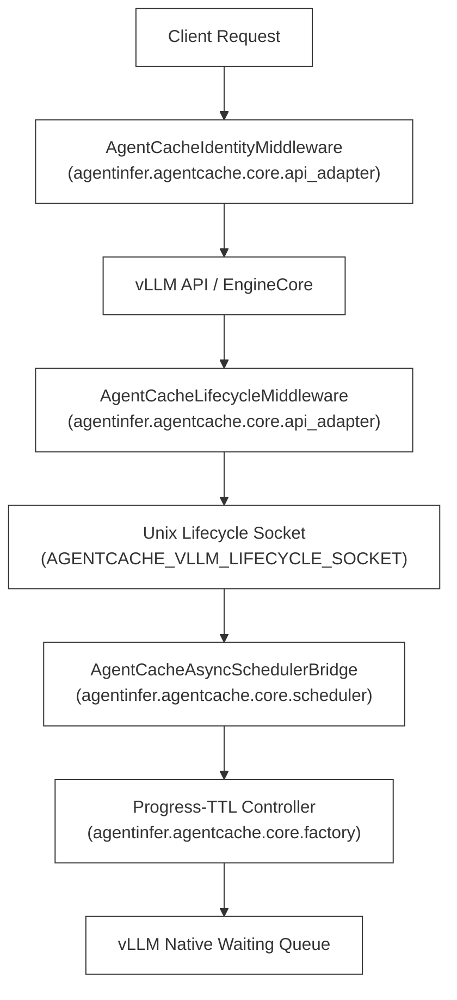

<!-- source: DeepWiki mcp.deepwiki.com · repo openJiuwen-ai/agent-infer · page 1 Overview · fetched 2026-11-02 -->

# Overview

Relevant source files

The following files were used as context for generating this wiki page:

- [README.md](README.md)
- [README.zh.md](README.zh.md)
- [docs/en/explanation/architecture.md](docs/en/explanation/architecture.md)
- [pyproject.toml](pyproject.toml)
- [setup.py](setup.py)
- [tests/scheduling/test_scheduling_contracts.py](tests/scheduling/test_scheduling_contracts.py)

## Purpose and Scope

AgentInfer provides agent-aware caching and request scheduling designed to run inside or in front of LLM serving engines such as vLLM [README.md:1-3](). It manages agent workflow requests by introducing extensible admission decisions, retaining and pausing agent programs through an embedded Progress-TTL controller, and tracking agent identity and lifecycle observations without altering model execution or physical KV block management [docs/en/explanation/architecture.md:3-6]().

Sources: `README.md:1-3`, `docs/en/explanation/architecture.md:3-6`

---

## Deployment Topologies

AgentInfer supports two primary deployment topologies depending on whether scheduling is embedded directly inside the inference engine or placed in front as an external routing layer:

1. **In-Engine Scheduler Topology**: AgentInfer embeds directly into vLLM by composing async/sync scheduler bridges, API identity and lifecycle middleware, and an inference engine controller (`build_progress_ttl_controller`) [README.md:9-12](), [docs/en/explanation/architecture.md:25-39](). In this mode, requests are intercepted before entering vLLM's native waiting queue [docs/en/explanation/architecture.md:3-5]().
2. **Request Router Topology**: AgentInfer can act as a request router or use a native middleware patch (`agentinfer/agentrouter`) providing support for `agent_hint_affinity` and `agent_hint_token_offsets` without requiring a full vendored router tree [README.md:12-14]().

*Figure 1: Natural language to code entity mapping of the in-engine scheduler serving path.*

Sources: `README.md:9-14`, `docs/en/explanation/architecture.md:25-39`

---

## Key Subsystems and Repository Layout

The codebase is organized into several modular subsystems handling scheduling, vLLM integration, benchmarking, and developer utilities:

- `agentinfer/scheduling`: The environment-neutral scheduling core, containing runtime definitions, program ref contracts, transition controllers, and the Progress-TTL strategy family.
- `agentinfer/agentcache`: The vLLM integration layer, holding scheduler bridges (`AgentCacheAsyncSchedulerBridge`, `AgentCacheSyncSchedulerBridge`), API adapters/middleware, controller factories, and CLI entrypoints [docs/en/explanation/architecture.md:30-41]().
- `agentinfer/agentagentbench`: The benchmarking harness and workspace orchestration engine (`run_benchmark`, dataset handling, metrics, and agent adapters) [docs/en/explanation/architecture.md:76-80]().
- `agentinfer/agentrouter`: Native router middleware patches supporting agent hint affinities and token offsets [README.md:12-14]().
- `tools/` and `design/`: Calibration utilities, pre-fill/decode cost estimators, design specifications, and skill packs (`ac-*`).

Sources: `README.md:9-14`, `docs/en/explanation/architecture.md:30-80`

---

## Getting Started & Installation

For details on package requirements (`>=python3.10`, vLLM 0.23.0), installation from source (`pyproject.toml`), serving flags, and quick-start tutorials, see [Getting Started & Installation](#1.1).

Sources: `pyproject.toml:5-10`, `README.md:22-68`

---

## Documentation Map (docs/ en & zh)

For a complete tour of the bilingual documentation tree—including tutorials, how-to guides, reference manuals, architectural explanations, and design specifications—see [Documentation Map (docs/ en & zh)](#1.2).

Sources: `README.md:16-20`, `docs/en/explanation/architecture.md:82-85`

---

