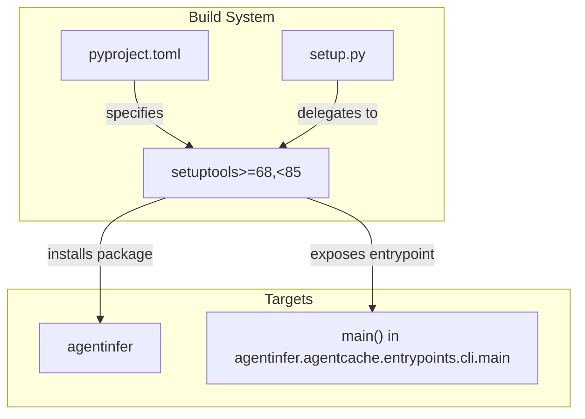
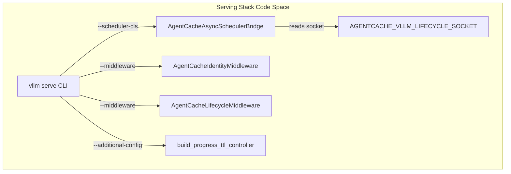

<!-- source: DeepWiki mcp.deepwiki.com · repo openJiuwen-ai/agent-infer · page 1.1 Getting Started & Installation · fetched 2026-11-02 -->

# Getting Started & Installation

<details>
<summary>Relevant source files</summary>

The following files were used as context for generating this wiki page:

- [README.md](README.md)
- [docs/en/tutorial/01-quick-start.md](docs/en/tutorial/01-quick-start.md)
- [examples/serve-progress-ttl.sh](examples/serve-progress-ttl.sh)
- [pyproject.toml](pyproject.toml)
- [setup.py](setup.py)
- [tests/scheduling/test_scheduling_contracts.py](tests/scheduling/test_scheduling_contracts.py)

</details>


## Purpose and Scope
This section covers the foundational prerequisites, build configurations, package installation workflows, and runtime serving parameters required to deploy `agentinfer`. It details version constraints (Python and vLLM), package metadata defined in `pyproject.toml` and `setup.py`, command-line interface (CLI) entrypoints, and standard serving deployment commands using the AgentInfer scheduler bridge, API middleware, and Progress-TTL controller.

Sources: `README.md:1-84`, `pyproject.toml:1-57`, `docs/en/tutorial/01-quick-start.md:1-75`

---

## 1. System Requirements and Environment Setup
Running AgentInfer requires a compatible host environment equipped with appropriate Python runtimes, dependencies, and vLLM serving binaries.

- **Operating System**: Linux, or Windows with WSL 2 (`README.md:24`).
- **Python**: Version `3.10` or later, matching `requires-python` in `pyproject.toml` (`README.md:25`, `pyproject.toml:8`).
- **Inference Runtime**: `vLLM 0.23.0` (`README.md:26`, `docs/en/tutorial/01-quick-start.md:14`).
- **Hardware**: A CUDA-capable GPU supported by vLLM, sized appropriately for the target model weights (`README.md:27`, `docs/en/tutorial/01-quick-start.md:4`).

Dependencies declared in project metadata include dataset utilities, web frameworks, asynchronous communication libraries, and serialization components (`pyproject.toml:9`):
```toml
dependencies = ["datasets", "fastapi", "httpx", "matplotlib", "numpy", "prometheus-client", "PyYAML", "pydantic>=2", "tqdm", "uvicorn", "websockets", "zstandard"]
```

Sources: `README.md:22-29`, `pyproject.toml:5-16`, `docs/en/tutorial/01-quick-start.md:6-19`

---

## 2. Package Installation and Build Configuration
AgentInfer uses a standard setuptools build backend governed by `pyproject.toml` and a compatibility stub in `setup.py`.


*Figure 1: Build system and installation entrypoints bridging package specifications to executable commands.*

Sources: `pyproject.toml:1-10`, `setup.py:1-10`

### Installation from Source
For development and source-based deployments, clone the repository and install the package in editable mode within an active vLLM environment (`README.md:33-41`, `docs/en/tutorial/01-quick-start.md:20-28`):
```bash
git clone https://github.com/openjiuwen-ai/agent-infer.git
cd agent-infer
python -m pip install -e .
```

### Installation from Release Wheels
To install a pre-built distribution wheel in the target environment (`README.md:43-49`, `docs/en/tutorial/01-quick-start.md:30-35`):
```bash
python -m pip install agentinfer-0.1.0-py3-none-any.whl
```

The package configuration maps the `vllm` console script entrypoint directly to AgentInfer's CLI handler (`pyproject.toml:28-29`):
```toml
[project.scripts]
vllm = "agentinfer.agentcache.entrypoints.cli.main:main"
```

Sources: `README.md:31-49`, `pyproject.toml:28-30`, `setup.py:1-10`, `docs/en/tutorial/01-quick-start.md:20-36`

---

## 3. Serving Architecture and Flag Configuration
Deploying AgentInfer with vLLM involves passing specific scheduler classes, middleware hooks, and controller configurations via the vLLM serving CLI flags.


*Figure 2: Mapping natural language serving parameters to core agentinfer classes and middleware components.*

Sources: `README.md:51-68`, `examples/serve-progress-ttl.sh:1-13`, `docs/en/tutorial/01-quick-start.md:37-55`

### Key Serving Parameters

| Flag / Environment Variable | Target Code Entity / Component | Role & Description |
| :--- | :--- | :--- |
| `AGENTCACHE_VLLM_LIFECYCLE_SOCKET` | Unix Datagram Socket | Path to the local Unix socket used for lifecycle signalling across Data Parallel (DP) ranks (`README.md:57`). |
| `--async-scheduling` | vLLM Engine Core | Enables asynchronous scheduling execution mode; required by `AgentCacheAsyncSchedulerBridge` (`README.md:60`, `docs/en/tutorial/01-quick-start.md:56`). |
| `--scheduler-cls` | `agentinfer.agentcache.core.scheduler.AgentCacheAsyncSchedulerBridge` | Instructs vLLM to utilize AgentInfer's asynchronous scheduling bridge (`README.md:61`). |
| `--middleware` | `AgentCacheIdentityMiddleware`, `AgentCacheLifecycleMiddleware` | Intercepts HTTP/API requests to inject agent identity and emit lifecycle events (`README.md:62-63`). |
| `--additional-config` | `agentinfer.agentcache.core.factory.build_progress_ttl_controller` | Injects JSON configuration specifying the factory builder for the Progress-TTL controller (`README.md:64-65`). |

Sources: `README.md:53-66`, `docs/en/tutorial/01-quick-start.md:39-51`

---

## 4. Quick Start Tutorial and Example Execution Script
The reference serving script [`examples/serve-progress-ttl.sh`](../../../examples/serve-progress-ttl.sh) automates environment variable setup and executes `vllm serve` with the full AgentInfer component stack.

```bash
#!/usr/bin/env bash
set -euo pipefail

MODEL=${MODEL:-meta-llama/Llama-3.1-8B-Instruct}
export AGENTCACHE_VLLM_LIFECYCLE_SOCKET=${AGENTCACHE_VLLM_LIFECYCLE_SOCKET:-/tmp/agentinfer-vllm-lifecycle.sock}

exec vllm serve "$MODEL" \
  --async-scheduling \
  --scheduler-cls agentinfer.agentcache.core.scheduler.AgentCacheAsyncSchedulerBridge \
  --middleware agentinfer.agentcache.core.api_adapter.AgentCacheIdentityMiddleware \
  --middleware agentinfer.agentcache.core.api_adapter.AgentCacheLifecycleMiddleware \
  --additional-config \
  '{"agentcache":{"controller_factory":"agentinfer.agentcache.core.factory.build_progress_ttl_controller"}}'
```

### Verification
Once the server finishes loading model weights, query the vLLM models endpoint to confirm operational status (`docs/en/tutorial/01-quick-start.md:59-70`):
```bash
curl http://127.0.0.1:8000/v1/models
```

Sources: `README.md:51-74`, `examples/serve-progress-ttl.sh:1-13`, `docs/en/tutorial/01-quick-start.md:37-75`

---

