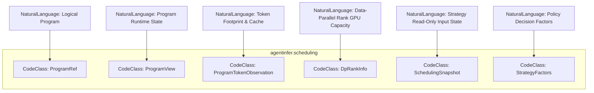
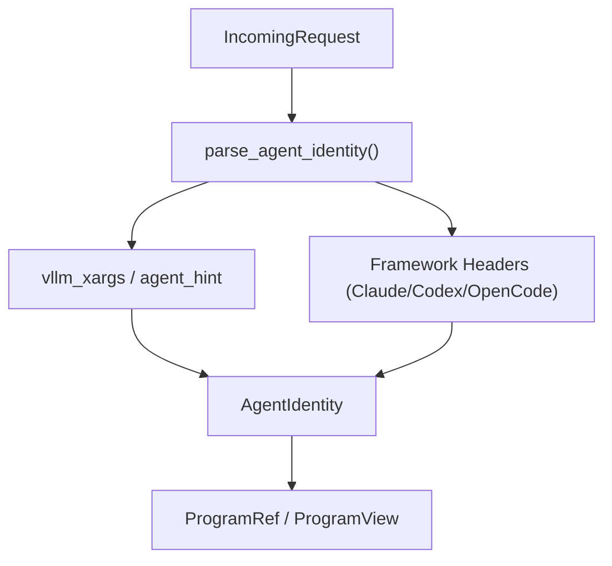

<!-- source: DeepWiki mcp.deepwiki.com · repo openJiuwen-ai/agent-infer · page 2.1 Scheduling Contracts and Domain Model · fetched 2026-11-02 -->

# Scheduling Contracts and Domain Model

<details>
<summary>Relevant source files</summary>

The following files were used as context for generating this wiki page:

- [agentinfer/__init__.py](agentinfer/__init__.py)
- [agentinfer/scheduling/admission_outcome.py](agentinfer/scheduling/admission_outcome.py)
- [agentinfer/scheduling/backend.py](agentinfer/scheduling/backend.py)
- [agentinfer/scheduling/domain.py](agentinfer/scheduling/domain.py)
- [agentinfer/scheduling/events.py](agentinfer/scheduling/events.py)
- [agentinfer/scheduling/factors.py](agentinfer/scheduling/factors.py)
- [agentinfer/scheduling/identity.py](agentinfer/scheduling/identity.py)
- [agentinfer/scheduling/lifecycle.py](agentinfer/scheduling/lifecycle.py)
- [agentinfer/scheduling/snapshot.py](agentinfer/scheduling/snapshot.py)
- [pyproject.toml](pyproject.toml)
- [tests/scheduling/test_identity.py](tests/scheduling/test_identity.py)
- [tests/scheduling/test_scheduling_contracts.py](tests/scheduling/test_scheduling_contracts.py)

</details>


This page documents the environment-neutral domain models, immutable state contracts, identity normalization layers, and event primitives defined in `agentinfer.scheduling`. These types establish the shared vocabulary and boundary contracts between host adapters, router runtimes, and pluggable scheduling strategies without depending on vLLM engine internals or transport protocols.

---

## Program Identity and Token Observation

The core scheduling entity is a logical program incarnation. Programs are tracked via generation-safe references, core forwarding states, model-service statuses, and token observations.

### ProgramRef and View

`ProgramRef` provides a stable, generation-safe identity combining an external `program_id` with an incremented runtime `generation` `[agentinfer/scheduling/domain.py:49-67]()`. `ProgramView` wraps these identifiers alongside runtime-owned flags like `state` (`ACTIVE`, `PAUSED`, `TERMINATED`), `status` (`REASONING`, `ACTING`), and step counters into an immutable view passed to strategies `[agentinfer/scheduling/domain.py:118-150]()`.

```
[ProgramRef] ---> (program_id, generation)
[ProgramView] ---> (ref, state, status, tokens, backend_id, step_count)
```
Sources: `[agentinfer/scheduling/domain.py:49-150]()`

### Token Observations

`ProgramTokenObservation` records estimated context sizes, shared prefix token counts, freshness deadlines, and optional physical KV block allocations observed from backend engines `[agentinfer/scheduling/domain.py:70-94]()`. It supports attribution markers (`EXACT`, `PARTIAL`, `UNKNOWN`) and source annotations (`ROUTER_ESTIMATE`, `BACKEND_USAGE`, `MIXED`) `[agentinfer/scheduling/domain.py:33-47]()`.

Sources: `[agentinfer/scheduling/domain.py:33-116]()`

---

## Backend Topology and Data-Parallel Ranks

Capacities and execution targets are modeled across data-parallel (DP) ranks, backend instances, and remote storage pools.

### DpRankInfo, BackendInfo, and BackendPoolInfo

- **`DpRankInfo`**: Encapsulates health, schedulability, running/waiting request counts, and per-rank local HBM, DRAM, and SSD KV token capacities `[agentinfer/scheduling/backend.py:18-38]()`.
- **`BackendInfo`**: Groups an individual backend instance (`backend_id`, `backend_url`) with its aggregate DP ranks and observation timestamps `[agentinfer/scheduling/backend.py:64-72]()`.
- **`BackendPoolInfo`**: Aggregates all backend observations along with the shared remote KV store token capacity `[agentinfer/scheduling/backend.py:86-92]()`.
- **`DispatchTarget`**: Represents the concrete routing destination (`backend_id`, optional `dp_rank`) selected for an admitted request `[agentinfer/scheduling/backend.py:106-111]()`.

```
DpRankInfo (rank-local HBM/DRAM quotas) 
    -> BackendInfo (grouped DP ranks)
        -> BackendPoolInfo (global cluster + remote KV store)
```
Sources: `[agentinfer/scheduling/backend.py:18-117]()`

---

## Scheduling Snapshots and Strategy Factors

Policy decisions rely on immutable read snapshots coupled with synchronized strategy factor stores.

### SchedulingSnapshot

`SchedulingSnapshot` provides the complete read model used for a single admission, resume, or capacity-repair strategy hook invocation `[agentinfer/scheduling/snapshot.py:23-35]()`. It contains monotonic timestamps, active backend capacity (`total_kv_tokens`), native vLLM utilization metrics, waiting request pool counts, and immutable tuples of all live `ProgramView` items and waiting program references `[agentinfer/scheduling/snapshot.py:37-44]()`.

Sources: `[agentinfer/scheduling/snapshot.py:23-86]()`

### StrategyFactors

`StrategyFactors` maintains policy-owned global and per-Program decision metadata (e.g., sliding statistics, weights, decay timers) `[agentinfer/scheduling/factors.py:27-38]()`. It is synchronized directly with the host router lock, eliminating copy-on-write overhead during execution passes `[agentinfer/scheduling/factors.py:12-14]()`.

Sources: `[agentinfer/scheduling/factors.py:1-93]()`

---

## Natural Language Space to Code Entity Space Mapping

The following diagram bridges conceptual scheduling entities to their exact Python implementations within `agentinfer.scheduling`.


Sources: `[agentinfer/scheduling/domain.py:49-150](), [agentinfer/scheduling/backend.py:18-38](), [agentinfer/scheduling/snapshot.py:23-44](), [agentinfer/scheduling/factors.py:27-38]()`

---

## Agent Identity Normalization

API gateways and routers parse diverse framework headers and custom payload extensions into a uniform host-neutral `AgentIdentity` structure `[agentinfer/scheduling/identity.py:27-53]()`.

### AgentIdentity and parse_agent_identity

`parse_agent_identity` extracts or infers `program_id`, `task_id`, `session_id`, `agent_id`, parent relationships, and flow expectations (`blocks_parent`, `expected_resume`) from `vllm_xargs`, `agent_hint`, or framework-specific request headers (`X-Claude-Code-Session-Id`, `session-id`, `X-Session-Id`) `[agentinfer/scheduling/identity.py:97-164]()`.


Sources: `[agentinfer/scheduling/identity.py:27-165](), [tests/scheduling/test_identity.py:15-194]()`

---

## Events, Diagnostics, and Admission Outcomes

Scheduling operations emit sink-neutral immutable audit structures after state transitions are committed.

### SchedulingEvent and StrategyDiagnostic

- **`SchedulingEvent`**: Represents a committed lifecycle fact (e.g., `REQUEST_ADMITTED`, `PROGRAM_PAUSED`, `CAPACITY_OBSERVED`) along with monotonic timestamps, reasons, and typed key-value diagnostic fields `[agentinfer/scheduling/events.py:25-86]()`.
- **`StrategyDiagnostic`**: Captures how a policy calculated a decision during a strategy hook invocation without mutating core runtime state `[agentinfer/scheduling/events.py:116-121]()`.

Sources: `[agentinfer/scheduling/events.py:25-133]()`

### AdmissionOutcome and ProgramLifecycle

- **`AdmissionOutcome`**: Returned synchronously by admission hooks, indicating whether a candidate should be `ADMITTED` or `QUEUED`, alongside deficit metrics and transitioned program references `[agentinfer/scheduling/admission_outcome.py:20-45]()`.
- **`ProgramLifecycle`**: A closed vocabulary (`UNKNOWN`, `CONTINUE`, `TERMINAL`) capturing whether a completed response implies further agent execution steps `[agentinfer/scheduling/lifecycle.py:14-19]()`.

Sources: `[agentinfer/scheduling/admission_outcome.py:1-53](), [agentinfer/scheduling/lifecycle.py:1-19]()`

---

