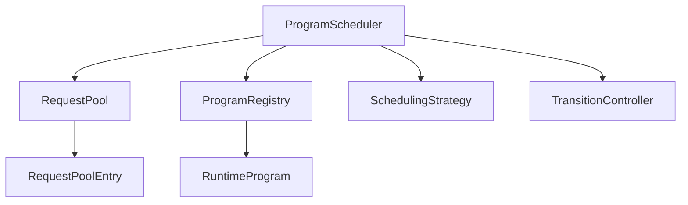
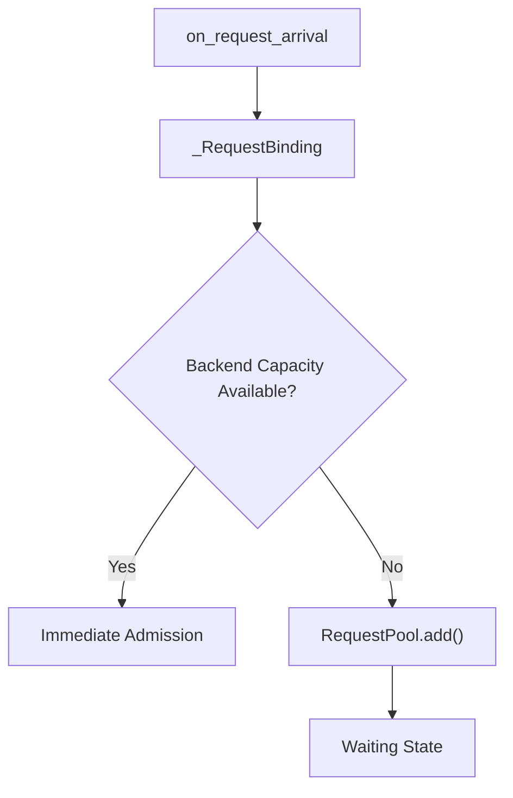

<!-- source: DeepWiki mcp.deepwiki.com · repo openJiuwen-ai/agent-infer · page 2.2 ProgramScheduler Runtime · fetched 2026-11-02 -->

# ProgramScheduler Runtime

Relevant source files

The following files were used as context for generating this wiki page:

- [agentinfer/agentcache/core/vllm_logging.py](agentinfer/agentcache/core/vllm_logging.py)
- [agentinfer/scheduling/__init__.py](agentinfer/scheduling/__init__.py)
- [agentinfer/scheduling/observability.py](agentinfer/scheduling/observability.py)
- [agentinfer/scheduling/program_registry.py](agentinfer/scheduling/program_registry.py)
- [agentinfer/scheduling/program_runtime.py](agentinfer/scheduling/program_runtime.py)
- [agentinfer/scheduling/request_pool.py](agentinfer/scheduling/request_pool.py)
- [agentinfer/scheduling/runtime.py](agentinfer/scheduling/runtime.py)
- [agentinfer/scheduling/strategy.py](agentinfer/scheduling/strategy.py)
- [agentinfer/scheduling/transitions.py](agentinfer/scheduling/transitions.py)
- [tests/scheduling/test_program_runtime.py](tests/scheduling/test_program_runtime.py)
- [tests/scheduling/test_progress_ttl_runtime.py](tests/scheduling/test_progress_ttl_runtime.py)
- [tests/scheduling/test_strategy_contracts.py](tests/scheduling/test_strategy_contracts.py)

## Purpose and Scope

The `ProgramScheduler` runtime provides an environment-neutral coordination core that manages request arrival, retention, program lifecycle state, strategy execution, and periodic scheduling cycles [agentinfer/scheduling/runtime.py:3-9](). It integrates request handling via an embedded `RequestPool` [agentinfer/scheduling/request_pool.py:49-50](), tracks live agent program instances using `ProgramRegistry` [agentinfer/scheduling/program_registry.py:31-37]() and `RuntimeProgram` [agentinfer/scheduling/program_runtime.py:26-47](), and evaluates scheduling policies through the `SchedulingStrategy` interface [agentinfer/scheduling/strategy.py:31-33]().

For detailed coverage of transition mechanics, the `TransitionController` interface, and policy contract tests, see [Transitions and Strategy Interface](#2.2.1).

Sources: `agentinfer/scheduling/runtime.py:3-9`, `agentinfer/scheduling/request_pool.py:49-50`, `agentinfer/scheduling/program_registry.py:31-37`, `agentinfer/scheduling/program_runtime.py:26-47`, `agentinfer/scheduling/strategy.py:31-33`

---

## Architecture and Core Components

*Figure 1: `ProgramScheduler` subsystem relationships connecting `agentinfer/scheduling/runtime.py`, `agentinfer/scheduling/request_pool.py`, `agentinfer/scheduling/program_registry.py`, and `agentinfer/scheduling/strategy.py`.*

Sources: `agentinfer/scheduling/runtime.py:69-96`, `agentinfer/scheduling/request_pool.py:49-52`, `agentinfer/scheduling/program_registry.py:31-37`, `agentinfer/scheduling/strategy.py:31-33`

---

## Request Arrival and Retention (`RequestPool`)

When a request arrives at the scheduler via `on_request_arrival()`, the scheduler binds the request to an agent program identity [agentinfer/scheduling/runtime.py:50-67](). Unadmitted or waiting request attempts are buffered inside the scheduler-owned `RequestPool` [agentinfer/scheduling/request_pool.py:49-50](). 

Each request attempt is represented as a `RequestPoolEntry` tracking its status (`WAITING` or `ADMITTED`) and target dispatch details [agentinfer/scheduling/request_pool.py:30-40](). The pool manages insertion order, allowing the scheduler to evaluate waiting attempts during periodic schedule cycles [agentinfer/scheduling/request_pool.py:57-81]().

*Figure 2: Request arrival and retention flow within `ProgramScheduler` (`agentinfer/scheduling/runtime.py` and `agentinfer/scheduling/request_pool.py`).*

Sources: `agentinfer/scheduling/runtime.py:50-67`, `agentinfer/scheduling/request_pool.py:30-81`

---

## Program Registry and Runtime Records

The scheduler decouples physical request execution from logical agent programs using `ProgramRegistry` [agentinfer/scheduling/program_registry.py:31-37]() and `RuntimeProgram` [agentinfer/scheduling/program_runtime.py:26-47](). 

- **`ProgramRegistry`**: Maintains live `RuntimeProgram` records, generation counters, task groupings, and parent-child blocking edges [agentinfer/scheduling/program_registry.py:39-44](). It protects against stale references using generation-safe `ProgramRef` instances [agentinfer/scheduling/program_registry.py:103-108]().
- **`RuntimeProgram`**: Stores mutable core attributes including scheduling eligibility (`ProgramState`), model service status (`ProgramStatus`), step counts, and token observations (`ProgramTokenObservation`) [agentinfer/scheduling/program_runtime.py:26-65]().

Sources: `agentinfer/scheduling/program_registry.py:31-44`, `agentinfer/scheduling/program_runtime.py:26-65`

---

## Schedule Cycles, Prefix-Cache Observation, and Completion

The runtime evaluates scheduling decisions periodically or when triggered by dirty state updates via `needs_schedule_cycle()` [agentinfer/scheduling/runtime.py:130-141](). During a schedule cycle:
1. **Prefix-Cache Observation**: `prefix_cache_candidates()` identifies paused reasoning requests whose reusable prefix cache attribution must be refreshed [agentinfer/scheduling/runtime.py:112-128]().
2. **Strategy Hook Execution**: The scheduler invokes strategy hooks (`handle_admission`, `schedule_resume`, and `repair_capacity`) under a protected mutation boundary [agentinfer/scheduling/strategy.py:46-90]().
3. **Completion and Cancellation**: Request completions update token usage and program states, while `cancel_request()` clears stale bindings from the request pool without affecting completed metrics [agentinfer/scheduling/request_pool.py:114-117]().

Sources: `agentinfer/scheduling/runtime.py:112-141`, `agentinfer/scheduling/strategy.py:46-90`, `agentinfer/scheduling/request_pool.py:114-117`

---

## Transitions and Strategy Interface

For detailed specifications on how policies request state changes via `TransitionController`, apply `ADMIT`, `PAUSE`, `RESUME`, `QUEUE`, `MARK_FOR_PAUSE`, and `RELEASE` semantics, and execute contract tests, see [Transitions and Strategy Interface](#2.2.1).

Sources: `agentinfer/scheduling/transitions.py:22-40`, `agentinfer/scheduling/strategy.py:31-90`

---

