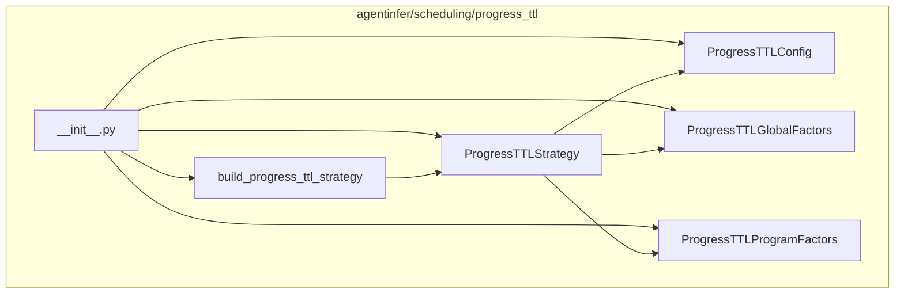
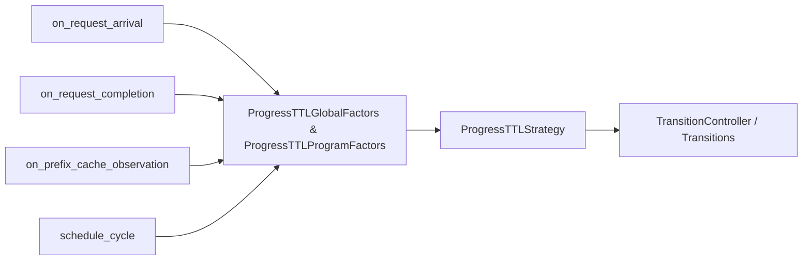

<!-- source: DeepWiki mcp.deepwiki.com · repo openJiuwen-ai/agent-infer · page 2.3 Progress-TTL Policy · fetched 2026-11-02 -->

# Progress-TTL Policy

Relevant source files

The following files were used as context for generating this wiki page:

- [agentinfer/scheduling/progress_ttl/__init__.py](agentinfer/scheduling/progress_ttl/__init__.py)
- [agentinfer/scheduling/progress_ttl/factors.py](agentinfer/scheduling/progress_ttl/factors.py)
- [agentinfer/scheduling/progress_ttl/rolling_stats.py](agentinfer/scheduling/progress_ttl/rolling_stats.py)
- [design/module/scheduling/progress-ttl-scheduling.md](design/module/scheduling/progress-ttl-scheduling.md)

## Purpose and Scope

This page provides a high-level overview of the Progress-TTL strategy family in AgentInfer (`agentinfer/scheduling/progress_ttl`) [agentinfer/scheduling/progress_ttl/__init__.py:1-21](). Progress-TTL is an agent-aware caching and scheduling policy that manages Program execution across consecutive tool-call rounds under tight HBM KV cache constraints [design/module/scheduling/progress-ttl-scheduling.md:27-38](). 

As a parent page, this document outlines the overarching package architecture, global rolling statistics, configuration factors, and decision flows. For in-depth technical details, refer to the child pages:
- [ProgressTTLStrategy Decision Logic](#2.3.1)
- [Configuration, Factors and Rolling Statistics](#2.3.2)

---

## 1. Overview of Progress-TTL Strategy Family

The Progress-TTL module packages configuration models, global workload statistics, per-program decision factors, and strategy execution builders [agentinfer/scheduling/progress_ttl/__init__.py:1-21](). It coordinates with the scheduling core runtime to decide when programs are admitted, paused, resumed, or released based on cache-locality and throughput trade-offs [design/module/scheduling/progress-ttl-scheduling.md:27-58]().

The primary components exposed by the package include `ProgressTTLStrategy`, `ProgressTTLConfig`, `ProgressTTLGlobalFactors`, `ProgressTTLProgramFactors`, and `build_progress_ttl_strategy` [agentinfer/scheduling/progress_ttl/__init__.py:6-20]().

### Diagram 1: Progress-TTL Subsystem Component Architecture

Sources: `agentinfer/scheduling/progress_ttl/__init__.py:1-21`, `agentinfer/scheduling/progress_ttl/factors.py:17-56`, `agentinfer/scheduling/progress_ttl/rolling_stats.py:66-94`

---

## 2. ProgressTTLStrategy Decision Logic

The core decision logic—including admission control, resume ordering tiers, capacity repair, TTL expiry enforcement, privilege management, batch-gain calculations, and continuous-growth reserves—is implemented by `ProgressTTLStrategy` [agentinfer/scheduling/progress_ttl/__init__.py:10]() and specified in `design/module/scheduling/progress-ttl-scheduling.md:27-58` [design/module/scheduling/progress-ttl-scheduling.md:27-58](). It protects HBM cache utilization during short agent tool-call intervals while preventing request starvation.

For detailed coverage of admission criteria, resume queues, and state transition mechanics, see [ProgressTTLStrategy Decision Logic](#2.3.1).

Sources: `agentinfer/scheduling/progress_ttl/__init__.py:1-21`, `design/module/scheduling/progress-ttl-scheduling.md:27-58`

---

## 3. Configuration, Factors and Rolling Statistics

Configuration validation, operating modes, resume orders (`ProgressTTLResumeOrder`), global workload aggregates (`ProgressTTLGlobalFactors`), and per-program runtime records (`ProgressTTLProgramFactors`) are managed across `config.py`, `factors.py`, and `rolling_stats.py` [agentinfer/scheduling/progress_ttl/__init__.py:6-10](). These structures maintain bounded rolling windows and fit lognormal TTL distributions to dynamically adapt thresholds to active agent behaviors [design/module/scheduling/progress-ttl-scheduling.md:59-74]().

For detailed configuration parameters, validation rules, and statistical window formulas, see [Configuration, Factors and Rolling Statistics](#2.3.2).

Sources: `agentinfer/scheduling/progress_ttl/__init__.py:1-21`, `agentinfer/scheduling/progress_ttl/factors.py:17-56`, `agentinfer/scheduling/progress_ttl/rolling_stats.py:66-94`

---

## 4. Observation and Decision Flow

Progress-TTL listens to runtime events such as request arrivals, stream outputs, request completions, prefix-cache observations, and backend schedule cycles to update `ProgressTTLGlobalFactors` and `ProgressTTLProgramFactors`, which in turn drive typed strategy decisions [design/module/scheduling/progress-ttl-scheduling.md:75-117]().

### Diagram 2: Observation and Decision Control Flow

Sources: `agentinfer/scheduling/progress_ttl/factors.py:17-56`, `agentinfer/scheduling/progress_ttl/rolling_stats.py:66-94`, `design/module/scheduling/progress-ttl-scheduling.md:75-117`

---

