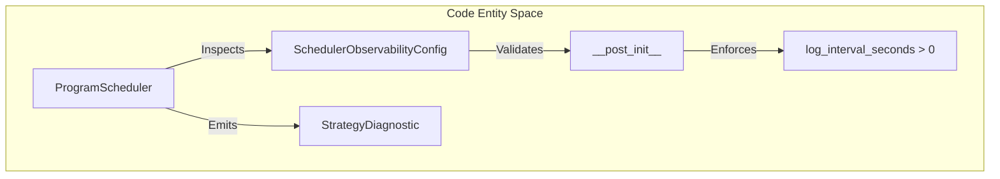
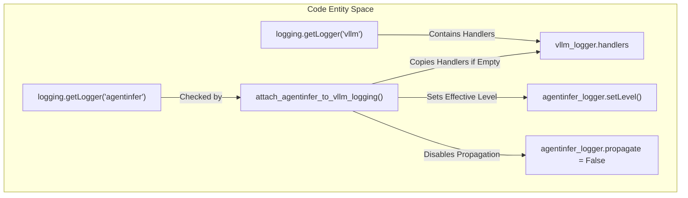

<!-- source: DeepWiki mcp.deepwiki.com · repo openJiuwen-ai/agent-infer · page 2.4 Observability and Metrics · fetched 2026-11-02 -->

# Observability and Metrics

<details>
<summary>Relevant source files</summary>

The following files were used as context for generating this wiki page:

- [agentinfer/agentcache/core/vllm_logging.py](agentinfer/agentcache/core/vllm_logging.py)
- [agentinfer/scheduling/__init__.py](agentinfer/scheduling/__init__.py)
- [agentinfer/scheduling/observability.py](agentinfer/scheduling/observability.py)
- [agentinfer/scheduling/program_registry.py](agentinfer/scheduling/program_registry.py)
- [agentinfer/scheduling/program_runtime.py](agentinfer/scheduling/program_runtime.py)
- [agentinfer/scheduling/request_pool.py](agentinfer/scheduling/request_pool.py)
- [agentinfer/scheduling/transitions.py](agentinfer/scheduling/transitions.py)
- [skills/ac-review/criteria/90-observability.md](skills/ac-review/criteria/90-observability.md)
- [tests/agentcache/core/test_vllm_logging.py](tests/agentcache/core/test_vllm_logging.py)
- [tests/scheduling/test_strategy_contracts.py](tests/scheduling/test_strategy_contracts.py)

</details>


## Purpose and Scope
This section details the observability and metrics subsystem within `agent-infer`, covering validated control mechanisms for scheduler logging, additive integration with `vLLM`’s logging hierarchy, strategy diagnostics emission, and Prometheus exposure hooks. Observability in AgentInfer is designed to provide actionable context at system boundaries without exposing secrets or private prompt data, conforming to strict quality review criteria [skills/ac-review/criteria/90-observability.md:1-60]().

---

## 1. Scheduling Observability Configuration

Scheduler-level observability is controlled via the immutable `SchedulerObservabilityConfig` dataclass located in `agentinfer/scheduling/observability.py`. It validates opt-in event tracing and periodic strategy diagnostic logging intervals.

```python
@dataclass(frozen=True)
class SchedulerObservabilityConfig:
    enabled: bool = False
    log_interval_seconds: float = 5.0
```

`SchedulerObservabilityConfig` rejects non-boolean activation flags and ensures that diagnostic log intervals are finite, positive numbers during its `__post_init__` phase [agentinfer/scheduling/observability.py:12-28]().

### Diagram: Observability Control & Diagnostic Data Flow


*Figure 1: Validation and emission flow governed by `SchedulerObservabilityConfig`.*

Sources: `agentinfer/scheduling/observability.py:12-29](), `agentinfer/scheduling/__init__.py:22`

---

## 2. vLLM Logging Integration

AgentInfer runs a separate logger hierarchy (`agentinfer`) from `vLLM` (`vllm`) and `uvicorn`. To prevent unhandled log records while preserving native `vLLM` formatting, filters, and stream configurations, AgentInfer provides an additive logging bridge function: `attach_agentinfer_to_vllm_logging()` in `agentinfer/agentcache/core/vllm_logging.py`.

```python
def attach_agentinfer_to_vllm_logging() -> None:
    agentinfer_logger = logging.getLogger("agentinfer")
    if agentinfer_logger.handlers:
        return

    vllm_logger = logging.getLogger("vllm")
    if not vllm_logger.handlers:
        return

    for handler in vllm_logger.handlers:
        agentinfer_logger.addHandler(handler)
    agentinfer_logger.setLevel(vllm_logger.getEffectiveLevel())
    agentinfer_logger.propagate = False
```

### Key Behavioral Traits of the Logging Bridge:
* **Additive Handler Attachment**: Reuses `vLLM` handlers without replacing user-configured or `uvicorn` handlers [agentinfer/agentcache/core/vllm_logging.py:10-20]().
* **Idempotency**: Explicit AgentInfer handlers take precedence; calling `attach_agentinfer_to_vllm_logging()` multiple times is safe and avoids duplicate records [agentinfer/agentcache/core/vllm_logging.py:18-23]().
* **Deferred Initialization**: If imported before `vLLM` initializes its loggers, the attachment remains a safe no-op until handlers exist [tests/agentcache/core/test_vllm_logging.py:75-84]().

### Diagram: Logging Bridge Architecture


*Figure 2: Process-global logger hierarchy integration between `vllm` and `agentinfer`.*

Sources: `agentinfer/agentcache/core/vllm_logging.py:10-33](), `tests/agentcache/core/test_vllm_logging.py:1-118`

---

## 3. Event Diagnostics and Review Standards

AgentInfer adheres to the `ac-review` quality criteria for observability (`90-observability.md`), ensuring that operational telemetry meets strict guidelines:
* **System Boundaries (`O1`)**: Important events across request handling, transitions, and admission checks generate structured event records [skills/ac-review/criteria/90-observability.md:9-14]().
* **Contextual Richness (`O2`)**: Logs contain relevant `ProgramRef`, transition kinds, operation statuses, and durations [skills/ac-review/criteria/90-observability.md:16-22]().
* **Secret Redaction (`O3`)**: Passwords, API tokens, and private user content are strictly excluded from log outputs [skills/ac-review/criteria/90-observability.md:24-30]().
* **Log Levels (`O4`)**: Uses `DEBUG` for local traces, `INFO` for state transitions, `WARN` for recoverable bottlenecks, and `ERROR` for operation failures [skills/ac-review/criteria/90-observability.md:31-38]().

Sources: `skills/ac-review/criteria/90-observability.md:1-61]()`

---

