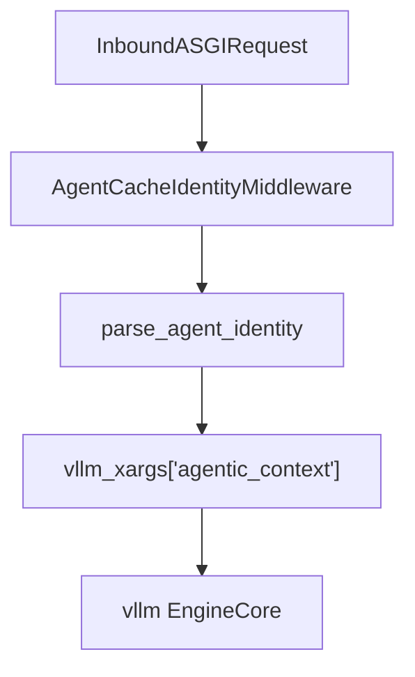
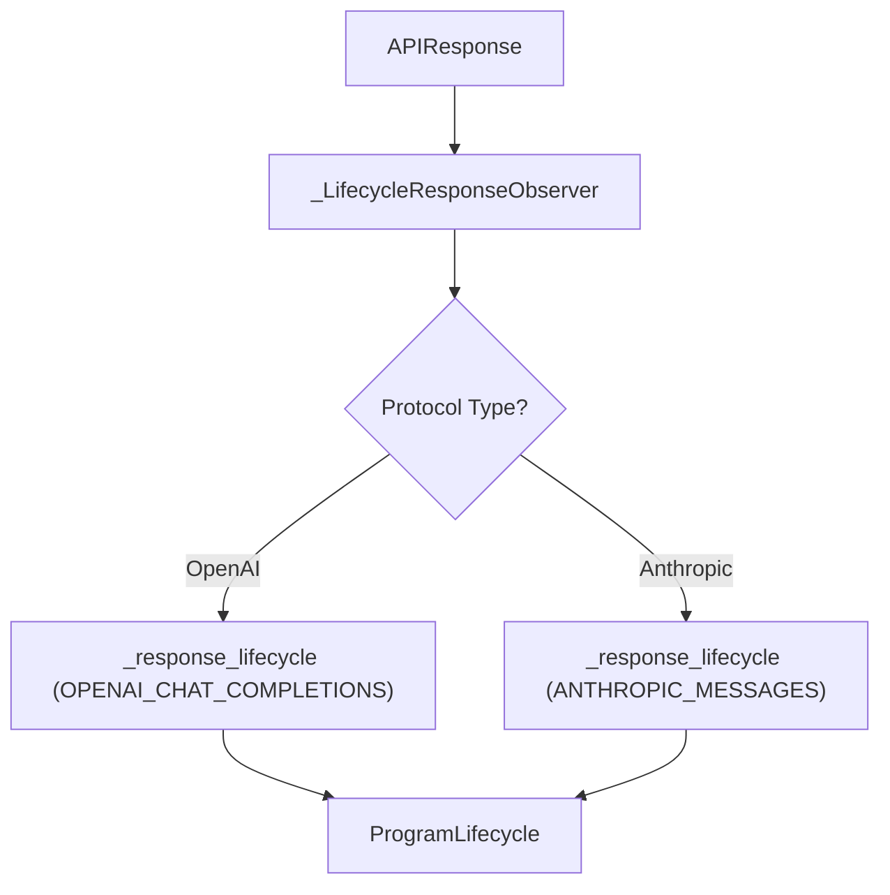
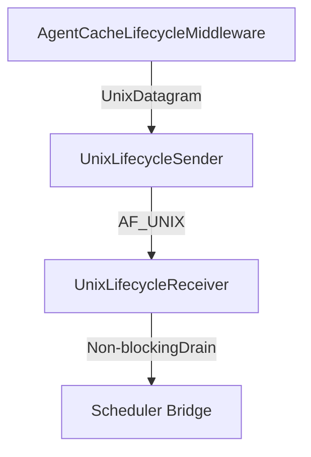
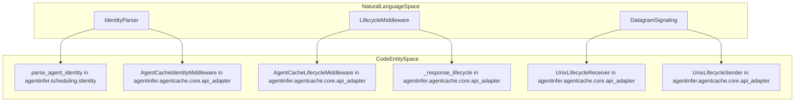

<!-- source: DeepWiki mcp.deepwiki.com · repo openJiuwen-ai/agent-infer · page 3.2 API Adapter: Identity and Lifecycle Middleware · fetched 2026-11-02 -->

# API Adapter: Identity and Lifecycle Middleware

Relevant source files

The following files were used as context for generating this wiki page:

- [agentinfer/__init__.py](agentinfer/__init__.py)
- [agentinfer/agentcache/core/api_adapter.py](agentinfer/agentcache/core/api_adapter.py)
- [agentinfer/scheduling/admission_outcome.py](agentinfer/scheduling/admission_outcome.py)
- [agentinfer/scheduling/events.py](agentinfer/scheduling/events.py)
- [agentinfer/scheduling/factors.py](agentinfer/scheduling/factors.py)
- [agentinfer/scheduling/identity.py](agentinfer/scheduling/identity.py)
- [agentinfer/scheduling/lifecycle.py](agentinfer/scheduling/lifecycle.py)
- [tests/agentcache/core/test_vllm_api_adapter.py](tests/agentcache/core/test_vllm_api_adapter.py)
- [tests/agentcache/core/test_vllm_factory.py](tests/agentcache/core/test_vllm_factory.py)

## Purpose and Scope

The API adapter subsystem provides ASGI middleware components and protocol translation bridges that integrate vLLM HTTP entrypoints with AgentInfer's session identity parsing and asynchronous scheduling mechanics [agentinfer/agentcache/core/api_adapter.py:3-15](). It consists of two primary middleware classes (`AgentCacheIdentityMiddleware` and `AgentCacheLifecycleMiddleware`) [agentinfer/agentcache/core/api_adapter.py:5-13](), protocol-specific request/response adapters for OpenAI and Anthropic formats [agentinfer/agentcache/core/api_adapter.py:96-101](), and an inter-process Unix datagram signaling channel for communicating program lifecycle events across Data Parallel (DP) ranks [agentinfer/agentcache/core/api_adapter.py:115-160]().

Sources: `agentinfer/agentcache/core/api_adapter.py:1-163()`

---

## Identity Extraction and `vllm_xargs`/Anthropic Bridge

`AgentCacheIdentityMiddleware` intercepts inbound HTTP requests at the ASGI boundary to resolve session context and agent metadata using the shared identity parser [agentinfer/agentcache/core/api_adapter.py:10-13](). 

### Identity Parsing Workflow

The middleware inspects request payloads and HTTP headers to construct a canonical `AgentIdentity` record [agentinfer/scheduling/identity.py:28-54](). It serializes the canonical representation into vLLM's scalar `vllm_xargs` transport layer [agentinfer/agentcache/core/api_adapter.py:11-13]().

Sources: `agentinfer/agentcache/core/api_adapter.py:11-13()`, `agentinfer/scheduling/identity.py:97-115()`

### Anthropic Bridge and Replay Sampling

For Anthropic Messages API requests, identity metadata and replay-only sampling configurations are embedded within the `metadata` dictionary and subsequently adapted into internal vLLM chat request parameters [agentinfer/agentcache/core/api_adapter.py:11-13]().

| Metadata Key | Target Field | Validation Rules |
| :--- | :--- | :--- |
| `_agentinfer_agentic_context` | `vllm_xargs["agentic_context"]` | Must serialize within `_MAX_AGENTIC_CONTEXT_BYTES` (16KB) [agentinfer/scheduling/identity.py:20()]. |
| `_agentinfer_replay_sampling` | `seed`, `min_tokens`, `ignore_eos` | Requires non-negative integer `seed`, non-negative integer `min_tokens`, and boolean `ignore_eos` [agentinfer/agentcache/core/api_adapter.py:71-93()]. |

Sources: `agentinfer/agentcache/core/api_adapter.py:46-93()`, `tests/agentcache/core/test_vllm_api_adapter.py:32-58()`

---

## Lifecycle Observation and SSE Parsing

`AgentCacheLifecycleMiddleware` leverages vLLM's public middleware hooks to observe response semantics after tool calling and generation completion [agentinfer/agentcache/core/api_adapter.py:5-8](). It evaluates both non-streaming JSON responses and Server-Sent Events (SSE) streaming streams via `_LifecycleResponseObserver` [agentinfer/agentcache/core/api_adapter.py:130-141]().

### Protocol-Neutral Lifecycle Mapping

Wire-specific completion reasons are mapped into the closed `ProgramLifecycle` vocabulary (`UNKNOWN`, `CONTINUE`, `TERMINAL`) [agentinfer/scheduling/lifecycle.py:14-19]() without modifying response bytes or buffering streaming payloads unnecessarily [agentinfer/agentcache/core/api_adapter.py:5-8]().

Sources: `agentinfer/agentcache/core/api_adapter.py:96-127()`, `tests/agentcache/core/test_vllm_api_adapter.py:81-127()`

Sources: `agentinfer/agentcache/core/api_adapter.py:1-163()`

---

## Cross-DP-Rank Unix Datagram Signaling

To support multi-GPU deployments where API workers run separately from DP-ranked inference engines, the lifecycle middleware transmits observed program states over local Unix datagram sockets [agentinfer/agentcache/core/api_adapter.py:5-8]().

### Signal Architecture

Sources: `agentinfer/agentcache/core/api_adapter.py:115-160()`

* **`LIFECYCLE_SOCKET_ENV`**: Environment variable (`AGENTCACHE_VLLM_LIFECYCLE_SOCKET`) pointing to the base socket path [agentinfer/agentcache/core/api_adapter.py:41()].
* **`UnixLifecycleReceiver`**: Bound per DP-rank (`_rank_socket_path(socket_path, dp_rank)`) [agentinfer/agentcache/core/api_adapter.py:118-126()]. Operates in non-blocking mode (`setblocking(False)`) to drain validated `LifecycleSignal` objects during scheduler ticks without stalling the engine core [agentinfer/agentcache/core/api_adapter.py:8-9,127-149()].
* **`LifecycleSignal`**: Dataclass pairing a `program_id` string with a `ProgramLifecycle` enumeration value [agentinfer/agentcache/core/api_adapter.py:103-113()].

Sources: `agentinfer/agentcache/core/api_adapter.py:41-163()`, `tests/agentcache/core/test_vllm_api_adapter.py:3-29()`

---

## Code Entity Mapping

The following diagram bridges the natural language concepts of the API adapter layer to exact classes and functions defined in the codebase.

Sources: `agentinfer/agentcache/core/api_adapter.py:1-163()`, `agentinfer/scheduling/identity.py:97-115()`

---

