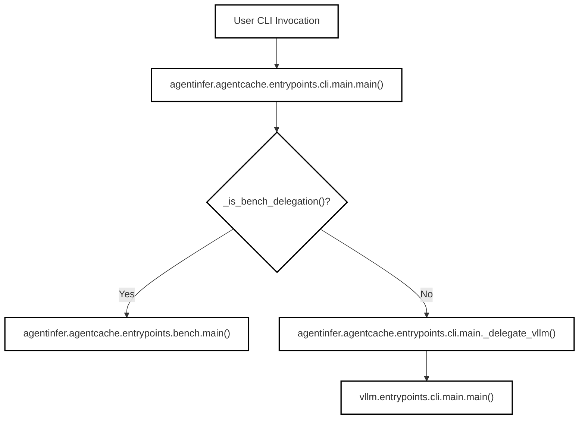
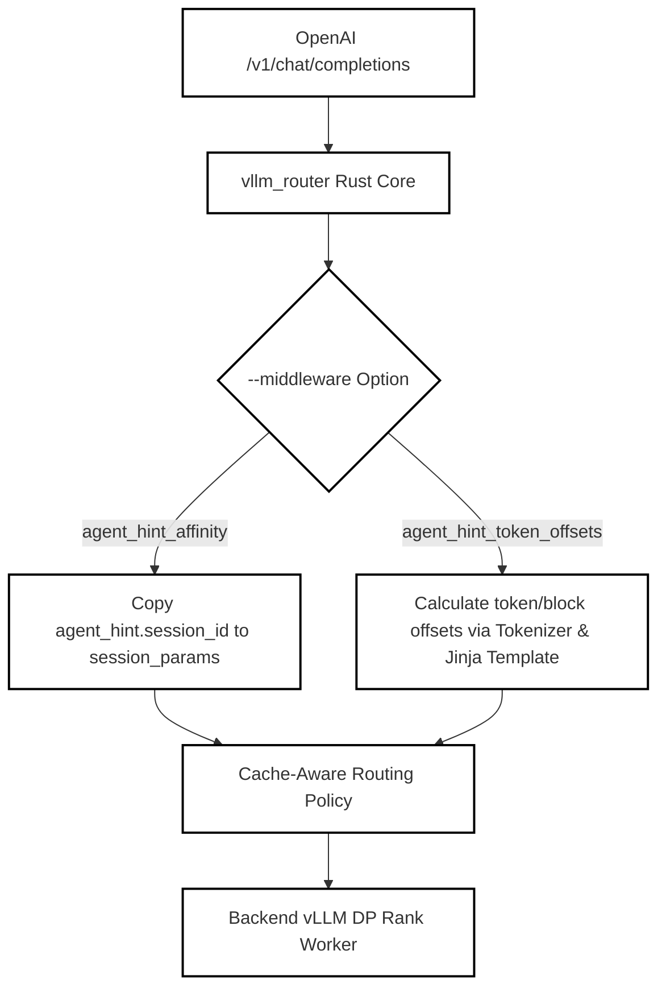

<!-- source: DeepWiki mcp.deepwiki.com · repo openJiuwen-ai/agent-infer · page 3.3 Entrypoints, LLM Wrapper and AgentRouter · fetched 2026-11-02 -->

# Entrypoints, LLM Wrapper and AgentRouter

Relevant source files

The following files were used as context for generating this wiki page:

- [agentinfer/agentbench/agents/claude/runner.py](agentinfer/agentbench/agents/claude/runner.py)
- [agentinfer/agentbench/benchkit/collectors/source_control.py](agentinfer/agentbench/benchkit/collectors/source_control.py)
- [agentinfer/agentbench/benchkit/metrics/request.py](agentinfer/agentbench/benchkit/metrics/request.py)
- [agentinfer/agentbench/benchkit/metrics/source_health.py](agentinfer/agentbench/benchkit/metrics/source_health.py)
- [agentinfer/agentcache/entrypoints/bench.py](agentinfer/agentcache/entrypoints/bench.py)
- [agentinfer/agentcache/entrypoints/cli/main.py](agentinfer/agentcache/entrypoints/cli/main.py)
- [agentinfer/agentrouter/README.md](agentinfer/agentrouter/README.md)
- [agentinfer/agentrouter/patches/0001-agent-hint-native-middleware.patch](agentinfer/agentrouter/patches/0001-agent-hint-native-middleware.patch)
- [docs/README.md](docs/README.md)

## Purpose and Scope
This page details the integration entrypoints, client wrappers, and router-level extensions provided by AgentInfer. It covers the `agentcache` CLI wrapper (`agentinfer.agentcache.entrypoints.cli.main`), the benchmark delegation entrypoint (`agentinfer.agentcache.entrypoints.bench`), and the Rust-native `agentrouter` middleware patches that process agent hints, affinity, and token offsets (`agentinfer/agentrouter/`).

---

## 1. AgentCache CLI and vLLM Entrypoint

The AgentCache command-line interface intercepts standard vLLM entrypoints to detect explicit AgentInfer benchmark requests or delegate execution to upstream vLLM implementations while preserving command-line arguments.

The entrypoint logic is rooted in `agentinfer/agentcache/entrypoints/cli/main.py` [agentinfer/agentcache/entrypoints/cli/main.py:1-46](). The function `_is_bench_delegation` parses `sys.argv` to check whether a request targets the benchmark subsystem (`bench serve --agentinfer`) [agentinfer/agentcache/entrypoints/cli/main.py:10-18](). If detected, `main()` routes control to the benchmark dispatcher; otherwise, it invokes `_delegate_vllm()`, which safely swaps `sys.argv` and invokes the upstream vLLM CLI [agentinfer/agentcache/entrypoints/cli/main.py:21-46]().

### CLI Delegation Data Flow

Sources: `agentinfer/agentcache/entrypoints/cli/main.py:1-47`

---

## 2. Benchmark Entrypoint and BenchKit Delegation

When an AgentInfer benchmark is invoked via the CLI, control transfers to `agentinfer/agentcache/entrypoints/bench.py` [agentinfer/agentcache/entrypoints/bench.py:1-50](). 

The module normalizes argument vectors through `_strip_program_name` and `_normalize_delegated_argv`, stripping console-script names like `agentinfer-bench` or `vllm` and validating the presence of `--agentinfer` [agentinfer/agentcache/entrypoints/bench.py:12-36](). Recognized subcommands (`compare`, `prepare`, `replay`, `run`, `summarize`) are delegated directly to the BenchKit CLI (`agentinfer.agentbench.benchkit.cli.main`) [agentinfer/agentcache/entrypoints/bench.py:9-47]().

### Benchmark Invocation Mapping

| Natural Language Concept | Code Entity / Function | File Path |
| :--- | :--- | :--- |
| CLI Entrypoint Dispatch | `main(argv)` | `agentinfer/agentcache/entrypoints/bench.py:38-47` |
| Argument Normalization | `_normalize_delegated_argv(argv)` | `agentinfer/agentcache/entrypoints/bench.py:20-35` |
| BenchKit Hand-off | `benchkit_main(normalized, cli_metadata)` | `agentinfer/agentbench/benchkit/cli.py` |

Sources: `agentinfer/agentcache/entrypoints/bench.py:1-51`

---

## 3. AgentRouter Native Middleware Patch

AgentInfer provides opt-in native middleware for the Rust-based vLLM Router (`agentrouter`) to handle agent session affinity and KV cache token offsets without Python ASGI overhead [agentinfer/agentrouter/README.md:1-29]().

The patch `agentinfer/agentrouter/patches/0001-agent-hint-native-middleware.patch` introduces two mutually exclusive middleware implementations selectable via `--middleware` [agentinfer/agentrouter/patches/0001-agent-hint-native-middleware.patch:52-118]():

1. **`agent_hint_affinity`**: Copies `agent_hint.session_id` into `session_params.session_id` prior to routing OpenAI-compatible chat completion requests [agentinfer/agentrouter/patches/0001-agent-hint-native-middleware.patch:52-54]().
2. **`agent_hint_token_offsets`**: Translates `agent_hint.cache_control.msg_offset` into concrete `token_offset`, `block_offset`, and `intra_block_offset` coordinates using a configured tokenizer, chat template, and block size [agentinfer/agentrouter/patches/0001-agent-hint-native-middleware.patch:97-116]().

### Router Middleware Architecture

Sources: `agentinfer/agentrouter/README.md:1-54`, `agentinfer/agentrouter/patches/0001-agent-hint-native-middleware.patch:52-118`

---

