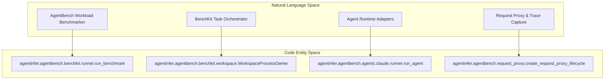
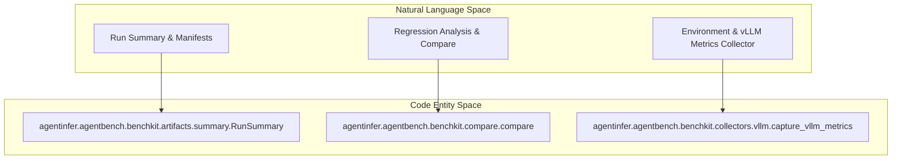

<!-- source: DeepWiki mcp.deepwiki.com · repo openJiuwen-ai/agent-infer · page 4 AgentBench: Benchmarking Harness · fetched 2026-11-02 -->

# AgentBench: Benchmarking Harness

Relevant source files

The following files were used as context for generating this wiki page:

- [agentinfer/agentbench/README.md](agentinfer/agentbench/README.md)
- [agentinfer/agentbench/benchkit/artifacts/summary.py](agentinfer/agentbench/benchkit/artifacts/summary.py)
- [agentinfer/agentbench/benchkit/runner.py](agentinfer/agentbench/benchkit/runner.py)
- [design/module/benchmarking/agent-runtime-adapters.md](design/module/benchmarking/agent-runtime-adapters.md)
- [design/module/benchmarking/artifacts-and-evaluation.md](design/module/benchmarking/artifacts-and-evaluation.md)
- [design/module/benchmarking/benchkit-orchestration.md](design/module/benchmarking/benchkit-orchestration.md)
- [design/module/benchmarking/index.md](design/module/benchmarking/index.md)
- [design/module/benchmarking/request-proxy-and-hints.md](design/module/benchmarking/request-proxy-and-hints.md)
- [tests/agentbench/test_compare.py](tests/agentbench/test_compare.py)

## Purpose and Scope

AgentBench is the reproducible benchmarking harness for evaluating agent-aware caching and scheduling strategies in `agentinfer` [agentinfer/agentbench/README.md:1-5](). It decouples workload orchestration, agent execution, request observation, and metric artifact generation to provide side-by-side comparison between standard vLLM baselines and AgentCache-enabled router candidates [design/module/benchmarking/index.md:21-28](). 

This page serves as a high-level parent overview of the benchmarking system. For granular technical specifications, refer to the child pages:
- [Benchkit Orchestration and CLI](#4.1)
- [Artifacts, Metrics and Comparison](#4.2)
- [Agent Runtime Adapters](#4.3)
- [Request Proxy and Trace Replay](#4.4)

*Figure 1: Bridging AgentBench components to code entities.*

Sources: `agentinfer/agentbench/README.md:1-8`, `agentinfer/agentbench/benchkit/runner.py:41-95`, `design/module/benchmarking/index.md:21-41`.

---

## Subpackages and Architecture Overview

The AgentBench harness comprises four major subpackages interacting to execute tasks, capture proxy metrics, and evaluate regressions:
1. `benchkit/`: Orchestrates the run lifecycle, workspace setup, datasets, concurrency, and final artifacts [design/module/benchmarking/benchkit-orchestration.md:27-38]().
2. `agents/`: Manages agent runtimes (such as Claude Code) via explicit dispatch, contracts, and preflight checks [design/module/benchmarking/agent-runtime-adapters.md:22-31]().
3. `request_proxy/`: Provides a transparent observation boundary forwarding Anthropic API requests while recording request facts [design/module/benchmarking/request-proxy-and-hints.md:24-34]().
4. `replay/`: Reconstructs replayable sessions and token targets from captured `requests.jsonl` traces for deterministic cache evaluation [agentinfer/agentbench/README.md:10-16]().

*Figure 2: Mapping evaluation artifacts to underlying metric classes and functions.*

Sources: `agentinfer/agentbench/benchkit/artifacts/summary.py:48-69`, `agentinfer/agentbench/benchkit/compare.py`, `agentinfer/agentbench/benchkit/collectors/vllm.py`, `design/module/benchmarking/artifacts-and-evaluation.md:30-40`.

---

## 4.1 Benchkit Orchestration and CLI

The `benchkit/` package controls configuration loading, task index resolution, temporary workspace isolation, concurrency limits, and the execution lifecycle orchestrated by `run_benchmark` [agentinfer/agentbench/benchkit/runner.py:49-100](). CLI commands (`prepare`, `run`, `summarize`, `compare`) thin-wrap these core operations.

For details, see [Benchkit Orchestration and CLI](#4.1).

Sources: `agentinfer/agentbench/benchkit/runner.py:41-100`, `design/module/benchmarking/benchkit-orchestration.md:27-49`.

---

## 4.2 Artifacts, Metrics and Comparison

AgentBench captures comprehensive metrics across tasks, requests, vLLM server counters, and source control state, serializing them into structured `RunSummary` and manifest schemas [agentinfer/agentbench/benchkit/artifacts/summary.py:48-69](). The comparison harness evaluates baseline versus candidate outputs to generate regression analysis and delta reports [tests/agentbench/test_compare.py:87-105]().

For details, see [Artifacts, Metrics and Comparison](#4.2).

Sources: `agentinfer/agentbench/benchkit/artifacts/summary.py:18-69`, `tests/agentbench/test_compare.py:87-105`, `design/module/benchmarking/artifacts-and-evaluation.md:30-50`.

---

## 4.3 Agent Runtime Adapters

The `agents/` package defines standard execution contracts (`AgentRunRequest`, `AgentRunResult`) to drive individual task agents [agentinfer/agentbench/benchkit/runner.py:17](). It handles environment preflight checks, workspace credentials sanitization, and runtime-specific runners like Claude Code [design/module/benchmarking/agent-runtime-adapters.md:22-37]().

For details, see [Agent Runtime Adapters](#4.3).

Sources: `agentinfer/agentbench/benchkit/runner.py:17-18`, `design/module/benchmarking/agent-runtime-adapters.md:22-47`.

---

## 4.4 Request Proxy and Trace Replay

The `request_proxy/` server transparently intercepts and forwards `POST /v1/messages` traffic between agents and vLLM without modifying request protocol semantics [design/module/benchmarking/request-proxy-and-hints.md:24-34](). Additionally, the replay package parses `requests.jsonl` traces to reproduce shared-prefix structures and measure cache hit performance [agentinfer/agentbench/README.md:10-22]().

For details, see [Request Proxy and Trace Replay](#4.4).

Sources: `agentinfer/agentbench/README.md:10-22`, `design/module/benchmarking/request-proxy-and-hints.md:24-48`.

---

