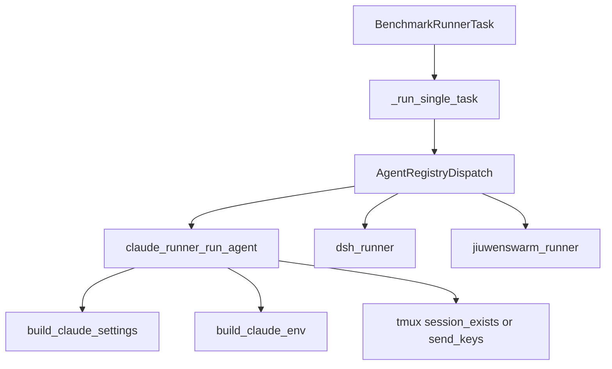
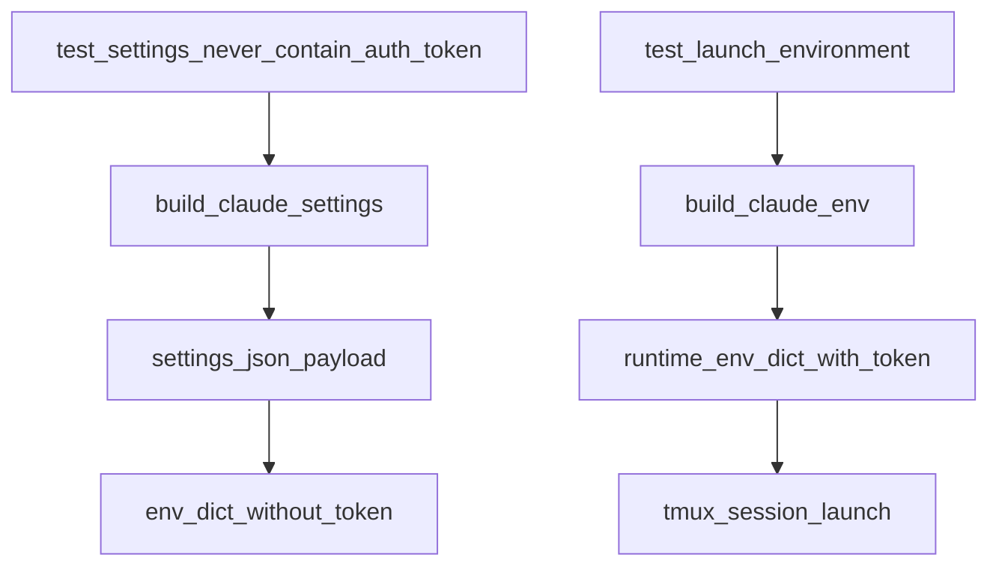

<!-- source: DeepWiki mcp.deepwiki.com · repo openJiuwen-ai/agent-infer · page 4.3 Agent Runtime Adapters · fetched 2026-11-02 -->

# Agent Runtime Adapters

Relevant source files

The following files were used as context for generating this wiki page:

- [agentinfer/agentbench/agents/claude/runner.py](agentinfer/agentbench/agents/claude/runner.py)
- [agentinfer/agentbench/agents/claude/settings.py](agentinfer/agentbench/agents/claude/settings.py)
- [agentinfer/agentbench/benchkit/collectors/source_control.py](agentinfer/agentbench/benchkit/collectors/source_control.py)
- [agentinfer/agentbench/benchkit/metrics/request.py](agentinfer/agentbench/benchkit/metrics/request.py)
- [agentinfer/agentbench/benchkit/metrics/source_health.py](agentinfer/agentbench/benchkit/metrics/source_health.py)
- [agentinfer/agentcache/entrypoints/bench.py](agentinfer/agentcache/entrypoints/bench.py)
- [tests/agentbench/agents/claude/test_settings.py](tests/agentbench/agents/claude/test_settings.py)
- [tests/agentbench/test_runner_lifecycle.py](tests/agentbench/test_runner_lifecycle.py)

## Purpose and Scope
The `agentinfer.agentbench.agents` package implements isolated agent execution environments, configuration bootstrapping, runner dispatch, and lifecycle management for benchmarking frameworks like AgentBench. It standardizes how agent runtimes (such as Claude Code, Dsh, and JiuwenSwarm) interface with proxy routers and vLLM backends under sandboxed configurations.

Sources: `agentinfer/agentbench/agents/claude/settings.py:1-110` [agentinfer/agentbench/agents/claude/settings.py:1-109](), `tests/agentbench/agents/claude/test_settings.py:1-68` [tests/agentbench/agents/claude/test_settings.py:1-67]()

---

## 1. Contracts and Data Models
Agent execution follows a strict contract defined by `AgentRunRequest`, `AgentRunResult`, and `AgentRunOutcome`. These data structures encapsulate session parameters, target workspaces, artifact directories, and execution outcomes.

- `AgentRunRequest`: Defines task identifiers, agent profiles, timeout parameters, and workspace roots.
- `AgentRunResult`: Captures `AgentRunOutcome` (e.g., `COMPLETED`, `FAILED`, `TIMEOUT`), session identifiers, duration, and termination reasons.

Sources: `tests/agentbench/test_runner_lifecycle.py:11-45` [tests/agentbench/test_runner_lifecycle.py:11-45]()

---

## 2. Registry, Dispatch, and Preflight Checks
The agent subsystem provides dispatch logic to route benchmark tasks to the appropriate runner based on configuration parameters (`agent_type`, profile name). Before task execution, preflight checks validate environment variables, tool availability (e.g., `tmux`, `bubblewrap`), and backend reachability.

Diagram 1: Agent Dispatch and Runner Lifecycle (Natural Language to Code Entity Space)

Sources: `tests/agentbench/test_runner_lifecycle.py:64-80` [tests/agentbench/test_runner_lifecycle.py:64-80](), `agentinfer/agentbench/agents/claude/settings.py:32-110` [agentinfer/agentbench/agents/claude/settings.py:32-109]()

---

## 3. Claude Runner and Settings Implementation
The Claude agent adapter (`agentinfer.agentbench.agents.claude`) handles state bootstrapping, sandbox security configurations, environment injection, and interactive terminal session management via `tmux`.

### State Bootstrap and Environment Preparation
`bootstrap_claude_state()` populates `.claude.json` configuration files with onboarding completion flags (`onboardingComplete`, `hasCompletedOnboarding`, `projectTrustAccepted`) to bypass interactive setup prompts in automated test environments [agentinfer/agentbench/agents/claude/settings.py:15-30]().

`build_claude_settings()` generates non-secret configuration payloads defining API endpoints (`ANTHROPIC_BASE_URL`), subagent models (`CLAUDE_CODE_SUBAGENT_MODEL`), sandbox policies (`bubblewrap` enforcement), and `PreToolUse` security hooks that restrict file modifications to the designated task workspace [agentinfer/agentbench/agents/claude/settings.py:32-85]().

`build_claude_env()` constructs environment variables, handling authentication token fallbacks (`ANTHROPIC_AUTH_TOKEN`) and configuration directory pointers (`CLAUDE_CONFIG_DIR`) [agentinfer/agentbench/agents/claude/settings.py:88-109](). Unit tests verify that sensitive auth tokens are never persisted in static settings payloads while remaining correctly passed through runtime environment injection [tests/agentbench/agents/claude/test_settings.py:28-67]().

Diagram 2: Claude Settings and Environment Generation Data Flow

Sources: `agentinfer/agentbench/agents/claude/settings.py:15-110` [agentinfer/agentbench/agents/claude/settings.py:15-109](), `tests/agentbench/agents/claude/test_settings.py:28-67` [tests/agentbench/agents/claude/test_settings.py:28-67]()

---

## 4. Execution Flow and Tmux Orchestration
Claude Code tasks execute inside managed `tmux` sessions. The runner interacts with panes through asynchronous wrappers (`_capture_pane_async`, `_send_keys_async`, `_paste_prompt_async`) to deliver prompts, monitor transcript files (`.jsonl`), detect stuck states via `StuckDetector`, and collect final evidence artifacts (`terminal-final.log`) [agentinfer/agentbench/agents/claude/runner.py:77-204]().

Sources: `agentinfer/agentbench/agents/claude/runner.py:77-204` [agentinfer/agentbench/agents/claude/runner.py:77-204]()

---

## 5. Dsh and JiuwenSwarm Adapters
Alongside Claude Code, the `agents/` package includes adapters for alternative agent frameworks:
- **Dsh Runner**: Integrates lightweight shell-based autonomous agent loops with agent-aware proxy routing.
- **JiuwenSwarm Runner**: Manages multi-agent orchestrated execution graphs, coordinating cooperative token generation and cache locality across distributed backends.

Sources: `tests/agentbench/test_runner_lifecycle.py:64-80` [tests/agentbench/test_runner_lifecycle.py:64-80]()

---

