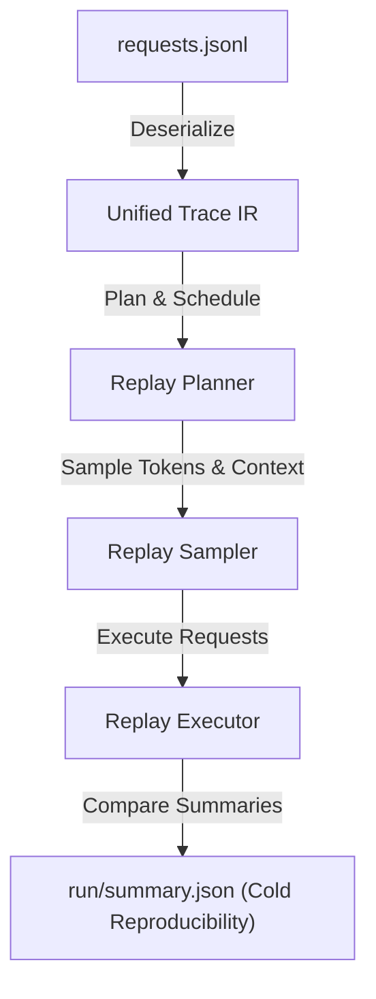

<!-- source: DeepWiki mcp.deepwiki.com · repo openJiuwen-ai/agent-infer · page 4.4 Request Proxy and Trace Replay · fetched 2026-11-02 -->

# Request Proxy and Trace Replay

<details>
<summary>Relevant source files</summary>

The following files were used as context for generating this wiki page:

- [agentinfer/agentbench/README.md](agentinfer/agentbench/README.md)
- [agentinfer/agentbench/request_proxy/server.py](agentinfer/agentbench/request_proxy/server.py)
- [design/module/benchmarking/agent-runtime-adapters.md](design/module/benchmarking/agent-runtime-adapters.md)
- [design/module/benchmarking/artifacts-and-evaluation.md](design/module/benchmarking/artifacts-and-evaluation.md)
- [design/module/benchmarking/benchkit-orchestration.md](design/module/benchmarking/benchkit-orchestration.md)
- [design/module/benchmarking/index.md](design/module/benchmarking/index.md)
- [design/module/benchmarking/request-proxy-and-hints.md](design/module/benchmarking/request-proxy-and-hints.md)
- [docs/en/explanation/benchmark-methodology.md](docs/en/explanation/benchmark-methodology.md)
- [tests/agentbench/request_proxy/test_server.py](tests/agentbench/request_proxy/test_server.py)

</details>


## Purpose and Scope

This page documents the **Request Proxy** and **Trace Replay** subsystem within `agentinfer.agentbench`. The Request Proxy acts as a transparent observation boundary situated between agent runtimes (such as Claude Code, JiuwenSwarm, or DSH) and the model backend (`vLLM` baseline or the AgentCache Router candidate). It records immutable `RequestFact` entries and forwards Anthropic or OpenAI-compatible requests without mutating core semantic payloads. The Trace Replay package reconstructs recorded sessions, actors, request kinds, token targets, and synthetic shared-prefix structures from captured trace logs (e.g., `requests.jsonl`) to validate cold-start prefix cache reproducibility across benchmark runs.

---

## 1. Request Proxy Server and Launch Configuration

The proxy runs as an asynchronous FastAPI application managed by BenchKit via `RequestProxyLaunchConfig`. It binds to loopback interfaces, exposing health check endpoints, model request forwarders, and authenticated shutdown triggers.

### Launch Configuration

The `RequestProxyLaunchConfig` dataclass carries pickleable per-run execution state from BenchKit into the spawned proxy subprocess:

```python
@dataclass(frozen=True)
class RequestProxyLaunchConfig:
    host: str
    port: int
    upstream_url: str
    run_id: str
    trace_path: Path
    request_timeout_seconds: float
    shutdown_timeout_seconds: float
    shutdown_token: str
    stdout_path: Path
    stderr_path: Path
    endpoint: str
```
*Source: [agentinfer/agentbench/request_proxy/server.py:63-78]()*

### Server Initialization and Lifecycle

`RequestProxyServer` initializes an `httpx.AsyncClient` with specific connection limits and disabled keep-alive reuse to ensure clean, isolated benchmark network measurements. It registers API routes for health (`/health`), model traffic (`endpoint`, e.g., `/v1/messages`), and graceful shutdown (`/shutdown`).

```mermaid
graph TD
    Client["AgentRuntime (e.g., ClaudeCode)"] -->|POST endpoint| Proxy["RequestProxyServer (FastAPI)"]
    Proxy -->|_admit() check| InFlight["Active Request Tracker"]
    InFlight -->|Build Upstream Request| Upstream["vLLM or AgentRouter"]
    Upstream -->|Stream / Non-stream Response| Proxy
    Proxy -->|Submit RequestFact| Writer["RequestTraceWriter"]
    Proxy -->|Relay Bytes| Client
```
*Diagram: Request Proxy Server Request Handling Flow*
*Sources: [agentinfer/agentbench/request_proxy/server.py:80-117](), [tests/agentbench/request_proxy/test_server.py:87-97]()*

---

## 2. Request Interception, Forwarding, and Trace Capture

When a request arrives at `handle_model_request`, the proxy admits the connection, extracts identity and metadata, constructs an upstream HTTP request, and dispatches it.

### Request Admission and Forwarding

1. **Admission Control:** `_admit()` increments the active request count under an asynchronous condition block, rejecting requests with HTTP 503 if the proxy is shutting down `[agentinfer/agentbench/request_proxy/server.py:121-126]()`.
2. **Identity Extraction:** Extracts agent and session identities from headers or request bodies (`_request_fact_identity`) `[agentinfer/agentbench/request_proxy/server.py:138-139]()`.
3. **Upstream Transport:** Uses `httpx.AsyncClient` to send the payload to `${upstream_url}${endpoint}` while filtering protocol and hop-by-hop headers (`_upstream_headers`) `[agentinfer/agentbench/request_proxy/server.py:144-150]()`.
4. **Response Handling:** Supports both streaming (Server-Sent Events / `text/event-stream`) and non-streaming responses, intercepting usage metrics and recording facts upon completion or cancellation `[agentinfer/agentbench/request_proxy/server.py:160-187]()`.

```python
async def handle_model_request(self, request: Request) -> Response:
    await self._admit()
    release_here = True
    response: httpx.Response | None = None
    try:
        body = await request.body()
        identity = _request_fact_identity(request.headers, body)
        request_id = str(uuid.uuid4())
        started = datetime.now(timezone.utc)
        started_clock = time.monotonic()
        ...
```
*Source: [agentinfer/agentbench/request_proxy/server.py:133-143]()*

*Sources: [agentinfer/agentbench/request_proxy/server.py:133-187](), [tests/agentbench/request_proxy/test_server.py:142-184]()*

---

## 3. Trace Replay Subsystem

The replay package processes captured `requests.jsonl` trace files to reproduce workloads without needing original prompt plaintext or live agent execution.

### Trace Replay Scope and Components

- **Unified Trace IR:** Deserializes raw `RequestFact` records into structured session, actor, and prompt sequences.
- **Planner & Sampler:** Reconstructs historical start offsets, token targets, context relationships, and synthetic shared-prefix structures.
- **Executor:** Drives the vLLM engine or proxy with the synthesized workloads, simulating realistic arrival rates and prefix reuse patterns.
- **Converters:** Translates trace records across different API response schemas (e.g., Anthropic Messages API vs. OpenAI Chat Completions).


*Diagram: Trace Replay Pipeline*
*Sources: [agentinfer/agentbench/README.md:10-22]()*

### Cold-Start Reproducibility Validation

The validation workflow executes the same trace twice:
1. Starts vLLM in a pristine state and runs the generated replay workload, confirming Prefix Cache counters start at zero.
2. Restarts vLLM completely.
3. Runs the second arm and compares finalized `summary.json` artifacts to verify cold-start reproducibility and cache hit-rate determinism.

*Sources: [agentinfer/agentbench/README.md:10-22](), [docs/en/explanation/benchmark-methodology.md:67-74]()*

---

## 4. Invariants and Design Constraints

The proxy and replay subsystem operate under strict architectural invariants defined in the design documents:

- **BENCH-INV-006 (Proxy forwarding remains transparent):** The proxy must preserve request semantics, relayed response status, headers, body, and stream bytes. Observation failures must remain isolated from forwarding `[design/module/benchmarking/request-proxy-and-hints.md:44-49]()`.
- **BENCH-INV-007 (The control surface remains local and bounded):** The proxy must bind strictly to loopback, authenticate shutdown requests, stop admission cleanly, wait boundedly for in-flight requests, and report process health `[design/module/benchmarking/request-proxy-and-hints.md:53-59]()`.
- **Hint Boundary:** The benchmark proxy acts solely as an observation boundary; protocol adaptations and hinting mechanisms belong at the serving protocol/router boundary rather than inside the proxy `[design/module/benchmarking/request-proxy-and-hints.md:38-42]()`.

*Sources: [design/module/benchmarking/request-proxy-and-hints.md:24-62]()*

---

