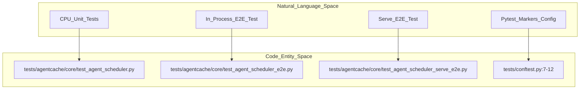
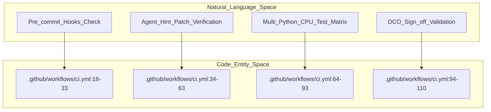

<!-- source: DeepWiki mcp.deepwiki.com · repo openJiuwen-ai/agent-infer · page 5 Testing and Quality Infrastructure · fetched 2026-11-02 -->

# Testing and Quality Infrastructure

Relevant source files

The following files were used as context for generating this wiki page:

- [.github/workflows/ci.yml](.github/workflows/ci.yml)
- [.markdownlint.json](.markdownlint.json)
- [tests/README.md](tests/README.md)
- [tests/conftest.py](tests/conftest.py)

This page provides a high-level overview of the testing taxonomy, continuous integration pipelines, and quality verification workflows implemented in AgentInfer. The testing infrastructure spans hermetic CPU unit tests, GPU-accelerated in-process/serve E2E tiers, automated benchmarking harnesses, and GitHub Actions CI pipelines enforcing rigorous checks.

For technical details, see the child pages:
- [Test Suites and Markers](#5.1) — covers `tests/` layout, pytest markers (`cpu_test`, `gpu_test`, `e2e_perf`, `benchmark_smoke`), and testing tiers.
- [End-to-End Scheduler Comparison Harness](#5.2) — covers `tests/e2e/` fixtures, server helpers, case loaders, and baseline vs agentinfer JSON evaluations.
- [CI, Pre-commit and Contribution Workflow](#5.3) — covers GitHub Actions workflows, `pre-commit` hooks, markdownlint, DCO checks, and PR conventions.

---

## 5.1 Test Suites and Markers

The test suite mirrors the structure of `vllm-project/vllm` under `tests/agentcache/core/` [tests/README.md:1-4] and separates execution requirements using custom pytest markers defined in `tests/conftest.py:7-12`. Tests are categorized into tiers ranging from fast, dependency-free CPU unit tests to full GPU serve-mode E2E runs.

*Figure 1: Mapping test tiers and semantic categories to specific test files and configuration hooks.*

For full details on test layout, execution instructions, and marker definitions, see [Test Suites and Markers](#5.1).

**Sources:** `tests/README.md:1-79`, `tests/conftest.py:1-12`

---

## 5.2 End-to-End Scheduler Comparison Harness

AgentInfer includes an end-to-end evaluation harness under `tests/e2e/` designed to compare scheduling behaviors, latency profiles, and cache hit rates between baseline vLLM deployments and AgentInfer-accelerated engines. 

The harness provides:
- Automated server lifecycle management and process supervision for spawned vLLM instances.
- JSON-driven workload specifications (`tests/e2e/README.md`, `tests/e2e/cases/`) supporting replay and assertion evaluation.
- Helper modules (`server.py`, `case_loader.py`, `benchmark.py`) that orchestrate concurrency patterns and capture performance metrics.
- Comparison scripts that compute statistical divergences between baseline and agentinfer outputs.

For details on harness architecture, dataset formats, and execution commands, see [End-to-End Scheduler Comparison Harness](#5.2).

**Sources:** `tests/README.md:58-60`, `tests/conftest.py:10-10`

---

## 5.3 CI, Pre-commit and Contribution Workflow

Quality gates are enforced automatically via GitHub Actions defined in `.github/workflows/ci.yml` and auxiliary pre-commit tooling. The CI runner guarantees that code contributions adhere to styling, documentation formatting, developer certificate of origin (DCO) sign-offs, and upstream middleware patch compatibility.

*Figure 2: Mapping CI workflow jobs in `.github/workflows/ci.yml` to their corresponding quality enforcement roles.*

Key validation checks executed in CI include:
- **Pre-commit**: Static analysis and markdown linting (`.markdownlint.json:1-6`) across all files `[.github/workflows/ci.yml:18-33]()`.
- **Router Patch Verification**: Confirms that patches in `agentinfer/agentrouter/patches/` apply cleanly against upstream vLLM Router pins (`d60711dc72ab8f073e33f9a3d93ee81b97274c26`) `[.github/workflows/ci.yml:34-63]()`.
- **CPU Test Matrix**: Executes unit tests across Python 3.10 and 3.12 target environments without requiring GPU acceleration `[.github/workflows/ci.yml:64-93]()`.
- **DCO Enforcement**: Validates that all non-merge commits contain a valid `Signed-off-by` trailer `[.github/workflows/ci.yml:94-110]()`.

For full details on workflow triggers, contribution guidelines, and review standards, see [CI, Pre-commit and Contribution Workflow](#5.3).

**Sources:** `.github/workflows/ci.yml:1-110`, `.markdownlint.json:1-6`

---

